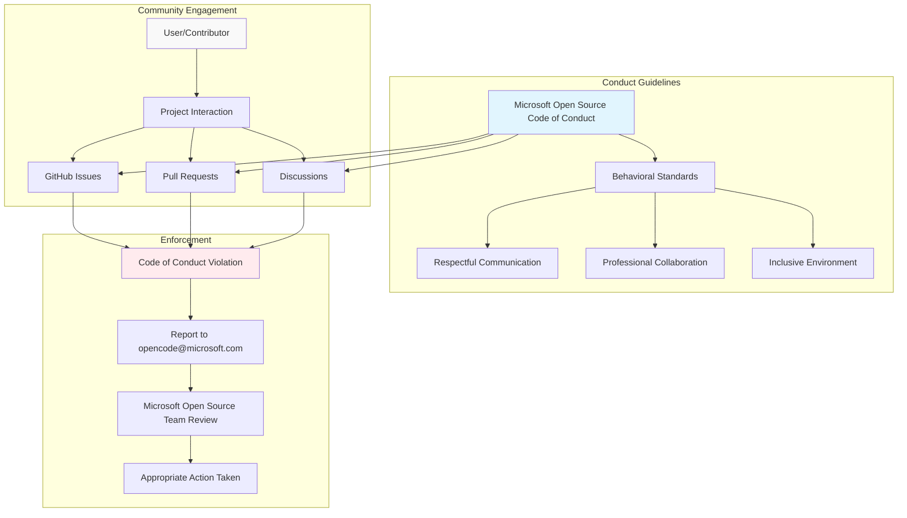
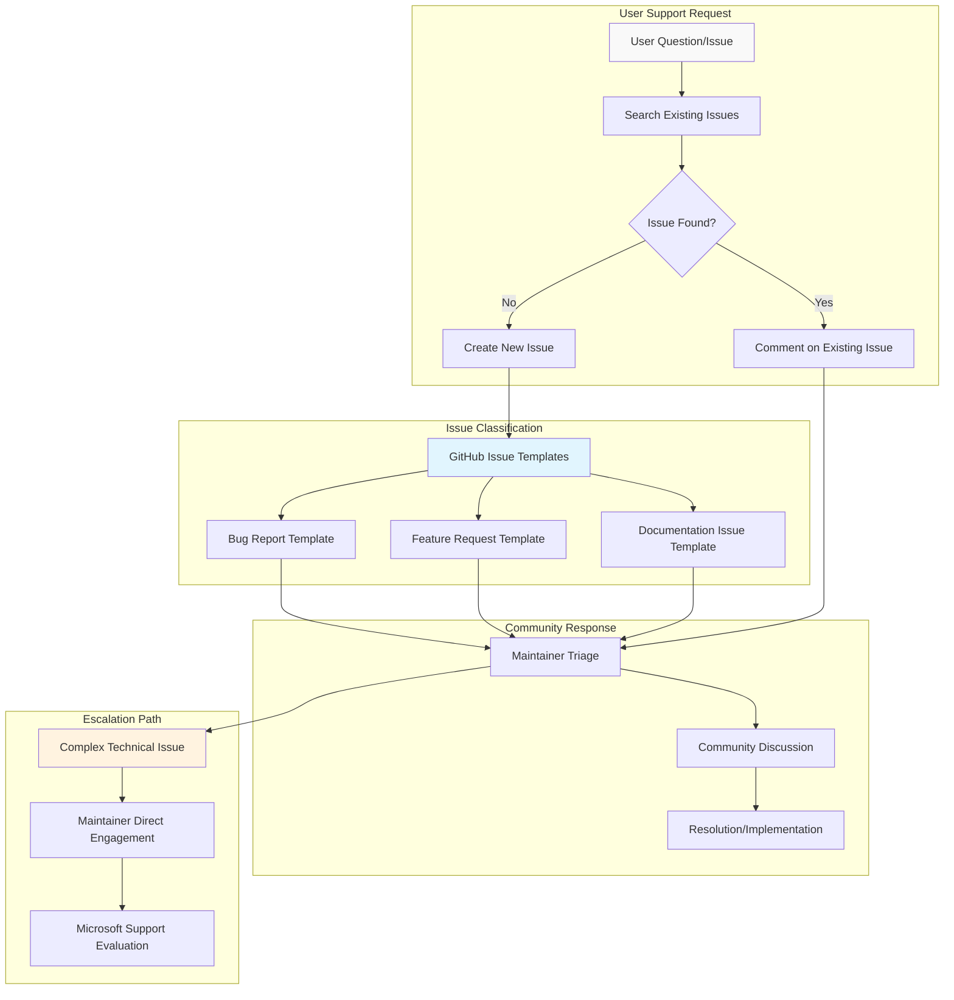
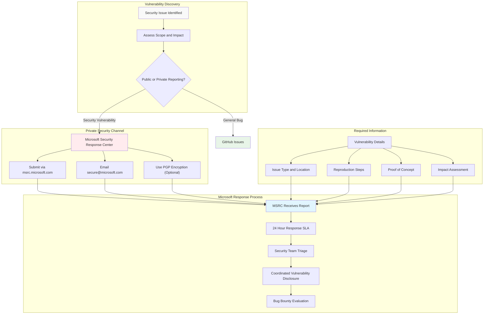
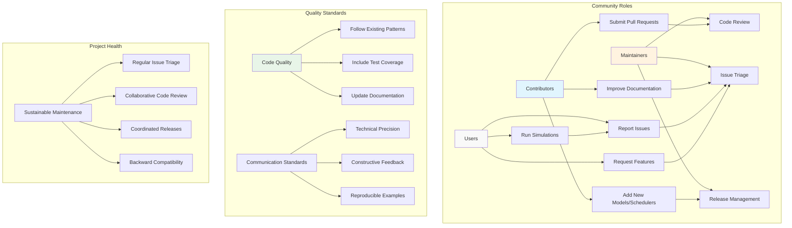

<!-- source: DeepWiki mcp.deepwiki.com · repo microsoft/vidur · page 10.2 Community Guidelines · fetched 2026-10-26 -->

# Community Guidelines

Relevant source files

The following files were used as context for generating this wiki page:

- [CODE_OF_CONDUCT.md](CODE_OF_CONDUCT.md)
- [SECURITY.md](SECURITY.md)
- [SUPPORT.md](SUPPORT.md)

This document outlines the standards, processes, and channels for community engagement with the Vidur project. It covers behavioral expectations, support procedures, and security reporting protocols for contributors, users, and maintainers.

For information about setting up a development environment and contributing code, see [Development Environment](#10.1). For technical details about extending Vidur's functionality, see [Extending Vidur](#11).

## Code of Conduct

The Vidur project operates under the Microsoft Open Source Code of Conduct, which establishes behavioral expectations for all community interactions including GitHub issues, pull requests, discussions, and other project communications.

### Behavioral Standards

The Microsoft Open Source Code of Conduct defines expectations for:
- Respectful and inclusive communication
- Professional behavior in all project interactions
- Constructive feedback and collaboration
- Zero tolerance for harassment or discriminatory behavior

### Enforcement and Contact

Questions or concerns about conduct should be directed to `opencode@microsoft.com`. The code of conduct is enforced by Microsoft's open source team and project maintainers.

**Community Interaction Flow**

Sources: [CODE_OF_CONDUCT.md:1-10]()

## Support Channels

The Vidur project provides multiple channels for users to seek help, report bugs, and request features. The support structure is designed to efficiently route different types of inquiries to appropriate resources.

### GitHub Issues

GitHub Issues serves as the primary channel for:
- **Bug Reports**: Technical issues with simulation accuracy, performance problems, or unexpected behavior
- **Feature Requests**: Proposals for new functionality, schedulers, models, or analysis capabilities
- **Documentation Issues**: Errors or gaps in documentation, wiki pages, or code comments

Before filing new issues, users should search existing issues to avoid duplicates. Each issue should include relevant system information, reproduction steps, and expected vs. actual behavior.

### Issue Categories and Templates

| Issue Type | Purpose | Required Information |
|------------|---------|----------------------|
| Bug Report | Technical problems or incorrect behavior | Environment details, reproduction steps, error logs |
| Feature Request | New functionality proposals | Use case description, proposed implementation approach |
| Documentation | Documentation improvements | Specific pages/sections affected, suggested changes |
| Question | Usage questions and clarifications | Context about simulation goals, configuration details |

**Support Request Processing Flow**

Sources: [SUPPORT.md:13-21]()

## Security Vulnerability Reporting

Security vulnerabilities in Vidur must be reported through Microsoft's Security Response Center (MSRC) rather than public GitHub issues. This ensures proper handling of sensitive security information and coordinated disclosure.

### Reporting Process

**Do not report security vulnerabilities through public GitHub issues.** Instead, use one of these channels:

1. **Primary**: Submit through the Microsoft Security Response Center at `https://msrc.microsoft.com/create-report`
2. **Alternative**: Email `secure@microsoft.com` with vulnerability details
3. **Encrypted**: Use Microsoft's PGP key for encrypted communication

### Required Vulnerability Information

Security reports should include:
- **Issue Type**: Buffer overflow, injection vulnerability, etc.
- **Affected Files**: Full paths to source files involved
- **Source Location**: Specific branch, commit, or tag information
- **Reproduction Steps**: Detailed instructions to reproduce the vulnerability
- **Configuration**: Any special setup required to manifest the issue
- **Proof of Concept**: Exploit code or demonstration (if available)
- **Impact Assessment**: Potential attack vectors and consequences

### Response Timeline

- **Initial Response**: Within 24 hours of submission
- **Follow-up**: If no response received, follow up via email
- **Language**: All communications should be in English
- **Policy**: Microsoft follows Coordinated Vulnerability Disclosure principles

**Security Reporting Workflow**

Sources: [SECURITY.md:9-41]()

## Community Standards

The Vidur community operates according to established standards that promote high-quality contributions, constructive collaboration, and sustainable project maintenance.

### Communication Standards

- **Technical Precision**: Use specific terminology, cite code paths, and provide measurable details
- **Constructive Feedback**: Focus on code, design, and implementation rather than personal attributes
- **Documentation**: Maintain clear, accurate documentation for all contributions
- **Reproducibility**: Provide sufficient detail for others to reproduce issues or validate proposals

### Contribution Quality

All community contributions should meet baseline quality standards:
- **Code Quality**: Follow existing patterns in the codebase
- **Testing**: Include appropriate test coverage for new functionality
- **Documentation**: Update relevant wiki pages and code comments
- **Performance**: Consider impact on simulation accuracy and execution time

### Project Maintenance

The community supports project sustainability through:
- **Issue Maintenance**: Regular triage and response to GitHub issues
- **Code Review**: Collaborative review process for pull requests
- **Release Management**: Coordinated releases with proper versioning
- **Backward Compatibility**: Careful consideration of breaking changes

**Community Participation Model**

Sources: [SUPPORT.md:15-21](), [CODE_OF_CONDUCT.md:1-10](), [SECURITY.md:35-39]()

---

