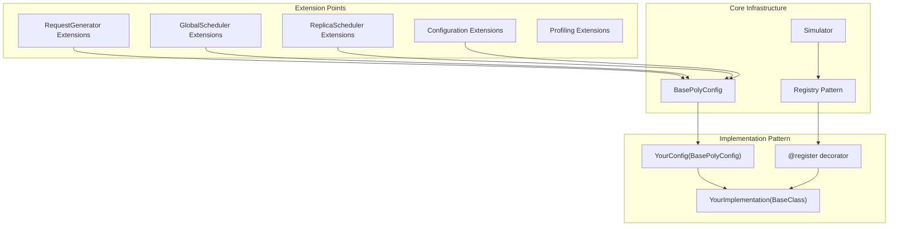
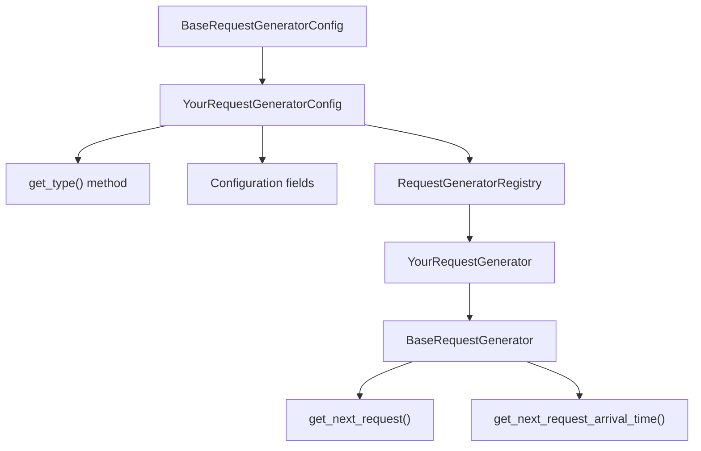
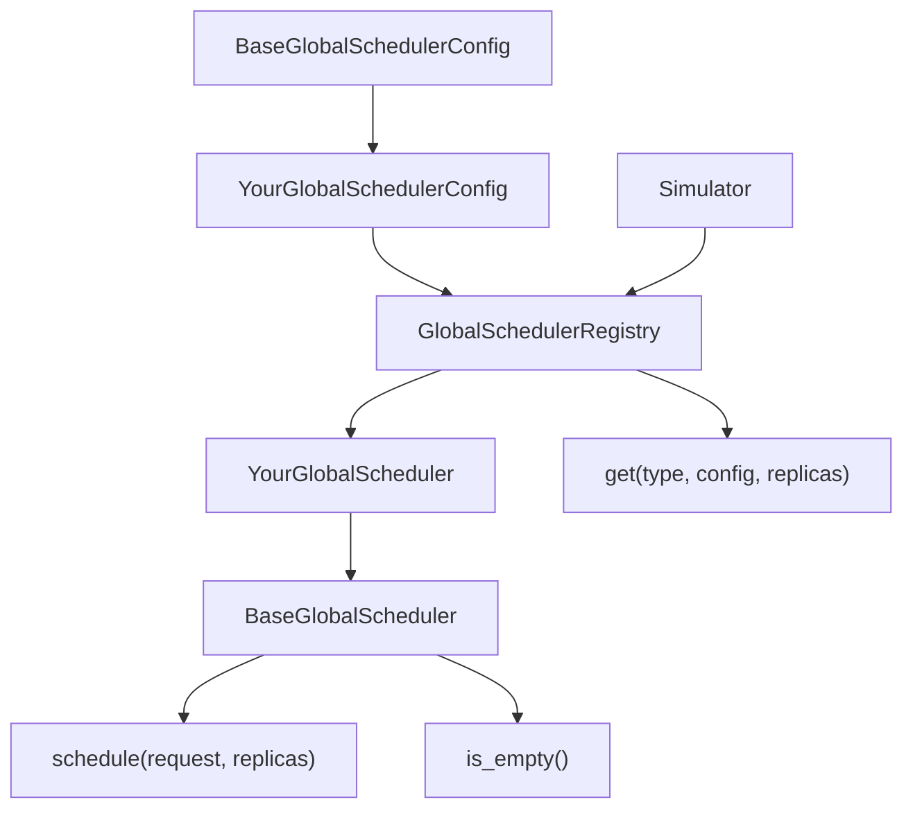
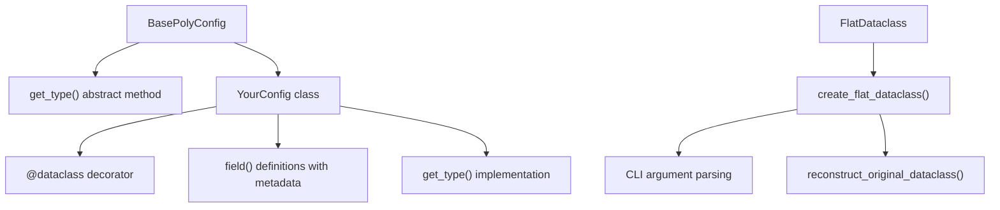
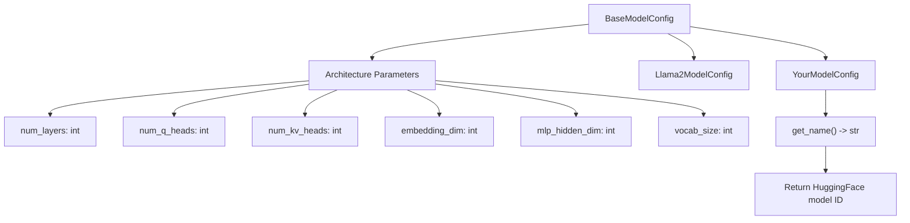
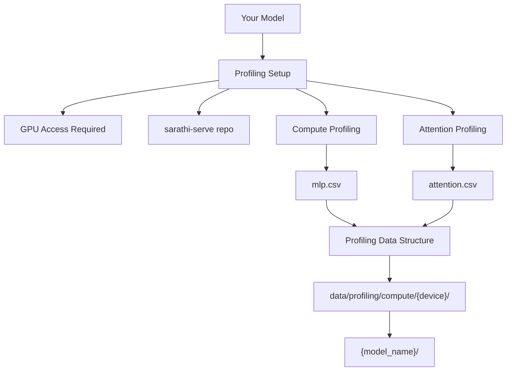
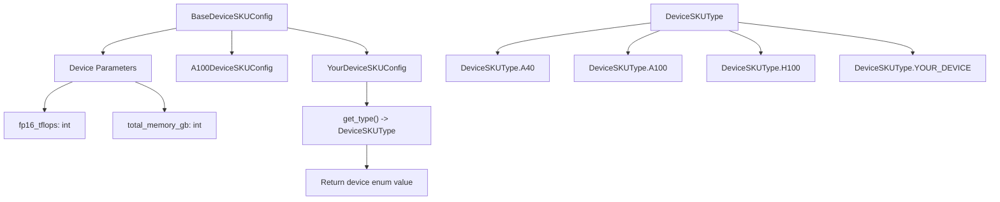
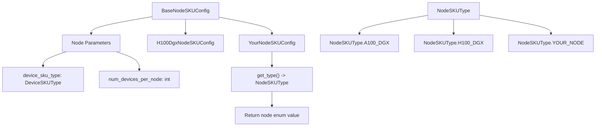
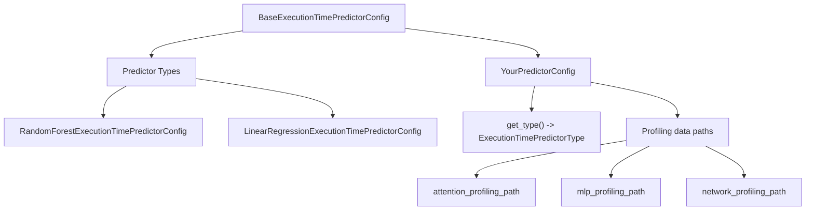
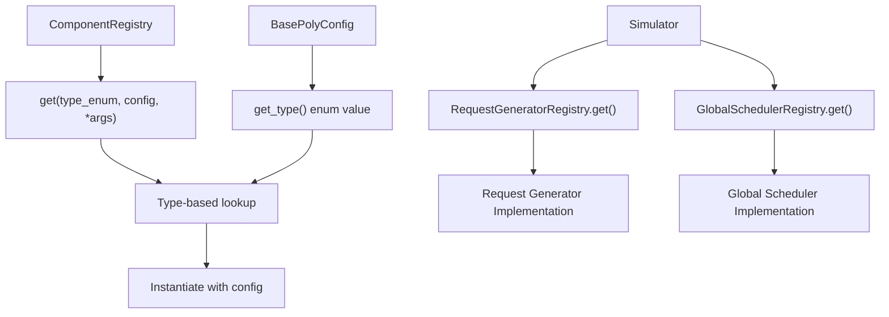

<!-- source: DeepWiki mcp.deepwiki.com · repo microsoft/vidur · page 11 Extending Vidur · fetched 2026-10-26 -->

# Extending Vidur

<details>
<summary>Relevant source files</summary>

The following files were used as context for generating this wiki page:

- [data/profiling/compute/a100/meta-llama/Meta-Llama-3-70B/attention.csv](data/profiling/compute/a100/meta-llama/Meta-Llama-3-70B/attention.csv)
- [data/profiling/compute/a100/meta-llama/Meta-Llama-3-70B/mlp.csv](data/profiling/compute/a100/meta-llama/Meta-Llama-3-70B/mlp.csv)
- [data/profiling/compute/a100/meta-llama/Meta-Llama-3-8B/attention.csv](data/profiling/compute/a100/meta-llama/Meta-Llama-3-8B/attention.csv)
- [data/profiling/compute/a100/meta-llama/Meta-Llama-3-8B/mlp.csv](data/profiling/compute/a100/meta-llama/Meta-Llama-3-8B/mlp.csv)
- [docs/metrics.md](docs/metrics.md)
- [docs/profiling.md](docs/profiling.md)
- [vidur/config/device_sku_config.py](vidur/config/device_sku_config.py)
- [vidur/config/model_config.py](vidur/config/model_config.py)
- [vidur/config/node_sku_config.py](vidur/config/node_sku_config.py)

</details>


This document provides a comprehensive guide for developers who want to extend Vidur with new schedulers, request generators, configuration types, or profiling capabilities. It covers the key extension points in Vidur's architecture and demonstrates how to implement custom components that integrate seamlessly with the existing system.

For information about running simulations with existing components, see [Running Simulations](#9). For details about the core configuration system, see [Configuration System](#4).

## Extension Architecture Overview

Vidur's architecture is designed for extensibility through a combination of polymorphic configuration classes, registry patterns, and modular component interfaces. The system uses three main extension mechanisms:

1. **Polymorphic Configuration System** - Based on `BasePolyConfig` classes with type identification
2. **Component Registries** - Runtime registration of implementations using decorators
3. **Interface-Based Components** - Abstract base classes defining standard interfaces



Sources: [vidur/simulator.py:45-53](), [vidur/config/config.py:10-27](), [vidur/config/flat_dataclass.py:139-231]()

## Adding New Request Generators

Request generators control workload creation and must implement the `BaseRequestGenerator` interface. The implementation requires both a configuration class and the generator implementation.

### Configuration Class

Create a configuration class extending `BaseRequestGeneratorConfig`:



The configuration class must:
- Extend `BaseRequestGeneratorConfig` from [vidur/config/config.py:220-230]()
- Implement `get_type()` returning a `RequestGeneratorType` enum value
- Include all necessary configuration fields with metadata

### Implementation Class

The generator implementation must:
- Extend `BaseRequestGenerator`
- Implement `get_next_request()` returning `Optional[Request]`
- Implement `get_next_request_arrival_time()` returning `Optional[float]`
- Handle request queue management internally

Example structure based on [vidur/request_generator/synthetic_request_generator.py:15-74]():

```python
class YourRequestGenerator(BaseRequestGenerator):
    def __init__(self, config: YourRequestGeneratorConfig):
        super().__init__(config)
        # Initialize your generator logic
        
    def get_next_request_arrival_time(self) -> Optional[float]:
        # Return next request arrival time or None if no more requests
        
    def get_next_request(self) -> Optional[Request]:
        # Return next request or None if no more requests
```

### Registration

Register your implementation using the registry pattern. The registry system uses the `get_type()` method from your configuration class to map types to implementations.

Sources: [vidur/request_generator/synthetic_request_generator.py:15-74](), [vidur/config/config.py:232-257]()

## Adding New Schedulers

Vidur supports two types of schedulers that can be extended: global schedulers (for request distribution across replicas) and replica schedulers (for request execution within a replica).

### Global Schedulers

Global schedulers distribute incoming requests across available replicas and must implement the `BaseGlobalScheduler` interface.



Configuration requirements:
- Extend `BaseGlobalSchedulerConfig` from [vidur/config/config.py:605-617]()
- Implement `get_type()` returning a `GlobalSchedulerType` enum value
- Include scheduler-specific parameters

Implementation requirements:
- Extend `BaseGlobalScheduler` 
- Implement request scheduling logic
- Handle replica state tracking
- Maintain queue state for `is_empty()` checks

### Replica Schedulers

Replica schedulers manage request execution within individual replicas, handling batching, preemption, and resource allocation.

Configuration class pattern:
- Extend `BaseReplicaSchedulerConfig` from [vidur/config/config.py:342-352]()
- Define `batch_size_cap` and scheduler-specific parameters
- Implement `get_type()` returning a `ReplicaSchedulerType` enum value

Examples of existing implementations can be found in [vidur/config/config.py:355-416]() showing various scheduler configurations like `VllmSchedulerConfig`, `SarathiSchedulerConfig`, and others.

Sources: [vidur/config/config.py:605-692](), [vidur/config/config.py:342-416](), [vidur/simulator.py:49-53]()

## Configuration System Extensions

The configuration system uses the flat dataclass pattern to enable CLI argument parsing while maintaining hierarchical configuration structures.

### Polymorphic Configuration Classes

All extensible components use `BasePolyConfig` as their base class:



### Implementation Pattern

1. **Define Configuration Class**:
   - Use `@dataclass` decorator
   - Extend appropriate `BasePolyConfig` subclass
   - Define fields with `field()` and metadata for help text
   - Implement `get_type()` returning appropriate enum value

2. **Integrate with Flat Dataclass System**:
   The system automatically handles CLI argument generation through [vidur/config/flat_dataclass.py:87-137]()

3. **Type Registration**:
   Configuration types are discovered through the polymorphic system using [vidur/config/flat_dataclass.py:165-182]()

### Field Definition Best Practices

- Use `field()` with `default` or `default_factory` for optional parameters
- Include helpful metadata: `metadata={"help": "Description for CLI help"}`
- Use appropriate type hints for automatic CLI argument type inference
- Follow existing naming conventions from [vidur/config/config.py]()

Sources: [vidur/config/flat_dataclass.py:139-231](), [vidur/config/config.py:31-54](), [vidur/config/base_poly_config.py]()

## Adding New Models

Adding support for new LLM models requires defining model configurations and collecting profiling data. The process involves creating model configuration classes and gathering empirical performance data.

### Model Configuration Implementation

Model configurations extend `BaseModelConfig` and define architecture parameters:



Key implementation steps:

1. **Create Model Configuration Class**:
   - Extend `BaseModelConfig` from [vidur/config/model_config.py:11-31]()
   - Define architecture parameters (layers, heads, dimensions)
   - Implement `get_name()` returning HuggingFace model identifier

2. **Define Architecture Parameters** based on [vidur/config/model_config.py:34-94]():
   - `num_layers`: Number of transformer layers
   - `num_q_heads`: Number of query attention heads  
   - `num_kv_heads`: Number of key-value attention heads
   - `embedding_dim`: Model embedding dimension
   - `mlp_hidden_dim`: MLP layer hidden dimension
   - `vocab_size`: Vocabulary size
   - `use_gated_mlp`: Whether MLP uses gating mechanism
   - `activation`: Activation function type (`ActivationType.SILU`, etc.)

3. **Implementation Example** following [vidur/config/model_config.py:69-80]():

```python
@dataclass
class YourModelConfig(BaseModelConfig):
    num_layers: int = 32
    num_q_heads: int = 32
    num_kv_heads: int = 32
    embedding_dim: int = 4096
    mlp_hidden_dim: int = 11008
    # ... other parameters
    
    @staticmethod
    def get_name():
        return "your-org/your-model-name"
```

### Profiling Data Collection

New models require empirical profiling data for accurate performance modeling:



**Profiling Process** following [docs/profiling.md:33-70]():

1. **Setup Requirements**:
   - Clone `sarathi-serve` repository (vidur branch)
   - Access to target GPU hardware
   - Create model YAML config in `data/model_configs/`

2. **MLP Profiling**:
   ```bash
   python vidur/profiling/mlp/main.py --models your-model/name --num_gpus 4
   ```

3. **Attention Profiling**:
   ```bash
   python vidur/profiling/attention/main.py --models your-model/name --num_gpus 4
   ```

4. **Data Organization**:
   - Copy profiling CSVs to `data/profiling/compute/{device}/{model_name}/`
   - Device folder structure: `a100/`, `h100/`, etc.
   - Model folder uses HuggingFace model ID format

**Profiling Data Format** based on [data/profiling/compute/a100/meta-llama/Meta-Llama-3-8B/mlp.csv:1-2]():

| Field | Description |
|-------|-------------|
| `time_stats.mlp_up_proj.*` | MLP up projection timing statistics |
| `time_stats.mlp_down_proj.*` | MLP down projection timing statistics |
| `time_stats.attn_pre_proj.*` | Attention pre-projection timing |
| `num_tokens` | Token batch size |
| `num_tensor_parallel_workers` | Tensor parallelism degree |

Sources: [vidur/config/model_config.py:11-94](), [docs/profiling.md:33-70](), [data/profiling/compute/a100/meta-llama/Meta-Llama-3-8B/mlp.csv:1-2]()

## Adding New Hardware Devices

Hardware device support requires device SKU configurations, node configurations, and profiling data collection.

### Device SKU Configuration

Device SKUs define compute capabilities and memory specifications:



**Implementation Steps** based on [vidur/config/device_sku_config.py:16-24]():

1. **Add Device Type Enum**: Extend `DeviceSKUType` enum
2. **Create Device SKU Config**:
   ```python
   @dataclass
   class YourDeviceSKUConfig(BaseDeviceSKUConfig):
       fp16_tflops: int = 500  # FP16 TFLOPS rating
       total_memory_gb: int = 48  # Memory in GB
       
       @staticmethod
       def get_type():
           return DeviceSKUType.YOUR_DEVICE
   ```

### Node SKU Configuration

Node SKUs define multi-device configurations and interconnect topology:



**Implementation Example** from [vidur/config/node_sku_config.py:55-62]():

```python
@dataclass
class YourNodeSKUConfig(BaseNodeSKUConfig):
    device_sku_type: DeviceSKUType = DeviceSKUType.YOUR_DEVICE
    num_devices_per_node: int = 8
    
    @staticmethod
    def get_type():
        return NodeSKUType.YOUR_NODE
```

### Network Profiling

Network profiling captures communication performance for tensor and pipeline parallelism:

**Profiling Requirements** from [docs/profiling.md:73-117]():

1. **Tensor Parallelism**: Profile `all_reduce` operations
   ```bash
   python vidur/profiling/collectives/main.py \
       --num_workers_per_node_combinations 1,2,4,8 \
       --collective all_reduce
   ```

2. **Pipeline Parallelism**: Profile `send_recv` operations  
   ```bash
   python vidur/profiling/collectives/main.py \
       --num_workers_per_node_combinations 1,2,4,8 \
       --collective send_recv
   ```

3. **Data Organization**:
   - Save to `data/profiling/network/{network_device}/`
   - Network device examples: `a100_dgx`, `h100_pairwise_nvlink`
   - Files: `allreduce.csv`, `send_recv.csv`

Sources: [vidur/config/device_sku_config.py:16-43](), [vidur/config/node_sku_config.py:15-62](), [docs/profiling.md:73-117]()

## Extending Performance Modeling

Performance modeling extensions involve execution time predictors and custom profiling approaches.

### Execution Time Predictor Extensions

Execution time predictors model hardware performance using profiling data:



**Implementation Requirements**:

1. **Configuration Class**: Extend `BaseExecutionTimePredictorConfig`
2. **Profiling Data Integration**: Define paths to profiling CSV files
3. **Prediction Model**: Implement performance prediction algorithms
4. **Model Training**: Train prediction models on profiling data

The system supports different predictor types with examples like `RandomForestExecutionTimePredictorConfig` and `LinearRegressionExecutionTimePredictorConfig` for different modeling approaches.

### Custom Metrics Extensions

Metrics extensions allow tracking custom performance indicators beyond standard latency and throughput measures.

**Metrics System Architecture** from [docs/metrics.md:1-27]():

| Metric Category | Description | Examples |
|----------------|-------------|----------|
| Request-level | Per-request performance | TTFT, TPOT, E2E latency |
| System-level | Global performance | Throughput, GPU utilization |
| Distribution | Statistical analysis | CDF analysis, histograms |

**Custom Metrics Implementation**:
- Extend metrics collection in simulation components
- Define new performance indicators
- Integrate with visualization systems (WandB, Chrome tracing)
- Add statistical analysis capabilities

Sources: [vidur/config/config.py:707-851](), [docs/metrics.md:1-27]()

## Registry and Discovery System

Vidur uses a registry pattern for component discovery and instantiation. The system automatically discovers implementations through the polymorphic configuration system.

### Registry Integration Pattern



### Component Lifecycle

1. **Configuration Discovery**: The flat dataclass system discovers all configuration types through [vidur/config/flat_dataclass.py:178-182]()
2. **Type Registration**: Components register their types through `get_type()` implementations
3. **Runtime Instantiation**: Registries instantiate components using the factory pattern
4. **Dependency Injection**: The simulator injects components as dependencies

The registration happens automatically when configuration classes implement `get_type()` and are included in the polymorphic hierarchy, as demonstrated in [vidur/simulator.py:45-53]() where the simulator retrieves components from registries.

Sources: [vidur/simulator.py:45-53](), [vidur/config/flat_dataclass.py:165-182](), [vidur/config/config.py:220-288]()

---

