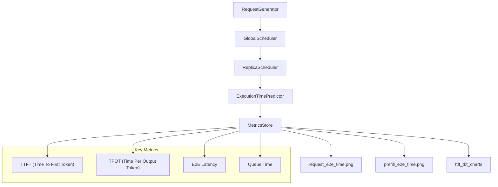
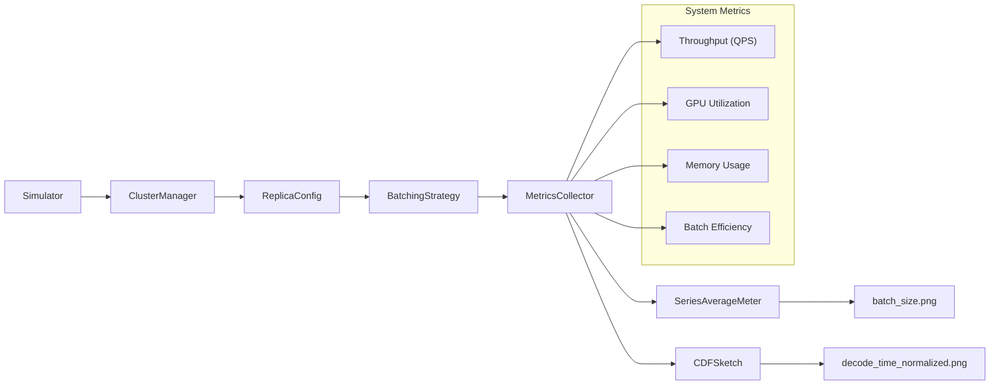
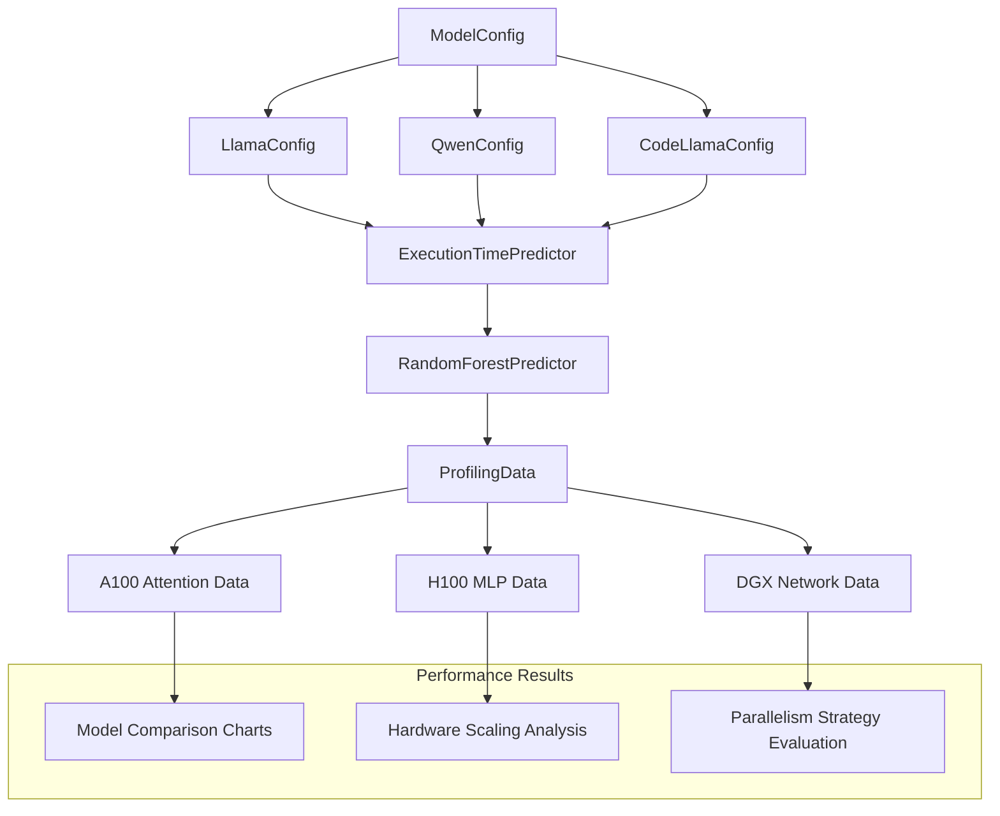
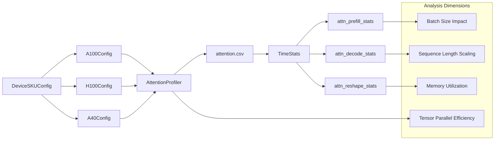
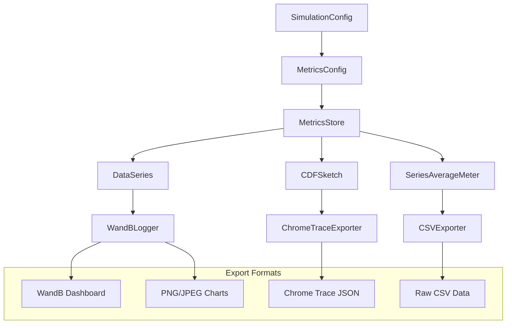

<!-- source: DeepWiki mcp.deepwiki.com · repo microsoft/vidur · page 12 Performance Results Gallery · fetched 2026-10-26 -->

# Performance Results Gallery

Relevant source files

The following files were used as context for generating this wiki page:

- [.github/PULL_REQUEST_TEMPLATE.md](.github/PULL_REQUEST_TEMPLATE.md)
- [assets/batch_size.png](assets/batch_size.png)
- [assets/decode_time_execution_plus_preemption_normalized.png](assets/decode_time_execution_plus_preemption_normalized.png)
- [assets/llama70b_Chat1M_ttft_tbt_90_99_2.0_0.2.jpeg](assets/llama70b_Chat1M_ttft_tbt_90_99_2.0_0.2.jpeg)
- [assets/prefill_e2e_time.png](assets/prefill_e2e_time.png)
- [assets/request_e2e_time.png](assets/request_e2e_time.png)
- [data/profiling/compute/a100/Qwen/Qwen-72B/attention.csv](data/profiling/compute/a100/Qwen/Qwen-72B/attention.csv)

This page showcases example simulation results, performance comparisons, and case studies generated by Vidur's comprehensive performance measurement and analysis system. The gallery demonstrates various types of performance visualizations and provides guidance on interpreting simulation outcomes across different hardware configurations, model architectures, and scheduling strategies.

For information about the underlying metrics collection system and performance indicators, see [Performance Metrics](#8.1). For details on visualization tools and monitoring capabilities, see [Visualization and Monitoring](#8.2).

## Types of Performance Visualizations

Vidur generates several categories of performance charts, each highlighting different aspects of LLM inference performance. These visualizations are produced through the metrics collection pipeline and can be exported in various formats.

### Request-Level Performance Metrics

The simulator tracks comprehensive request-level metrics throughout the inference pipeline, from arrival to completion.

**Sources:** [assets/request_e2e_time.png](), [assets/prefill_e2e_time.png](), [assets/llama70b_Chat1M_ttft_tbt_90_99_2.0_0.2.jpeg]()

### System-Level Performance Analysis

System-level metrics provide insights into resource utilization, throughput characteristics, and scheduling efficiency across different configurations.

**Sources:** [assets/batch_size.png](), [assets/decode_time_execution_plus_preemption_normalized.png]()

## Chart Interpretation Guide

### End-to-End Request Latency Analysis

Request end-to-end time charts show the complete latency distribution for inference requests, including queueing, prefill, and decode phases.

- **X-axis**: Typically represents time or request sequence
- **Y-axis**: Latency in milliseconds or seconds
- **Key patterns to observe**:
  - Latency spikes indicating system bottlenecks
  - Variance in response times across different request types
  - Impact of batching strategies on individual request performance

### Batch Size Performance Characteristics  

Batch size charts demonstrate the relationship between batching strategies and system throughput/latency trade-offs.

- **Optimal batch sizes** for different hardware configurations
- **Memory utilization** patterns across batch sizes
- **Throughput scaling** behavior with increasing batch sizes
- **Latency degradation** at high batch sizes due to memory constraints

### Prefill vs. Decode Performance

Prefill charts isolate the initial processing phase performance, which has different computational characteristics than autoregressive decode.

- **Prefill latency** scales with input sequence length
- **Memory allocation** patterns during prefill
- **Impact of chunked prefill** strategies on system performance

## Case Studies

### Multi-Model Performance Comparison

The following analysis demonstrates performance characteristics across different model architectures using Vidur's simulation capabilities.

**Sources:** [data/profiling/compute/a100/Qwen/Qwen-72B/attention.csv]()

### LLaMA-70B Chat Workload Analysis

The LLaMA-70B chat workload demonstrates performance characteristics under realistic conversational AI scenarios with varying input/output lengths.

Key observations from the simulation:
- **TTFT characteristics**: 90th and 99th percentile response times
- **Token generation rates**: Sustained throughput under chat workloads  
- **Memory scaling**: GPU memory utilization patterns
- **Scheduling efficiency**: Impact of different replica scheduling strategies

### Hardware Configuration Impact

Profiling data collection enables detailed analysis of how different hardware configurations affect performance across model components.

**Sources:** [data/profiling/compute/a100/Qwen/Qwen-72B/attention.csv]()

## Generating Custom Performance Reports

The metrics collection system supports custom analysis through programmatic access to performance data.

### Metrics Collection Pipeline

### Key Code Components

The performance visualization pipeline involves several key classes:

- `MetricsStore` - Central collection point for all performance metrics
- `DataSeries` - Time series data tracking for continuous metrics
- `CDFSketch` - Distribution analysis for latency percentiles
- `SeriesAverageMeter` - Running statistics computation
- `ChromeTraceExporter` - Detailed execution timeline visualization

**Sources:** [vidur/metrics/](), [vidur/visualization/]()

## Best Practices for Performance Analysis

### Simulation Configuration for Meaningful Results

1. **Hardware modeling accuracy**: Ensure device SKU configurations match target deployment hardware
2. **Workload representativeness**: Use trace-based request generation when available
3. **Statistical significance**: Run sufficient simulation duration for stable metrics
4. **Comparative analysis**: Use consistent configurations when comparing scheduling strategies

### Interpreting Results

1. **Look for patterns**: Consistent trends across multiple runs indicate systematic behavior
2. **Consider context**: Absolute numbers should be interpreted relative to hardware capabilities  
3. **Validate against profiling**: Compare simulation predictions with empirical profiling data
4. **Account for variability**: Use percentile metrics rather than averages for latency analysis

**Sources:** [vidur/config/](), [vidur/profiling/](), [vidur/metrics/]()