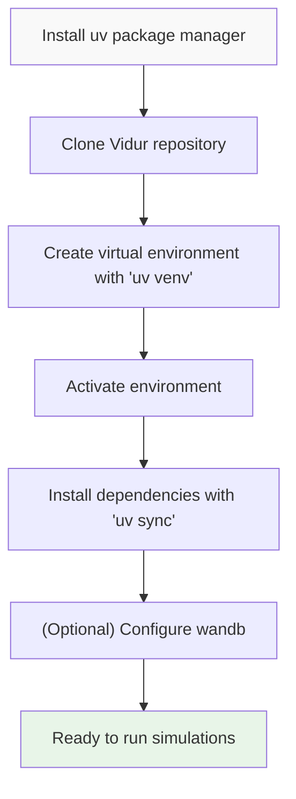
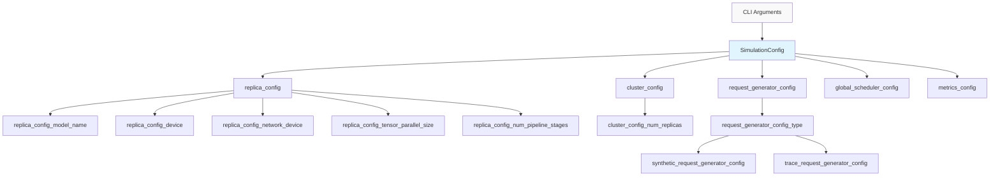
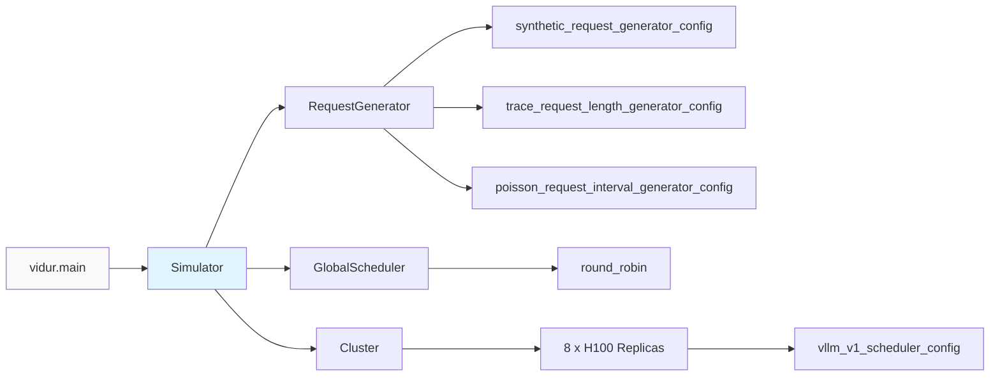
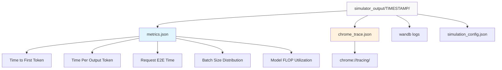

<!-- source: DeepWiki mcp.deepwiki.com · repo microsoft/vidur · page 2 Getting Started · fetched 2026-10-26 -->

# Getting Started

<details>
<summary>Relevant source files</summary>

The following files were used as context for generating this wiki page:

- [LICENSE](LICENSE)
- [README.md](README.md)
- [assets/chrome_trace.png](assets/chrome_trace.png)

</details>


This page provides a step-by-step guide to installing Vidur, configuring your first simulation, and running it successfully. It covers the essential setup process, basic configuration concepts, and how to interpret simulation results.

For detailed information about configuration options, see [Configuration System](#4). For advanced simulation scenarios and parameter tuning, see [Running Simulations](#9).

## Prerequisites

Before installing Vidur, ensure you have:

- Python 3.8 or higher
- Git for repository access
- (Optional) A Weights & Biases account for experiment tracking

## Installation

### Setup Process Flow



**Installation Steps**

1. **Install uv package manager**
   
   Follow the installation instructions at https://docs.astral.sh/uv/getting-started/installation/

2. **Set up the project environment**
   
   ```bash
   # Clone the repository
   git clone https://github.com/microsoft/vidur
   cd vidur
   
   # Create virtual environment
   uv venv
   
   # Activate environment
   source .venv/bin/activate
   
   # Install dependencies
   uv sync
   ```

3. **Configure Weights & Biases (Optional)**
   
   If you want to use wandb for experiment tracking:
   ```bash
   wandb login --host https://<your-org>.wandb.io
   ```
   
   To disable wandb:
   ```bash
   export WANDB_MODE=disabled
   ```

Sources: [README.md:40-55]()

## Configuration Overview

Vidur uses a hierarchical configuration system where CLI arguments map to specific configuration dataclasses. Understanding this structure helps you customize simulations effectively.

### Configuration Architecture



**Key Configuration Categories**

| Category | Purpose | Key Parameters |
|----------|---------|----------------|
| Replica Config | Model and hardware setup | `replica_config_model_name`, `replica_config_device` |
| Cluster Config | Infrastructure scale | `cluster_config_num_replicas` |
| Request Generator | Workload definition | `request_generator_config_type` |
| Scheduler Config | Request scheduling | `global_scheduler_config_type`, `replica_scheduler_config_type` |

Sources: [README.md:62-81]()

## Running Your First Simulation

### Basic Simulation Command

The following command demonstrates a complete simulation setup using the `vidur.main` module:

```bash
python -m vidur.main \
--time_limit 10800 \
--replica_config_model_name meta-llama/Meta-Llama-3-8B \
--replica_config_device h100 \
--replica_config_network_device h100_dgx \
--cluster_config_num_replicas 8 \
--replica_config_tensor_parallel_size 1 \
--replica_config_num_pipeline_stages 1 \
--request_generator_config_type synthetic \
--synthetic_request_generator_config_num_requests 128 \
--length_generator_config_type trace \
--trace_request_length_generator_config_trace_file ./data/processed_traces/mooncake_conversation_trace.csv \
--interval_generator_config_type poisson \
--poisson_request_interval_generator_config_qps 8.0 \
--global_scheduler_config_type round_robin \
--replica_scheduler_config_type vllm_v1 \
--vllm_v1_scheduler_config_chunk_size 512 \
--vllm_v1_scheduler_config_batch_size_cap 512 \
--cache_config_enable_prefix_caching
```

### Simulation Flow



**What This Simulation Does**

- **Hardware**: Simulates 8 H100 GPU replicas in a DGX configuration
- **Model**: Runs Meta-Llama-3-8B with single-GPU tensor parallelism
- **Workload**: Generates 128 synthetic requests at 8 QPS using Poisson distribution
- **Request Lengths**: Uses realistic conversation trace data from `mooncake_conversation_trace.csv`
- **Scheduling**: Uses round-robin global scheduling with vLLM v1 replica scheduler
- **Duration**: Runs for 10,800 seconds (3 hours) or until all requests complete

### Getting Help

To see all available configuration parameters:

```bash
python -m vidur.main -h
```

Sources: [README.md:57-85]()

## Understanding Simulation Output

### Output Structure



**Key Output Files**

| File | Purpose | Usage |
|------|---------|--------|
| `metrics.json` | Performance measurements | Analysis and capacity planning |
| `chrome_trace.json` | Timeline visualization | Debug scheduling and bottlenecks |
| `simulation_config.json` | Configuration snapshot | Reproduce simulation settings |
| `wandb logs` | Experiment tracking | Compare across simulation runs |

### Key Performance Metrics

The simulation produces several critical performance indicators:

- **TTFT (Time to First Token)**: Prefill latency for interactive responsiveness
- **TPOT (Time Per Output Token)**: Decode throughput for generation speed  
- **Request E2E Time**: Complete request processing duration
- **Batch Size**: Dynamic batching efficiency
- **MFU (Model FLOP Utilization)**: Hardware efficiency measurement

### Visualizing Results

**Chrome Trace Analysis**

1. Navigate to `chrome://tracing/` in your browser
2. Load the `chrome_trace.json` file from your simulation output
3. Examine request timelines, GPU utilization, and scheduling decisions

The trace provides detailed insights into:
- Request queuing and scheduling patterns
- GPU compute and memory utilization
- Batching and preemption behavior
- Performance bottlenecks

Sources: [README.md:87-92]()

## Next Steps

After completing your first simulation:

1. **Explore Configuration Options**: See [Configuration System](#4) for detailed parameter descriptions
2. **Try Different Models**: Check [Hardware and Model Configurations](#4.2) for supported models and hardware
3. **Custom Workloads**: Learn about [Request Generation](#5) for realistic workload simulation
4. **Performance Analysis**: Review [Metrics and Analysis](#8) for in-depth result interpretation
5. **Advanced Scenarios**: See [Running Simulations](#9) for capacity planning and optimization studies

To explore all available parameters and their descriptions:

```bash
python -m vidur.main -h
```

For detailed metric descriptions and analysis guidance, consult the metrics documentation referenced in the simulation output.

Sources: [README.md:85]()

---

