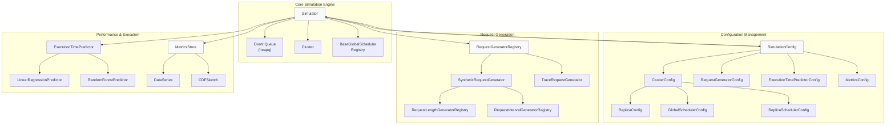
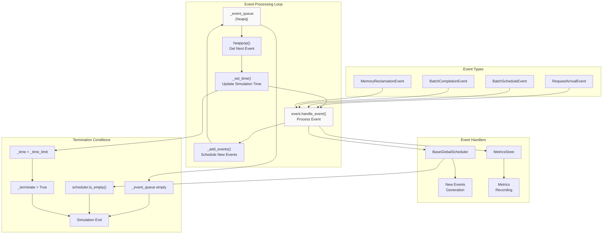
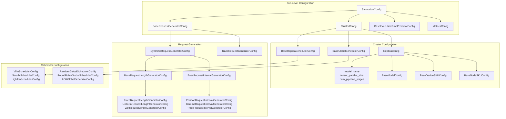
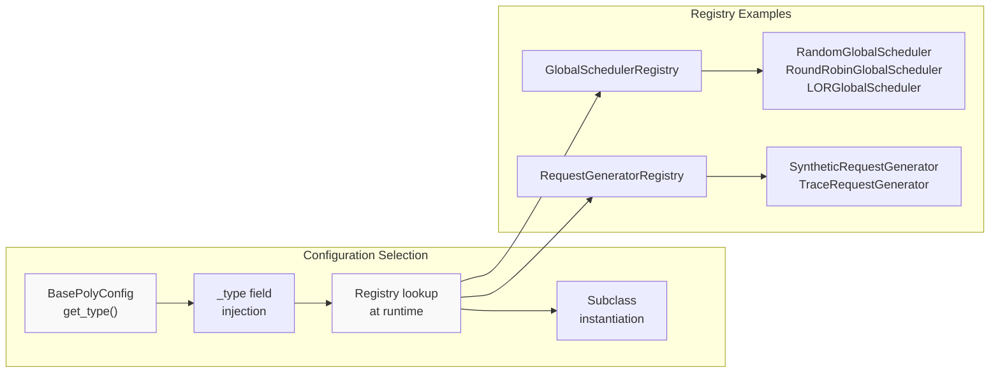
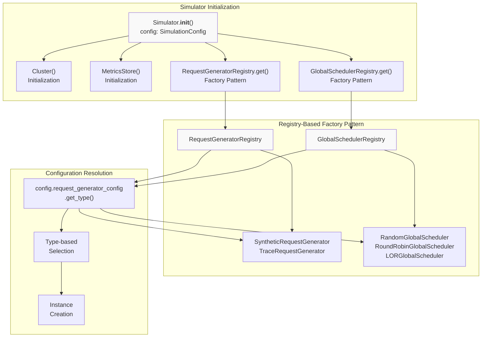
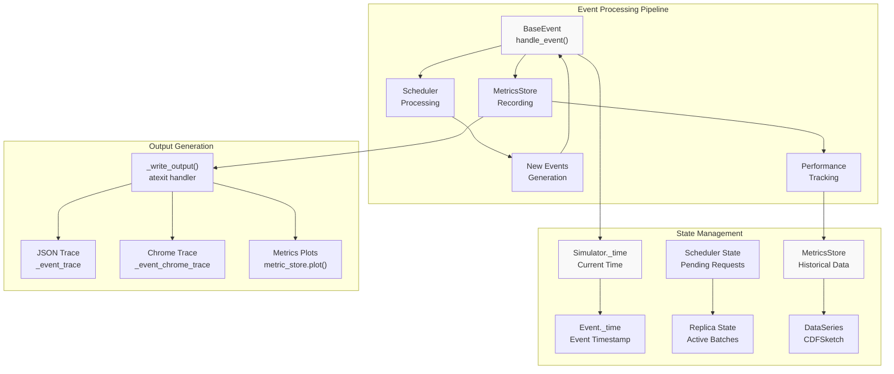
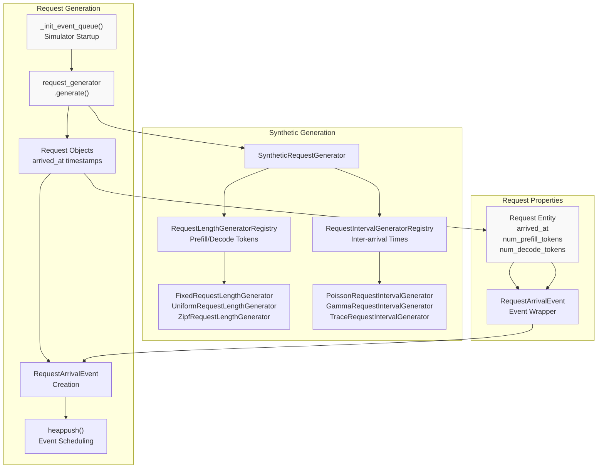

<!-- source: DeepWiki mcp.deepwiki.com · repo microsoft/vidur · page 3 Core Architecture · fetched 2026-10-26 -->

# Core Architecture

Relevant source files

The following files were used as context for generating this wiki page:

- [vidur/config/config.py](vidur/config/config.py)
- [vidur/request_generator/synthetic_request_generator.py](vidur/request_generator/synthetic_request_generator.py)
- [vidur/simulator.py](vidur/simulator.py)

This document provides an architectural overview of Vidur's core simulation framework, focusing on the primary components and their relationships. It covers the main orchestration layer, event-driven simulation engine, configuration system, and component interaction patterns.

For information about specific scheduling algorithms and resource management, see [Scheduling and Resource Management](#6). For details about performance modeling and prediction systems, see [Performance Modeling](#7). For comprehensive metrics collection and analysis capabilities, see [Metrics and Analysis](#8).

## System Overview

Vidur implements a discrete event simulation architecture designed to model large language model (LLM) inference systems at scale. The system is built around a central `Simulator` class that orchestrates multiple subsystems through an event-driven execution model.

### Primary System Components

**Sources:** [vidur/simulator.py:17-49](), [vidur/config/config.py:627-656]()

## Core Simulation Engine

The simulation engine centers around the `Simulator` class, which implements a discrete event simulation model using a priority queue for event scheduling and processing.

### Event-Driven Architecture

The simulation engine executes through a main event loop in the `run()` method:

- **Event Queue Management**: Uses Python's `heapq` for efficient priority queue operations [vidur/simulator.py:27,64-68]()
- **Time Progression**: Simulation time advances only when processing events [vidur/simulator.py:66,109-116]()
- **Event Generation**: Each event handler can spawn new events, maintaining the simulation flow [vidur/simulator.py:67-68,99-102]()
- **Termination Logic**: Simulation ends when the event queue is empty, time limit is reached, or scheduler reports completion [vidur/simulator.py:64,78,111-115]()

**Sources:** [vidur/simulator.py:59-81](), [vidur/simulator.py:96-116]()

## Configuration Architecture

Vidur implements a sophisticated hierarchical configuration system that supports both programmatic configuration and comprehensive CLI argument generation.

### Configuration Hierarchy

### Polymorphic Configuration System

The configuration system uses `BasePolyConfig` to enable runtime type selection through the `_type` field injection mechanism:

**Sources:** [vidur/config/config.py:8](), [vidur/config/config.py:468-491](), [vidur/config/config.py:255-329]()

## Component Initialization and Orchestration

The `Simulator` class orchestrates component initialization through dependency injection and registry patterns:

### Component Initialization Flow

Key initialization patterns:

- **Registry Pattern**: Component types are resolved through registry lookups using `get_type()` methods [vidur/simulator.py:38-46]()
- **Dependency Injection**: The `Simulator` injects dependencies (scheduler, metrics store) into components during creation
- **Configuration Propagation**: Nested configurations are passed down to appropriate subsystems [vidur/simulator.py:32-36]()

**Sources:** [vidur/simulator.py:18-49](), [vidur/request_generator/synthetic_request_generator.py:16-29]()

## Event Processing and State Management  

The simulation maintains state through event processing and component interaction:

### State Flow and Event Handling

The simulation manages multiple state dimensions:

- **Temporal State**: Simulation time progresses through event timestamps [vidur/simulator.py:66,109-110]()
- **Request State**: Tracking requests from arrival through completion via events and scheduler state
- **Resource State**: GPU memory, batch scheduling, and utilization managed by cluster components
- **Metrics State**: Continuous collection of performance data through the `MetricsStore` [vidur/simulator.py:37]()

**Sources:** [vidur/simulator.py:64-81](), [vidur/simulator.py:82-94](), [vidur/simulator.py:117-128]()

## Request Generation Integration

The request generation subsystem integrates with the core simulation through event scheduling:

### Request Generation Flow

The request generation system demonstrates the modular architecture:

- **Pluggable Generators**: Registry pattern allows different request generation strategies [vidur/simulator.py:38-41]()
- **Statistical Modeling**: Support for various probability distributions for realistic workload modeling [vidur/request_generator/synthetic_request_generator.py:21-28]()
- **Event Integration**: Generated requests are converted to `RequestArrivalEvent` objects for event queue processing [vidur/simulator.py:104-107]()

**Sources:** [vidur/simulator.py:103-108](), [vidur/request_generator/synthetic_request_generator.py:52-82]()

---

