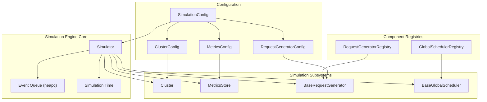
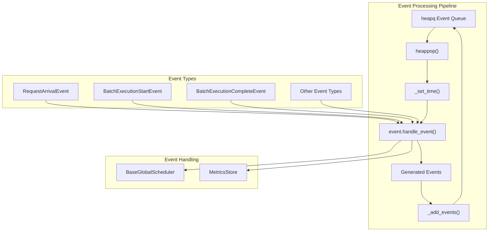
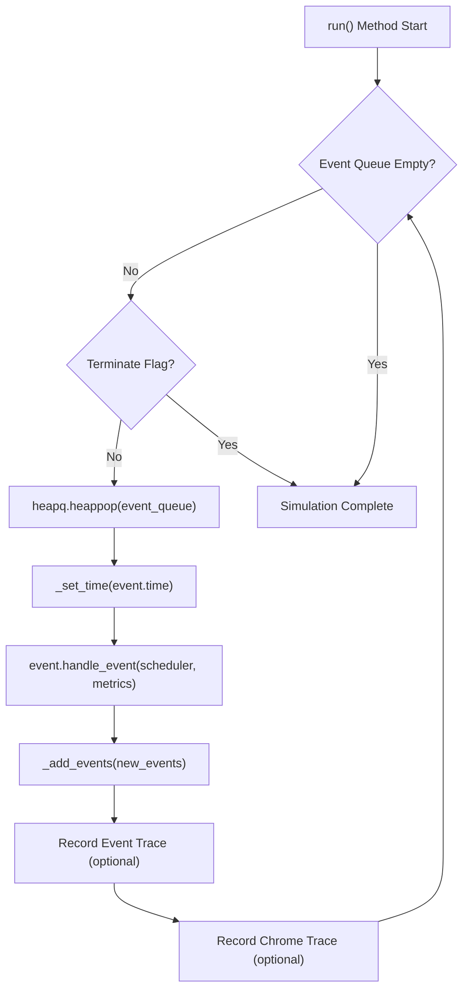
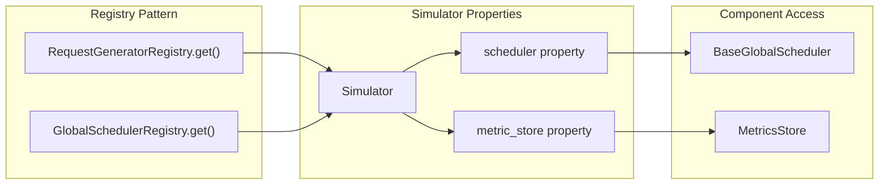
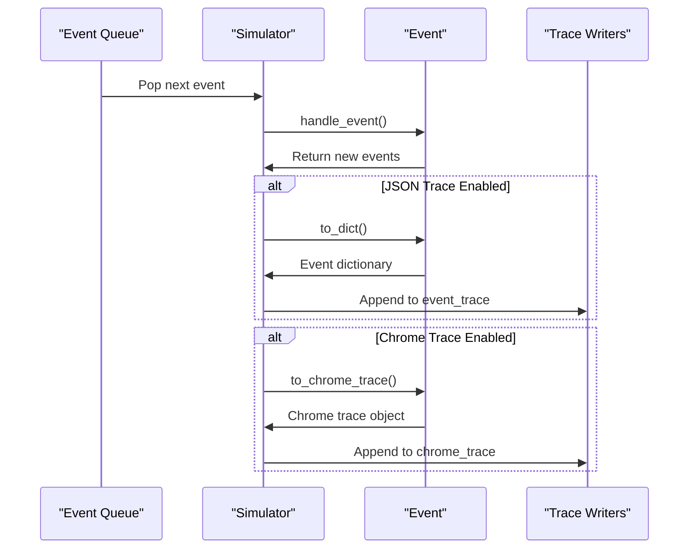
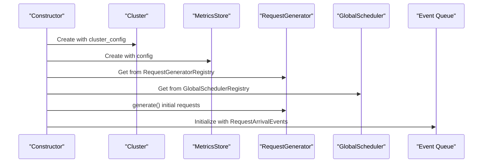

<!-- source: DeepWiki mcp.deepwiki.com · repo microsoft/vidur · page 3.1 Simulation Engine · fetched 2026-10-26 -->

# Simulation Engine

<details>
<summary>Relevant source files</summary>

The following files were used as context for generating this wiki page:

- [vidur/config/config.py](vidur/config/config.py)
- [vidur/request_generator/synthetic_request_generator.py](vidur/request_generator/synthetic_request_generator.py)
- [vidur/simulator.py](vidur/simulator.py)

</details>


## Purpose and Scope

The Simulation Engine is the core orchestration component of the Vidur LLM inference simulator. It implements an event-driven discrete simulation system that coordinates request processing across distributed inference replicas. This document covers the `Simulator` class architecture, event queue management, and the main simulation loop that drives the entire system.

For information about request processing within replicas, see [Request Processing Pipeline](#3.2). For configuration of simulation parameters, see [Configuration System](#4).

## Architecture Overview

The `Simulator` class serves as the central orchestrator that integrates all major subsystems. It manages the simulation timeline through a priority-based event queue and coordinates interactions between request generators, schedulers, clusters, and metrics collection systems.

### Core Components Integration



**Component Orchestration Flow**

The `Simulator` constructor orchestrates component initialization in a specific order to ensure proper dependencies. It creates the cluster infrastructure, metrics collection system, request generation pipeline, and global scheduling logic.

Sources: [vidur/simulator.py:17-49]()

### Event-Driven Architecture

The simulation engine operates through a discrete event system where all state changes occur through event processing. Events are scheduled with precise timestamps and processed in chronological order.



**Priority Queue Implementation**

The event queue uses Python's `heapq` module with events prioritized by timestamp. Each event contains a `_priority_number` field that ensures deterministic ordering for events with identical timestamps.

Sources: [vidur/simulator.py:27-28,96-101]()

## Simulation Loop

The main simulation loop implements the core discrete event simulation algorithm. It processes events chronologically until either the event queue is empty or a time limit is reached.

### Main Loop Algorithm



**Event Processing Details**

Each event's `handle_event()` method receives references to the global scheduler and metrics store. Events can generate zero or more new events that are added back to the priority queue. This allows for complex event cascades such as batch completion triggering new batch formation.

Sources: [vidur/simulator.py:64-78]()

### Time Management

The simulator maintains a global simulation time that advances as events are processed. Time limits can be configured to terminate long-running simulations.

```python
# Time management in simulator loop
self._set_time(event._time)

def _set_time(self, time: float) -> None:
    self._time = time
    if self._time > self._time_limit:
        logger.info(f"Time limit reached: {self._time_limit}s terminating the simulation.")
        self._terminate = True
```

Sources: [vidur/simulator.py:109-116]()

## Component Integration

The simulator integrates with major system components through well-defined interfaces, enabling modular replacement of different scheduling algorithms, request generators, and metrics systems.

### Subsystem Access Patterns



**Component Lifecycle Management**

The simulator manages component lifecycles through initialization, runtime access, and cleanup phases. It registers an `atexit` handler to ensure proper output generation even if the simulation terminates unexpectedly.

Sources: [vidur/simulator.py:49,52-57]()

## Output Generation

The simulation engine supports multiple output formats for analysis and debugging. Output generation occurs both during simulation (for tracing) and at completion (for metrics and final reports).

### Output Types and Configuration

| Output Type | Configuration Flag | File Format | Purpose |
|-------------|-------------------|-------------|---------|
| Metrics | `write_metrics` | JSON/Plots | Performance analysis |
| JSON Event Trace | `write_json_trace` | JSON | Event debugging |
| Chrome Trace | `enable_chrome_trace` | JSON | Timeline visualization |

**Trace Generation Flow**



**Output File Generation**

The simulator writes output files through the `_write_output()` method, which is called both at normal completion and via the `atexit` handler for abnormal termination.

Sources: [vidur/simulator.py:82-95,117-128]()

## Initialization Sequence

The simulator follows a specific initialization sequence to establish all dependencies and prepare the event queue with initial events.

### Component Creation Order



**Request Generation and Queue Seeding**

The initialization process generates all requests upfront through the configured request generator and seeds the event queue with `RequestArrivalEvent` instances. This approach allows the simulator to know the complete workload characteristics before simulation begins.

Sources: [vidur/simulator.py:103-108]()

---

