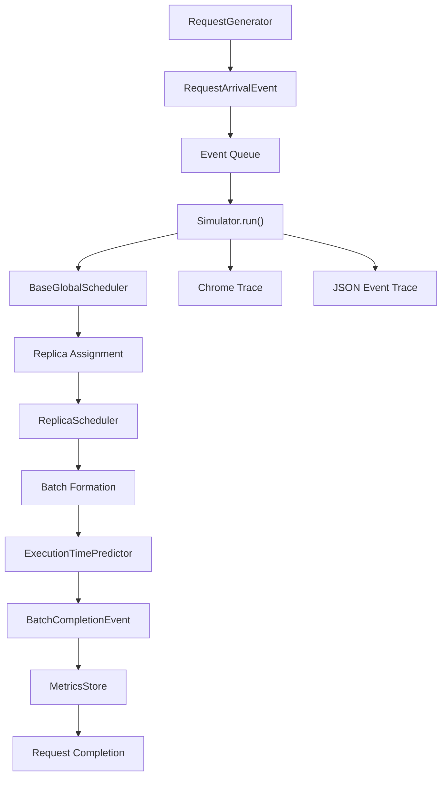
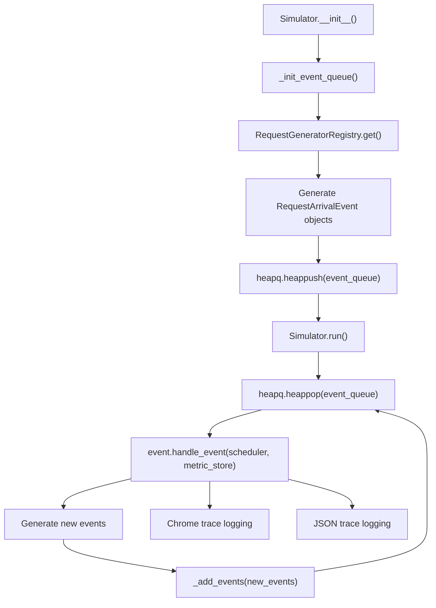
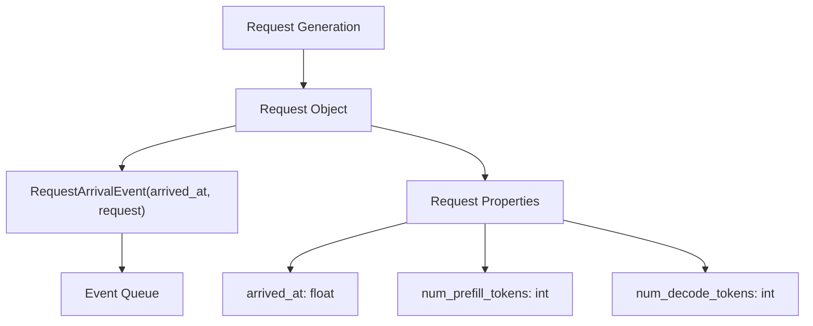
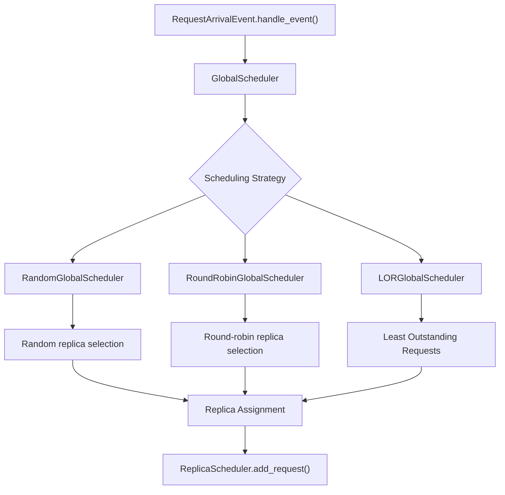
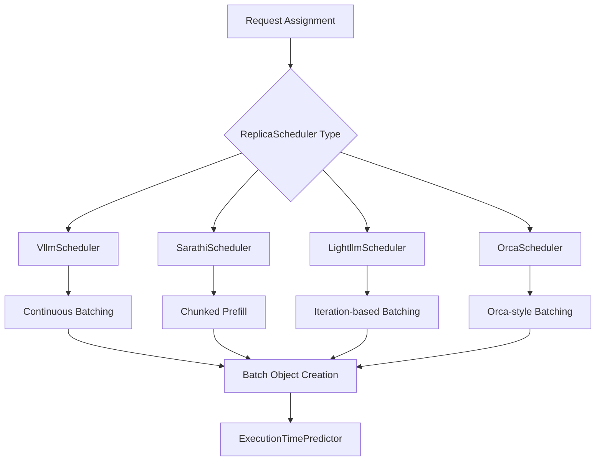
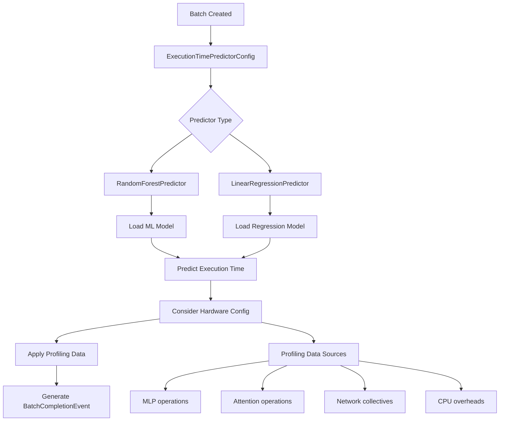
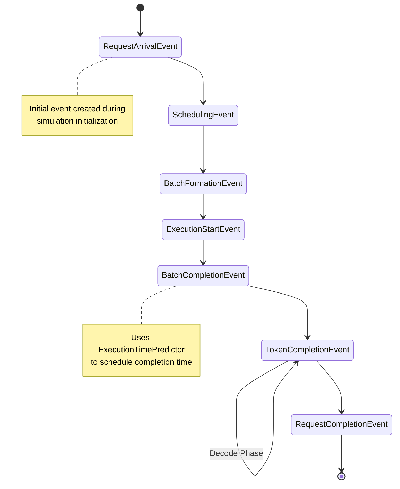
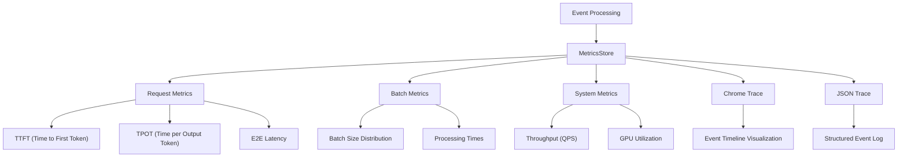

<!-- source: DeepWiki mcp.deepwiki.com · repo microsoft/vidur · page 3.2 Request Processing Pipeline · fetched 2026-10-26 -->

# Request Processing Pipeline

<details>
<summary>Relevant source files</summary>

The following files were used as context for generating this wiki page:

- [assets/batch_size.png](assets/batch_size.png)
- [assets/decode_time_execution_plus_preemption_normalized.png](assets/decode_time_execution_plus_preemption_normalized.png)
- [assets/prefill_e2e_time.png](assets/prefill_e2e_time.png)
- [assets/request_e2e_time.png](assets/request_e2e_time.png)
- [vidur/config/config.py](vidur/config/config.py)
- [vidur/request_generator/synthetic_request_generator.py](vidur/request_generator/synthetic_request_generator.py)
- [vidur/simulator.py](vidur/simulator.py)

</details>


## Purpose and Scope

This document describes how requests flow through the Vidur simulation system from initial arrival to completion. It covers the event-driven processing pipeline, scheduling decisions, and metrics collection that occur during request execution. For information about request generation methods, see [Request Generation](#5). For details about scheduling algorithms and resource management, see [Scheduling and Resource Management](#6). For performance modeling specifics, see [Performance Modeling](#7).

## Request Flow Overview

The request processing pipeline in Vidur follows an event-driven architecture orchestrated by the `Simulator` class. Requests progress through several distinct phases, each handled by specialized components working together to provide accurate LLM inference simulation.



**Request Processing Flow Overview**

Sources: [vidur/simulator.py:1-129](), [vidur/config/config.py:1-678]()

## Event-Driven Architecture

The core of request processing is built around a priority queue-based event system where all operations are scheduled and executed as discrete events in chronological order.

### Simulator Event Loop

The `Simulator` class manages the main event processing loop:



**Event Loop Processing Architecture**

The event loop continues until either the event queue is empty or the configured time limit is reached. Each event's `handle_event()` method can return new events that get added back to the queue.

Sources: [vidur/simulator.py:59-81](), [vidur/simulator.py:96-108]()

## Request Lifecycle Events

### Request Arrival

Requests enter the system through `RequestArrivalEvent` objects created during initialization:



**Request Object Structure**

Sources: [vidur/simulator.py:104-107](), [vidur/request_generator/synthetic_request_generator.py:46-50]()

### Scheduling and Assignment

When a `RequestArrivalEvent` is processed, it triggers the global scheduling system:



**Global Scheduling Decision Flow**

The global scheduler is responsible for selecting which replica should handle each incoming request based on the configured strategy.

Sources: [vidur/config/config.py:472-491](), [vidur/simulator.py:42-46]()

## Replica-Level Processing

### Batch Formation

Once assigned to a replica, requests undergo batching based on the replica's scheduler configuration:



**Replica Scheduling and Batching**

Each replica scheduler implements different batching strategies optimized for specific serving patterns.

Sources: [vidur/config/config.py:276-328]()

### Execution Time Prediction

The system predicts execution times using machine learning models trained on profiling data:



**Execution Time Prediction Pipeline**

Sources: [vidur/config/config.py:564-607](), [vidur/config/config.py:494-563]()

## Event Types and Transitions

The system uses several event types to model different phases of request processing:



**Request Processing State Machine**

Each event type represents a specific phase in request processing and can generate subsequent events to continue the pipeline.

Sources: [vidur/simulator.py:67-68]()

## Metrics Collection Integration

Throughout the request processing pipeline, comprehensive metrics are collected:



**Metrics Collection Architecture**

The metrics system captures performance data at multiple granularities for comprehensive analysis.

Sources: [vidur/simulator.py:70-76](), [vidur/config/config.py:332-425]()

## Configuration Integration

The request processing pipeline is highly configurable through the hierarchical configuration system:

| Configuration Category | Key Classes | Purpose |
|----------------------|-------------|---------|
| Request Generation | `BaseRequestGeneratorConfig` | Controls request arrival patterns |
| Global Scheduling | `BaseGlobalSchedulerConfig` | Defines replica selection strategy |
| Replica Scheduling | `BaseReplicaSchedulerConfig` | Configures batching behavior |
| Execution Prediction | `BaseExecutionTimePredictorConfig` | Sets performance modeling parameters |
| Hardware Modeling | `ReplicaConfig` | Specifies device and parallelism settings |
| Metrics Collection | `MetricsConfig` | Controls data collection and output |

**Configuration Components Affecting Request Processing**

Sources: [vidur/config/config.py:193-253](), [vidur/config/config.py:428-465](), [vidur/config/config.py:610-624]()

## Processing Pipeline Optimizations

The pipeline includes several optimizations for simulation efficiency:

### Event Prioritization

Events are processed using a priority queue where earlier events (lower timestamps) are handled first:

```python
heapq.heappush(self._event_queue, (event._priority_number, event))
```

### Lazy Event Generation

Events are generated only when needed, avoiding unnecessary computation for events that may not occur due to simulation termination.

### Configurable Tracing

Both Chrome tracing and JSON event logging can be enabled/disabled based on analysis needs to reduce overhead.

Sources: [vidur/simulator.py:96-97](), [vidur/simulator.py:70-76]()

The request processing pipeline forms the core execution engine of Vidur, providing accurate simulation of LLM inference workloads through its event-driven architecture and comprehensive modeling of scheduling, batching, and execution phases.

---

