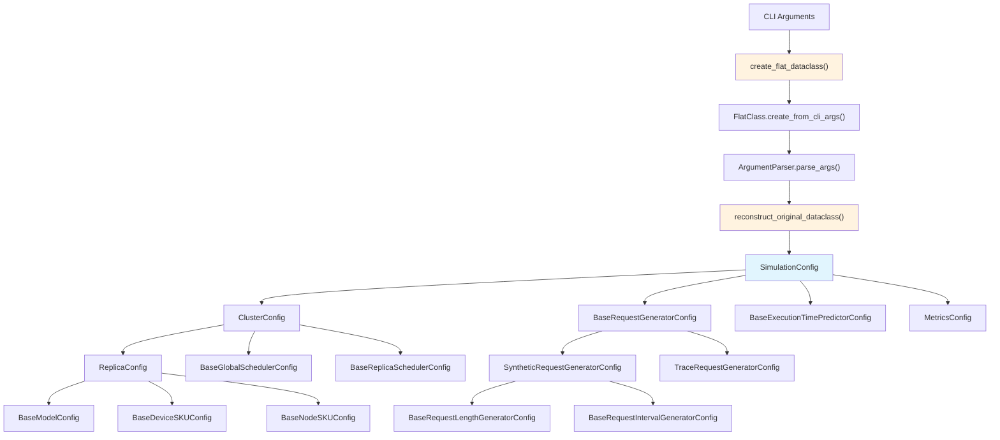
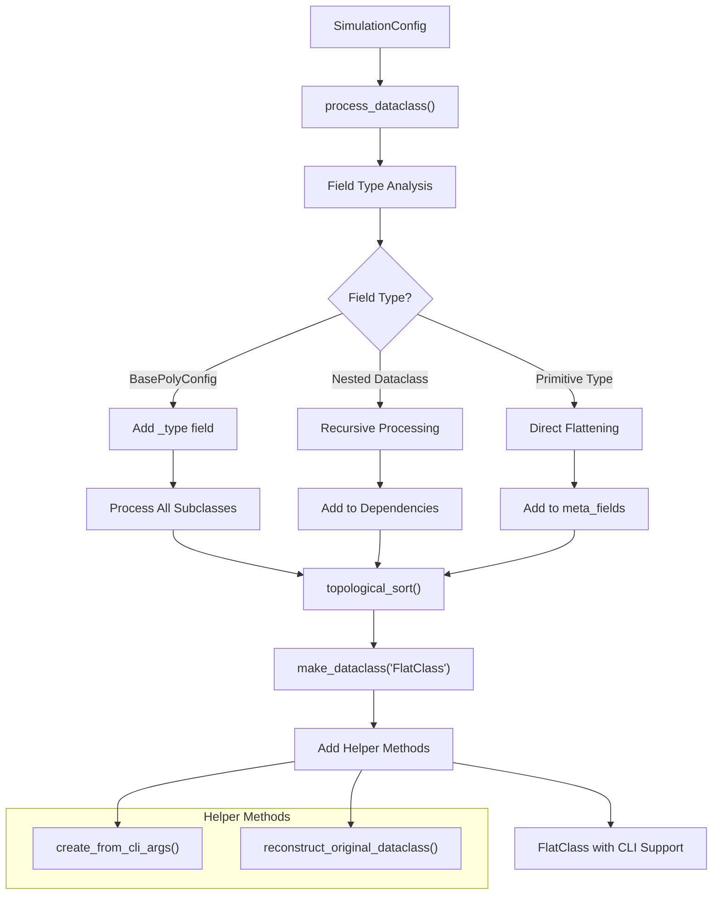
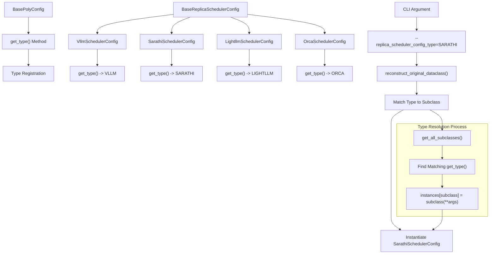

<!-- source: DeepWiki mcp.deepwiki.com · repo microsoft/vidur · page 4 Configuration System · fetched 2026-10-26 -->

# Configuration System

<details>
<summary>Relevant source files</summary>

The following files were used as context for generating this wiki page:

- [vidur/config/config.py](vidur/config/config.py)
- [vidur/config/flat_dataclass.py](vidur/config/flat_dataclass.py)
- [vidur/request_generator/synthetic_request_generator.py](vidur/request_generator/synthetic_request_generator.py)
- [vidur/simulator.py](vidur/simulator.py)

</details>


The Configuration System is responsible for managing all simulation parameters in Vidur through a sophisticated hierarchical dataclass architecture that automatically generates command-line interface (CLI) arguments from nested configuration objects. This system enables users to configure complex simulation scenarios while maintaining type safety and supporting polymorphic configuration selection at runtime.

For information about running simulations with these configurations, see [Running Simulations](#9). For details on extending the configuration system with new components, see [Extending Vidur](#11).

## Overview

The configuration system solves the challenge of exposing deeply nested configuration hierarchies as flat CLI arguments while preserving the original nested structure for internal use. It consists of three main components:

- **Flat Dataclass System**: Automatically flattens nested dataclass configurations into CLI-parseable arguments
- **Polymorphic Configuration**: Enables runtime selection of different implementations through `BasePolyConfig`
- **Configuration Hierarchy**: Organizes all simulation parameters into logical groupings

## Configuration Flow Architecture

The following diagram illustrates how configurations flow from CLI arguments to the core simulation components:



**Configuration Flow from CLI to Nested Objects**

Sources: [vidur/config/flat_dataclass.py:139-231](), [vidur/config/config.py:660-665](), [vidur/simulator.py:18-46]()

## Flat Dataclass System

The core innovation of Vidur's configuration system is the automatic flattening of nested dataclass hierarchies into CLI arguments. The `create_flat_dataclass()` function performs this transformation through recursive traversal and topological sorting.



**Flat Dataclass Creation Process**

The flattening process handles three types of fields:

| Field Type | Processing Strategy | Example |
|------------|-------------------|---------|
| Primitive Types | Direct flattening with prefixes | `cluster_config.num_replicas` → `--cluster_config_num_replicas` |
| Nested Dataclasses | Recursive processing with dependencies | `ReplicaConfig` → Process all its fields |
| Polymorphic Configs | Add `_type` field + process all subclasses | `BaseReplicaSchedulerConfig` → `--replica_scheduler_config_type` |

Sources: [vidur/config/flat_dataclass.py:139-231](), [vidur/config/flat_dataclass.py:26-45](), [vidur/config/flat_dataclass.py:151-216]()

## Configuration Hierarchy

The configuration system is organized into a well-defined hierarchy rooted at `SimulationConfig`. Each level manages specific aspects of the simulation:

```mermaid
graph TD
    A["SimulationConfig"] --> B["ClusterConfig"]
    A --> C["BaseRequestGeneratorConfig"]
    A --> D["BaseExecutionTimePredictorConfig"]
    A --> E["MetricsConfig"]
    
    B --> F["ReplicaConfig"]
    B --> G["BaseGlobalSchedulerConfig"]
    B --> H["BaseReplicaSchedulerConfig"]
    
    F --> I["BaseModelConfig"]
    F --> J["BaseDeviceSKUConfig"] 
    F --> K["BaseNodeSKUConfig"]
    
    C --> L["SyntheticRequestGeneratorConfig"]
    C --> M["TraceRequestGeneratorConfig"]
    
    L --> N["BaseRequestLengthGeneratorConfig"]
    L --> O["BaseRequestIntervalGeneratorConfig"]
    
    N --> P["FixedRequestLengthGeneratorConfig"]
    N --> Q["ZipfRequestLengthGeneratorConfig"]
    N --> R["UniformRequestLengthGeneratorConfig"]
    N --> S["TraceRequestLengthGeneratorConfig"]
    
    O --> T["PoissonRequestIntervalGeneratorConfig"]
    O --> U["GammaRequestIntervalGeneratorConfig"]
    O --> V["StaticRequestIntervalGeneratorConfig"]
    O --> W["TraceRequestIntervalGeneratorConfig"]
    
    G --> X["RandomGlobalSchedulerConfig"]
    G --> Y["RoundRobinGlobalSchedulerConfig"]
    G --> Z["LORGlobalSchedulerConfig"]
    
    H --> AA["VllmSchedulerConfig"]
    H --> BB["SarathiSchedulerConfig"]
    H --> CC["LightllmSchedulerConfig"]
    H --> DD["OrcaSchedulerConfig"]
    H --> EE["FasterTransformerSchedulerConfig"]
    
    D --> FF["LinearRegressionExecutionTimePredictorConfig"]
    D --> GG["RandomForrestExecutionTimePredictorConfig"]
```



**Complete Configuration Hierarchy**

### Core Configuration Classes

| Configuration Class | Purpose | Key Fields |
|-------------------|---------|------------|
| `SimulationConfig` | Root configuration object | `seed`, `log_level`, `time_limit` |
| `ClusterConfig` | Cluster-wide settings | `num_replicas`, scheduler configs |
| `ReplicaConfig` | Individual replica settings | `model_name`, `tensor_parallel_size`, `num_pipeline_stages` |
| `MetricsConfig` | Output and monitoring settings | `output_dir`, `wandb_project`, trace flags |

Sources: [vidur/config/config.py:627-656](), [vidur/config/config.py:610-624](), [vidur/config/config.py:428-465](), [vidur/config/config.py:332-425]()

## Polymorphic Configuration System

The `BasePolyConfig` system enables runtime selection of different implementations through a type-safe mechanism. Each polymorphic configuration automatically injects a `_type` field during flattening.



**Polymorphic Configuration Resolution Process**

### Polymorphic Configuration Examples

The system supports multiple polymorphic configuration types:

| Base Class | Subclasses | Selection Method |
|-----------|-----------|-----------------|
| `BaseRequestGeneratorConfig` | `SyntheticRequestGeneratorConfig`, `TraceRequestGeneratorConfig` | `--request_generator_config_type` |
| `BaseReplicaSchedulerConfig` | `VllmSchedulerConfig`, `SarathiSchedulerConfig`, `LightllmSchedulerConfig` | `--replica_scheduler_config_type` |
| `BaseGlobalSchedulerConfig` | `RandomGlobalSchedulerConfig`, `RoundRobinGlobalSchedulerConfig`, `LORGlobalSchedulerConfig` | `--global_scheduler_config_type` |
| `BaseExecutionTimePredictorConfig` | `LinearRegressionExecutionTimePredictorConfig`, `RandomForrestExecutionTimePredictorConfig` | `--execution_time_predictor_config_type` |

Sources: [vidur/config/base_poly_config.py](), [vidur/config/flat_dataclass.py:61-83](), [vidur/config/flat_dataclass.py:166-182]()

## CLI Integration

The configuration system provides seamless CLI integration through automatically generated argument parsers. The `create_from_cli_args()` method handles complex argument types and validation.

### Argument Type Mapping

| Configuration Type | CLI Argument Type | Special Handling |
|------------------|------------------|------------------|
| `bool` | `BooleanOptionalAction` | `--flag` / `--no-flag` syntax |
| `List[primitive]` | `nargs="+"` | Multiple values accepted |
| `Dict` | `json.loads` | JSON string parsing |
| Polymorphic configs | String + validation | Type validation against subclasses |

### CLI Example

```bash
python -m vidur.main \
    --cluster_config_num_replicas 2 \
    --replica_scheduler_config_type SARATHI \
    --sarathi_scheduler_config_chunk_size 512 \
    --request_generator_config_type SYNTHETIC \
    --synthetic_request_generator_config_num_requests 1000 \
    --fixed_request_length_generator_config_prefill_tokens 2048 \
    --poisson_request_interval_generator_config_qps 2.0
```

### Configuration Reconstruction

The `reconstruct_original_dataclass()` function rebuilds the nested configuration structure through topological sorting of dependencies:

1. **Dependency Resolution**: Sort configuration classes based on their dependencies
2. **Instance Creation**: Create instances in reverse topological order
3. **Type Matching**: Match polymorphic `_type` fields to concrete subclasses
4. **Nested Assembly**: Build nested structure from flat arguments

Sources: [vidur/config/flat_dataclass.py:87-137](), [vidur/config/flat_dataclass.py:48-84](), [vidur/config/config.py:660-665]()

---

