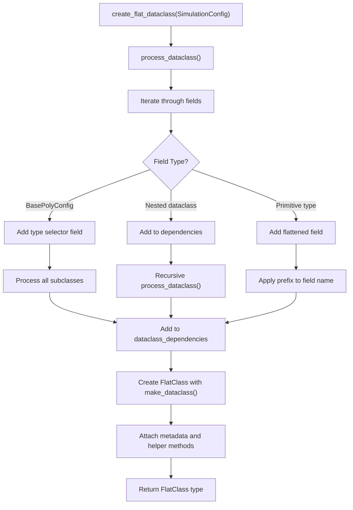
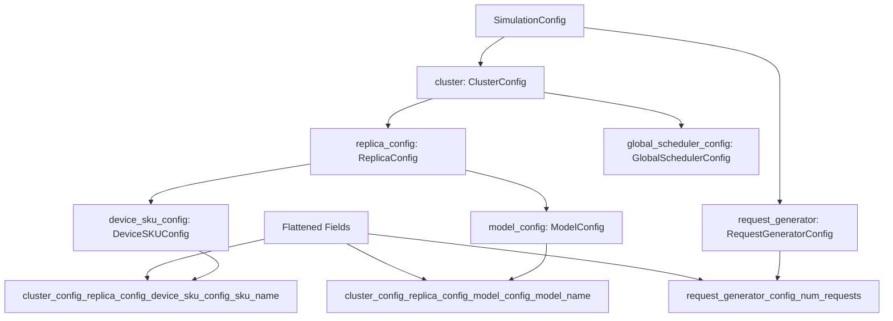
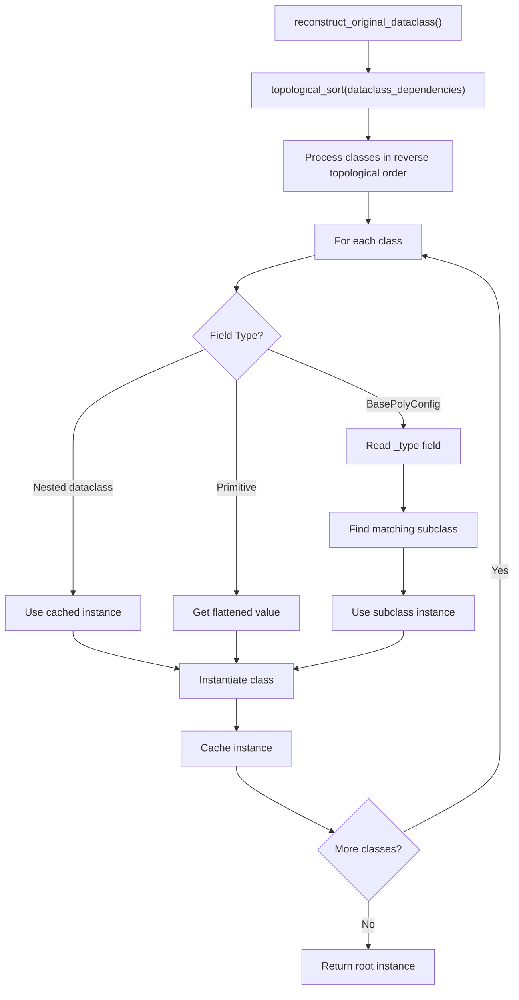
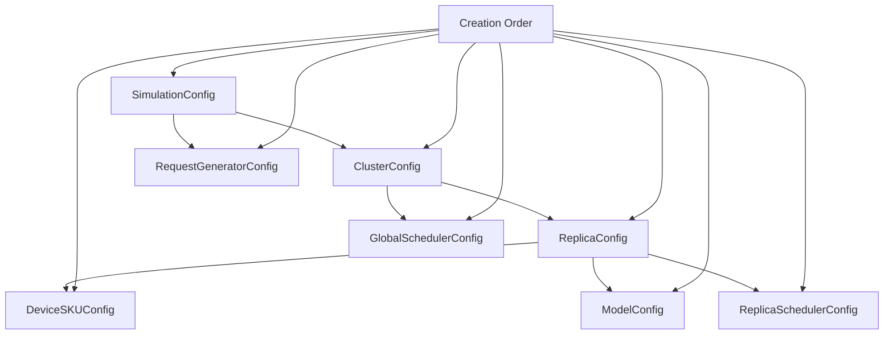
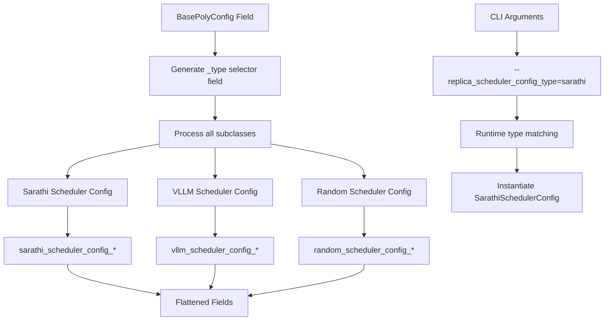
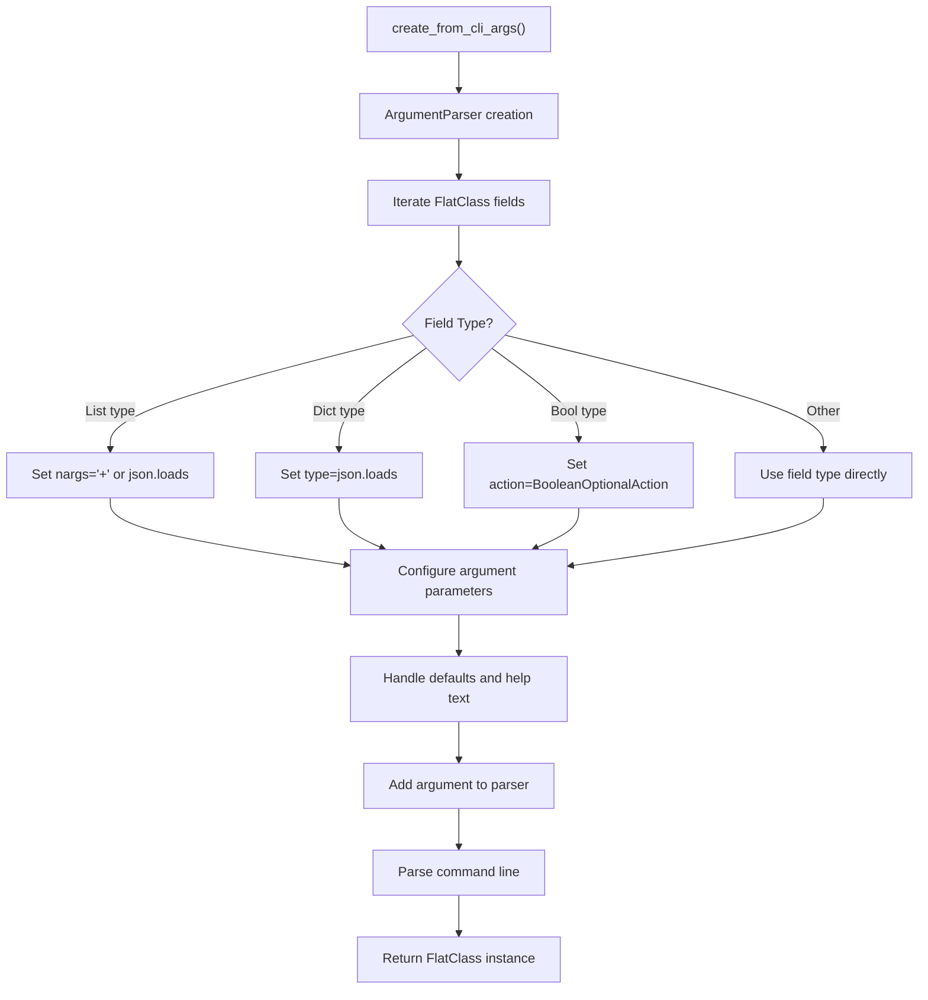
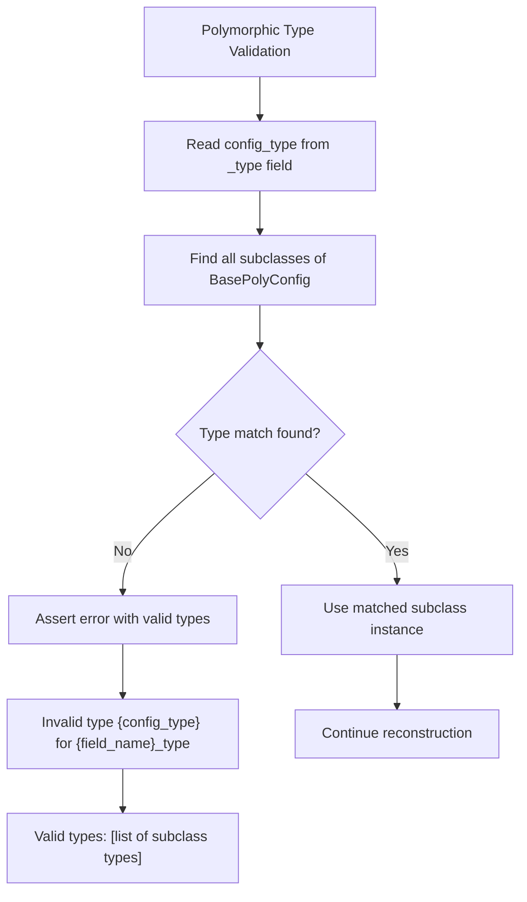

<!-- source: DeepWiki mcp.deepwiki.com · repo microsoft/vidur · page 4.1 Configuration Architecture · fetched 2026-10-26 -->

# Configuration Architecture

Relevant source files

The following files were used as context for generating this wiki page:

- [vidur/config/flat_dataclass.py](vidur/config/flat_dataclass.py)

This document covers Vidur's sophisticated configuration system that enables complex nested dataclass configurations to be automatically flattened into command-line arguments while maintaining type safety and supporting polymorphic component selection. 

The flat dataclass system serves as the foundation for Vidur's CLI interface, automatically generating argument parsers from nested configuration hierarchies and providing seamless reconstruction of the original configuration objects. For specific hardware and model configuration details, see [Hardware and Model Configurations](#4.2).

## Core Design Principles

Vidur's configuration architecture is built around three key principles:

1. **Automatic CLI Generation**: Complex nested configurations are automatically flattened into command-line arguments with proper type handling and help text
2. **Type Safety**: Full preservation of dataclass field types, defaults, and validation during the flatten-reconstruct cycle  
3. **Polymorphic Support**: Runtime selection of different implementation classes through type-based configuration fields

The system transforms deeply nested configuration objects like `SimulationConfig` containing `ClusterConfig`, `ModelConfig`, and other sub-configurations into a single flat dataclass that can be easily parsed from command-line arguments.

Sources: [vidur/config/flat_dataclass.py:139-231]()

## Flattening Process Architecture

The flattening process recursively traverses nested dataclass structures and creates a single flat representation suitable for CLI argument parsing.

### Flattening Flow Diagram

The flattening process handles three distinct field types:

**Primitive Fields**: Basic types (int, str, bool, list, dict) are prefixed with their parent class name and added directly to the flat structure.

**Nested Dataclass Fields**: Complex nested configurations trigger recursive processing, with field names prefixed by the parent class name converted to snake_case.

**Polymorphic Fields** (`BasePolyConfig` subclasses): Special handling creates a `_type` field for runtime class selection and processes all possible subclass configurations.

Sources: [vidur/config/flat_dataclass.py:139-216]()

### Field Naming and Prefixing

Field names are systematically prefixed using snake_case conversion of parent class names, creating unambiguous flat field names that preserve the original hierarchical structure.

Sources: [vidur/config/flat_dataclass.py:151-215]()

## Reconstruction Process

The reconstruction process reverses the flattening by rebuilding the original nested dataclass hierarchy through topological sorting of dependencies.

### Reconstruction Flow Diagram  

### Dependency Resolution

The system uses topological sorting to ensure dataclass instances are created in the correct order, with dependencies created before their dependents.

The topological sort ensures leaf configurations are instantiated first, followed by their parents, until the root `SimulationConfig` is created.

Sources: [vidur/config/flat_dataclass.py:26-45](), [vidur/config/flat_dataclass.py:48-84]()

## Polymorphic Configuration Support

The system provides sophisticated support for polymorphic configurations through the `BasePolyConfig` mechanism, allowing runtime selection of different implementation classes.

### Polymorphic Type Selection

Each `BasePolyConfig` field generates:
- A `_type` selector field for specifying the implementation class
- Flattened configurations for all possible subclass implementations
- Runtime validation ensuring the selected type matches available implementations

The polymorphic system supports scheduler selection, request generator types, device configurations, and other pluggable components.

Sources: [vidur/config/flat_dataclass.py:166-182](), [vidur/config/flat_dataclass.py:61-72]()

## CLI Integration Architecture

The flat dataclass system seamlessly integrates with Python's `argparse` to provide comprehensive command-line interfaces.

### Argument Parser Generation

### Argument Parameter Handling

The system provides sophisticated parameter handling:

| Field Type | Argument Configuration | Example |
|------------|----------------------|---------|
| `bool` | `BooleanOptionalAction` | `--enable_feature / --no-enable_feature` |
| `List[int]` | `nargs="+"`, `type=int` | `--batch_sizes 32 64 128` |
| `Dict[str, Any]` | `type=json.loads` | `--config_overrides '{"key": "value"}'` |
| `Optional[str]` | Standard with default | `--optional_field default_value` |

Default values and help text are preserved from the original dataclass field metadata, ensuring comprehensive CLI documentation.

Sources: [vidur/config/flat_dataclass.py:87-137]()

## Error Handling and Validation

The configuration system includes robust error handling for type validation and configuration consistency.

### Type Validation Process

The system validates that:
- Polymorphic type selectors match available subclass implementations
- All required fields have values or appropriate defaults
- Complex types (lists, dicts) are properly formatted
- Dataclass dependencies can be resolved through topological sorting

Sources: [vidur/config/flat_dataclass.py:61-72]()

## Integration with Core Systems

The configuration architecture serves as the foundation for Vidur's other systems:

- **Simulation Engine**: Receives fully-constructed configuration objects
- **Request Generation**: Uses generator-specific configurations selected via polymorphic fields  
- **Hardware Modeling**: Leverages device and model configurations with type-safe parameter validation
- **Metrics Collection**: Integrates with metrics configuration for output formatting and destinations

The flat dataclass system ensures that complex nested configurations remain manageable through the command-line interface while preserving all the benefits of structured, type-safe configuration objects.

Sources: [vidur/config/flat_dataclass.py:1-231]()

---

