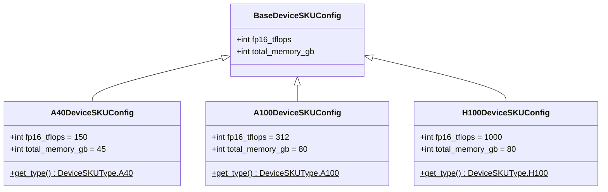
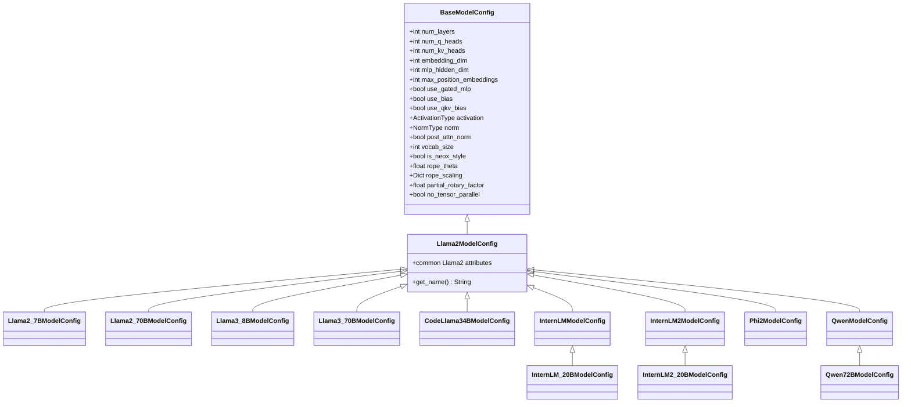
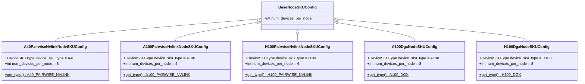
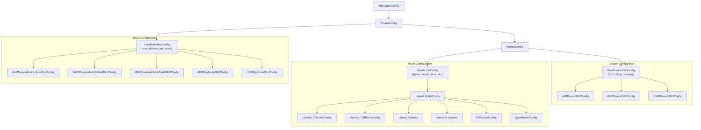

<!-- source: DeepWiki mcp.deepwiki.com · repo microsoft/vidur · page 4.2 Hardware and Model Configurations · fetched 2026-10-26 -->

# Hardware and Model Configurations

Relevant source files

The following files were used as context for generating this wiki page:

- [vidur/config/device_sku_config.py](vidur/config/device_sku_config.py)
- [vidur/config/model_config.py](vidur/config/model_config.py)
- [vidur/config/node_sku_config.py](vidur/config/node_sku_config.py)

This page documents the device SKUs, node configurations, and model definitions supported by Vidur. These configurations provide the foundation for realistic simulation by accurately representing hardware characteristics and model architectures without requiring access to actual GPU hardware. For information on the broader configuration system, see [Configuration System](#4).

## Device SKU Configurations

The Device SKU (Stock Keeping Unit) configuration system defines the hardware characteristics of specific GPU models supported by the simulator. Each device type has specific performance and memory attributes that impact simulation results.

**Device SKU Class Hierarchy**

The `BaseDeviceSKUConfig` class defines the common properties for all device SKUs:
- `fp16_tflops`: Integer representing the device's FP16 computational capacity in teraFLOPS
- `total_memory_gb`: Integer representing the device's total memory in gigabytes

Currently, the system supports three device types:

| Device SKU | FP16 TFLOPS | Memory (GB) | Type Enum |
|------------|-------------|-------------|-----------|
| A40        | 150         | 45          | DeviceSKUType.A40 |
| A100       | 312         | 80          | DeviceSKUType.A100 |
| H100       | 1000        | 80          | DeviceSKUType.H100 |

Sources: [vidur/config/device_sku_config.py:10-43]()

## Model Configurations

The Model Configuration system defines the architectural characteristics of various LLM models. These configurations capture the essential parameters needed to accurately simulate model execution.

The `BaseModelConfig` class defines the common attributes for all model configurations, including:

- Architecture parameters:
  - `num_layers`: Number of transformer layers
  - `num_q_heads`: Number of query attention heads
  - `num_kv_heads`: Number of key-value attention heads
  - `embedding_dim`: Dimension of embeddings
  - `mlp_hidden_dim`: Dimension of MLP hidden layers
  - `max_position_embeddings`: Maximum sequence length
- Implementation details:
  - `use_gated_mlp`: Whether to use gated MLP
  - `use_bias`: Whether to use bias terms in general
  - `use_qkv_bias`: Whether to use bias in QKV projections
  - `activation`: Activation function type (SILU, GELU, etc.)
  - `norm`: Normalization type (RMS_NORM, LAYER_NORM, etc.)
  - `post_attn_norm`: Whether to use post-attention normalization
- Other settings:
  - `vocab_size`: Size of vocabulary
  - `is_neox_style`: Whether using NeoX style architecture
  - `rope_theta`: RoPE theta parameter
  - `rope_scaling`: RoPE scaling configuration
  - `partial_rotary_factor`: Partial rotary factor
  - `no_tensor_parallel`: Whether tensor parallelism is disabled

The system implements model configurations for several model families:

| Model Family | Variants | Key Characteristics |
|--------------|----------|---------------------|
| Llama 2      | 7B, 70B  | RMS normalization, SiLU activation, gated MLP |
| Llama 3      | 8B, 70B  | Similar to Llama 2 with larger vocab size (128K) |
| CodeLlama    | 34B      | Specialized Llama 2 variant for code generation |
| InternLM     | 20B      | Large vocab size (103K) |
| InternLM2    | 20B      | Larger context window (32K), vocab size 92K |
| Phi2         | 2.7B     | Layer normalization, GELU activation, non-gated MLP |
| Qwen         | 72B      | Large vocab size (152K), QKV bias |

Each model configuration provides a `get_name()` method that returns a string identifier corresponding to the model's HuggingFace path or similar identifier.

Sources: [vidur/config/model_config.py:11-214]()

## Node SKU Configurations

The Node SKU configuration system defines clusters of devices with specific interconnect characteristics. Each node represents a server containing multiple GPU devices of a specific type.

**Node SKU Class Hierarchy**

The `BaseNodeSKUConfig` class defines common properties for all node SKUs, primarily:
- `num_devices_per_node`: The number of devices (GPUs) in each node

Currently supported node configurations include:

| Node SKU Type | Device Type | Devices Per Node | Node Type Enum |
|---------------|-------------|-----------------|----------------|
| A40 Pairwise NVLink | A40 | 8 | NodeSKUType.A40_PAIRWISE_NVLINK |
| A100 Pairwise NVLink | A100 | 4 | NodeSKUType.A100_PAIRWISE_NVLINK |
| H100 Pairwise NVLink | H100 | 4 | NodeSKUType.H100_PAIRWISE_NVLINK |
| A100 DGX | A100 | 8 | NodeSKUType.A100_DGX |
| H100 DGX | H100 | 8 | NodeSKUType.H100_DGX |

Each configuration specifies the device type and number of devices, as well as providing a `get_type()` method that returns the corresponding `NodeSKUType` enum value.

Sources: [vidur/config/node_sku_config.py:10-62]()

## Configuration Relationships

The Device, Model, and Node configurations work together within the Vidur simulation system to create a realistic inference environment. The following diagram illustrates their relationships and how they integrate into the simulation:

In the Vidur simulation system:

1. **Device SKU Configurations** define individual GPU device characteristics
2. **Model Configurations** define LLM architecture parameters
3. **Node SKU Configurations** define servers containing multiple devices

These configurations are combined in a simulation setup:
- A `ReplicaConfig` combines a model configuration with a device SKU to represent a model deployed on a specific hardware
- A `ClusterConfig` combines node SKU configurations with replica configurations to create a complete simulation environment
- The `SimulationConfig` incorporates the cluster configuration along with other simulation parameters

This hierarchy enables detailed and realistic simulation of LLM inference systems by accurately representing both hardware capabilities and model characteristics.

Sources: [vidur/config/device_sku_config.py](), [vidur/config/model_config.py](), [vidur/config/node_sku_config.py]()

## Extending the Configuration System

To add support for new device types or model architectures, you can extend the appropriate base configuration classes:

1. For new device SKUs:
   - Extend `BaseDeviceSKUConfig` with appropriate TFLOPS and memory values
   - Implement a `get_type()` method returning a unique `DeviceSKUType` enum value

2. For new model configurations:
   - Usually extend `Llama2ModelConfig` or `BaseModelConfig` directly
   - Set appropriate architecture parameters (layers, dimensions, etc.)
   - Implement a `get_name()` method returning a model identifier

3. For new node SKUs:
   - Extend `BaseNodeSKUConfig` with appropriate device type and quantity
   - Implement a `get_type()` method returning a unique `NodeSKUType` enum value

This extensible design enables Vidur to support a wide range of hardware and model configurations with minimal code changes.

Sources: [vidur/config/device_sku_config.py](), [vidur/config/model_config.py](), [vidur/config/node_sku_config.py]()

---

