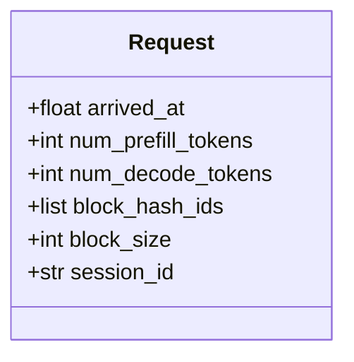
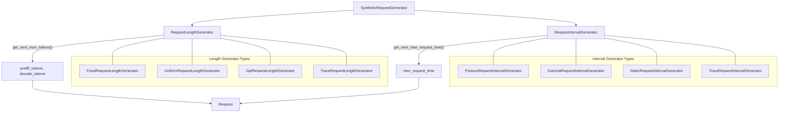
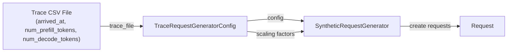
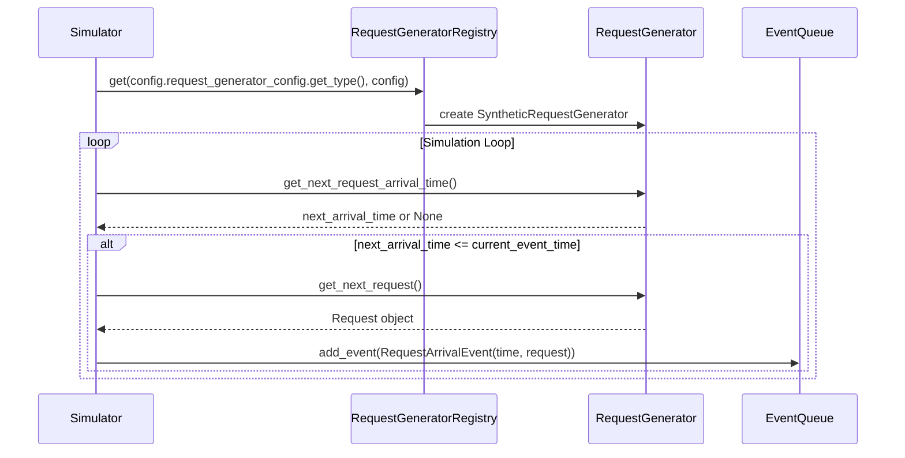
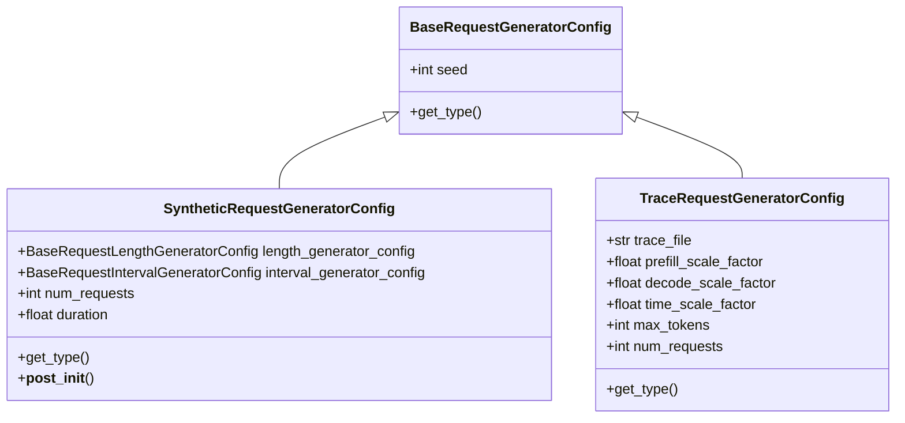
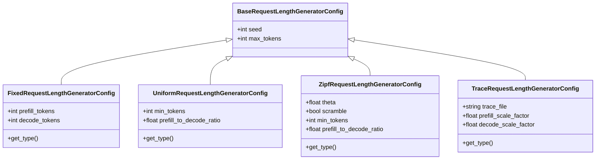

<!-- source: DeepWiki mcp.deepwiki.com · repo microsoft/vidur · page 5 Request Generation · fetched 2026-10-26 -->

# Request Generation

<details>
<summary>Relevant source files</summary>

The following files were used as context for generating this wiki page:

- [data/processed_traces/splitwise_code.csv](data/processed_traces/splitwise_code.csv)
- [data/processed_traces/splitwise_conv.csv](data/processed_traces/splitwise_conv.csv)
- [vidur/config/config.py](vidur/config/config.py)
- [vidur/request_generator/synthetic_request_generator.py](vidur/request_generator/synthetic_request_generator.py)
- [vidur/request_generator/trace_replay_request_generator.py](vidur/request_generator/trace_replay_request_generator.py)
- [vidur/simulator.py](vidur/simulator.py)

</details>


The Request Generation system in Vidur is responsible for creating and managing simulated LLM requests that feed into the simulator. It provides mechanisms to generate requests with realistic patterns, either synthetically or by replaying traces from real-world data, allowing users to accurately test and evaluate LLM inference systems under various load conditions.

For information about how these requests are scheduled and processed once generated, see [Scheduling System](#5).

## Architecture Overview

The request generation system consists of two main generator types that work together to create requests with specific characteristics:

```mermaid
flowchart TD
    subgraph "Request Generation System"
        A["RequestGeneratorRegistry"] --> B["BaseRequestGenerator"]
        B --> C["SyntheticRequestGenerator"]
        B --> D["TraceReplayRequestGenerator"]
        
        C --> E["RequestLengthGeneratorRegistry"]
        C --> F["RequestIntervalGeneratorRegistry"]
        
        E --> G1["FixedRequestLengthGenerator"]
        E --> G2["UniformRequestLengthGenerator"] 
        E --> G3["ZipfRequestLengthGenerator"]
        E --> G4["TraceRequestLengthGenerator"]
        
        F --> H1["PoissonRequestIntervalGenerator"]
        F --> H2["GammaRequestIntervalGenerator"]
        F --> H3["StaticRequestIntervalGenerator"]
        F --> H4["TraceRequestIntervalGenerator"]
        
        D --> I["CSV Trace File"]
    end
    
    J["Simulator"] --"uses"--> A
    
    K["Request Entity"] <--"creates"-- C
    K <--"creates"-- D
```

Title: Request Generation System Architecture

Sources:
- [vidur/simulator.py:38-41]()
- [vidur/request_generator/synthetic_request_generator.py:16-28]()
- [vidur/request_generator/trace_replay_request_generator.py:13-23]()
- [vidur/config/config.py:193-252]()

The request generation architecture follows a registry pattern, allowing for multiple types of request generators that can be selected at runtime based on configuration. The `SyntheticRequestGenerator` uses configurable sub-generators for statistical request creation, while `TraceReplayRequestGenerator` reads requests directly from CSV trace files.

## Request Entity Model

At the core of the request generation system is the Request entity, which represents an LLM inference request:



Title: Request Entity Model

Sources:
- [vidur/request_generator/synthetic_request_generator.py:52-61]()

Each request contains:
- `arrived_at`: The simulation time when the request arrives
- `num_prefill_tokens`: Number of tokens in the prompt/context (prefill phase)
- `num_decode_tokens`: Number of tokens to generate as output (decode phase)
- `block_hash_ids`: Identifiers for cached content blocks (for prefix caching)
- `block_size`: Size of cache blocks 
- `session_id`: Identifier for grouping related requests

## Request Generator Types

Vidur uses a `SyntheticRequestGenerator` that supports both synthetic and trace-based request generation through configurable sub-generators:

### Synthetic Request Generator

The `SyntheticRequestGenerator` creates requests using configurable statistical properties and can incorporate trace data:



Title: Synthetic Request Generator Flow

Sources:
- [vidur/request_generator/synthetic_request_generator.py:16-73]()
- [vidur/config/config.py:233-256]()

The `SyntheticRequestGenerator` works by:
1. Creating a `RequestLengthGeneratorRegistry.get()` and `RequestIntervalGeneratorRegistry.get()` based on configuration
2. Using lazy generation during simulation via `get_next_request_arrival_time()` and `get_next_request()`
3. For each new request in `_generate_next_request()`:
   - Getting the next inter-request time from the interval generator
   - Getting the next token counts (prefill and decode) from the length generator  
   - Creating a Request object with the calculated arrival time and all required fields
4. Continuing until either:
   - The specified duration is reached (`config.duration`)
   - The specified number of requests is generated (`config.num_requests`)

#### Request Length Generation Strategies

Several strategies are available for determining request length:

- **Fixed**: Uses constant values for prefill and decode token counts
- **Uniform**: Selects token counts from a uniform distribution
- **Zipf**: Uses a Zipf distribution to model token counts (power law)
- **Trace**: Reads token counts from a trace file of real-world data

#### Request Interval Generation Strategies

Similarly, several strategies are available for determining the time between requests:

- **Poisson**: Models arrivals as a Poisson process (exponential inter-arrival times)
- **Gamma**: Uses a Gamma distribution for more flexible modeling of inter-arrival times
- **Static**: Uses a constant interval between requests
- **Trace**: Reads inter-arrival times from a trace file

### Trace-Based Request Generation

The `SyntheticRequestGenerator` supports trace-based generation through specialized sub-generators:



Title: Trace-Based Request Generation Flow

Sources:
- [vidur/config/config.py:260-288]()
- [data/processed_traces/splitwise_code.csv:1-10]()

Trace-based request generation works by:
1. Configuring `TraceRequestGeneratorConfig` with a trace file path
2. Applying scaling factors via `prefill_scale_factor`, `decode_scale_factor`, and `time_scale_factor`
3. Setting limits through `max_tokens` and `num_requests` parameters
4. The `SyntheticRequestGenerator` processes the trace data and creates Request objects
5. Ensuring all token counts are valid and within specified limits

## Integration with the Simulator

The request generation system integrates with the Simulator using on-demand generation:



Title: Request Generation Integration with Simulator

Sources:
- [vidur/simulator.py:45-48]()
- [vidur/simulator.py:61-78]()

During simulation execution:
1. The `RequestGeneratorRegistry.get()` creates the appropriate request generator during initialization
2. In the main simulation loop, the simulator checks `get_next_request_arrival_time()` to see if a new request should arrive
3. When a request should arrive, `get_next_request()` is called to generate the request on-demand
4. The request is immediately converted to a `RequestArrivalEvent` and added to the event queue
5. This lazy generation approach allows for efficient memory usage with large workloads

## Configuration

The request generation system is highly configurable through the following configuration classes:

### Base Request Generator Configuration

Request generator configurations inherit from `BaseRequestGeneratorConfig`:



Title: Request Generator Configuration Hierarchy

Sources:
- [vidur/config/config.py:220-288]()

### Length and Interval Generator Configurations

Each length and interval generator has its own configuration:



Title: Request Length Generator Configuration Hierarchy

Sources:
- [vidur/config/config.py:26-189](vidur/config/config.py:26-189)

Similarly, there are configurations for the interval generators (not shown for brevity).

## Example Configuration

Here's an example of configuring the request generation system:

| Configuration Option | Description | Example Value |
|----------------------|-------------|--------------|
| `request_generator_config.get_type()` | Type of request generator | `RequestGeneratorType.SYNTHETIC` |
| `length_generator_config.get_type()` | Type of length generator | `RequestLengthGeneratorType.ZIPF` |
| `length_generator_config.theta` | Parameter for Zipf distribution | `0.6` |
| `length_generator_config.min_tokens` | Minimum token count | `1024` |
| `interval_generator_config.get_type()` | Type of interval generator | `RequestIntervalGeneratorType.POISSON` |
| `interval_generator_config.qps` | Queries per second (Poisson rate) | `0.5` |
| `num_requests` | Number of requests to generate | `128` |

Sources:
- [vidur/config/config.py:233-256]()
- [vidur/config/config.py:83-92]()
- [vidur/config/config.py:162-183]()

## Trace File Format

For trace-based request generation, the trace file must be a CSV with the following columns:

| Column | Description |
|--------|-------------|
| `arrived_at` | Time (in seconds) when the request arrives |
| `num_prefill_tokens` | Number of tokens in the prompt/context |
| `num_decode_tokens` | Number of tokens to generate as output |

Example of a trace file entry:
```
arrived_at,num_prefill_tokens,num_decode_tokens
0.0,374,44
4.314579,396,109
4.541877,879,55
```

Sources:
- [data/processed_traces/splitwise_conv.csv:1-5](data/processed_traces/splitwise_conv.csv:1-5)
- [vidur/request_generator/trace_replay_request_generator.py:22-32](vidur/request_generator/trace_replay_request_generator.py:22-32)

## Usage in Simulation

In a typical simulation workflow:

1. The request generator is configured as part of the overall simulation configuration
2. When the simulator starts, it creates the appropriate request generator using the registry
3. The generator creates all requests at the beginning of the simulation
4. The requests are converted to events and added to the event queue
5. The simulator processes these events in order of arrival time, simulating the LLM inference system's behavior

This approach allows Vidur to simulate realistic workloads that closely match either statistical models or real-world trace data, enabling accurate performance assessment of LLM inference systems under various conditions.

Sources:
- [vidur/simulator.py:37-48](vidur/simulator.py:37-48)
- [vidur/simulator.py:59-80](vidur/simulator.py:59-80)
- [vidur/simulator.py:103-107](vidur/simulator.py:103-107)

---

