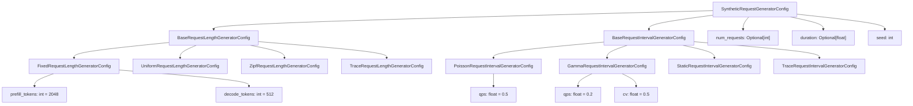
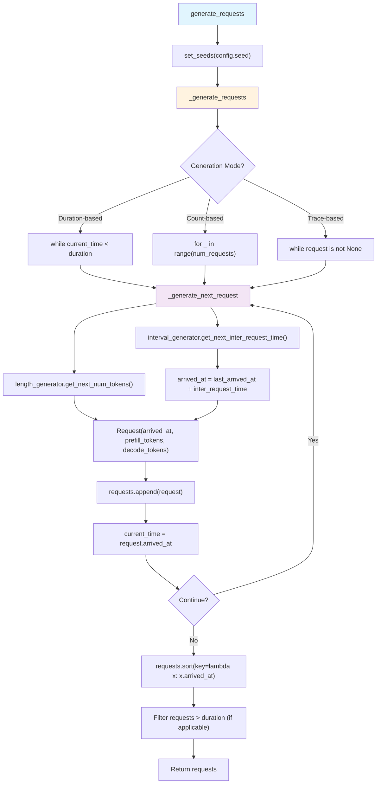
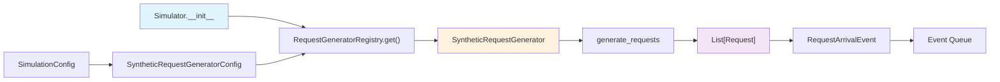

<!-- source: DeepWiki mcp.deepwiki.com · repo microsoft/vidur · page 5.1 Synthetic Request Generation · fetched 2026-10-26 -->

# Synthetic Request Generation

<details>
<summary>Relevant source files</summary>

The following files were used as context for generating this wiki page:

- [vidur/config/config.py](vidur/config/config.py)
- [vidur/request_generator/synthetic_request_generator.py](vidur/request_generator/synthetic_request_generator.py)
- [vidur/simulator.py](vidur/simulator.py)

</details>


This document covers the synthetic request generation system in Vidur, which creates artificial workloads using configurable statistical distributions. For trace-based request generation that replays real workload patterns, see [Trace-Based Request Generation](#5.2).

## Overview

The synthetic request generation system creates artificial LLM inference requests with configurable arrival patterns and request characteristics. This enables controlled experimentation with different workload profiles without requiring real trace data. The system supports multiple statistical distributions for both request timing and token length characteristics.

**Sources:** [vidur/request_generator/synthetic_request_generator.py:1-106](), [vidur/config/config.py:200-225]()

## Architecture Overview

The synthetic request generation system follows a modular architecture with separate components for timing and length generation:

**Synthetic Request Generation Architecture**

```mermaid
graph TD
    A[SyntheticRequestGenerator] --> B[RequestLengthGenerator]
    A --> C[RequestIntervalGenerator]
    
    B --> D[FixedRequestLengthGenerator]
    B --> E[UniformRequestLengthGenerator] 
    B --> F[ZipfRequestLengthGenerator]
    B --> G[TraceRequestLengthGenerator]
    
    C --> H[PoissonRequestIntervalGenerator]
    C --> I[GammaRequestIntervalGenerator]
    C --> J[StaticRequestIntervalGenerator]
    C --> K[TraceRequestIntervalGenerator]
    
    L[SyntheticRequestGeneratorConfig] --> M[BaseRequestLengthGeneratorConfig]
    L --> N[BaseRequestIntervalGeneratorConfig]
    
    M --> O["FixedRequestLengthGeneratorConfig"]
    M --> P["UniformRequestLengthGeneratorConfig"]
    M --> Q["ZipfRequestLengthGeneratorConfig"]
    M --> R["TraceRequestLengthGeneratorConfig"]
    
    N --> S["PoissonRequestIntervalGeneratorConfig"]
    N --> T["GammaRequestIntervalGeneratorConfig"]
    N --> U["StaticRequestIntervalGeneratorConfig"]
    N --> V["TraceRequestIntervalGeneratorConfig"]
    
    style A fill:#e1f5fe
    style L fill:#fff3e0
```


**Sources:** [vidur/request_generator/synthetic_request_generator.py:16-29](), [vidur/config/config.py:200-225]()

## Request Length Generation

Request length generators determine the number of prefill and decode tokens for each request. The system supports multiple distribution types:

| Generator Type | Description | Key Parameters |
|---|---|---|
| `FixedRequestLengthGenerator` | Fixed token counts | `prefill_tokens`, `decode_tokens` |
| `UniformRequestLengthGenerator` | Uniform distribution | `min_tokens`, `max_tokens`, `prefill_to_decode_ratio` |
| `ZipfRequestLengthGenerator` | Zipf distribution | `theta`, `min_tokens`, `max_tokens`, `scramble` |
| `TraceRequestLengthGenerator` | Sample from trace data | `trace_file`, `prefill_scale_factor`, `decode_scale_factor` |

The length generator is accessed through the registry pattern and instantiated based on the configuration type:

```python
self.request_length_generator = RequestLengthGeneratorRegistry.get(
    self.config.length_generator_config.get_type(),
    self.config.length_generator_config,
)
```

**Sources:** [vidur/request_generator/synthetic_request_generator.py:21-24](), [vidur/config/config.py:134-190]()

## Request Interval Generation

Request interval generators control the timing between request arrivals. The system provides several arrival process models:

| Generator Type | Description | Key Parameters |
|---|---|---|
| `PoissonRequestIntervalGenerator` | Poisson arrival process | `qps` (queries per second) |
| `GammaRequestIntervalGenerator` | Gamma distribution arrivals | `qps`, `cv` (coefficient of variation) |
| `StaticRequestIntervalGenerator` | No inter-arrival time variation | None |
| `TraceRequestIntervalGenerator` | Replay timing from traces | `trace_file`, `start_time`, `end_time`, `time_scale_factor` |

The interval generator is similarly accessed through the registry:

```python
self.request_interval_generator = RequestIntervalGeneratorRegistry.get(
    self.config.interval_generator_config.get_type(),
    self.config.interval_generator_config,
)
```

**Sources:** [vidur/request_generator/synthetic_request_generator.py:25-28](), [vidur/config/config.py:48-108]()

## Configuration System

The synthetic request generator uses a hierarchical configuration system with polymorphic type selection:

**Configuration Hierarchy**


The configuration supports three generation modes:
- **Duration-based**: Generate requests for a specified time period
- **Count-based**: Generate a fixed number of requests
- **Trace-based**: Generate requests based on trace data exhaustion

**Sources:** [vidur/config/config.py:200-225](), [vidur/config/config.py:177-189](), [vidur/config/config.py:74-82]()

## Generation Process

The request generation process follows a structured workflow:

**Request Generation Process Flow**


The core generation loop in `_generate_next_request` creates individual requests by:
1. Getting the next inter-request time from the interval generator
2. Getting prefill and decode token counts from the length generator  
3. Creating a `Request` object with the calculated arrival time and token counts

**Sources:** [vidur/request_generator/synthetic_request_generator.py:30-51](), [vidur/request_generator/synthetic_request_generator.py:52-106]()

## Integration with Simulation Engine

The synthetic request generator integrates with the main simulation engine through the request generator registry system:

**Simulation Integration**


The simulator initializes the request generator during startup and calls `generate_requests()` to populate the initial event queue with `RequestArrivalEvent` objects:

```python
self._request_generator = RequestGeneratorRegistry.get(
    self._config.request_generator_config.get_type(),
    self._config.request_generator_config,
)

# Later in _init_event_queue()
requests = self._request_generator.generate()
for request in requests:
    self._add_event(RequestArrivalEvent(request.arrived_at, request))
```

**Sources:** [vidur/simulator.py:38-41](), [vidur/simulator.py:103-107](), [vidur/request_generator/synthetic_request_generator.py:83-105]()

## Usage Examples

### Basic Poisson Workload
Generate 1000 requests with Poisson arrivals at 2 QPS and fixed request sizes:
```bash
--request_generator_config.interval_generator_config._type poisson \
--request_generator_config.interval_generator_config.qps 2.0 \
--request_generator_config.length_generator_config._type fixed \
--request_generator_config.length_generator_config.prefill_tokens 1024 \
--request_generator_config.length_generator_config.decode_tokens 512 \
--request_generator_config.num_requests 1000
```

### Variable Request Sizes with Zipf Distribution  
Generate requests for 300 seconds with Zipf-distributed token lengths:
```bash
--request_generator_config.duration 300 \
--request_generator_config.length_generator_config._type zipf \
--request_generator_config.length_generator_config.theta 0.8 \
--request_generator_config.length_generator_config.min_tokens 512 \
--request_generator_config.length_generator_config.max_tokens 4096
```

**Sources:** [vidur/config/config.py:200-225](), [vidur/config/config.py:134-156](), [vidur/config/config.py:74-82]()

---

