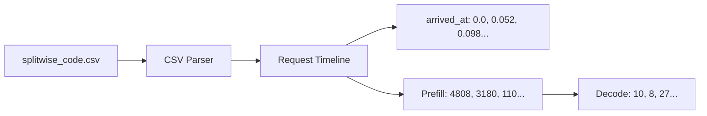
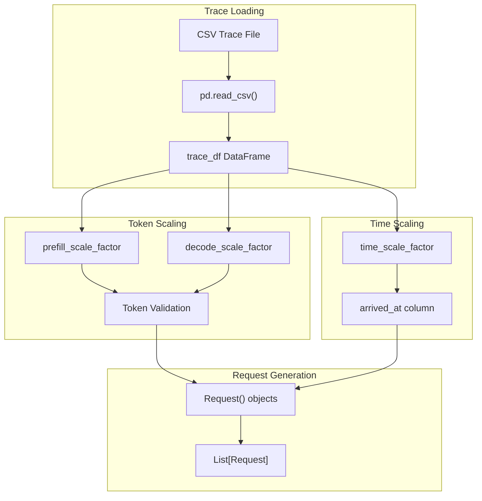
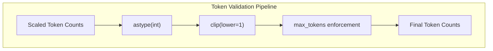
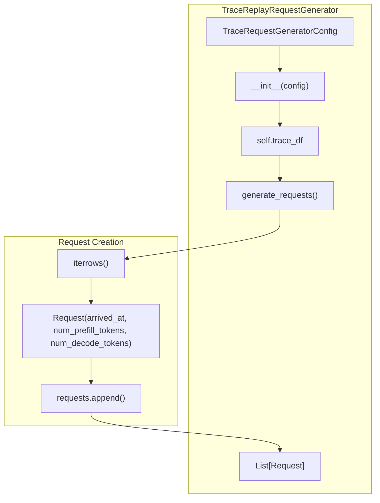
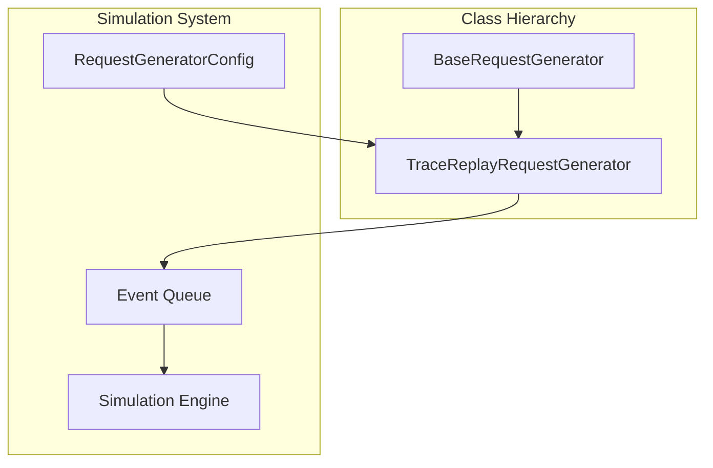

<!-- source: DeepWiki mcp.deepwiki.com · repo microsoft/vidur · page 5.2 Trace-Based Request Generation · fetched 2026-10-26 -->

# Trace-Based Request Generation

<details>
<summary>Relevant source files</summary>

The following files were used as context for generating this wiki page:

- [data/processed_traces/splitwise_code.csv](data/processed_traces/splitwise_code.csv)
- [data/processed_traces/splitwise_conv.csv](data/processed_traces/splitwise_conv.csv)
- [vidur/request_generator/trace_replay_request_generator.py](vidur/request_generator/trace_replay_request_generator.py)

</details>


## Purpose and Scope

This page documents Vidur's trace-based request generation system implemented in the `TraceReplayRequestGenerator` class. This system enables realistic workload simulation by replaying real-world conversation logs and code execution traces with configurable scaling capabilities. The system can adjust token counts and timing patterns to simulate different load conditions while preserving the original workload characteristics.

The trace replay system provides three key scaling mechanisms:
- **Token scaling**: Adjust prefill and decode token counts via `prefill_scale_factor` and `decode_scale_factor`
- **Time scaling**: Modify request arrival patterns via `time_scale_factor` 
- **Token validation**: Enforce model constraints via `max_tokens` limits

For information about synthetic request generation using statistical distributions, see [Synthetic Request Generation](#5.1). For the overall request generation architecture, see [Request Generation](#5).

## Trace File Format

The `TraceReplayRequestGenerator` processes trace data from CSV files using `pandas.read_csv()`. Each trace file contains timestamped request records with token count information.

### Standard Trace Schema

```csv
arrived_at,num_prefill_tokens,num_decode_tokens
0.0,4808,10
0.052,3180,8
0.098189,110,27
```

| Column | Type | Description |
|--------|------|-------------|
| `arrived_at` | float | Request arrival timestamp in seconds from trace start |
| `num_prefill_tokens` | int | Number of input tokens requiring parallel processing |
| `num_decode_tokens` | int | Number of output tokens requiring sequential generation |

The trace format directly maps to LLM inference phases: `num_prefill_tokens` determines the parallel computation workload during the prefill stage, while `num_decode_tokens` controls the sequential token generation workload during decode.

### CSV Loading and Processing

The `TraceReplayRequestGenerator` loads trace data using pandas DataFrame operations:

```python
self.trace_df = pd.read_csv(config.trace_file)
```

After loading, the system applies scaling transformations and validation as described in subsequent sections.

**Sources:** [vidur/request_generator/trace_replay_request_generator.py:23](), [data/processed_traces/splitwise_code.csv:1-10]()

## Trace Data Characteristics

### Request Arrival Patterns



Real traces exhibit complex temporal patterns including:

- **Bursty arrivals**: Clusters of requests at timestamps like 29.479069, 29.580407, 29.610325
- **Idle periods**: Large gaps between request clusters (e.g., 183.061791 after 39.285966)
- **Variable load**: Request rates varying from seconds to minutes between arrivals

**Sources:** [data/processed_traces/splitwise_code.csv:14-75]()

### Token Distribution Analysis

The trace data reveals realistic token count distributions:

| Metric | Prefill Tokens | Decode Tokens |
|--------|----------------|---------------|
| Range | 6 - 7,437 | 6 - 1,899 |
| Common Values | 1,000-3,000 | 6-30 |
| Large Requests | >7,000 tokens | >100 tokens |

Code execution traces (like `splitwise_code.csv`) typically show:
- High prefill token counts (representing large code contexts)
- Relatively small decode counts (representing code completions)
- Occasional very large decode sequences (representing extensive code generation)

**Sources:** [data/processed_traces/splitwise_code.csv:1-100]()

## TraceReplayRequestGenerator Implementation

### Core Processing Pipeline



The `TraceReplayRequestGenerator` implements a multi-stage pipeline that loads CSV trace data, applies scaling transformations, validates token constraints, and generates `Request` objects for the simulation engine.

### Scaling Transformations

The system applies three types of scaling to modify trace characteristics:

```python
# Token count scaling
self.trace_df["num_prefill_tokens"] = (
    self.trace_df["num_prefill_tokens"] * config.prefill_scale_factor
)
self.trace_df["num_decode_tokens"] = (
    self.trace_df["num_decode_tokens"] * config.decode_scale_factor
)

# Time scaling  
self.trace_df["arrived_at"] = (
    self.trace_df["arrived_at"] * config.time_scale_factor
)
```

**Sources:** [vidur/request_generator/trace_replay_request_generator.py:25-31](), [vidur/request_generator/trace_replay_request_generator.py:64-67]()

### Token Validation and Enforcement



The system enforces token count constraints through multiple validation steps:

1. **Integer conversion**: Ensures scaled values are integers
2. **Minimum enforcement**: Clips token counts to at least 1
3. **Maximum enforcement**: Adjusts prefill tokens to respect `max_tokens` limits

```python
# Ensure integer token counts
self.trace_df["num_prefill_tokens"] = self.trace_df["num_prefill_tokens"].astype(int)
self.trace_df["num_decode_tokens"] = self.trace_df["num_decode_tokens"].astype(int)

# Enforce minimum of 1 token
self.trace_df["num_prefill_tokens"] = self.trace_df["num_prefill_tokens"].clip(lower=1)
self.trace_df["num_decode_tokens"] = self.trace_df["num_decode_tokens"].clip(lower=1)

# Enforce max_tokens constraint
total_tokens = self.trace_df["num_prefill_tokens"] + self.trace_df["num_decode_tokens"]
diff_tokens = total_tokens - config.max_tokens
diff_tokens = diff_tokens.clip(lower=0)
self.trace_df["num_prefill_tokens"] = self.trace_df["num_prefill_tokens"] - diff_tokens
```

**Sources:** [vidur/request_generator/trace_replay_request_generator.py:33-57]()

## Configuration System

### TraceRequestGeneratorConfig

The `TraceReplayRequestGenerator` is configured through the `TraceRequestGeneratorConfig` class, which extends the base request generator configuration with trace-specific parameters:

| Parameter | Type | Purpose |
|-----------|------|---------|
| `trace_file` | str | Path to CSV trace file |
| `prefill_scale_factor` | float | Multiplier for prefill token counts |
| `decode_scale_factor` | float | Multiplier for decode token counts |
| `time_scale_factor` | float | Multiplier for arrival timestamps |
| `max_tokens` | int | Maximum total tokens per request |

### Request Generation Process



The `generate_requests()` method creates `Request` objects by iterating through the processed DataFrame:

```python
def generate_requests(self) -> List[Request]:
    requests = []
    
    for _, row in self.trace_df.iterrows():
        request = Request(
            arrived_at=row["arrived_at"],
            num_prefill_tokens=row["num_prefill_tokens"],
            num_decode_tokens=row["num_decode_tokens"],
        )
        requests.append(request)
    
    return requests
```

**Sources:** [vidur/request_generator/trace_replay_request_generator.py:19](), [vidur/request_generator/trace_replay_request_generator.py:80-92]()

### Integration with BaseRequestGenerator



The `TraceReplayRequestGenerator` inherits from `BaseRequestGenerator` and integrates with Vidur's simulation system by producing `Request` objects that match the expected interface for discrete-event simulation processing.

**Sources:** [vidur/request_generator/trace_replay_request_generator.py:8](), [vidur/request_generator/trace_replay_request_generator.py:13]()

## Trace Data Analysis and Statistics

### Splitwise Code Trace Characteristics

The `data/processed_traces/splitwise_code.csv` trace demonstrates the system's ability to handle real code completion workloads. The `TraceReplayRequestGenerator` logs statistical analysis during initialization:

```python
# Compute prompt/decode ratio statistics
pd_ratio = (
    self.trace_df["num_prefill_tokens"] / self.trace_df["num_decode_tokens"]
)
logger.debug(
    f"Prompt/decode token ratio stats\n:{pd_ratio.describe(percentiles=[0.25, 0.5, 0.75, 0.9, 0.95, 0.99])}"
)
```

### Token Distribution Patterns

| Metric | Prefill Tokens | Decode Tokens |
|--------|----------------|---------------|
| Range | 6 - 7,437 | 6 - 1,899 |
| Common Values | 1,000-3,000 | 6-30 |
| Large Requests | >7,000 tokens | >100 tokens |

### Temporal Characteristics

Real traces exhibit complex timing patterns captured in the `arrived_at` column:
- **Bursty arrivals**: Clusters at timestamps like 29.479069, 29.580407, 29.610325  
- **Idle periods**: Extended gaps (e.g., 183.061791 after 39.285966)
- **Variable load**: Request rates from seconds to minutes between arrivals

These patterns are preserved during replay but can be scaled via `time_scale_factor` to simulate different load conditions.

**Sources:** [vidur/request_generator/trace_replay_request_generator.py:72-78](), [data/processed_traces/splitwise_code.csv:14-75](), [data/processed_traces/splitwise_code.csv:1-100]()

## Performance Considerations

Trace-based generation provides several advantages over synthetic generation:

- **Realistic Patterns**: Captures actual user behavior and system load characteristics
- **Validation Data**: Enables comparison of simulation results against known system performance
- **Reproducibility**: Identical trace replays ensure consistent simulation results
- **Scenario Testing**: Supports "what-if" analysis using historical workload patterns

The deterministic nature of trace replay makes it particularly valuable for performance regression testing and capacity planning validation.

**Sources:** [data/processed_traces/splitwise_code.csv:1-4967]()

---

