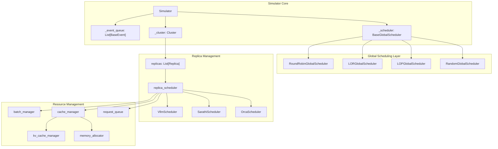
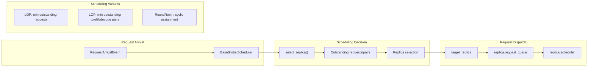
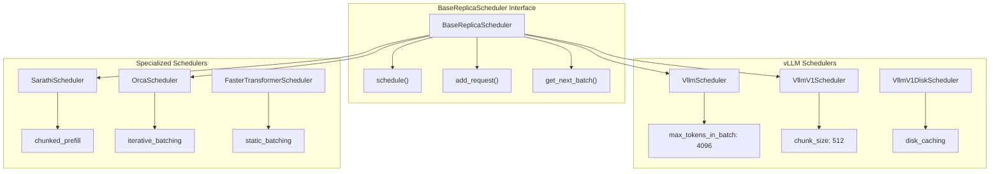
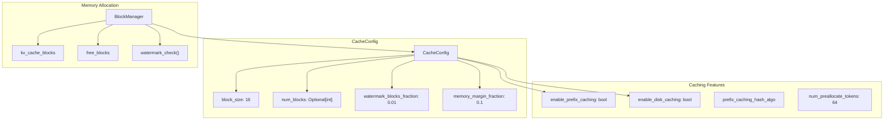
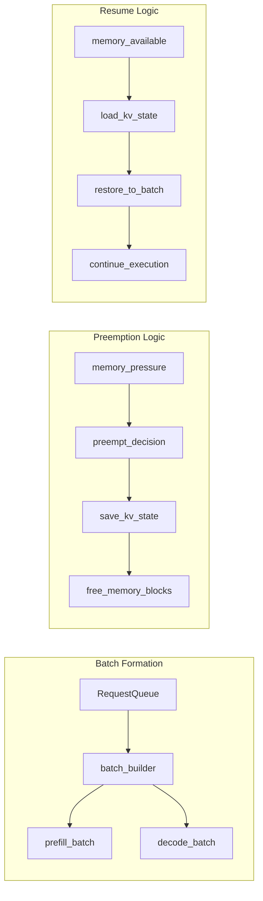
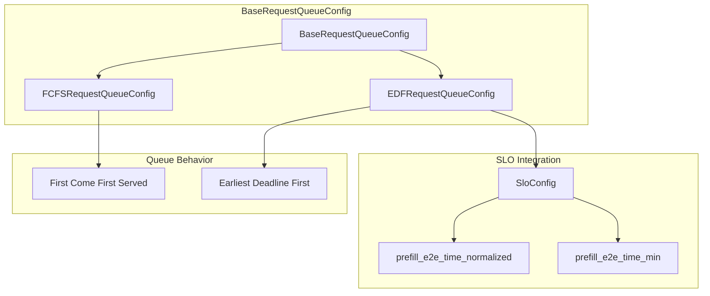
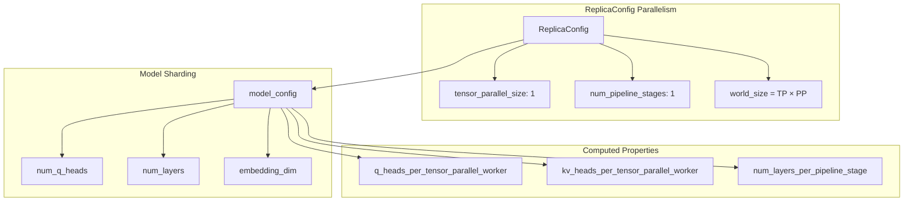
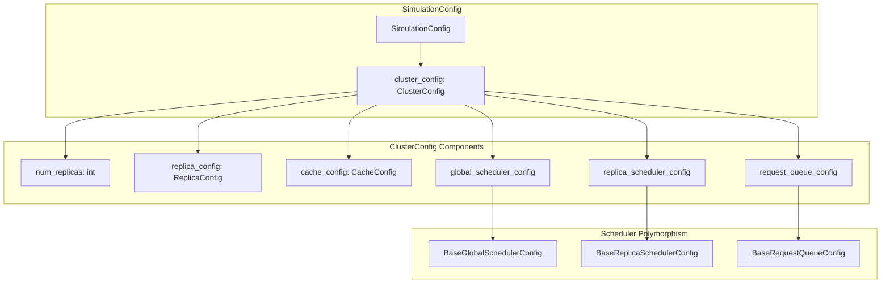

<!-- source: DeepWiki mcp.deepwiki.com · repo microsoft/vidur · page 6 Scheduling and Resource Management · fetched 2026-10-26 -->

# Scheduling and Resource Management

Relevant source files

The following files were used as context for generating this wiki page:

- [vidur/config/config.py](vidur/config/config.py)
- [vidur/config/device_sku_config.py](vidur/config/device_sku_config.py)
- [vidur/config/model_config.py](vidur/config/model_config.py)
- [vidur/config/node_sku_config.py](vidur/config/node_sku_config.py)
- [vidur/request_generator/synthetic_request_generator.py](vidur/request_generator/synthetic_request_generator.py)
- [vidur/simulator.py](vidur/simulator.py)

This page covers Vidur's multi-level scheduling system and resource management capabilities. The system employs a hierarchical approach with global schedulers for distributing requests across replicas and replica schedulers for managing local execution within each replica. Resource management encompasses memory allocation, KV cache management, batching strategies, and preemption policies.

For workload generation and request characteristics, see [Request Generation](#5). For performance modeling and execution time prediction, see [Performance Modeling](#7).

## Multi-Level Scheduling Architecture

Vidur implements a two-tier scheduling architecture that separates global load balancing from local resource management. The global scheduler distributes incoming requests across available replicas, while each replica scheduler manages its local request queue and resource allocation.

### Scheduling System Overview

Sources: [vidur/simulator.py:22-54](), [vidur/config/config.py:605-704](), [vidur/config/config.py:342-416]()

## Global Scheduling Strategies

Global schedulers handle request distribution across replicas in the cluster. Each strategy optimizes for different objectives such as load balancing, minimizing outstanding requests, or maintaining session affinity.

### Global Scheduler Types and Configurations

| Scheduler Type | Configuration Class | Strategy |
|----------------|-------------------|----------|
| `ROUND_ROBIN` | `RoundRobinGlobalSchedulerConfig` | Cyclic request distribution |
| `LOR` | `LORGlobalSchedulerConfig` | Least Outstanding Requests |
| `LOP` | `LOPGlobalSchedulerConfig` | Least Outstanding Pairs |
| `RANDOM` | `RandomGlobalSchedulerConfig` | Random replica selection |
| `STICKY_ROUND_ROBIN` | `StickyRoundRobinGlobalSchedulerConfig` | Session-aware round robin |
| `STICKY_LOR` | `StickyLorGlobalSchedulerConfig` | Session-aware LOR |

Sources: [vidur/config/config.py:619-704]()

### Request Distribution Flow

Sources: [vidur/events/__init__.py](), [vidur/scheduler/global_scheduler/]()

## Replica Scheduling Algorithms

Replica schedulers manage local request execution, batching, and resource allocation within individual replicas. Each algorithm implements different strategies for optimizing throughput and latency.

### Replica Scheduler Implementations

Sources: [vidur/config/config.py:355-416]()

### Scheduling Configuration Parameters

| Parameter | Description | Impact |
|-----------|-------------|--------|
| `batch_size_cap` | Maximum requests per batch | Memory vs. throughput tradeoff |
| `max_tokens_in_batch` | Token limit for vLLM batches | Controls batch density |
| `chunk_size` | Prefill chunking granularity | Preemption granularity |

Sources: [vidur/config/config.py:343-411]()

## Resource Management

The resource management system handles memory allocation, KV cache management, and batch scheduling to optimize hardware utilization while maintaining performance guarantees.

### Cache and Memory Management

Sources: [vidur/config/config.py:304-339]()

### Preemption and Batching Strategies

Vidur supports sophisticated preemption mechanisms that allow interrupted requests to resume execution while maintaining state consistency through the KV cache system.

Sources: [vidur/config/config.py:304-339]()

## Request Queueing and Prioritization

The system supports multiple queueing disciplines to handle different service level objectives and fairness requirements.

### Queue Types and Implementations

Sources: [vidur/config/config.py:583-602](), [vidur/config/config.py:292-301]()

## Parallelism and Distributed Execution

Vidur models tensor parallelism and pipeline parallelism to simulate distributed inference workloads across multiple GPUs and nodes.

### Parallelism Configuration

Sources: [vidur/config/config.py:513-580]()

## Configuration System Integration

The scheduling and resource management components are configured through a hierarchical configuration system that allows fine-grained control over system behavior.

### Configuration Hierarchy

Sources: [vidur/config/config.py:854-876](), [vidur/config/config.py:879-934]()

---

