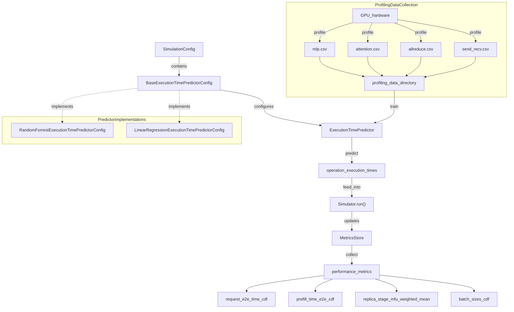
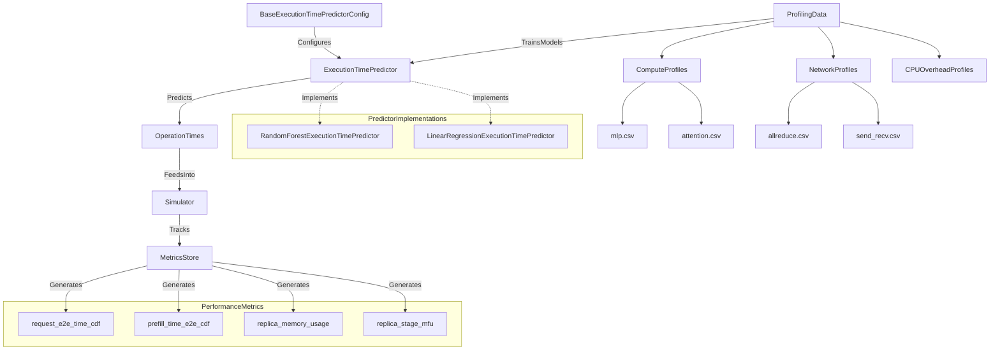
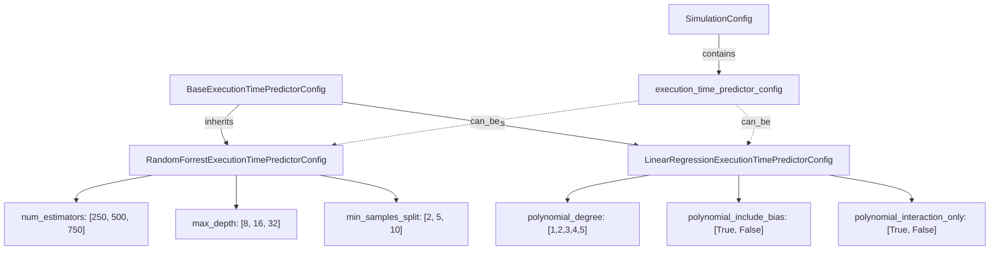
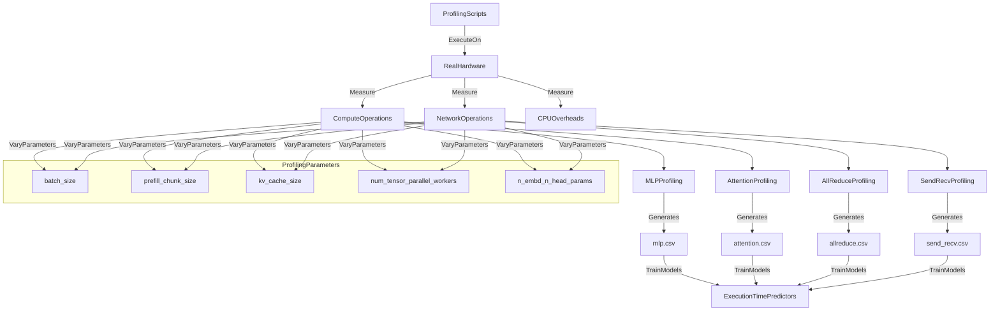
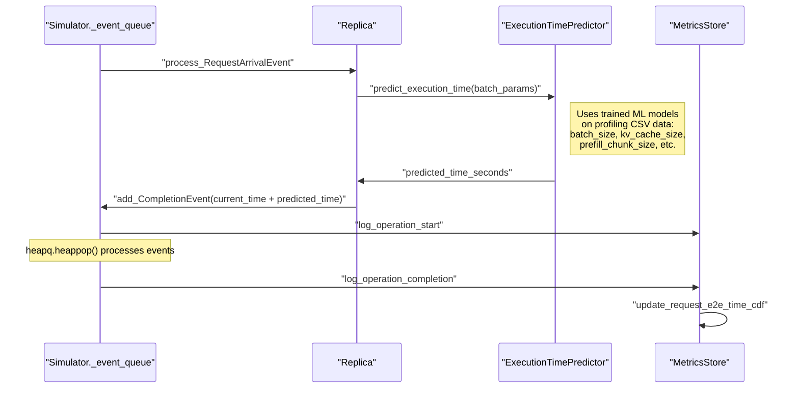
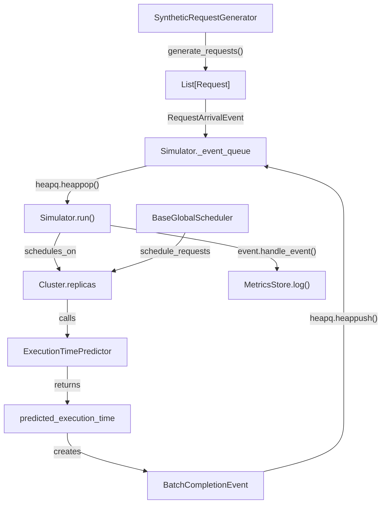
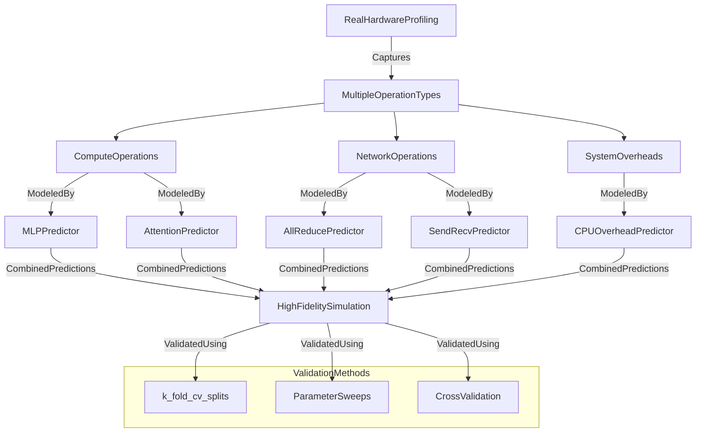

<!-- source: DeepWiki mcp.deepwiki.com · repo microsoft/vidur · page 7 Performance Modeling · fetched 2026-10-26 -->

# Performance Modeling

<details>
<summary>Relevant source files</summary>

The following files were used as context for generating this wiki page:

- [data/profiling/compute/a100/meta-llama/Meta-Llama-3-70B/attention.csv](data/profiling/compute/a100/meta-llama/Meta-Llama-3-70B/attention.csv)
- [data/profiling/compute/a100/meta-llama/Meta-Llama-3-70B/mlp.csv](data/profiling/compute/a100/meta-llama/Meta-Llama-3-70B/mlp.csv)
- [data/profiling/compute/a100/meta-llama/Meta-Llama-3-8B/attention.csv](data/profiling/compute/a100/meta-llama/Meta-Llama-3-8B/attention.csv)
- [data/profiling/compute/a100/meta-llama/Meta-Llama-3-8B/mlp.csv](data/profiling/compute/a100/meta-llama/Meta-Llama-3-8B/mlp.csv)
- [docs/metrics.md](docs/metrics.md)
- [docs/profiling.md](docs/profiling.md)
- [vidur/config/config.py](vidur/config/config.py)
- [vidur/request_generator/synthetic_request_generator.py](vidur/request_generator/synthetic_request_generator.py)
- [vidur/simulator.py](vidur/simulator.py)

</details>


Performance Modeling is the foundation of Vidur's simulation system, enabling accurate LLM inference simulation without requiring actual GPU hardware. This page explains how Vidur models hardware performance using profiling data, predicts execution times for various operations, and simulates realistic system behavior.

## Purpose and Overview

Vidur's performance modeling system enables high-fidelity simulation of LLM inference systems by accurately modeling hardware performance characteristics without requiring actual GPU access. This comprehensive approach includes:

- **Execution time prediction** for compute and network operations
- **Resource utilization modeling** including memory usage and throughput
- **Performance metrics collection** that mirrors real-world deployment monitoring
- **Hardware-specific modeling** supporting different GPU types and network configurations

The system uses machine learning models trained on profiling data collected from real hardware to predict execution times for compute operations (MLP and attention mechanisms), network operations (all-reduce and point-to-point communication), and system overheads. This enables:

- Simulation of LLM inference on consumer hardware (like laptops)
- Testing scheduling algorithms without expensive GPU resources
- Capacity planning and performance optimization
- Research on new LLM serving approaches

## Performance Modeling Architecture

The performance modeling system bridges real hardware profiling data with simulation execution through machine learning predictors.



Sources: [vidur/config/config.py:494-606](), [vidur/simulator.py:17-80](), [docs/profiling.md:1-37](), [docs/metrics.md:1-42]()

## Core Components

The performance modeling system consists of several interconnected components:



### Execution Time Predictors

The system provides two main prediction model implementations defined in the configuration system:

1. **`RandomForrestExecutionTimePredictorConfig`**: Uses Random Forest regression with configurable `num_estimators`, `max_depth`, and `min_samples_split` parameters for robust prediction across diverse operation parameters
2. **`LinearRegressionExecutionTimePredictorConfig`**: Uses polynomial features with configurable `polynomial_degree`, `polynomial_include_bias`, and `polynomial_interaction_only` for interpretable predictions

Both inherit from `BaseExecutionTimePredictorConfig` and are selected via the `execution_time_predictor_config` field in `SimulationConfig`.



Sources: [vidur/config/config.py:589-606](), [vidur/config/config.py:565-587](), [vidur/config/config.py:494-563]()

## Profiling Data System

Vidur's performance modeling relies on comprehensive profiling data collected from real hardware. This data captures the performance characteristics of different operations across various configurations.

### Profiling Data Collection Process



### Data Organization Structure

The profiling data follows a hierarchical organization that separates hardware-specific and model-specific characteristics:

```
data/profiling/
├── compute/                    # Hardware-dependent compute profiles
│   ├── a100/                  # NVIDIA A100 GPU profiles
│   │   ├── meta-llama/Meta-Llama-3-8B/
│   │   │   ├── mlp.csv       # MLP timing measurements
│   │   │   └── attention.csv # Attention timing measurements
│   │   └── meta-llama/Meta-Llama-3-70B/
│   │       ├── mlp.csv
│   │       └── attention.csv
│   └── h100/                  # NVIDIA H100 GPU profiles
├── network/                   # Network configuration dependent
│   ├── a100_pair_nvlink/     # 4 A100s with pairwise NVLink
│   │   ├── allreduce.csv     # Tensor parallelism communication
│   │   └── send_recv.csv     # Pipeline parallelism communication
│   ├── a100_dgx/             # 8 A100s fully connected
│   └── h100_dgx/             # 8 H100s fully connected
└── cpu_overhead/             # Implementation-specific overheads
```

### Profiling Data Content

Each profiling CSV contains detailed timing statistics with specific column structures. The attention profiling CSV contains:

| Column Pattern | Examples |
|---------------|----------|
| **Timing Statistics** | `time_stats.attn_input_reshape.min`, `time_stats.attn_kv_cache_save.max`, `time_stats.attn_prefill.mean`, `time_stats.attn_decode.median`, `time_stats.attn_output_reshape.std` |
| **Model Architecture** | `n_embd`, `n_q_head`, `n_kv_head`, `block_size` |
| **Execution Parameters** | `batch_size`, `prefill_chunk_size`, `kv_cache_size`, `num_tensor_parallel_workers`, `max_model_len` |
| **Configuration Flags** | `is_prefill`, `attention_backend` |

The MLP profiling CSV follows the same pattern with operations:

| Column Pattern | Examples |
|---------------|----------|
| **Timing Statistics** | `time_stats.emb.min`, `time_stats.input_layernorm.max`, `time_stats.mlp_up_proj.mean`, `time_stats.mlp_act.median`, `time_stats.mlp_down_proj.std`, `time_stats.add.std` |
| **Model Architecture** | `n_head`, `n_kv_head`, `n_embd`, `n_expanded_embd`, `vocab_size`, `use_gated_mlp` |
| **Execution Parameters** | `num_tokens`, `num_tensor_parallel_workers` |

Sources: [data/profiling/compute/a100/meta-llama/Meta-Llama-3-8B/attention.csv:1-2](), [data/profiling/compute/a100/meta-llama/Meta-Llama-3-8B/mlp.csv:1-2](), [data/profiling/compute/a100/meta-llama/Meta-Llama-3-70B/mlp.csv:1-2]()

## Performance Modeling Process

During simulation, the performance modeling system predicts operation durations and tracks comprehensive metrics:

### Execution Time Prediction Flow

The `Simulator` orchestrates performance prediction through its event-driven architecture:



### Operation Categories

The performance modeling system handles multiple operation types with specialized prediction models:

| Operation Category | Specific Operations | Key Parameters |
|-------------------|-------------------|----------------|
| **Compute - MLP** | `emb`, `input_layernorm`, `mlp_up_proj`, `mlp_act`, `mlp_down_proj` | `batch_size`, `num_tokens`, `n_embd`, `n_expanded_embd` |
| **Compute - Attention** | `attn_input_reshape`, `attn_kv_cache_save`, `attn_prefill`, `attn_decode` | `batch_size`, `prefill_chunk_size`, `kv_cache_size`, `n_q_head`, `n_kv_head` |
| **Network - Tensor Parallel** | `all_reduce` operations | `tensor_size`, `num_tensor_parallel_workers` |
| **Network - Pipeline Parallel** | `send_recv` operations | `message_size`, `pipeline_stage_configuration` |
| **CPU Overheads** | Scheduling, sampling, tokenization | Implementation-specific parameters |

### Performance Metrics Collection

The system tracks comprehensive performance metrics that mirror real-world monitoring:

| Metric Category | Key Metrics | Purpose |
|----------------|-------------|---------|
| **Request Latency** | `request_e2e_time_cdf`, `prefill_time_e2e_cdf`, `decode_time_execution_plus_preemption_normalized_cdf` | End-user experience measurement |
| **Throughput** | `request_completions_time_series`, `prefill_completions_time_series`, `decode_completions_time_series` | System capacity analysis |
| **Resource Utilization** | `replica_memory_usage_weighted_mean`, `replica_stage_busy_time_percent`, `replica_stage_mfu_weighted_mean` | Hardware efficiency tracking |
| **Batch Efficiency** | `batch_sizes_cdf`, `batch_num_tokens_cdf` | Batching strategy effectiveness |

Sources: [data/profiling/compute/a100/meta-llama/Meta-Llama-3-8B/attention.csv:1-2](), [data/profiling/compute/a100/meta-llama/Meta-Llama-3-8B/mlp.csv:1-2](), [docs/metrics.md:17-42]()

## Configuration

The execution time prediction system is highly configurable, allowing you to control various aspects of how predictions are made:

### BaseExecutionTimePredictorConfig Options

The `BaseExecutionTimePredictorConfig` class defines common configuration parameters:

| Parameter | Description | Default |
|-----------|-------------|---------|
| `compute_input_file` | Path template for MLP profiling data | `./data/profiling/compute/{DEVICE}/{MODEL}/mlp.csv` |
| `attention_input_file` | Path template for attention profiling data | `./data/profiling/compute/{DEVICE}/{MODEL}/attention.csv` |
| `all_reduce_input_file` | Path template for tensor parallel communication | `./data/profiling/network/{NETWORK_DEVICE}/all_reduce.csv` |
| `send_recv_input_file` | Path template for pipeline parallel communication | `./data/profiling/network/{NETWORK_DEVICE}/send_recv.csv` |
| `cpu_overhead_input_file` | Path template for implementation overheads | `./data/profiling/cpu_overhead/{NETWORK_DEVICE}/{MODEL}/cpu_overheads.csv` |
| `k_fold_cv_splits` | Cross-validation splits for model training | 10 |
| `kv_cache_prediction_granularity` | KV cache size granularity for prediction | 64 |
| `prediction_max_prefill_chunk_size` | Maximum prefill chunk size for training | 4096 |
| `prediction_max_batch_size` | Maximum batch size for training | 128 |
| `prediction_max_tokens_per_request` | Maximum request length for training | 4096 |
| `skip_cpu_overhead_modeling` | Whether to skip CPU overhead prediction | True |

### Model-Specific Configuration Options

#### RandomForrestExecutionTimePredictorConfig Options

The `RandomForrestExecutionTimePredictorConfig` provides hyperparameter search lists:

| Parameter | Description | Default Search Space |
|-----------|-------------|---------------------|
| `num_estimators` | Number of trees in the Random Forest | [250, 500, 750] |
| `max_depth` | Maximum depth of each tree | [8, 16, 32] |
| `min_samples_split` | Minimum samples required to split internal node | [2, 5, 10] |

The predictor performs grid search over all combinations during training with `k_fold_cv_splits` cross-validation.

#### LinearRegressionExecutionTimePredictorConfig Options

The `LinearRegressionExecutionTimePredictorConfig` provides polynomial feature configuration:

| Parameter | Description | Default Search Space |
|-----------|-------------|---------------------|
| `polynomial_degree` | Degree of polynomial features | [1, 2, 3, 4, 5] |
| `polynomial_include_bias` | Include bias term in polynomial expansion | [True, False] |
| `polynomial_interaction_only` | Only include interaction features (no powers) | [True, False] |
| `fit_intercept` | Fit intercept term in linear regression | [True, False] |

The predictor uses `sklearn.preprocessing.PolynomialFeatures` and `sklearn.linear_model.LinearRegression` with grid search validation.

Sources: [vidur/config/config.py:494-606](vidur/config/config.py:494-606)

## Integration with Simulator

The execution time prediction system is tightly integrated with the `Simulator` class's event-driven architecture:



The performance modeling system integrates at several key points in the simulation:

1. **Request Scheduling**: When `BaseGlobalScheduler` assigns requests to replicas
2. **Prefill/Decode Phases**: During attention and MLP operation execution
3. **Network Operations**: For tensor parallelism (`all_reduce`) and pipeline parallelism (`send_recv`)
4. **Event Timing**: Controls when `BaseEvent` completion events are scheduled in `Simulator._event_queue`

The `Simulator.run()` method processes events via `heapq.heappop()`, where each event's timing is determined by execution time predictions, directly controlling simulation flow.

Sources: [vidur/simulator.py:17-80](), [vidur/simulator.py:96-101](), [vidur/request_generator/synthetic_request_generator.py:83-105]()

## Model Fidelity and Validation

Vidur achieves high-fidelity performance modeling through several key design principles:

### Multi-Dimensional Modeling Approach



### Accuracy Factors

1. **Comprehensive Hardware Profiling**: Data collected from actual A100 and H100 GPUs across multiple models and configurations
2. **Specialized ML Models**: Different model types (Random Forest, Linear Regression) optimized for different operation characteristics
3. **Parameter-Aware Predictions**: Models account for batch sizes, sequence lengths, tensor parallel degrees, and hardware configurations
4. **Cross-Validation**: Built-in k-fold cross-validation (default 10 splits) ensures model generalization
5. **Hardware-Specific Modeling**: Separate profiles for different GPU types and network configurations (e.g., `a100_pair_nvlink` vs `a100_dgx`)

### Model Training Configuration

The system provides extensive hyperparameter tuning options:

| Predictor Type | Key Hyperparameters | Default Search Space |
|---------------|-------------------|-------------------|
| **Random Forest** | `num_estimators`, `max_depth`, `min_samples_split` | [250, 500, 750], [8, 16, 32], [2, 5, 10] |
| **Linear Regression** | `polynomial_degree`, `polynomial_include_bias`, `polynomial_interaction_only` | [1, 2, 3, 4, 5], [True, False], [True, False] |

Sources: [vidur/config/config.py:494-606](), [docs/profiling.md:1-121]()

## Adding New Hardware or Models

To add support for predicting execution times for new hardware or models:

1. Collect profiling data for the new hardware/model using the profiling scripts
2. Place the profiling data in the appropriate directory structure
3. Configure the execution time predictor to use the new profiling data

For detailed instructions on collecting profiling data for new models, see [Profiling Data](#6.1).

Sources: [docs/profiling.md:1-121](docs/profiling.md:1-121)

---

