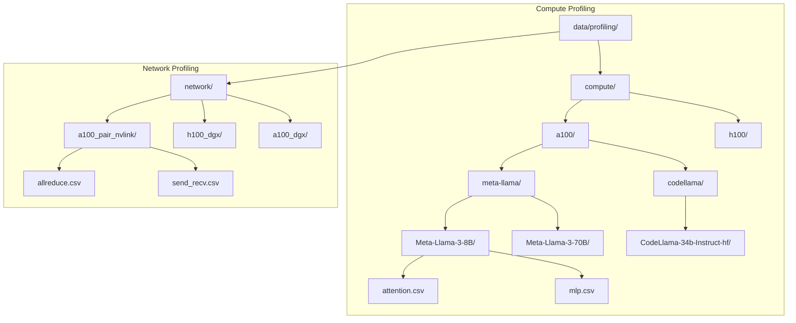
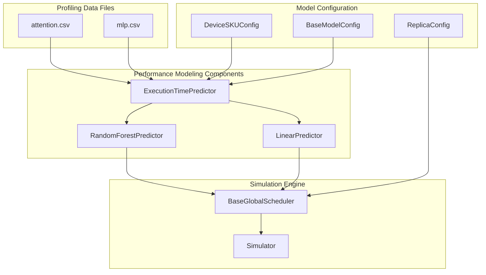
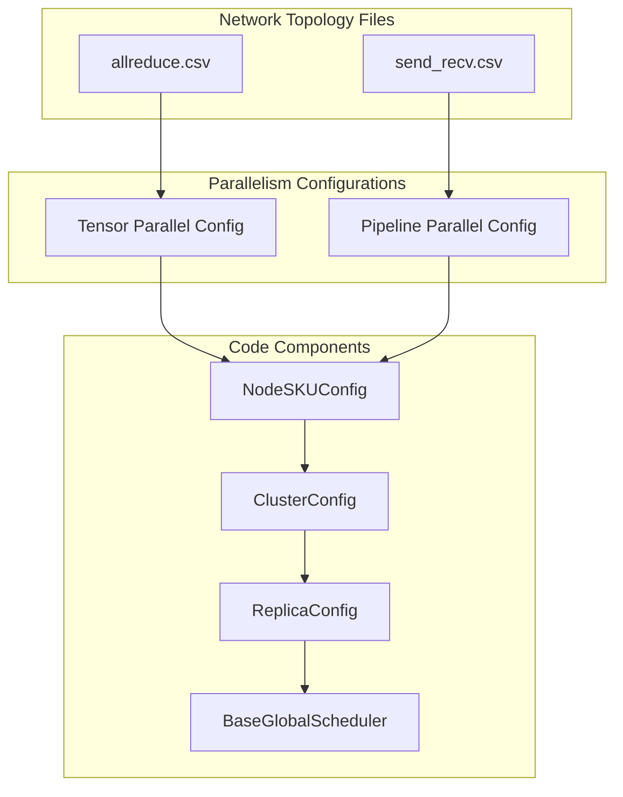
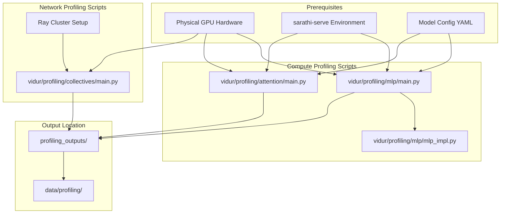
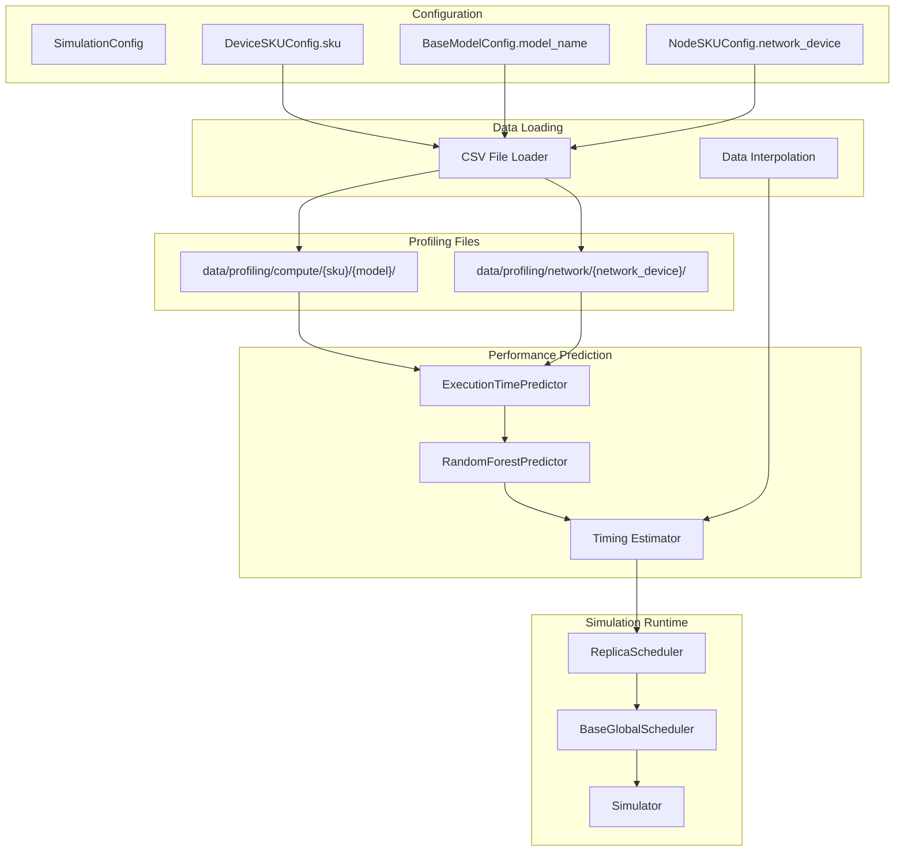

<!-- source: DeepWiki mcp.deepwiki.com · repo microsoft/vidur · page 7.1 Profiling Data System · fetched 2026-10-26 -->

# Profiling Data System

<details>
<summary>Relevant source files</summary>

The following files were used as context for generating this wiki page:

- [data/profiling/compute/a100/meta-llama/Meta-Llama-3-70B/attention.csv](data/profiling/compute/a100/meta-llama/Meta-Llama-3-70B/attention.csv)
- [data/profiling/compute/a100/meta-llama/Meta-Llama-3-70B/mlp.csv](data/profiling/compute/a100/meta-llama/Meta-Llama-3-70B/mlp.csv)
- [data/profiling/compute/a100/meta-llama/Meta-Llama-3-8B/attention.csv](data/profiling/compute/a100/meta-llama/Meta-Llama-3-8B/attention.csv)
- [data/profiling/compute/a100/meta-llama/Meta-Llama-3-8B/mlp.csv](data/profiling/compute/a100/meta-llama/Meta-Llama-3-8B/mlp.csv)
- [docs/metrics.md](docs/metrics.md)
- [docs/profiling.md](docs/profiling.md)

</details>


The Profiling Data System stores empirical performance measurements that enable realistic hardware simulation without requiring actual GPUs during execution. The system organizes pre-collected timing data for compute operations (attention and MLP) and network collective communications across different hardware SKUs and model architectures.

This profiling data is consumed by the `ExecutionTimePredictor` and related performance modeling components to provide realistic timing estimates during simulation. For the broader performance modeling architecture, see [Performance Modeling](#7).

## Directory Structure and Organization

The profiling data follows a hierarchical directory structure under `data/profiling/` that separates compute performance (device SKU dependent) from network performance (topology dependent):

**Profiling Data Directory Structure**


The separation allows compute profiling to be shared across different network topologies (since compute performance depends only on the GPU SKU), while network profiling captures topology-specific communication patterns.

Sources: [docs/profiling.md:8-31]()

## Compute Profiling Data

Compute profiling captures timing measurements for individual neural network operations on specific GPU SKUs. Each model has two CSV files containing empirical timing data for different operation types and batch configurations.

**Code Integration with Profiling Data**


The `ExecutionTimePredictor` loads CSV files based on the `DeviceSKUConfig.sku` and `BaseModelConfig.model_name` to provide timing estimates during simulation.

Sources: [docs/profiling.md:30-31]()

### Attention Profiling Data Schema

The `attention.csv` files contain detailed timing statistics for attention operations with the following column structure:

| Column Pattern | Description | Example Columns |
|----------------|-------------|-----------------|
| `time_stats.attn_prefill.*` | Prefill attention timing (min/max/mean/median/std) | `time_stats.attn_prefill.mean` |
| `time_stats.attn_decode.*` | Decode attention timing statistics | `time_stats.attn_decode.max` |
| `time_stats.attn_kv_cache_save.*` | KV cache save operation timings | `time_stats.attn_kv_cache_save.min` |
| `time_stats.attn_input_reshape.*` | Input tensor reshape operations | `time_stats.attn_input_reshape.mean` |
| `time_stats.attn_output_reshape.*` | Output tensor reshape operations | `time_stats.attn_output_reshape.std` |

**Configuration Parameters:**
- `batch_size`: Number of requests in batch
- `prefill_chunk_size`: Prefill chunk size (64, 128, etc.)
- `kv_cache_size`: Current KV cache occupancy in tokens
- `is_prefill`: Boolean indicating prefill (True) vs decode (False) phase
- `attention_backend`: Backend used (e.g., `AttentionBackend.FLASHINFER`)

### MLP Profiling Data Schema  

The `mlp.csv` files capture timing data for transformer layer operations beyond attention:

| Column Pattern | Description | Example Columns |
|----------------|-------------|-----------------|
| `time_stats.mlp_up_proj.*` | Up projection timing statistics | `time_stats.mlp_up_proj.mean` |
| `time_stats.mlp_down_proj.*` | Down projection timing statistics | `time_stats.mlp_down_proj.min` |  
| `time_stats.mlp_act.*` | Activation function (SiLU/GELU) timing | `time_stats.mlp_act.median` |
| `time_stats.input_layernorm.*` | Pre-attention layer normalization | `time_stats.input_layernorm.std` |
| `time_stats.post_attention_layernorm.*` | Post-attention layer normalization | `time_stats.post_attention_layernorm.max` |
| `time_stats.attn_pre_proj.*` | Attention projection operations | `time_stats.attn_pre_proj.mean` |
| `time_stats.attn_post_proj.*` | Attention output projection | `time_stats.attn_post_proj.median` |

**Model Architecture Parameters:**
- `num_tokens`: Number of tokens processed in the measurement
- `num_tensor_parallel_workers`: Tensor parallelism degree
- `n_head`, `n_kv_head`: Attention head counts
- `n_embd`, `n_expanded_embd`: Embedding dimensions
- `vocab_size`: Vocabulary size
- `use_gated_mlp`: Whether model uses gated MLP (SwiGLU)

Sources: [data/profiling/compute/a100/meta-llama/Meta-Llama-3-8B/attention.csv:1](), [data/profiling/compute/a100/meta-llama/Meta-Llama-3-8B/mlp.csv:1]()

## Network Profiling Data

Network profiling captures collective communication performance for distributed inference patterns. The data is organized by network topology configuration since communication performance depends on specific interconnect arrangements rather than individual GPU characteristics.

**Network Profiling Integration**


### Supported Network Topologies

| Network Configuration | Physical Setup | GPU Configuration | NVLink Pattern |
|----------------------|----------------|-------------------|----------------|
| `a100_pair_nvlink` | Azure Standard_NC96ads_A100_v4 | 4x A100 80GB PCIe | Pair-wise connectivity |
| `h100_pair_nvlink` | Azure H100 NVL VM | 4x H100 80GB NVL | Pair-wise connectivity |
| `a100_dgx` | NVIDIA A100 DGX | 8x A100 80GB SXM | Full NVSwitch mesh |
| `h100_dgx` | NVIDIA H100 DGX | 8x H100 SXM | Full NVSwitch mesh |

The `NodeSKUConfig.network_device` field determines which network profiling data directory to use.

### Collective Communication Files

**AllReduce Operations (`allreduce.csv`)**
- Used for tensor parallelism where tensors must be summed across all GPUs
- Captures timing for different worker counts and data sizes
- Essential for TP configurations where model weights are sharded

**Send/Recv Operations (`send_recv.csv`)**  
- Used for pipeline parallelism where activations pass between pipeline stages
- Measures point-to-point communication latency
- Critical for PP configurations across nodes

Sources: [docs/profiling.md:75-84](), [docs/profiling.md:94-116]()

## Profiling Data Collection Process  

New profiling data is collected using actual GPU hardware with specialized profiling scripts. The process requires physical access to target hardware configurations.

**Profiling Script Execution Flow**


### Compute Profiling Execution

**MLP Profiling:**
```bash
python vidur/profiling/mlp/main.py \
    --models codellama/CodeLlama-34b-Instruct-hf \
    --num_gpus 4
```

**Attention Profiling:**  
```bash
python vidur/profiling/attention/main.py \
    --models codellama/CodeLlama-34b-Instruct-hf \
    --num_gpus 4
```

Output files are generated in `profiling_outputs/{operation}/{timestamp}/` and must be manually copied to the appropriate `data/profiling/compute/{device_sku}/{model_name}/` directory.

### Network Profiling Execution

**Tensor Parallelism (AllReduce):**
```bash
python vidur/profiling/collectives/main.py \
    --num_workers_per_node_combinations 1,2,4,8 \
    --collective all_reduce
```

**Pipeline Parallelism (Send/Recv):**
```bash  
python vidur/profiling/collectives/main.py \
    --num_workers_per_node_combinations 1,2,4,8 \
    --collective send_recv
```

Generated CSV files must be copied to `data/profiling/network/{network_device}/` directories.

Sources: [docs/profiling.md:49-68](), [docs/profiling.md:86-116]()

## Runtime Usage in Simulation

The profiling data is loaded and used by performance modeling components during simulation execution to provide realistic timing estimates without requiring physical GPUs.

**Runtime Profiling Data Flow**


### Timing Estimation Process

The `ExecutionTimePredictor` performs the following steps during simulation:

1. **File Path Resolution**: Uses `DeviceSKUConfig.sku` and `BaseModelConfig.model_name` to construct file paths like `data/profiling/compute/a100/meta-llama/Meta-Llama-3-8B/attention.csv`

2. **Parameter Matching**: Matches simulation parameters (batch size, sequence length, parallelism degree) against profiling data rows

3. **Interpolation/Extrapolation**: For configurations not directly measured, interpolates between nearby data points or extrapolates based on trends

4. **Timing Prediction**: Returns predicted execution times that feed into the discrete event simulation

The system enables realistic performance modeling across different hardware configurations, model sizes, and parallelism strategies without requiring access to physical GPUs during simulation.

Sources: [docs/profiling.md:35-36]()

## Data File Format Specifications

All profiling data is stored in CSV format with specific column structures:

### Attention CSV Schema
- Timing statistics columns follow pattern: `time_stats.{operation}.{statistic}`
- Configuration columns: `n_embd`, `n_q_head`, `n_kv_head`, `batch_size`, `prefill_chunk_size`
- Metadata columns: `is_prefill`, `attention_backend`, `num_tensor_parallel_workers`

### MLP CSV Schema  
- Timing statistics columns: `time_stats.{operation}.{statistic}` for operations like `mlp_up_proj`, `mlp_down_proj`
- Model configuration: `n_head`, `n_kv_head`, `n_embd`, `n_expanded_embd`, `vocab_size`
- Processing parameters: `num_tokens`, `num_tensor_parallel_workers`, `use_gated_mlp`

### Network CSV Schema
- Collective operation timing data organized by worker count and message sizes
- Separate files for different collective types (`allreduce.csv`, `send_recv.csv`)

Sources: [data/profiling/compute/a100/meta-llama/Meta-Llama-3-8B/attention.csv:1](), [data/profiling/compute/a100/meta-llama/Meta-Llama-3-8B/mlp.csv:1]()

---

