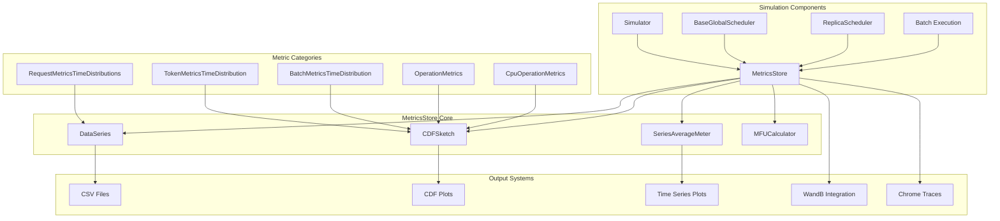
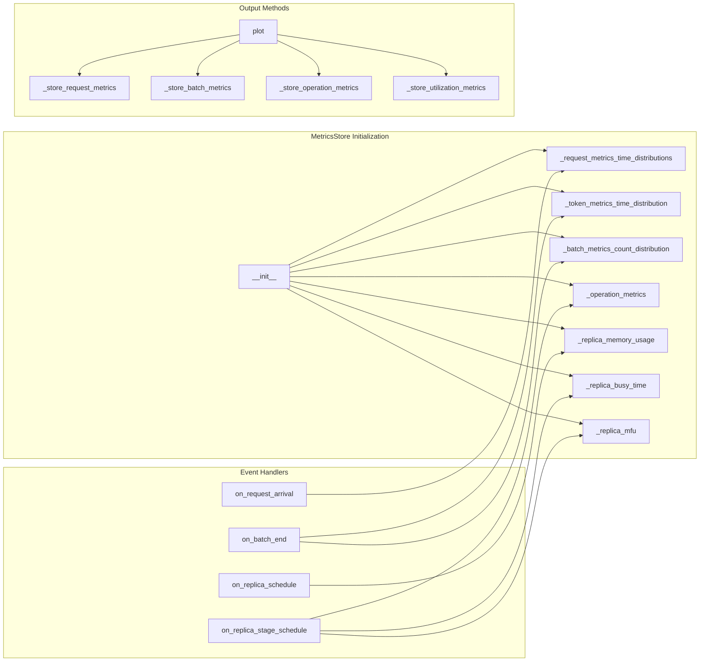
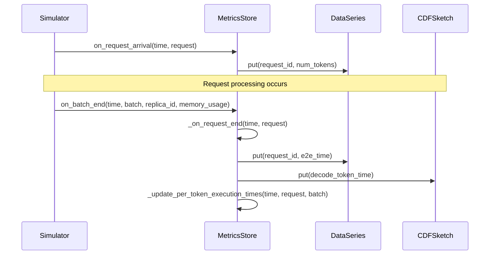
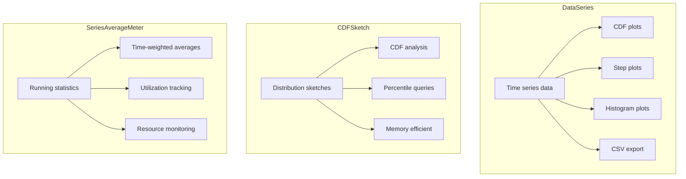
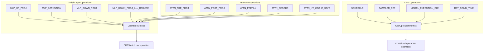
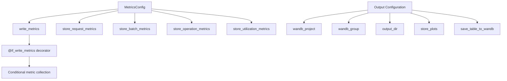

<!-- source: DeepWiki mcp.deepwiki.com · repo microsoft/vidur · page 8 Metrics and Analysis · fetched 2026-10-26 -->

# Metrics and Analysis

Relevant source files

The following files were used as context for generating this wiki page:

- [assets/batch_size.png](assets/batch_size.png)
- [assets/decode_time_execution_plus_preemption_normalized.png](assets/decode_time_execution_plus_preemption_normalized.png)
- [assets/prefill_e2e_time.png](assets/prefill_e2e_time.png)
- [assets/request_e2e_time.png](assets/request_e2e_time.png)
- [vidur/metrics/metrics_store.py](vidur/metrics/metrics_store.py)

This document covers Vidur's comprehensive metrics collection, storage, and analysis system. The metrics system provides detailed performance measurements across all simulation components, from individual request latencies to system-wide throughput and hardware utilization statistics. For specific performance indicators tracked by the simulator, see [Performance Metrics](#8.1). For visualization tools and monitoring integrations, see [Visualization and Monitoring](#8.2). For advanced statistical analysis capabilities, see [Advanced Analytics](#8.3).

## Metrics System Architecture

The metrics system in Vidur is built around a centralized `MetricsStore` that collects performance data from all simulation components and provides multiple output formats for analysis.

**Sources:** [vidur/metrics/metrics_store.py:1-822]()

## MetricsStore Component

The `MetricsStore` class serves as the central hub for all metrics collection in Vidur. It initializes multiple data structures to track different types of performance metrics and provides event-driven interfaces for the simulation engine to record data points.

**Sources:** [vidur/metrics/metrics_store.py:50-237]()

## Metric Collection Events

The metrics system uses an event-driven architecture where simulation components call specific methods on the `MetricsStore` when significant events occur.

### Request Lifecycle Events

**Sources:** [vidur/metrics/metrics_store.py:488-821]()

## Metric Categories

The system categorizes metrics into several distinct types, each using appropriate data structures for efficient storage and analysis.

| Metric Category | Data Structure | Examples |
|-----------------|----------------|----------|
| Request Time Distributions | `DataSeries` | `REQUEST_E2E_TIME`, `REQUEST_EXECUTION_TIME` |
| Token Time Distributions | `CDFSketch` | `DECODE_TOKEN_EXECUTION_PLUS_PREMPTION_TIME` |
| Batch Count Distributions | `CDFSketch` | `BATCH_NUM_TOKENS`, `BATCH_SIZE` |
| Operation Metrics | `CDFSketch` | `MLP_UP_PROJ`, `ATTN_PREFILL`, `ATTN_DECODE` |
| CPU Operation Metrics | `CDFSketch` | `SCHEDULE`, `SAMPLER_E2E`, `MODEL_EXECUTION_E2E` |
| Utilization Metrics | `SeriesAverageMeter` | Memory usage, busy time, MFU per replica |

**Sources:** [vidur/metrics/constants.py]() (imported in [vidur/metrics/metrics_store.py:13-23]())

## Data Structures for Metrics Storage

Vidur uses specialized data structures optimized for different types of performance analysis:

The `DataSeries` class handles time-indexed data with configurable subsampling, while `CDFSketch` provides memory-efficient distribution tracking. `SeriesAverageMeter` calculates running averages for utilization metrics.

**Sources:** [vidur/metrics/data_series.py](), [vidur/metrics/cdf_sketch.py](), [vidur/metrics/series_average_meter.py]() (imported in [vidur/metrics/metrics_store.py:24-25]())

## Hardware Performance Metrics

The system tracks detailed hardware operation timings through the `on_replica_stage_schedule` method, recording execution times for individual GPU operations:

The `MFUCalculator` computes Model FLOPS Utilization (MFU) metrics to measure how efficiently the hardware is being used during model execution.

**Sources:** [vidur/metrics/metrics_store.py:690-813](), [vidur/utils/mfu_calculator.py]() (imported at [vidur/metrics/metrics_store.py:26]())

## Configuration and Output Control

The metrics system behavior is controlled through the `MetricsConfig` which determines what metrics to collect and how to output them:

The `@if_write_metrics` decorator ensures that metric collection only occurs when enabled, preventing performance overhead during runs where metrics are not needed.

**Sources:** [vidur/metrics/metrics_store.py:31-36](), [vidur/metrics/metrics_store.py:52-54]()

---

