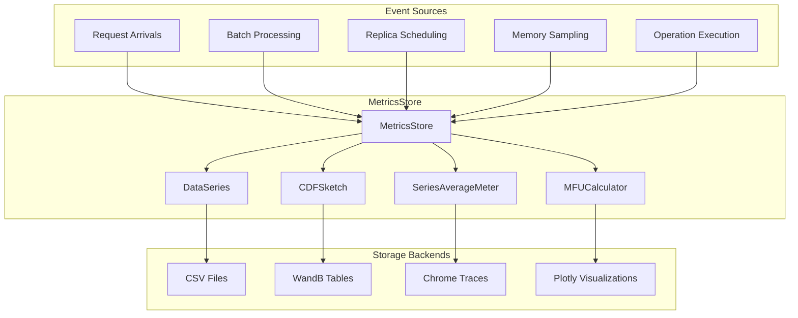
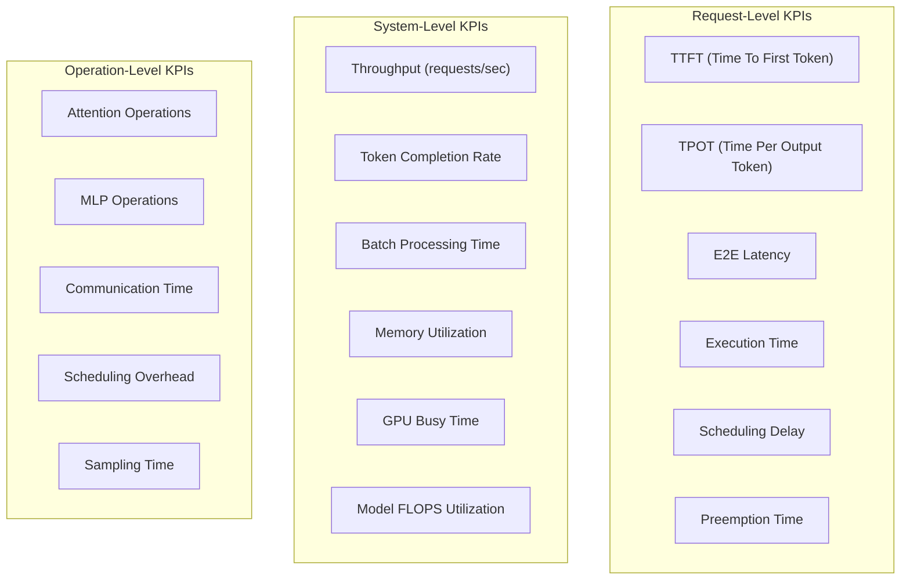
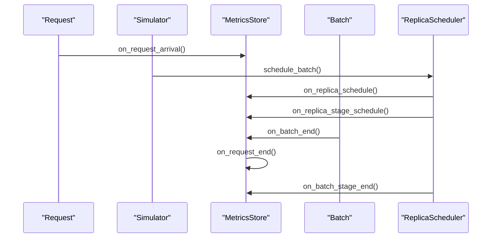

<!-- source: DeepWiki mcp.deepwiki.com · repo microsoft/vidur · page 8.1 Performance Metrics · fetched 2026-10-26 -->

# Performance Metrics

Relevant source files

The following files were used as context for generating this wiki page:

- [assets/batch_size.png](assets/batch_size.png)
- [assets/decode_time_execution_plus_preemption_normalized.png](assets/decode_time_execution_plus_preemption_normalized.png)
- [assets/prefill_e2e_time.png](assets/prefill_e2e_time.png)
- [assets/request_e2e_time.png](assets/request_e2e_time.png)
- [vidur/metrics/metrics_store.py](vidur/metrics/metrics_store.py)

This document covers the comprehensive performance measurement system in Vidur that tracks key performance indicators (KPIs) during LLM inference simulations. The metrics system provides detailed timing, throughput, utilization, and resource usage data for analyzing simulation results.

For information about visualization and monitoring tools, see [Visualization and Monitoring](#8.2). For advanced statistical analysis features, see [Advanced Analytics](#8.3).

## Overview

Vidur's metrics system captures performance data at multiple granularities - from individual operations within GPU kernels to end-to-end request latencies. The system is designed to provide insights into both system-level performance characteristics and fine-grained operation timing for optimization analysis.

The metrics collection is event-driven and integrated throughout the simulation pipeline, capturing data as requests flow through scheduling, batching, execution, and completion phases.

## Metrics Architecture

Sources: [vidur/metrics/metrics_store.py:50-252]()

## Core Data Structures

The metrics system uses specialized data structures for different types of performance measurements:

### DataSeries
Handles time-series data with configurable subsampling for memory efficiency. Used for tracking metrics that change over time, such as completion rates and per-batch measurements.

### CDFSketch  
Provides cumulative distribution function analysis for understanding performance distributions. Used for latency distributions, batch sizes, and operation timing.

### SeriesAverageMeter
Maintains running averages and statistics for continuous metrics like memory utilization and GPU busy time.

### MFUCalculator
Calculates Model FLOPS Utilization (MFU) to measure how efficiently the hardware is being used relative to theoretical peak performance.

Sources: [vidur/metrics/metrics_store.py:24-26](), [vidur/metrics/data_series.py](), [vidur/metrics/cdf_sketch.py](), [vidur/metrics/series_average_meter.py](), [vidur/utils/mfu_calculator.py]()

## Key Performance Indicators

### Request Metrics

The system tracks detailed per-request performance metrics stored in `RequestMetricsTimeDistributions` and `RequestMetricsHistogram`:

- **Time to First Token (TTFT)**: `REQUEST_E2E_TIME` minus decode time
- **Time Per Output Token (TPOT)**: Derived from `DECODE_TIME_EXECUTION_PLUS_PREEMPTION_NORMALIZED`  
- **End-to-End Latency**: Total time from request arrival to completion
- **Execution Time**: Actual processing time excluding queuing delays
- **Preemption Time**: Time spent preempted during execution
- **Scheduling Delay**: Time waiting in queue before execution begins

Sources: [vidur/metrics/metrics_store.py:63-95](), [vidur/metrics/metrics_store.py:515-577]()

### Batch Metrics

Batch-level metrics tracked in `BatchMetricsTimeDistribution` and `BatchMetricsCountDistribution`:

- **Batch Execution Time**: Total time to process a batch
- **Batch Size**: Number of requests in each batch
- **Token Counts**: Prefill tokens, decode tokens, and total tokens per batch
- **Memory Utilization**: GPU memory usage during batch processing

Sources: [vidur/metrics/metrics_store.py:96-136](), [vidur/metrics/metrics_store.py:657-680]()

### Operation Metrics

Fine-grained timing for individual GPU operations tracked in `OperationMetrics` and `CpuOperationMetrics`:

**GPU Operations:**
- Attention operations (prefill/decode, pre/post projection)
- MLP operations (up projection, activation, down projection)
- Communication (all-reduce, pipeline parallel)
- Memory operations (KV cache, RoPE)
- Normalization layers

**CPU Operations:**
- Scheduling overhead
- Input preparation
- Output processing  
- Sampling
- Ray communication

Sources: [vidur/metrics/metrics_store.py:706-813](), [vidur/metrics/constants.py]()

## Metrics Collection Flow

The metrics collection follows an event-driven pattern where different components in the simulation pipeline trigger metric recording:

1. **Request Arrival**: Records arrival time and request characteristics
2. **Scheduling Events**: Tracks scheduling delays and resource allocation  
3. **Execution Events**: Captures detailed operation timing and resource usage
4. **Completion Events**: Records final metrics and calculates derived KPIs

Sources: [vidur/metrics/metrics_store.py:488-822]()

## Configuration and Output

The metrics system behavior is controlled through `MetricsConfig` with options for:

- **Selective Collection**: Enable/disable different metric categories
- **Subsampling**: Reduce memory usage for large simulations  
- **Output Formats**: CSV files, WandB integration, Chrome traces
- **Batch Filtering**: Focus analysis on specific batch ranges
- **Visualization**: Automatic plot generation

The `@if_write_metrics` decorator conditionally enables metric collection based on configuration, allowing overhead-free simulation runs when metrics are disabled.

Sources: [vidur/metrics/metrics_store.py:31-36](), [vidur/metrics/metrics_store.py:239-252]()

## Integration Points

The metrics system integrates with external tools for analysis and monitoring:

- **WandB Integration**: Automatic experiment tracking and table upload
- **Chrome Tracing**: Timeline visualization of execution events  
- **CSV Export**: Raw data export for custom analysis
- **Plotly Visualizations**: Automatic CDF plots, histograms, and time series

Output files are organized in a structured directory hierarchy under the configured `output_dir` with separate folders for plots, tables, and traces.

Sources: [vidur/metrics/metrics_store.py:254-303](), [vidur/metrics/metrics_store.py:477-486]()

---

