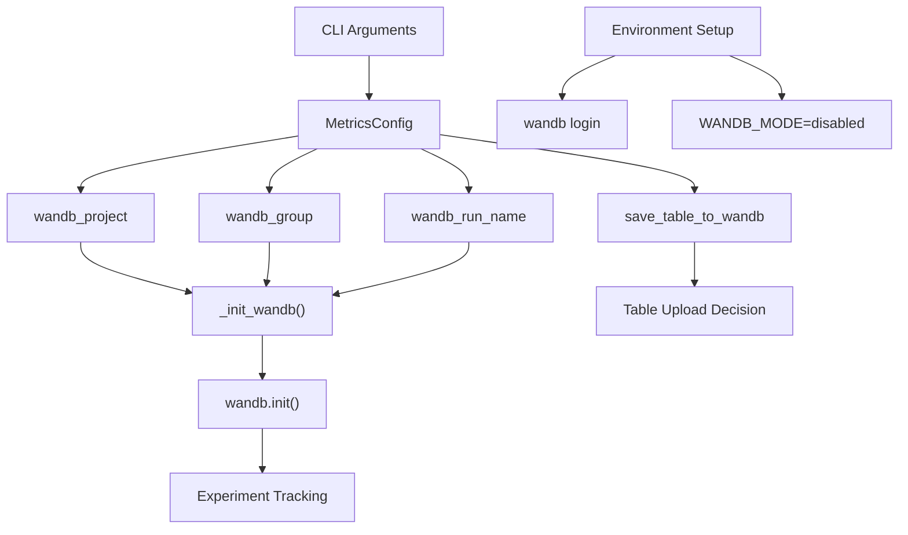
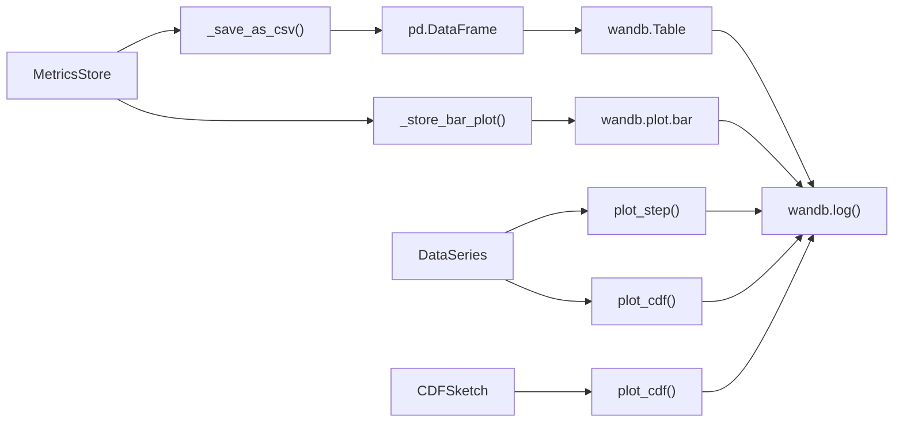
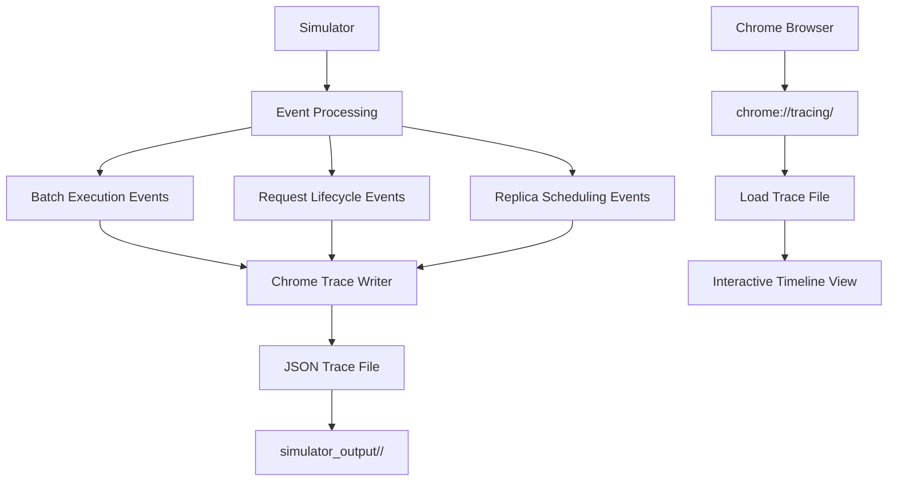
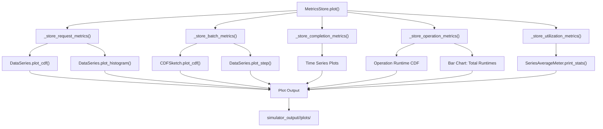
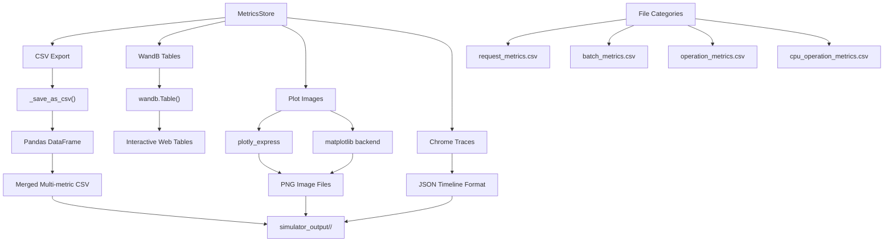
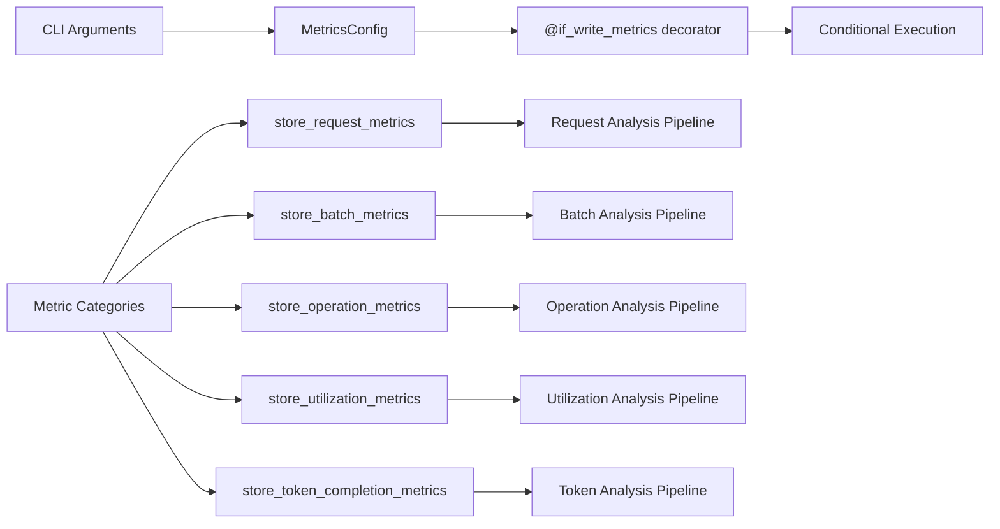

<!-- source: DeepWiki mcp.deepwiki.com · repo microsoft/vidur · page 8.2 Visualization and Monitoring · fetched 2026-10-26 -->

# Visualization and Monitoring

Relevant source files

The following files were used as context for generating this wiki page:

- [LICENSE](LICENSE)
- [README.md](README.md)
- [assets/chrome_trace.png](assets/chrome_trace.png)
- [vidur/metrics/metrics_store.py](vidur/metrics/metrics_store.py)

This page covers Vidur's comprehensive visualization and monitoring capabilities, including experiment tracking through WandB integration, detailed execution visualization via Chrome traces, and automated plot generation for performance analysis. The system provides multiple output formats including interactive plots, CSV exports, and real-time monitoring dashboards.

For information about the underlying performance metrics being visualized, see [Performance Metrics](#8.1). For advanced statistical analysis tools used in visualization, see [Advanced Analytics](#8.3).

## WandB Integration

Vidur provides seamless integration with Weights & Biases (WandB) for experiment tracking and collaborative analysis. The integration is managed through the `MetricsStore` class and configured via command-line arguments.

### Configuration and Setup

WandB integration is controlled through several configuration parameters:

**WandB Integration Architecture**
Sources: [vidur/metrics/metrics_store.py:239-252](), [README.md:77-88]()

The system initializes WandB through the `_init_wandb` method, which creates a new experiment run with the complete simulation configuration uploaded as metadata. Users can opt out by setting environment variables or leaving configuration fields empty.

### Data Logging and Visualization

WandB receives multiple types of visualization data:

| Data Type | Method | Description |
|-----------|--------|-------------|
| Tables | `wandb.Table` | Raw metrics data as interactive tables |
| Bar Plots | `wandb.plot.bar` | Operation runtime breakdowns |
| Time Series | `DataSeries.plot_step` | Request completion rates over time |
| CDF Plots | `CDFSketch.plot_cdf` | Distribution analysis |

**WandB Data Flow**

Sources: [vidur/metrics/metrics_store.py:254-302](), [vidur/metrics/metrics_store.py:268-270](), [vidur/metrics/metrics_store.py:280-295]()

## Chrome Tracing

Vidur exports detailed Chrome traces that provide microsecond-level visibility into simulation execution. These traces can be opened in Chrome's `chrome://tracing/` interface for interactive analysis.

### Trace Generation System

Chrome traces capture the complete execution timeline with nested events:

**Chrome Trace Export Flow**
Sources: [README.md:131-133]()

The traces include hierarchical event structures showing:
- Request arrival and completion events
- Batch formation and execution phases  
- Replica scheduling decisions
- Memory utilization changes
- Pipeline stage transitions

## Plot Generation System

The visualization system automatically generates comprehensive plots for performance analysis across multiple categories of metrics.

### Visualization Architecture

**Plot Generation System Overview**
Sources: [vidur/metrics/metrics_store.py:476-485](), [vidur/metrics/metrics_store.py:369-388](), [vidur/metrics/metrics_store.py:390-438]()

### Plot Categories

The system generates several categories of performance visualizations:

**Request Metrics Visualization**
- CDF plots for latency distributions (TTFT, TPOT, E2E time)
- Histograms for request characteristics (token counts, inter-arrival times)
- Normalized timing analysis

**Batch Metrics Visualization**  
- Execution time distributions per batch
- Batch size and token count analysis
- Individual batch performance tracking

**Operation-Level Metrics**
- Fine-grained operation timing (MLP, attention, communication)
- Runtime breakdown bar charts
- Per-batch operation analysis

Sources: [vidur/metrics/metrics_store.py:304-367](), [vidur/metrics/metrics_store.py:384-388](), [vidur/metrics/metrics_store.py:394-403]()

## Data Export Capabilities

Vidur provides comprehensive data export functionality for offline analysis and integration with external tools.

### Export Formats and Methods

**Data Export Architecture**
Sources: [vidur/metrics/metrics_store.py:254-270](), [vidur/metrics/metrics_store.py:377-382](), [vidur/metrics/metrics_store.py:434-437]()

### CSV Export Features

The CSV export system provides several advanced capabilities:

- **Multi-metric merging**: Combines related metrics into single files using pandas outer joins
- **Configurable subsampling**: Reduces file sizes for large simulations  
- **Hierarchical organization**: Separates request, batch, and operation-level metrics
- **WandB synchronization**: Automatically uploads CSV data as interactive tables

Sources: [vidur/metrics/metrics_store.py:261-267](), [vidur/metrics/metrics_store.py:343-349](), [vidur/metrics/metrics_store.py:359-367]()

## Configuration and Control

The visualization and monitoring system provides extensive configuration options through the metrics configuration structure.

### Configuration Parameters

| Parameter | Purpose | Default Behavior |
|-----------|---------|------------------|
| `write_metrics` | Global metrics toggle | Controls all metric collection |
| `store_plots` | Plot generation control | Enables/disables plot creation |
| `save_table_to_wandb` | WandB table uploads | Controls CSV-to-table conversion |
| `subsamples` | Data sampling rate | Reduces memory usage for large runs |
| `keep_individual_batch_metrics` | Per-batch tracking | Detailed vs. aggregate analysis |

**Configuration Control Flow**

Sources: [vidur/metrics/metrics_store.py:31-36](), [vidur/metrics/metrics_store.py:52-62](), [vidur/metrics/metrics_store.py:640-643]()

The `@if_write_metrics` decorator provides a clean mechanism to disable all visualization and monitoring overhead when not needed, making the system suitable for performance-critical scenarios where only core simulation results are required.

---

