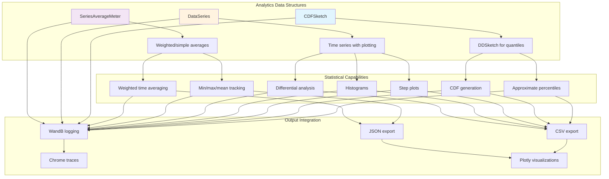
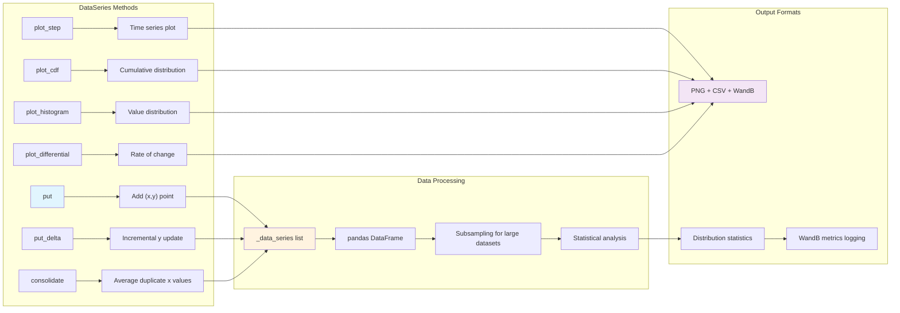
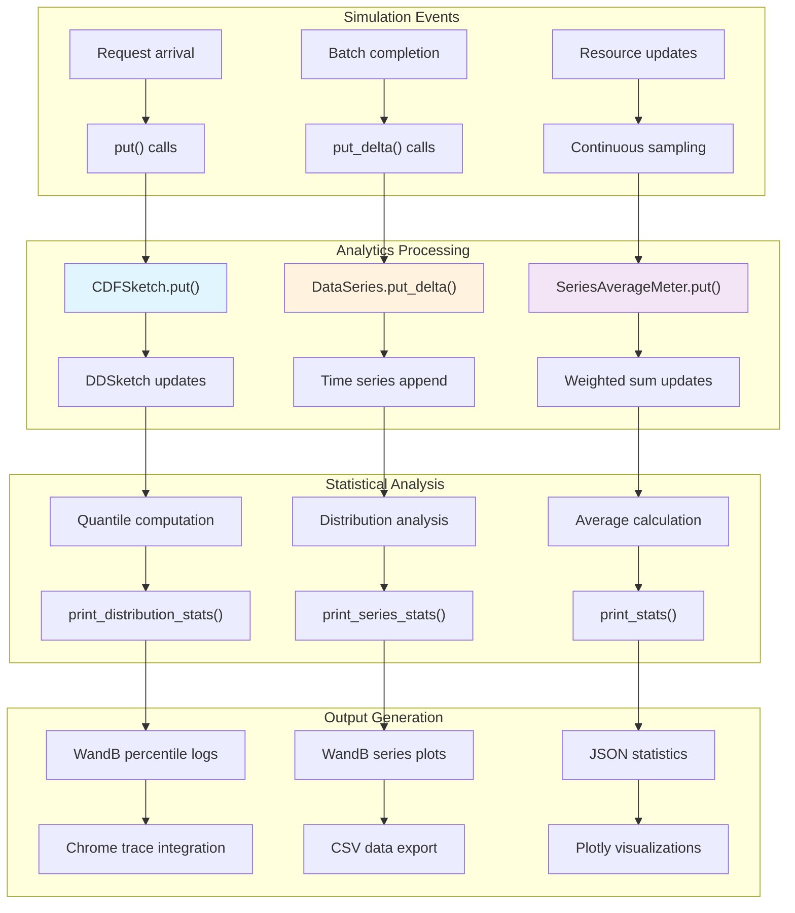

<!-- source: DeepWiki mcp.deepwiki.com · repo microsoft/vidur · page 8.3 Advanced Analytics · fetched 2026-10-26 -->

# Advanced Analytics

Relevant source files

The following files were used as context for generating this wiki page:

- [vidur/metrics/cdf_sketch.py](vidur/metrics/cdf_sketch.py)
- [vidur/metrics/data_series.py](vidur/metrics/data_series.py)
- [vidur/metrics/series_average_meter.py](vidur/metrics/series_average_meter.py)
- [vidur/profiling/common/model_config.py](vidur/profiling/common/model_config.py)

This document covers Vidur's advanced statistical analysis capabilities, including specialized data structures for quantile computation, time series analysis, and comprehensive performance measurement. These analytics tools provide the foundation for detailed performance characterization beyond basic metrics collection.

For basic performance metrics like TTFT and throughput, see [Performance Metrics](#8.1). For visualization and monitoring integration, see [Visualization and Monitoring](#8.2).

## Core Analytics Components

Vidur implements three specialized statistical data structures that form the backbone of its advanced analytics capabilities:

**Sources**: [vidur/metrics/cdf_sketch.py:1-151](), [vidur/metrics/data_series.py:1-339](), [vidur/metrics/series_average_meter.py:1-102]()

## Statistical Data Structures

### CDFSketch

The `CDFSketch` class provides memory-efficient approximate quantile computation using the DDSketch algorithm, enabling accurate percentile analysis of large datasets without storing all individual values.

| Method | Purpose | Statistical Output |
|--------|---------|-------------------|
| `put(data)` | Add single data point | Updates internal sketch |
| `put_delta(delta)` | Incremental update | Adds delta to last value |
| `print_distribution_stats()` | Log percentiles | 25th, 50th, 75th, 95th, 99th, 99.9th |
| `plot_cdf()` | Generate CDF plot | 101-point quantile curve |

The class maintains a `DDSketch` with 0.001 relative accuracy [vidur/metrics/cdf_sketch.py:20]() and automatically logs comprehensive percentile statistics to both console and WandB [vidur/metrics/cdf_sketch.py:63-89]().

**Sources**: [vidur/metrics/cdf_sketch.py:12-151]()

### DataSeries

The `DataSeries` class handles two-dimensional time series data with extensive plotting and analysis capabilities:

Key features include automatic subsampling for large datasets [vidur/metrics/data_series.py:173-182](), comprehensive statistical analysis [vidur/metrics/data_series.py:112-134](), and multiple visualization modes.

**Sources**: [vidur/metrics/data_series.py:14-339]()

### SeriesAverageMeter

The `SeriesAverageMeter` provides time-weighted averaging for metrics that vary over time, supporting both simple and weighted mean calculations:

| Configuration | Behavior | Use Case |
|---------------|----------|----------|
| `use_weighted_mean=True` | Time-weighted integration | Memory utilization over time |
| `use_weighted_mean=False` | Simple arithmetic mean | Event-based metrics |

The weighted mean implementation [vidur/metrics/series_average_meter.py:37-46]() computes the integral of the metric over time, divided by the total time duration, providing accurate time-based averages for continuous metrics.

**Sources**: [vidur/metrics/series_average_meter.py:10-102]()

## Data Collection Pipeline

The analytics components integrate seamlessly into Vidur's event-driven simulation architecture:

**Sources**: [vidur/metrics/cdf_sketch.py:35-44](), [vidur/metrics/data_series.py:57-74](), [vidur/metrics/series_average_meter.py:49-69]()

## Statistical Capabilities

### Distribution Analysis

The `CDFSketch` provides comprehensive percentile analysis without storing raw data:

- **Memory Efficiency**: Uses DDSketch with configurable accuracy [vidur/metrics/cdf_sketch.py:20]()
- **Percentile Coverage**: 25th, 50th, 75th, 95th, 99th, 99.9th percentiles [vidur/metrics/cdf_sketch.py:69-84]()
- **CDF Generation**: 101-point quantile curves for detailed distribution analysis [vidur/metrics/cdf_sketch.py:93-95]()

### Time Series Analysis

The `DataSeries` class supports multiple analysis modes:

| Analysis Type | Method | Statistical Output |
|---------------|--------|-------------------|
| **Step Plot** | `plot_step()` | Cumulative sum progression |
| **CDF Plot** | `plot_cdf()` | Value distribution percentiles |
| **Histogram** | `plot_histogram()` | 25-bin frequency distribution |
| **Differential** | `plot_differential()` | Rate of change analysis |

Each analysis automatically computes min, max, mean, median, and percentiles [vidur/metrics/data_series.py:112-134]().

**Sources**: [vidur/metrics/data_series.py:149-338]()

## Integration with Monitoring Systems

### WandB Integration

All analytics components provide automatic WandB logging:

- **Table Logging**: Complete datasets as WandB tables [vidur/metrics/cdf_sketch.py:108-110]()
- **Plot Generation**: Interactive line plots and visualizations [vidur/metrics/data_series.py:189-198]()
- **Metrics Logging**: Statistical summaries as scalar metrics [vidur/metrics/series_average_meter.py:93-101]()

### Export Formats

The system supports multiple output formats for offline analysis:

- **CSV Export**: Time series and distribution data [vidur/metrics/data_series.py:140-143]()
- **JSON Export**: Statistical summaries and metadata [vidur/metrics/series_average_meter.py:84-91]()
- **PNG Images**: High-resolution plots using Plotly [vidur/metrics/cdf_sketch.py:141-149]()

**Sources**: [vidur/metrics/cdf_sketch.py:108-150](), [vidur/metrics/data_series.py:139-143](), [vidur/metrics/series_average_meter.py:84-101]()

---

