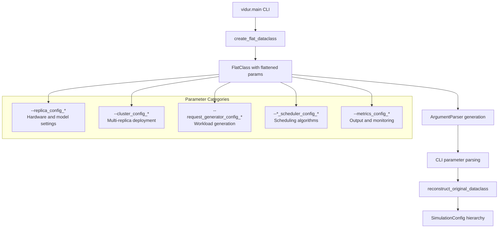
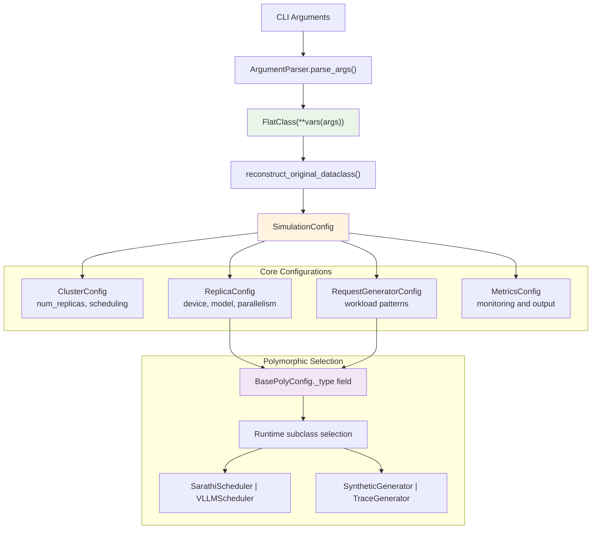
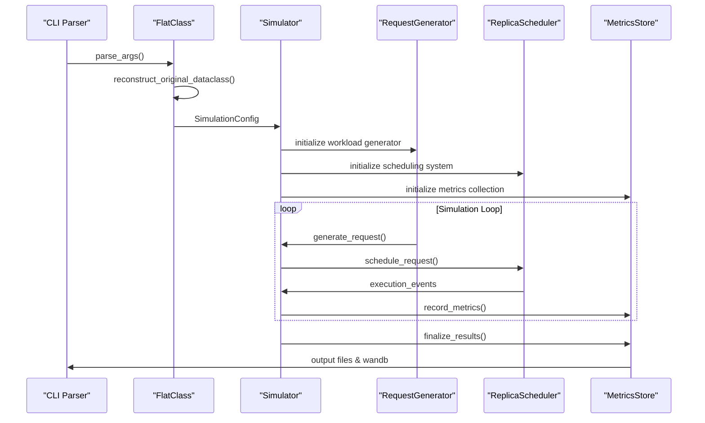

<!-- source: DeepWiki mcp.deepwiki.com · repo microsoft/vidur · page 9 Running Simulations · fetched 2026-10-26 -->

# Running Simulations

<details>
<summary>Relevant source files</summary>

The following files were used as context for generating this wiki page:

- [LICENSE](LICENSE)
- [README.md](README.md)
- [assets/chrome_trace.png](assets/chrome_trace.png)
- [vidur/config/flat_dataclass.py](vidur/config/flat_dataclass.py)

</details>


This page provides a practical guide to executing Vidur simulations with various configurations and parameters. It covers the command-line interface, common simulation scenarios, parameter configuration, and result interpretation.

For information about setting up the development environment, see [Development Environment](#10.1). For details about the underlying configuration architecture, see [Configuration System](#4). For information about analyzing simulation results, see [Metrics and Analysis](#8).

## Basic Usage

The Vidur simulator is executed through the `vidur.main` module as a Python package. The simplest way to run a simulation is with default parameters:

```bash
python -m vidur.main
```

This command will run a basic simulation using default configuration values. However, most practical use cases require specific parameters for hardware, models, and workload characteristics.

### Getting Help

To see all available command-line parameters:

```bash
python -m vidur.main -h
```

This displays the comprehensive list of configuration options generated automatically from the configuration system's dataclasses.

**Sources:** [README.md:92-96](), [README.md:122-126]()

## CLI Parameter System

Vidur uses a sophisticated configuration system that flattens nested dataclass configurations into command-line arguments. This allows for precise control over all simulation parameters while maintaining a clean hierarchical structure internally.

### Parameter Structure

The CLI parameters follow a predictable naming pattern based on the configuration hierarchy:



**Parameter Naming Convention**

Parameters are named using the pattern: `--{parent_config}_{field_name}` where nested configurations are flattened with underscores. For example:
- `--replica_config_device` sets the device type (A100, H100, etc.)
- `--replica_config_model_name` specifies the model to simulate
- `--synthetic_request_generator_config_num_requests` controls synthetic workload size

**Sources:** [vidur/config/flat_dataclass.py:139-143](), [vidur/config/flat_dataclass.py:87-136]()

## Common Simulation Scenarios

### Single Replica Basic Simulation

For testing a single model configuration with synthetic load:

```bash
python -m vidur.main \
  --replica_config_device a100 \
  --replica_config_model_name meta-llama/Meta-Llama-3-8B \
  --cluster_config_num_replicas 1 \
  --replica_config_tensor_parallel_size 1 \
  --replica_config_num_pipeline_stages 1 \
  --request_generator_config_type synthetic \
  --synthetic_request_generator_config_num_requests 100
```

### Trace-Based Workload Simulation

For replaying real workload patterns from trace files:

```bash
python -m vidur.main \
  --replica_config_device a100 \
  --replica_config_model_name meta-llama/Meta-Llama-3-8B \
  --request_generator_config_type trace \
  --trace_request_generator_config_trace_file ./data/processed_traces/splitwise_conv.csv \
  --interval_generator_config_type poisson \
  --poisson_request_interval_generator_config_qps 6.45
```

### Multi-GPU Tensor Parallel Simulation

For distributed inference across multiple GPUs:

```bash
python -m vidur.main \
  --replica_config_device a100 \
  --replica_config_model_name meta-llama/Llama-2-70b-hf \
  --replica_config_tensor_parallel_size 4 \
  --replica_config_num_pipeline_stages 1 \
  --cluster_config_num_replicas 1
```

### Advanced Scheduling Configuration

For testing different scheduling algorithms like Sarathi:

```bash
python -m vidur.main \
  --replica_config_device a100 \
  --replica_config_model_name meta-llama/Meta-Llama-3-8B \
  --replica_scheduler_config_type sarathi \
  --sarathi_scheduler_config_batch_size_cap 512 \
  --sarathi_scheduler_config_chunk_size 512
```

**Sources:** [README.md:100-120](), [README.md:25-46]()

## Configuration Flow Diagram

The following diagram shows how CLI parameters flow through the system to create the final simulation configuration:



**Sources:** [vidur/config/flat_dataclass.py:48-85](), [vidur/config/flat_dataclass.py:151-216]()

## Parameter Categories

### Hardware Configuration Parameters

| Parameter | Description | Example Values |
|-----------|-------------|----------------|
| `--replica_config_device` | GPU device type | `a100`, `h100`, `a40` |
| `--replica_config_tensor_parallel_size` | TP dimension | `1`, `2`, `4`, `8` |
| `--replica_config_num_pipeline_stages` | PP dimension | `1`, `2`, `4` |
| `--cluster_config_num_replicas` | Number of replicas | `1`, `2`, `4` |

### Model Configuration Parameters

| Parameter | Description | Example Values |
|-----------|-------------|----------------|
| `--replica_config_model_name` | HuggingFace model name | `meta-llama/Meta-Llama-3-8B` |
| `--random_forrest_execution_time_predictor_config_prediction_max_tokens_per_request` | Max context length | `4096`, `16384` |

### Workload Configuration Parameters

| Parameter | Description | Example Values |
|-----------|-------------|----------------|
| `--request_generator_config_type` | Workload source type | `synthetic`, `trace` |
| `--synthetic_request_generator_config_num_requests` | Request count for synthetic | `100`, `1000`, `10000` |
| `--poisson_request_interval_generator_config_qps` | Queries per second | `1.0`, `6.45`, `10.0` |

**Sources:** [README.md:25-46](), [README.md:35-41]()

## Simulation Execution Flow



**Sources:** [vidur/config/flat_dataclass.py:87-136](), [README.md:92-96]()

## Simulation Output

After running a simulation, Vidur generates several types of output:

### Directory Structure

```
simulator_output/<TIMESTAMP>/
├── chrome_trace.json          # Chrome tracing visualization
├── metrics.json              # Detailed performance metrics
├── config.json               # Full simulation configuration
└── wandb/                    # Weights & Biases integration files
```

### Metrics Files

The simulator outputs comprehensive performance metrics including:
- **Request-level metrics**: Time to First Token (TTFT), Time Per Output Token (TPOT), End-to-end latency
- **System-level metrics**: Throughput, GPU utilization, batch sizes
- **Distribution analysis**: Percentiles, CDFs, histograms

### Chrome Tracing

Vidur exports detailed Chrome traces showing the timeline of request processing, batch formations, and scheduling decisions. These can be viewed by navigating to `chrome://tracing/` and loading the generated JSON file.

**Sources:** [README.md:128-134]()

## Advanced Configuration Examples

### Large Model with Pipeline Parallelism

```bash
python -m vidur.main \
  --replica_config_device a100 \
  --replica_config_model_name meta-llama/Llama-2-70b-hf \
  --replica_config_tensor_parallel_size 2 \
  --replica_config_num_pipeline_stages 2 \
  --cluster_config_num_replicas 1
```

### High QPS Stress Testing

```bash
python -m vidur.main \
  --replica_config_device h100 \
  --replica_config_model_name meta-llama/Meta-Llama-3-8B \
  --poisson_request_interval_generator_config_qps 50.0 \
  --synthetic_request_generator_config_num_requests 5000 \
  --sarathi_scheduler_config_batch_size_cap 1024
```

### Extended Context Length Support

For models supporting longer context lengths like Llama-3:

```bash
python -m vidur.main \
  --replica_config_model_name meta-llama/Meta-Llama-3-8B \
  --random_forrest_execution_time_predictor_config_prediction_max_prefill_chunk_size 16384 \
  --random_forrest_execution_time_predictor_config_prediction_max_batch_size 512 \
  --random_forrest_execution_time_predictor_config_prediction_max_tokens_per_request 16384
```

**Sources:** [README.md:35-41](), [README.md:100-120]()

## Troubleshooting

### Common Issues

**Invalid Model/Device Combinations**: Ensure the model is supported on the specified device SKU by checking the compatibility matrix in the main README.

**Memory Constraints**: Large models may require specific tensor parallel configurations. Refer to the supported model configurations for guidance.

**Trace File Issues**: When using trace-based workloads, ensure the trace file exists and follows the expected CSV format.

**Parameter Validation**: Use the help command (`-h`) to verify parameter names and acceptable values, as the configuration system provides detailed validation.

### Debugging Tips

1. Start with minimal configurations and gradually add complexity
2. Use the Chrome tracing output to visualize scheduling behavior
3. Check the generated `config.json` file to verify parameter parsing
4. Monitor wandb logs for real-time simulation progress

**Sources:** [README.md:122-126](), [README.md:25-34]()

---

