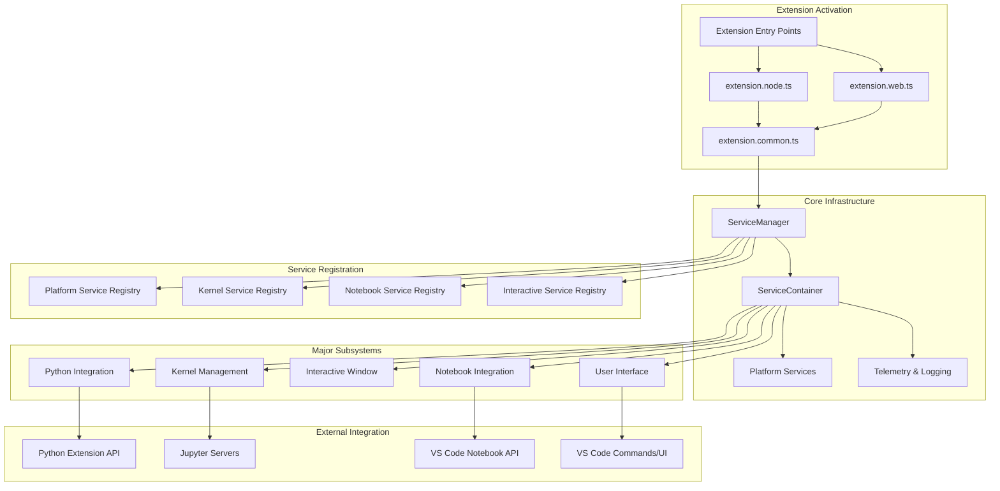
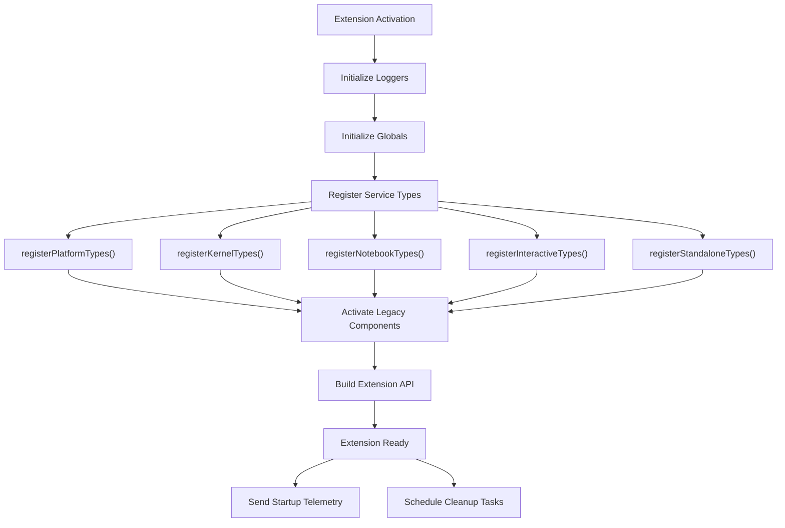
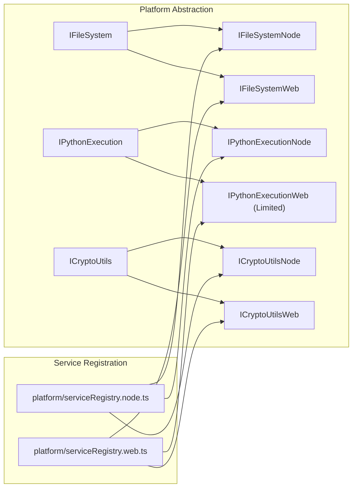
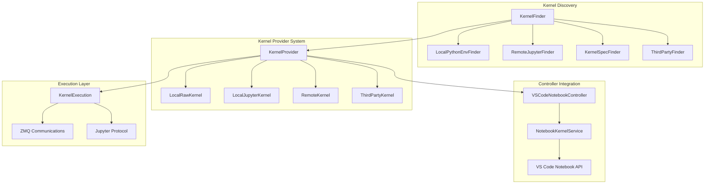
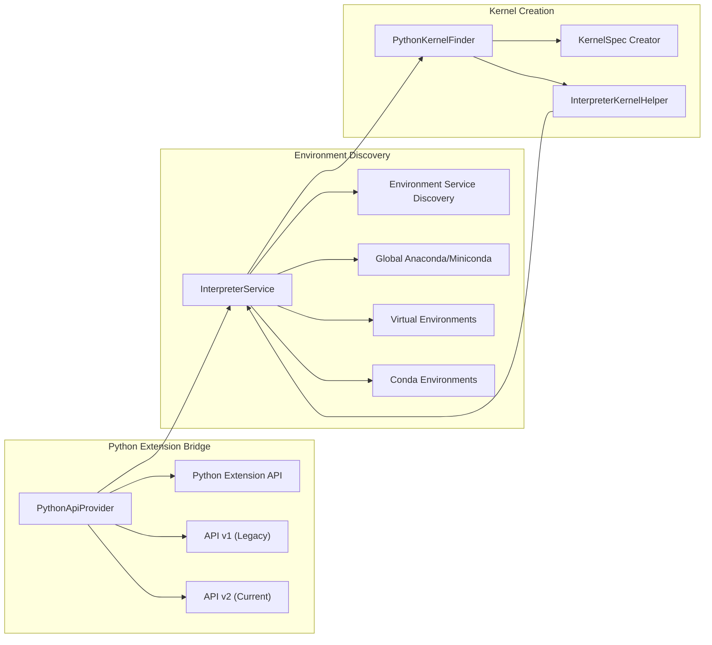
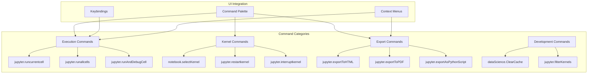
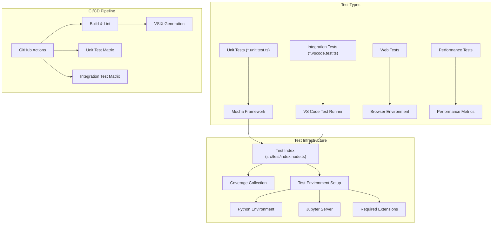
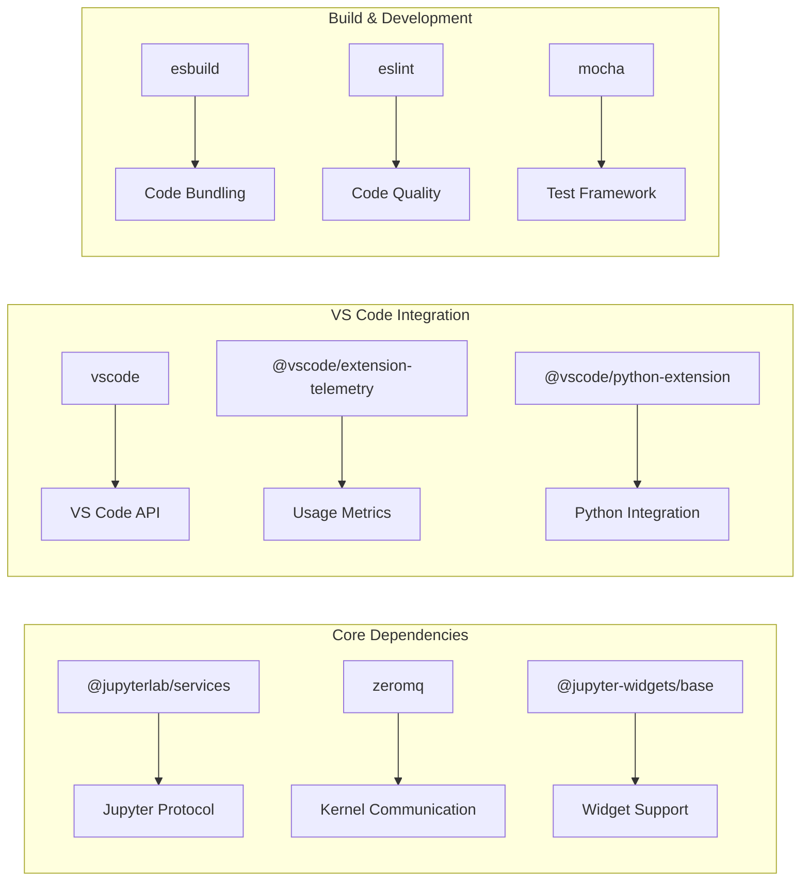

<!-- source: DeepWiki mcp.deepwiki.com · repo microsoft/vscode-jupyter · page 1 Overview · fetched 2026-10-26 -->

# Overview

Relevant source files

The following files were used as context for generating this wiki page:

- [.devcontainer/dev-with-python/Dockerfile](.devcontainer/dev-with-python/Dockerfile)
- [.devcontainer/dev/Dockerfile](.devcontainer/dev/Dockerfile)
- [.github/actions/create-venv-for-tests/action.yml](.github/actions/create-venv-for-tests/action.yml)
- [.github/instructions/typescript.instructions.md](.github/instructions/typescript.instructions.md)
- [.github/workflows/build-test.yml](.github/workflows/build-test.yml)
- [.nvmrc](.nvmrc)
- [.vscode/launch.json](.vscode/launch.json)
- [.vscode/tasks.json](.vscode/tasks.json)
- [CHANGELOG.md](CHANGELOG.md)
- [CONTRIBUTING.md](CONTRIBUTING.md)
- [README.md](README.md)
- [build/azure-pipeline.pre-release.yml](build/azure-pipeline.pre-release.yml)
- [build/azure-pipeline.stable.yml](build/azure-pipeline.stable.yml)
- [gulpfile.js](gulpfile.js)
- [package-lock.json](package-lock.json)
- [package.json](package.json)
- [src/api.pythonIntegration.d.ts](src/api.pythonIntegration.d.ts)
- [src/api.unstable.d.ts](src/api.unstable.d.ts)
- [src/extension.common.ts](src/extension.common.ts)
- [src/extension.node.ts](src/extension.node.ts)
- [src/extension.web.ts](src/extension.web.ts)
- [src/kernels/raw/finder/jupyterPaths.node.ts](src/kernels/raw/finder/jupyterPaths.node.ts)
- [src/kernels/raw/finder/jupyterPaths.node.unit.test.ts](src/kernels/raw/finder/jupyterPaths.node.unit.test.ts)
- [src/platform/common/cache.ts](src/platform/common/cache.ts)
- [src/platform/common/temp.node.ts](src/platform/common/temp.node.ts)
- [src/platform/common/temp.ts](src/platform/common/temp.ts)
- [src/platform/telemetry/startupTelemetry.ts](src/platform/telemetry/startupTelemetry.ts)
- [src/platform/vscode-path/platform.ts](src/platform/vscode-path/platform.ts)
- [src/standalone/devTools/clearCache.ts](src/standalone/devTools/clearCache.ts)
- [src/test/constants.node.ts](src/test/constants.node.ts)
- [src/test/index.node.ts](src/test/index.node.ts)
- [src/test/mocks/mementos.ts](src/test/mocks/mementos.ts)
- [src/test/standardTest.node.ts](src/test/standardTest.node.ts)
- [src/test/web/customReporter.ts](src/test/web/customReporter.ts)

This document provides a comprehensive overview of the VS Code Jupyter extension architecture, covering its core purpose, major subsystems, and how they interact to provide Jupyter notebook support within Visual Studio Code.

The VS Code Jupyter extension is a comprehensive system that brings Jupyter notebook functionality to Visual Studio Code, supporting both local and remote kernel execution, multiple programming languages, and integration with the Python extension ecosystem. This overview covers the extension's architecture, activation flow, and key subsystems that enable notebook editing, kernel management, and code execution.

For specific implementation details about individual subsystems, see the following related pages:
- Extension Infrastructure: [Extension Infrastructure](#2)
- Kernel Management: [Kernel Management](#3) 
- Notebook System: [Notebook System](#4)
- Interactive Window: [Interactive Window](#5)
- Python Integration: [Python Integration](#6)

## Extension Purpose and Capabilities

The Jupyter extension transforms VS Code into a powerful notebook editing environment by providing:

- **Multi-kernel support**: Execute code in Python, Julia, R, C#, and other Jupyter-compatible kernels
- **Dual environment support**: Works both in desktop VS Code and browser-based environments (vscode.dev, GitHub Codespaces)
- **Kernel management**: Automatic discovery and management of local Python environments, remote Jupyter servers, and kernel specifications
- **Interactive execution**: Both traditional notebook interface and Interactive Window for script-based development
- **Python ecosystem integration**: Deep integration with the Python extension for environment discovery and IntelliSense

Sources: [package.json:1-52](), [README.md:1-50]()

## High-Level System Architecture

The extension follows a modular service-oriented architecture with dependency injection, supporting both Node.js (desktop) and Web (browser) environments through platform-specific implementations.

Sources: [src/extension.node.ts:75-130](), [src/extension.web.ts:80-120](), [src/extension.common.ts:158-175]()

## Extension Activation Flow

The extension uses a carefully orchestrated activation sequence that initializes services, registers components, and prepares the environment for notebook operations.

Sources: [src/extension.node.ts:213-240](), [src/extension.common.ts:158-175](), [src/extension.node.ts:45-50]()

## Core Subsystem Overview

### Platform Infrastructure

The platform layer provides foundational services that abstract away environment-specific implementations, enabling the extension to run in both Node.js and Web environments.

| Component | Node Implementation | Web Implementation | Purpose |
|-----------|--------------------|--------------------|---------|
| File System | `IFileSystemNode` | `IFileSystemWeb` | File operations and path handling |
| Process Execution | `IPythonExecutionFactory` | Not Available | Running Python interpreters |
| Environment Variables | `ICustomEnvironmentVariablesProvider` | Limited Support | Environment configuration |
| Crypto | `ICryptoUtils` | Web Crypto API | Encryption/hashing operations |

Sources: [src/platform/serviceRegistry.node.ts](), [src/platform/serviceRegistry.web.ts](), [src/platform/common/platform/types.ts]()

### Kernel Management System

The kernel management system handles discovery, instantiation, and lifecycle management of Jupyter kernels across different connection types and environments.

Sources: [src/kernels/kernelProvider.ts](), [src/kernels/kernelFinder.ts](), [src/notebooks/controllers/]()

### Python Environment Integration

The extension integrates deeply with the Python extension to discover interpreters and manage Python-specific kernels, providing seamless environment switching and kernel creation.

Sources: [src/platform/api/pythonApi.ts](), [src/platform/interpreter/](), [src/kernels/raw/finder/]()

## Configuration and Command System

The extension provides extensive configuration options and commands that integrate with VS Code's command palette and settings system.

### Key Configuration Categories

| Category | Examples | Purpose |
|----------|----------|---------|
| Kernel Management | `jupyter.kernels.filter` | Control kernel discovery and display |
| Logging | `jupyter.logging.level` | Debug and troubleshooting |
| Python Integration | `jupyter.pythonPath` | Python interpreter selection |
| Server Connections | `jupyter.allowUnauthorizedRemoteConnection` | Security settings |
| UI Behavior | `jupyter.showOnlyOneTypeOfKernel` | Kernel picker behavior |

### Command Architecture

The extension registers over 80 commands covering notebook operations, kernel management, debugging, and development tools.

Sources: [package.json:249-784](), [package.json:129-248]()

## Development and Testing Infrastructure

The extension includes comprehensive testing infrastructure supporting both unit and integration testing across desktop and web environments.

### Testing Architecture

Sources: [src/test/index.node.ts:1-50](), [.github/workflows/build-test.yml:1-100](), [src/test/standardTest.node.ts:1-50]()

## Extension Pack and Dependencies

The Jupyter extension operates as part of an extension pack, providing a complete notebook development environment through coordinated extensions.

### Extension Pack Components

| Extension | Purpose | Integration |
|-----------|---------|-------------|
| `ms-toolsai.jupyter-keymap` | Jupyter-compatible keybindings | Keyboard shortcuts |
| `ms-toolsai.jupyter-renderers` | Rich output rendering (plots, widgets) | Output display |
| `ms-toolsai.vscode-jupyter-slideshow` | Presentation mode | Notebook export |
| `ms-toolsai.vscode-jupyter-cell-tags` | Cell metadata management | Notebook structure |

### Key Dependencies

Sources: [package.json:10-25](), [package-lock.json:12-73]()

This architecture enables the VS Code Jupyter extension to provide a comprehensive notebook development environment that seamlessly integrates with VS Code's existing capabilities while supporting the full spectrum of Jupyter ecosystem features.

---

