<!-- source: DeepWiki mcp.deepwiki.com · repo microsoft/vscode-jupyter · page 2 Extension Infrastructure · fetched 2026-10-26 -->

# Extension Infrastructure

Relevant source files

The following files were used as context for generating this wiki page:

- [.devcontainer/dev-with-python/Dockerfile](.devcontainer/dev-with-python/Dockerfile)
- [.devcontainer/dev/Dockerfile](.devcontainer/dev/Dockerfile)
- [.github/actions/create-venv-for-tests/action.yml](.github/actions/create-venv-for-tests/action.yml)
- [.github/instructions/typescript.instructions.md](.github/instructions/typescript.instructions.md)
- [.github/workflows/build-test.yml](.github/workflows/build-test.yml)
- [.nvmrc](.nvmrc)
- [.vscode/launch.json](.vscode/launch.json)
- [.vscode/tasks.json](.vscode/tasks.json)
- [CHANGELOG.md](CHANGELOG.md)
- [CONTRIBUTING.md](CONTRIBUTING.md)
- [README.md](README.md)
- [build/azure-pipeline.pre-release.yml](build/azure-pipeline.pre-release.yml)
- [build/azure-pipeline.stable.yml](build/azure-pipeline.stable.yml)
- [gulpfile.js](gulpfile.js)
- [package-lock.json](package-lock.json)
- [package.json](package.json)
- [src/api.pythonIntegration.d.ts](src/api.pythonIntegration.d.ts)
- [src/api.unstable.d.ts](src/api.unstable.d.ts)
- [src/extension.common.ts](src/extension.common.ts)
- [src/extension.node.ts](src/extension.node.ts)
- [src/extension.web.ts](src/extension.web.ts)
- [src/kernels/raw/finder/jupyterPaths.node.ts](src/kernels/raw/finder/jupyterPaths.node.ts)
- [src/kernels/raw/finder/jupyterPaths.node.unit.test.ts](src/kernels/raw/finder/jupyterPaths.node.unit.test.ts)
- [src/platform/common/cache.ts](src/platform/common/cache.ts)
- [src/platform/common/temp.node.ts](src/platform/common/temp.node.ts)
- [src/platform/common/temp.ts](src/platform/common/temp.ts)
- [src/platform/telemetry/startupTelemetry.ts](src/platform/telemetry/startupTelemetry.ts)
- [src/platform/vscode-path/platform.ts](src/platform/vscode-path/platform.ts)
- [src/standalone/devTools/clearCache.ts](src/standalone/devTools/clearCache.ts)
- [src/test/constants.node.ts](src/test/constants.node.ts)
- [src/test/index.node.ts](src/test/index.node.ts)
- [src/test/mocks/mementos.ts](src/test/mocks/mementos.ts)
- [src/test/standardTest.node.ts](src/test/standardTest.node.ts)
- [src/test/web/customReporter.ts](src/test/web/customReporter.ts)

This document covers the core infrastructure systems that enable the VS Code Jupyter extension to function. This includes extension activation and lifecycle management, the service registry and dependency injection system, telemetry collection, and the build/development infrastructure.

For information about kernel management, see [Kernel Management](#3). For notebook-specific functionality, see [Notebook System](#4). For Python environment integration, see [Python Integration](#6).

## Extension Activation and Lifecycle

The VS Code Jupyter extension supports both desktop (Node.js) and web environments through separate entry points that share common initialization logic.

### Activation Entry Points

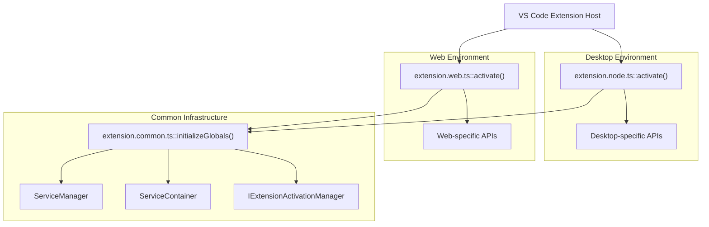

**Activation Flow**

The extension activation follows a consistent pattern across both environments:

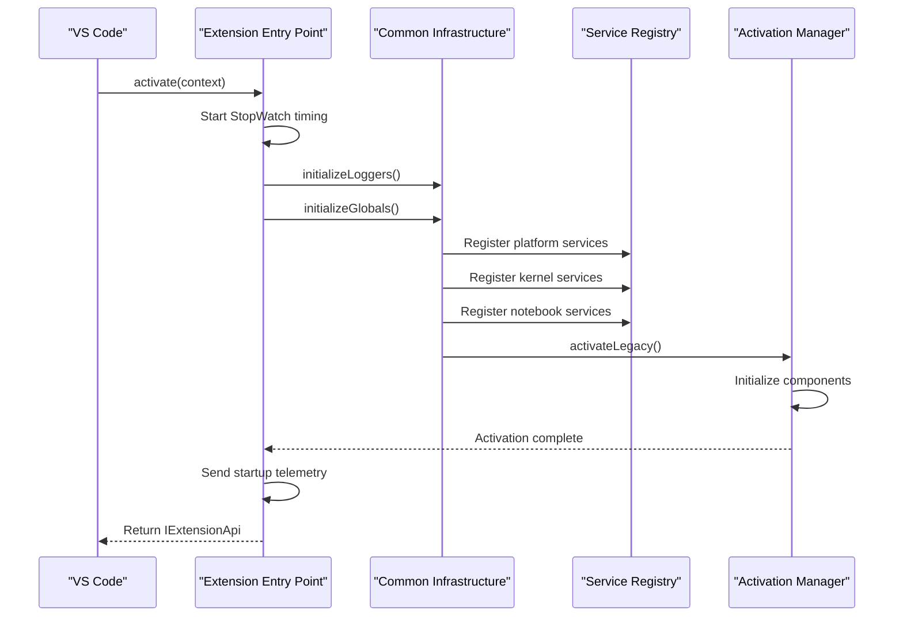

**Sources:** [src/extension.node.ts:78-129](), [src/extension.web.ts:80-120](), [src/extension.common.ts:50-150]()

### Service Registration Architecture

The extension uses a modular service registration system where each major component registers its services independently:

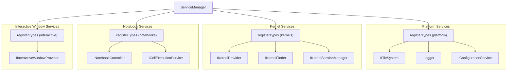

**Sources:** [src/extension.node.ts:219-239](), [src/platform/serviceRegistry.node.ts](), [src/kernels/serviceRegistry.node.ts](), [src/notebooks/serviceRegistry.node.ts]()

### Extension Context and Lifecycle Management

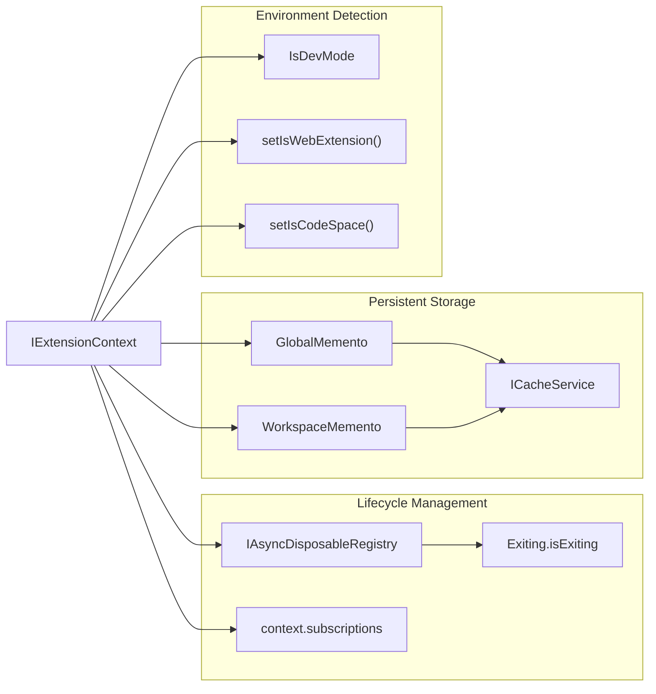

**Sources:** [src/extension.node.ts:90-94](), [src/extension.common.ts:158-170](), [src/platform/common/types.ts]()

## Telemetry and Monitoring

The extension implements comprehensive telemetry collection to monitor performance, usage patterns, and error conditions.

### Telemetry Architecture

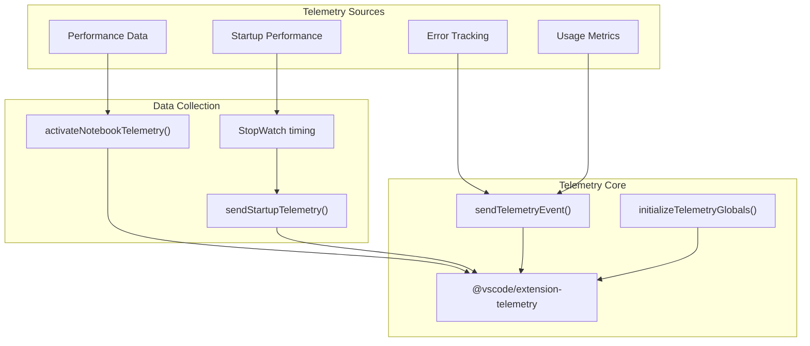

**Startup Performance Tracking**

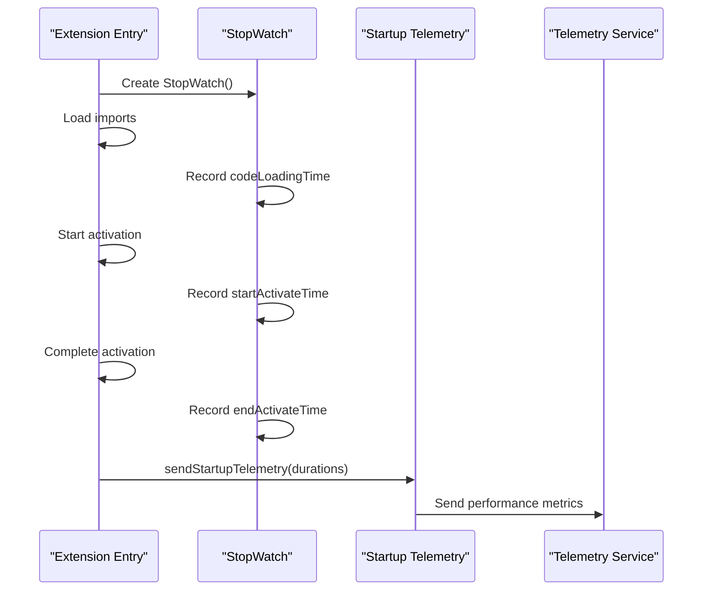

**Sources:** [src/extension.node.ts:4-27](), [src/platform/telemetry/startupTelemetry.ts](), [src/kernels/telemetry/notebookTelemetry.ts]()

### Error Handling and Reporting

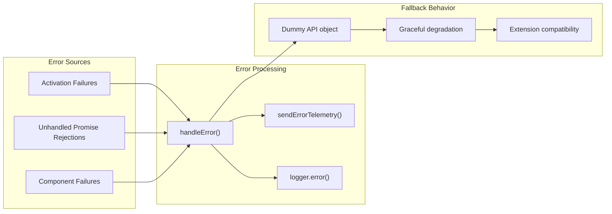

**Sources:** [src/extension.node.ts:103-129](), [src/extension.common.ts:140-150](), [src/platform/telemetry/startupTelemetry.ts:50-80]()

## Service Registry and Dependency Injection

The extension uses Inversify as its dependency injection framework, providing a robust service architecture that supports both testing and modularity.

### Service Container Architecture

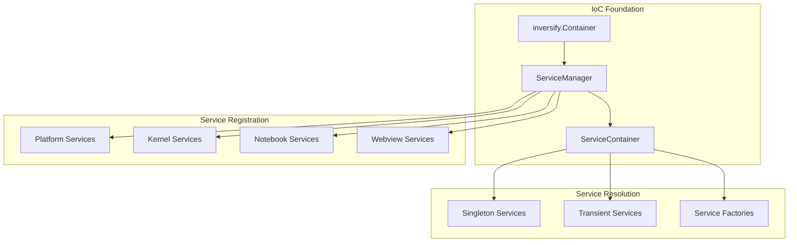

**Platform-Specific Service Registration**

The extension supports different service implementations for Node.js and web environments:

| Service Category | Node.js Implementation | Web Implementation |
|------------------|------------------------|-------------------|
| File System | `IFileSystemNode` | `IFileSystemWeb` |
| Process Execution | `IPythonExecutionFactory` | Not available |
| Terminals | `ITerminalManager` | `ITerminalManagerWeb` |
| Crypto | `ICryptoUtils` (native) | `ICryptoUtils` (web) |

**Service Lifecycle Management**

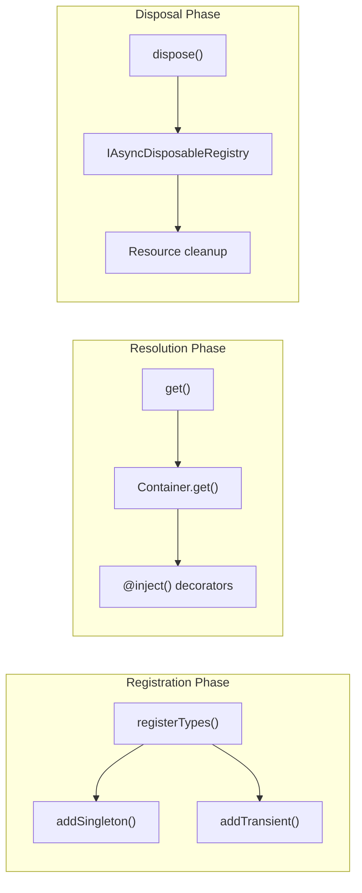

**Sources:** [src/platform/ioc/serviceManager.ts](), [src/platform/ioc/container.ts](), [src/extension.common.ts:158-170]()

## Build and Development Infrastructure

The extension includes comprehensive build tooling that supports both development and production scenarios across multiple platforms.

### Build Configuration System

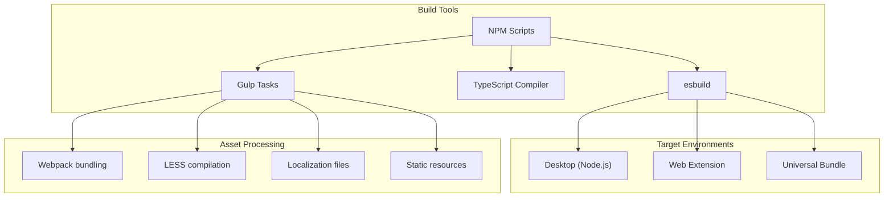

**Development Workflow**

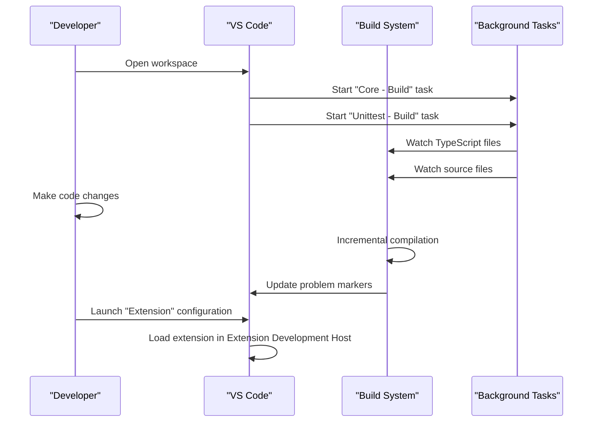

**Package.json Configuration Structure**

| Configuration Section | Purpose | Key Elements |
|----------------------|---------|--------------|
| `activationEvents` | When extension loads | `onLanguage:python`, `onNotebook:jupyter-notebook` |
| `contributes.commands` | Available commands | Jupyter execution, kernel management |
| `contributes.keybindings` | Keyboard shortcuts | Cell execution, navigation |
| `contributes.walkthroughs` | User onboarding | Getting started guide |
| `main` / `browser` | Entry points | Desktop vs web extension |

**Sources:** [package.json:53-63](), [gulpfile.js:26-287](), [.vscode/tasks.json:10-48](), [build/azure-pipeline.stable.yml]()

### Testing Infrastructure

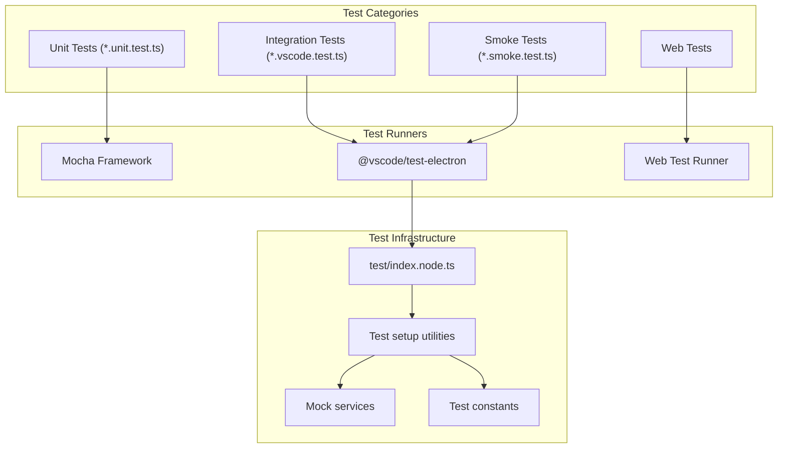

**Sources:** [src/test/index.node.ts:81-150](), [src/test/standardTest.node.ts:56-200](), [.vscode/launch.json:240-270]()

---

