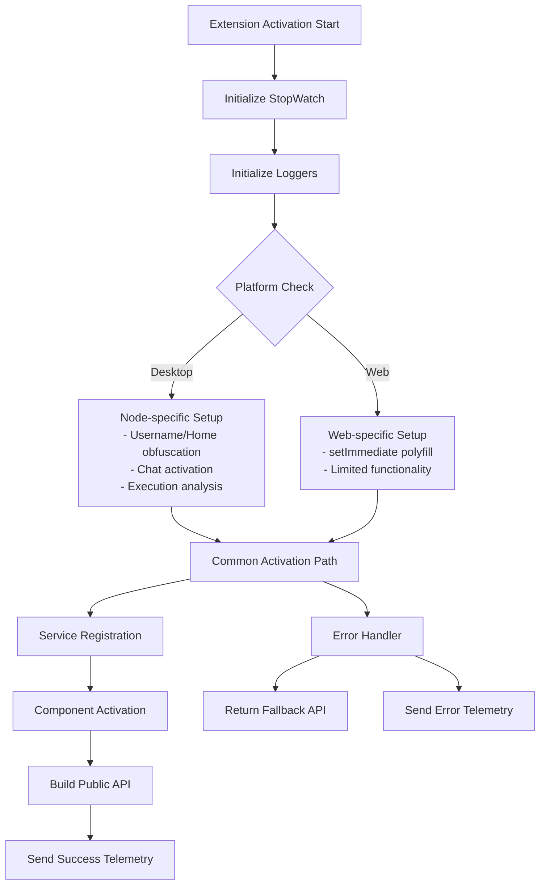
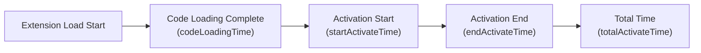
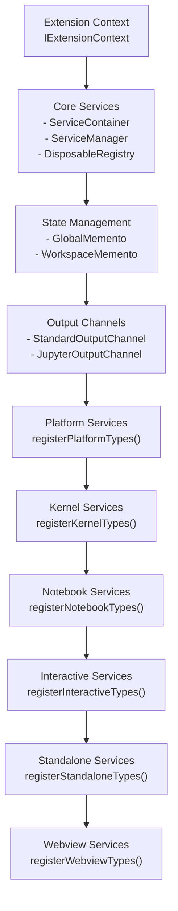
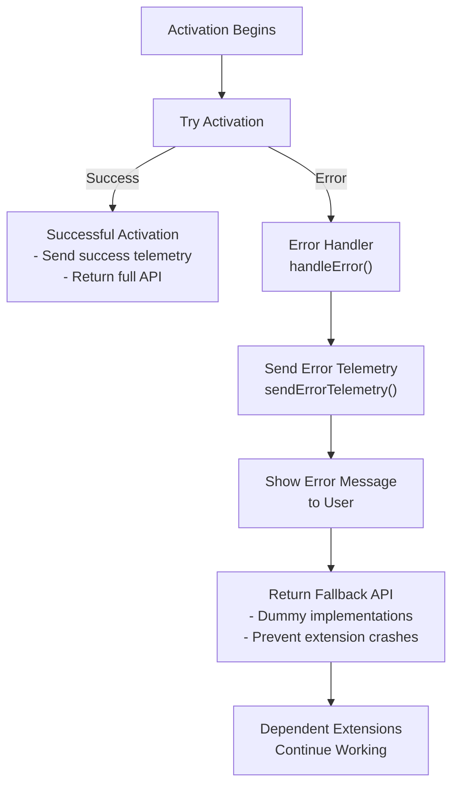
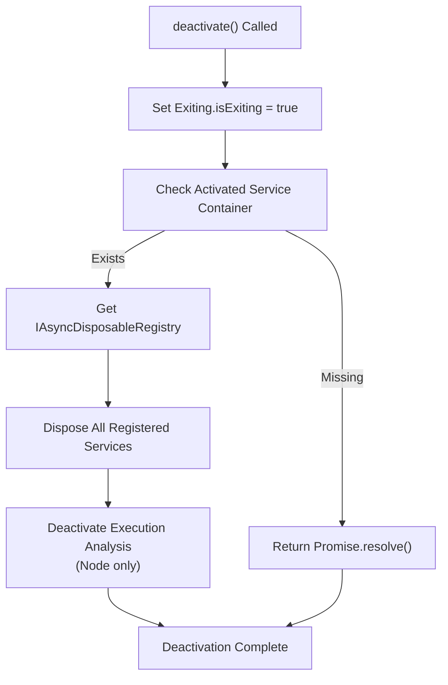
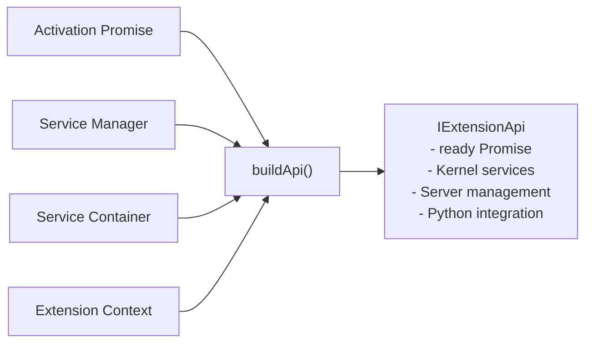

<!-- source: DeepWiki mcp.deepwiki.com · repo microsoft/vscode-jupyter · page 2.1 Extension Activation and Lifecycle · fetched 2026-10-26 -->

# Extension Activation and Lifecycle

<details>
<summary>Relevant source files</summary>

The following files were used as context for generating this wiki page:

- [src/api.pythonIntegration.d.ts](src/api.pythonIntegration.d.ts)
- [src/api.unstable.d.ts](src/api.unstable.d.ts)
- [src/extension.common.ts](src/extension.common.ts)
- [src/extension.node.ts](src/extension.node.ts)
- [src/extension.web.ts](src/extension.web.ts)
- [src/kernels/raw/finder/jupyterPaths.node.ts](src/kernels/raw/finder/jupyterPaths.node.ts)
- [src/kernels/raw/finder/jupyterPaths.node.unit.test.ts](src/kernels/raw/finder/jupyterPaths.node.unit.test.ts)
- [src/platform/common/cache.ts](src/platform/common/cache.ts)
- [src/platform/common/temp.node.ts](src/platform/common/temp.node.ts)
- [src/platform/common/temp.ts](src/platform/common/temp.ts)
- [src/platform/telemetry/startupTelemetry.ts](src/platform/telemetry/startupTelemetry.ts)
- [src/standalone/devTools/clearCache.ts](src/standalone/devTools/clearCache.ts)

</details>


This document covers the activation and deactivation lifecycle of the VS Code Jupyter extension, including timing tracking, service registration, error handling, and platform-specific differences. For information about specific service registration and dependency injection patterns, see [Service Registry and Dependency Injection](#2.3). For telemetry collection during activation, see [Telemetry and Monitoring](#2.2).

## Activation Entry Points

The VS Code Jupyter extension has two platform-specific entry points that share common activation logic:

- **Desktop Extension**: [src/extension.node.ts]() - Full featured desktop extension with Node.js capabilities
- **Web Extension**: [src/extension.web.ts]() - Browser-compatible version with limited functionality

Both entry points implement the same VS Code extension lifecycle methods:
- `activate(context: IExtensionContext): Promise<IExtensionApi>`
- `deactivate(): Thenable<void>`

### Activation Flow Diagram



Sources: [src/extension.node.ts:78-130](), [src/extension.web.ts:80-120](), [src/extension.common.ts:50-180]()

## Performance Tracking

The extension implements comprehensive performance tracking from the very beginning of the activation process using a `StopWatch` class that measures elapsed time in milliseconds.

### Timing Measurements

| Phase | Measurement | Description |
|-------|------------|-------------|
| `codeLoadingTime` | Import completion | Time to load all module dependencies |
| `startActivateTime` | Activation start | When `activate()` function begins |
| `endActivateTime` | Activation end | When activation completes successfully |
| `totalActivateTime` | Full duration | Complete activation time |



The `StopWatch` is initialized immediately at module load time:

```javascript
// Do not move this line of code (used to measure extension load times).
const stopWatch = new StopWatch();
```

Sources: [src/extension.node.ts:4-27](), [src/extension.web.ts:4-27](), [src/platform/telemetry/startupTelemetry.ts:10-43]()

## Service Registration and Initialization

The extension uses a dependency injection container to manage services. The activation process registers services in a specific order to ensure dependencies are available when needed.

### Service Registration Order



Sources: [src/extension.node.ts:232-239](), [src/extension.web.ts:185-193](), [src/extension.common.ts:109-132]()

### Platform-Specific Differences

The desktop and web versions have different service registration patterns:

| Service Type | Desktop (Node) | Web |
|-------------|----------------|-----|
| Platform Services | `platform/serviceRegistry.node` | `platform/serviceRegistry.web` |
| Kernel Services | `kernels/serviceRegistry.node` | `kernels/serviceRegistry.web` |
| Terminal Services | Not registered | `terminals/serviceRegistry.web` |
| Chat Services | Full chat activation | Not available |
| Execution Analysis | Full analysis features | Not available |

Sources: [src/extension.node.ts:45-50](), [src/extension.web.ts:56-62]()

## Global State and Configuration

During activation, the extension initializes global state and configuration that affects the entire extension lifecycle.

### Development Mode Detection

The extension detects development mode using multiple criteria:

```typescript
const isDevMode = 
    !isTestExecution() &&
    (context.extensionMode === ExtensionMode.Development ||
     workspace.getConfiguration('jupyter').get<boolean>('development', false));
```

Development mode enables additional features like cache clearing commands and enhanced logging.

### Environment Setup

The extension configures global environment variables and settings:

- **Code Spaces Detection**: Sets `jupyter.webExtension` context based on `env.uiKind`
- **Home Directory**: Configures logging home directory for file path obfuscation
- **Extension Context**: Registers VS Code context variables for command enabling

Sources: [src/extension.node.ts:219-230](), [src/extension.web.ts:175-183](), [src/extension.common.ts:172-179]()

## Error Handling and Recovery

The extension implements comprehensive error handling to ensure graceful degradation when activation fails.

### Error Handling Flow



### Fallback API Implementation

When activation fails, the extension returns a fallback API object with dummy implementations to prevent dependent extensions (like the Python extension) from failing:

```typescript
return {
    ready: Promise.resolve(),
    registerPythonApi: noop,
    registerRemoteServerProvider: () => ({ dispose: noop }),
    getKernelService: () => Promise.resolve(undefined),
    // ... other safe dummy implementations
};
```

Sources: [src/extension.node.ts:103-129](), [src/extension.web.ts:96-119](), [src/extension.common.ts:134-160]()

## Cache Management and Cleanup

The extension manages various caches and temporary files throughout its lifecycle, with cleanup occurring both during activation and deactivation.

### Cache Cleanup During Activation

The extension automatically cleans up old cache entries and temporary directories:

- **Old Global State Keys**: Removes deprecated cache keys from previous versions
- **Workspace State**: Cleans up old cell execution cache entries  
- **Temporary Directories**: Removes temporary directories from previous extension versions

### Cache Keys Removed

The extension maintains a list of deprecated cache keys that are automatically removed:

```typescript
const GlobalMementoKeyPrefixesToRemove = [
    'JUPYTER_LOCAL_KERNELSPECS',
    'JUPYTER_REMOTE_KERNELSPECS', 
    'user-jupyter-server-uri-list-v2',
    'CACHE_KEY_FOR_JUPYTER_KERNEL_PATHS',
    // ... other deprecated keys
];
```

Sources: [src/platform/common/cache.ts:33-66](), [src/platform/common/temp.node.ts:36-48](), [src/standalone/devTools/clearCache.ts:12-37]()

## Deactivation Process

The extension implements a clean deactivation process to properly dispose of resources and stop background operations.

### Deactivation Flow



### Resource Disposal

The deactivation process ensures all registered disposable resources are properly cleaned up:

1. **Service Disposal**: All services registered with `IAsyncDisposableRegistry` are disposed
2. **Background Tasks**: Execution analysis and other background operations are stopped
3. **Event Listeners**: All event subscriptions are cleaned up
4. **Temporary Files**: Some temporary resources may be cleaned up

Sources: [src/extension.node.ts:132-145](), [src/extension.web.ts:122-133]()

## Extension API Construction

The final phase of activation constructs the public API that other extensions can use to interact with the Jupyter extension.

### API Building Process

The `buildApi` function creates the public API interface using the activated service container:



The API provides access to:
- Kernel management services
- Remote server registration
- Python environment integration
- Notebook opening capabilities

Sources: [src/extension.node.ts:173-174](), [src/extension.web.ts:155-156](), [src/standalone/api.ts]()

---

