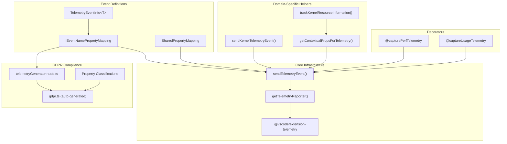
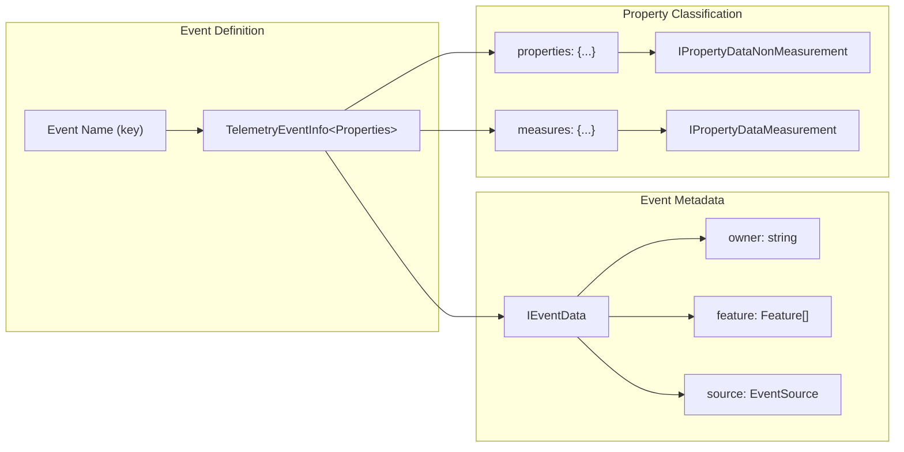
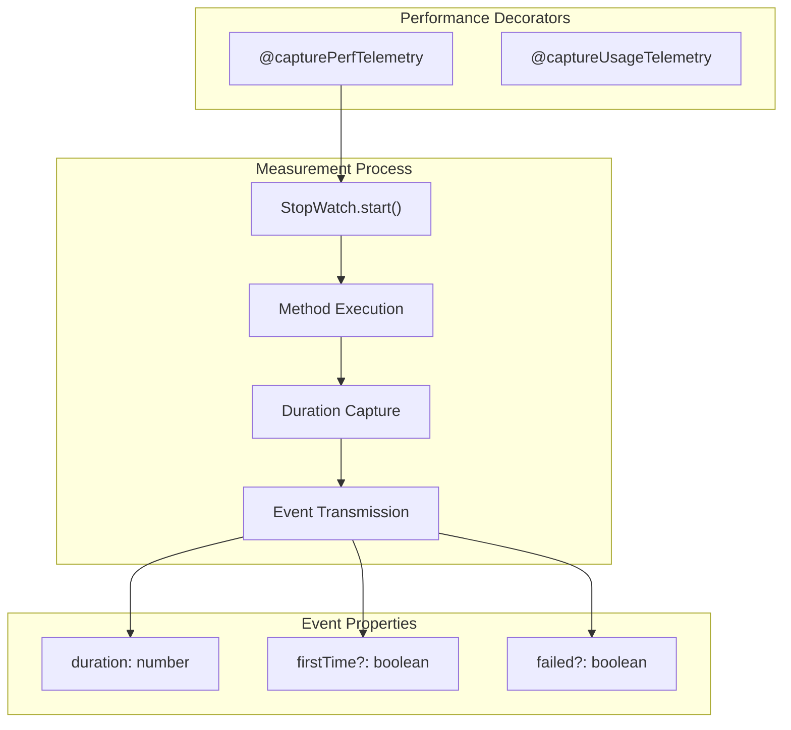
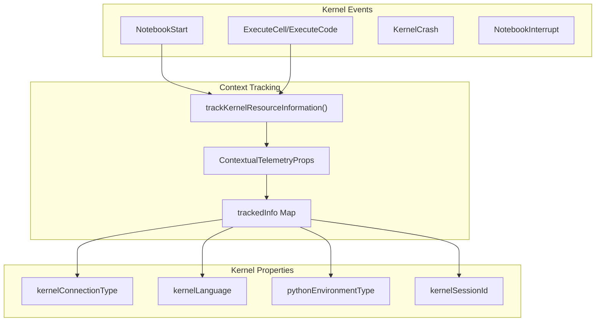
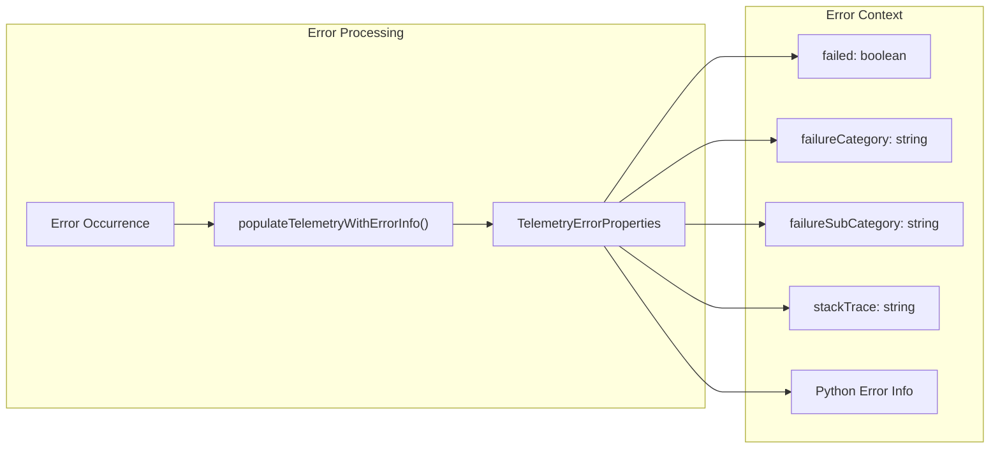
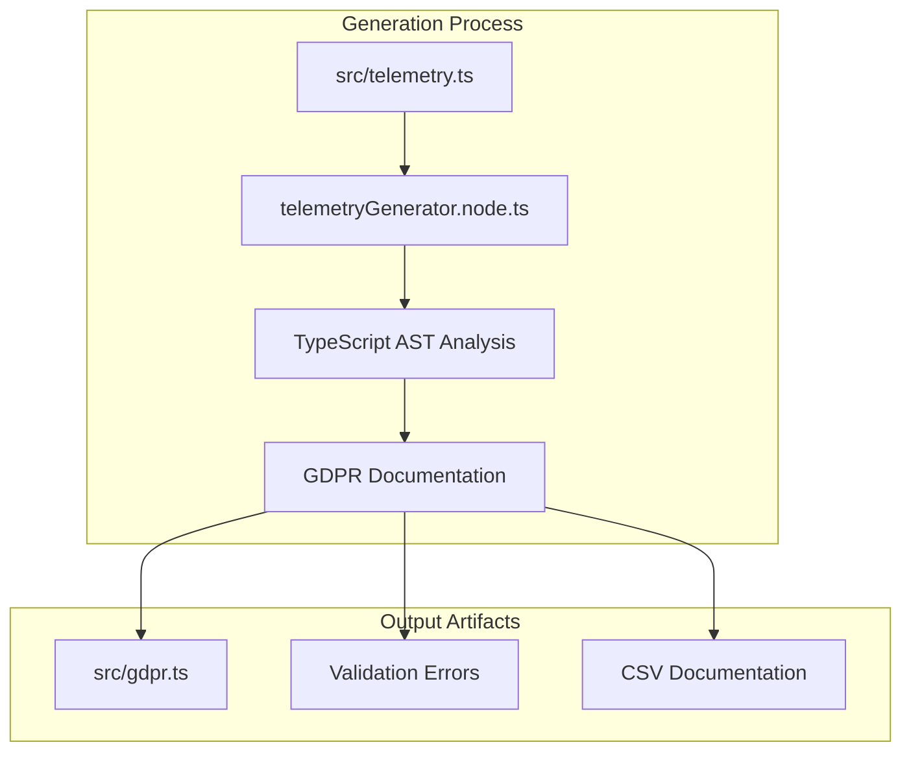

<!-- source: DeepWiki mcp.deepwiki.com · repo microsoft/vscode-jupyter · page 2.2 Telemetry and Monitoring · fetched 2026-10-26 -->

# Telemetry and Monitoring

<details>
<summary>Relevant source files</summary>

The following files were used as context for generating this wiki page:

- [src/gdpr.ts](src/gdpr.ts)
- [src/kernels/raw/launcher/kernelLauncher.node.ts](src/kernels/raw/launcher/kernelLauncher.node.ts)
- [src/kernels/raw/session/rawNotebookSupportedService.node.ts](src/kernels/raw/session/rawNotebookSupportedService.node.ts)
- [src/kernels/raw/session/zeromq.node.ts](src/kernels/raw/session/zeromq.node.ts)
- [src/kernels/telemetry/helper.ts](src/kernels/telemetry/helper.ts)
- [src/kernels/telemetry/sendKernelTelemetryEvent.ts](src/kernels/telemetry/sendKernelTelemetryEvent.ts)
- [src/notebooks/telemetry/kernelTelemetry.ts](src/notebooks/telemetry/kernelTelemetry.ts)
- [src/platform/common/constants.ts](src/platform/common/constants.ts)
- [src/platform/common/platform/linuxDistro.node.ts](src/platform/common/platform/linuxDistro.node.ts)
- [src/platform/telemetry/index.ts](src/platform/telemetry/index.ts)
- [src/telemetry.ts](src/telemetry.ts)
- [src/telemetryGenerator.node.ts](src/telemetryGenerator.node.ts)

</details>


This document covers the telemetry and monitoring infrastructure used throughout the VS Code Jupyter extension to collect usage analytics, performance metrics, and error information. The system is designed with privacy compliance in mind and includes automatic GDPR classification for all collected data.

For information about testing and quality assurance processes, see [Testing Infrastructure](#9.1). For details about configuration and settings management, see [Settings and Commands](#8.1).

## System Overview

The telemetry system operates as a layered architecture that collects, classifies, and transmits usage data to help improve the extension. All events must be pre-defined with explicit GDPR classifications and are validated at build time.

### Core Architecture



Sources: [src/telemetry.ts:1-503](), [src/platform/telemetry/index.ts:1-356](), [src/gdpr.ts:1-50]()

## Event Definition System

All telemetry events are centrally defined in the `IEventNamePropertyMapping` class, which serves as the single source of truth for all events collected by the extension.

### Event Structure



Sources: [src/telemetry.ts:452-503](), [src/telemetry.ts:79-163]()

### Property Classifications

Each telemetry property must include GDPR classification metadata:

| Classification | Purpose | Description |
|----------------|---------|-------------|
| `SystemMetaData` | `FeatureInsight`/`PerformanceAndHealth` | Non-personal system information |
| `PublicNonPersonalData` | `FeatureInsight` | User-provided non-personal data |
| `EndUserPseudonymizedInformation` | `FeatureInsight` | Hashed user identifiers |
| `CallstackOrException` | `PerformanceAndHealth` | Error data and stack traces |
| `CustomerContent` | Various | User-generated content (minimal use) |

Sources: [src/telemetry.ts:90-95](), [src/telemetry.ts:182-255]()

## Core Telemetry Infrastructure

### Event Transmission

The `sendTelemetryEvent` function is the primary API for transmitting telemetry data:

```typescript
sendTelemetryEvent<P extends IEventNamePropertyMapping, E extends keyof P>(
    eventName: E,
    measures?: PickType<UnionToIntersection<R>, number>,
    properties?: ExcludeType<R, number>,
    ex?: Error
)
```

Key features:
- Type-safe event names and properties
- Automatic shared property injection
- Error information extraction
- GDPR-compliant data sanitization

Sources: [src/platform/telemetry/index.ts:121-143](), [src/platform/telemetry/index.ts:171-207]()

### Shared Properties

The `SharedPropertyMapping` class defines properties attached to all telemetry events:

| Property | Type | Description |
|----------|------|-------------|
| `isInsiderExtension` | `'true' \| 'false'` | Whether running Insider extension |
| `rawKernelSupported` | `'true' \| 'false'` | ZMQ/raw kernel support availability |
| `isPythonExtensionInstalled` | `'true' \| 'false'` | Python extension installation status |

Sources: [src/platform/telemetry/index.ts:338-353](), [src/telemetry.ts:182-198]()

## Performance Monitoring

### Performance Decorators

The system provides decorators for automatic performance measurement:



Sources: [src/platform/telemetry/index.ts:232-301](), [src/platform/telemetry/index.ts:308-333]()

### Kernel Performance Tracking

Kernel operations include specialized performance tracking:

```typescript
// Example from kernel launcher
sendTelemetryEvent(
    Telemetry.KernelLauncherPerf,
    { duration: stopWatch.elapsedTime },
    { resourceType: getResourceType(resource) }
);
```

Sources: [src/kernels/raw/launcher/kernelLauncher.node.ts:173-177]()

## Domain-Specific Telemetry

### Kernel Telemetry

The kernel subsystem includes comprehensive telemetry for monitoring kernel lifecycle and performance:



Sources: [src/kernels/telemetry/helper.ts:50-157](), [src/kernels/telemetry/sendKernelTelemetryEvent.ts:9-29]()

### ZeroMQ Support Monitoring

The extension monitors ZeroMQ binary availability for local kernel support:

```typescript
// Platform-specific ZMQ telemetry
sendTelemetryEvent(Telemetry.ZMQSupport, undefined, {
    distro_id: distro.id,
    distro_version_id: distro.version_id,
    failed,
    alpine: platformInfo.alpine,
    libc: platformInfo.libc,
    armv: platformInfo.armv,
    zmqarch: platformInfo.zmqarch
});
```

Sources: [src/kernels/raw/session/zeromq.node.ts:84-93](), [src/kernels/raw/session/rawNotebookSupportedService.node.ts:16-46]()

## Error Monitoring

### Error Enrichment

The system automatically enriches error telemetry with contextual information:



Sources: [src/telemetry.ts:218-255](), [src/platform/telemetry/index.ts:181-193]()

### Kernel Crash Monitoring

Kernel process crashes are monitored with detailed exit information:

```typescript
// Kernel exit telemetry
sendKernelTelemetryEvent(
    resource,
    Telemetry.RawKernelSessionKernelProcessExited,
    exitCode ? { exitCode } : undefined,
    {
        exitReason: getTelemetrySafeErrorMessageFromPythonTraceback(reason)
    }
);
```

Sources: [src/kernels/raw/launcher/kernelLauncher.node.ts:147-155]()

## GDPR Compliance System

### Automatic Documentation Generation

The extension includes a build-time tool that generates GDPR-compliant documentation:



Sources: [src/telemetryGenerator.node.ts:394-431](), [src/gdpr.ts:1-20]()

### Event Validation

The system validates that all telemetry events have proper GDPR classifications:

| Validation Rule | Description |
|-----------------|-------------|
| Property Classification | All properties must have valid GDPR classification |
| Owner Assignment | Each event must have an assigned owner |
| Comment Requirements | Properties must include descriptive comments |
| Measurement Validation | Numeric properties must be marked as measurements |

Sources: [src/telemetryGenerator.node.ts:376-430]()

## Configuration and Privacy Controls

### Telemetry Enablement

The system respects VS Code's telemetry settings:

```typescript
function isTelemetryDisabled(): boolean {
    const settings = workspace.getConfiguration('telemetry').inspect<boolean>('enableTelemetry')!;
    return settings.globalValue === false ? true : false;
}
```

### Test Environment Handling

Telemetry is automatically disabled during test execution, with exceptions for performance measurements on CI:

```typescript
function isPerfMeasurementOnCI(eventName: string) {
    return (
        eventName === Telemetry.NativeNotebookEditPerformance ||
        eventName === Telemetry.JupyterNotebookExecutionPerformance ||
        eventName === Telemetry.NativeNotebookExecutionPerformance
    );
}
```

Sources: [src/platform/telemetry/index.ts:43-56](), [src/platform/telemetry/index.ts:149-155]()

---

