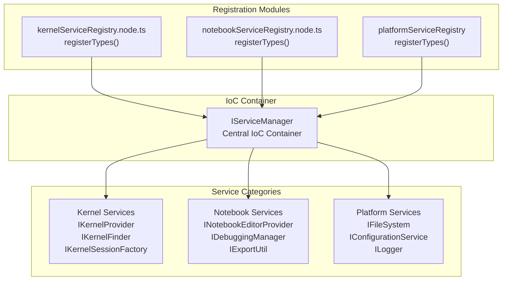
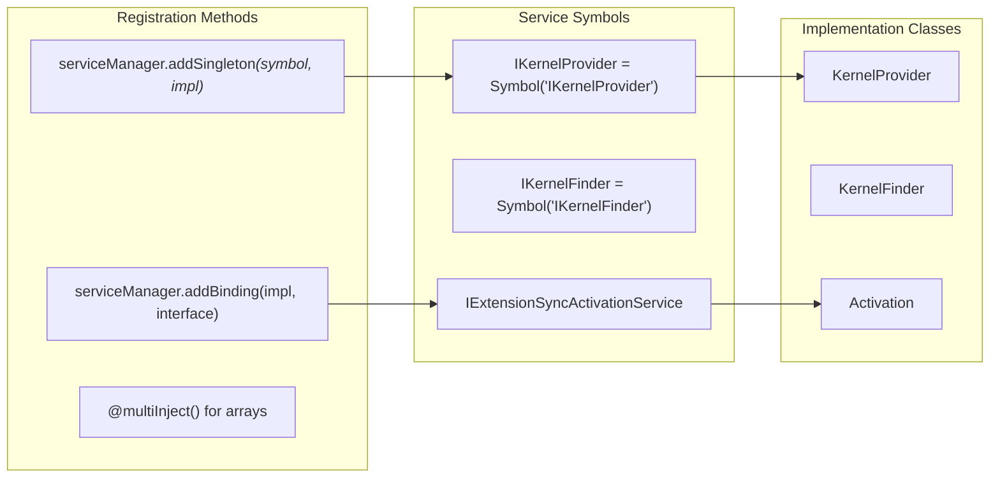
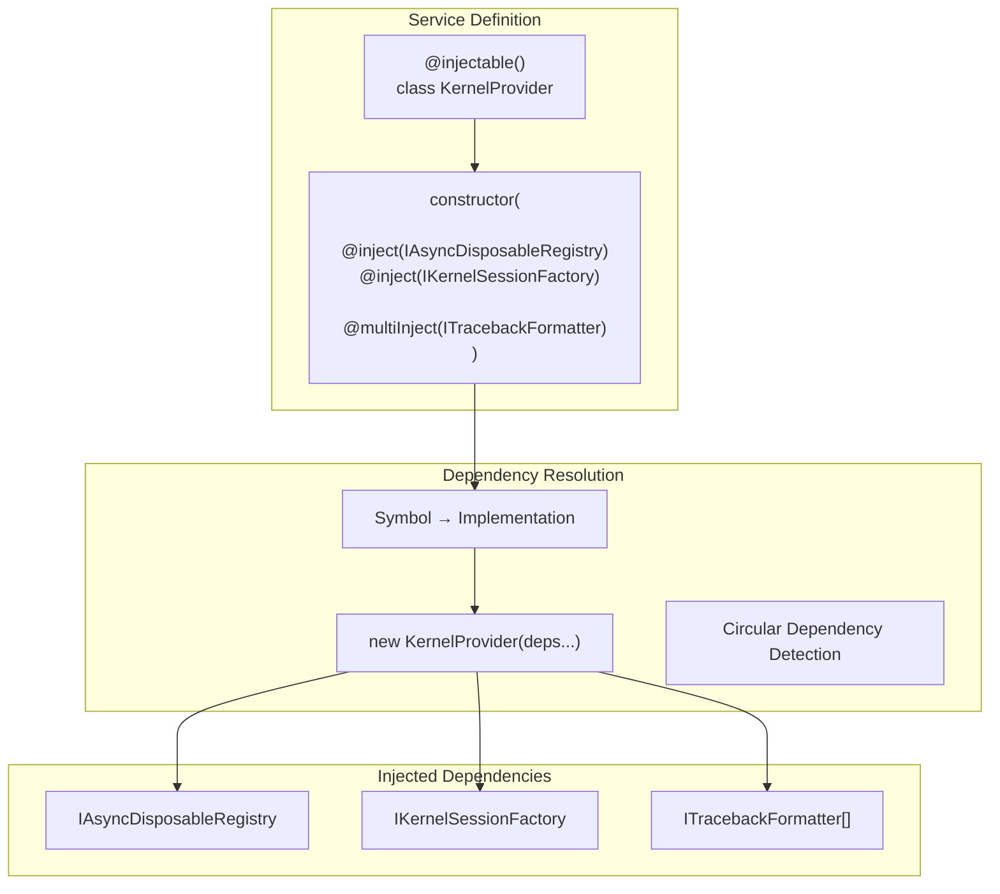
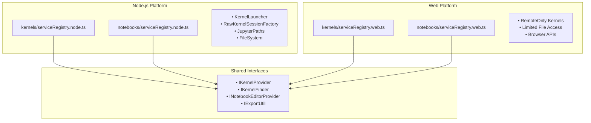
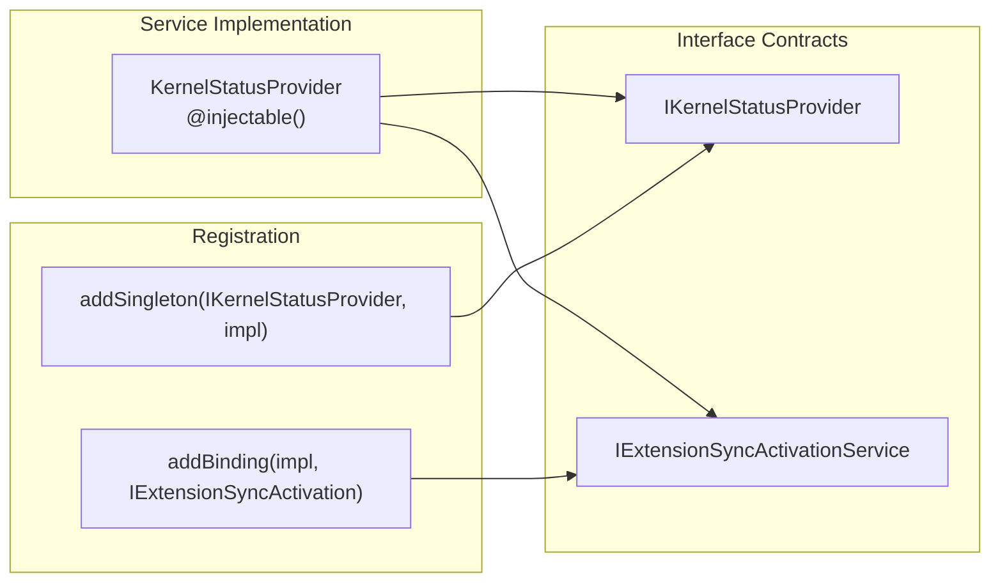

<!-- source: DeepWiki mcp.deepwiki.com · repo microsoft/vscode-jupyter · page 2.3 Service Registry and Dependency Injection · fetched 2026-10-26 -->

# Service Registry and Dependency Injection

<details>
<summary>Relevant source files</summary>

The following files were used as context for generating this wiki page:

- [src/api.proposed.kernelStartHook.d.ts](src/api.proposed.kernelStartHook.d.ts)
- [src/kernels/kernel.ts](src/kernels/kernel.ts)
- [src/kernels/kernelProvider.base.ts](src/kernels/kernelProvider.base.ts)
- [src/kernels/kernelProvider.node.ts](src/kernels/kernelProvider.node.ts)
- [src/kernels/kernelProvider.node.unit.test.ts](src/kernels/kernelProvider.node.unit.test.ts)
- [src/kernels/kernelProvider.web.ts](src/kernels/kernelProvider.web.ts)
- [src/kernels/kernelProvider.web.unit.test.ts](src/kernels/kernelProvider.web.unit.test.ts)
- [src/kernels/kernelStatusProvider.ts](src/kernels/kernelStatusProvider.ts)
- [src/kernels/serviceRegistry.node.ts](src/kernels/serviceRegistry.node.ts)
- [src/kernels/serviceRegistry.web.ts](src/kernels/serviceRegistry.web.ts)
- [src/kernels/types.ts](src/kernels/types.ts)
- [src/notebooks/serviceRegistry.node.ts](src/notebooks/serviceRegistry.node.ts)
- [src/notebooks/serviceRegistry.web.ts](src/notebooks/serviceRegistry.web.ts)
- [src/platform/constants.ts](src/platform/constants.ts)
- [src/standalone/userJupyterServer/serverSelectorForTests.ts](src/standalone/userJupyterServer/serverSelectorForTests.ts)
- [src/test/client/api.vscode.test.ts](src/test/client/api.vscode.test.ts)

</details>


This document covers the dependency injection system and service registry infrastructure used throughout the VS Code Jupyter extension. The system uses the inversify pattern to manage service creation, dependency resolution, and lifecycle management across kernel management, notebook operations, and platform services.

For information about extension activation and lifecycle, see [Extension Activation and Lifecycle](#2.1).

## Service Manager Architecture

The extension uses a centralized `IServiceManager` that acts as an inversion of control (IoC) container. Service registration occurs through module-specific `registerTypes` functions that configure service bindings, lifecycle management, and dependency relationships.



**Sources:** [src/kernels/serviceRegistry.node.ts:52-147](), [src/notebooks/serviceRegistry.node.ts:44-122](), [src/platform/ioc/types.ts]()

## Service Registration Patterns

Services are registered using type-safe binding methods that specify service lifetime, interface contracts, and implementation classes. The registration process supports singleton registration, multi-binding, and conditional registration based on platform capabilities.



**Key Registration Examples:**

| Registration Pattern | Purpose | Example |
|---------------------|---------|---------|
| `addSingleton<T>(symbol, impl)` | Single instance services | `IKernelProvider` → `KernelProvider` |
| `addBinding(impl, interface)` | Multi-interface binding | `KernelStatusProvider` → `IExtensionSyncActivationService` |
| `addSingleton<T>(symbol, impl, identifier)` | Named instances | `IJupyterVariables` with `Identifiers.ALL_VARIABLES` |

**Sources:** [src/kernels/serviceRegistry.node.ts:69-114](), [src/kernels/types.ts:543-579](), [src/notebooks/serviceRegistry.node.ts:86-105]()

## Dependency Injection Implementation

Services use constructor injection with the `@injectable()` decorator and `@inject()` for dependencies. The system supports both interface-based injection and multi-injection for service arrays.



**Sources:** [src/kernels/kernelProvider.node.ts:38-57](), [src/kernels/kernelProvider.web.ts:36-50](), [src/notebooks/controllers/kernelSource/notebookKernelSourceSelector.ts]()

## Service Categories and Organization

The service registry organizes services into logical categories based on functionality. Each category has dedicated registration modules that handle platform-specific implementations and feature availability.

### Kernel Services
Core services for kernel discovery, creation, and lifecycle management:

| Service | Interface | Implementation | Lifecycle |
|---------|-----------|----------------|-----------|
| Kernel Provider | `IKernelProvider` | `KernelProvider` | Singleton |
| Kernel Finder | `IKernelFinder` | `KernelFinder` | Singleton |
| Session Factory | `IKernelSessionFactory` | Platform-specific | Singleton |
| Dependency Service | `IKernelDependencyService` | `KernelDependencyService` | Singleton |

### Notebook Services  
Services for notebook editing, execution, and debugging:

| Service | Interface | Implementation | Lifecycle |
|---------|-----------|----------------|-----------|
| Editor Provider | `INotebookEditorProvider` | `NotebookEditorProvider` | Singleton |
| Debugging Manager | `INotebookDebuggingManager` | `DebuggingManager` | Singleton + Activation |
| Export Utilities | `IExportUtil` | Platform-specific | Singleton |

**Sources:** [src/kernels/serviceRegistry.node.ts:69-96](), [src/notebooks/serviceRegistry.node.ts:86-105]()

## Platform-Specific Registration

The system provides separate registration modules for Node.js and Web environments, allowing platform-specific service implementations while maintaining consistent interfaces.



**Platform Differences:**

| Feature | Node.js Implementation | Web Implementation |
|---------|----------------------|-------------------|
| Raw Kernels | `RawKernelSessionFactory` | `RawNotebookSupportedService` (disabled) |
| File System | `FileSystem` with full access | Browser-limited file access |
| Kernel Launch | `KernelLauncher` for local processes | Remote-only connections |
| Working Directory | `KernelWorkingDirectory` | Not available |

**Sources:** [src/kernels/serviceRegistry.node.ts:52-146](), [src/kernels/serviceRegistry.web.ts:44-106](), [src/notebooks/serviceRegistry.node.ts:44-122]()

## Service Lifecycle Management

The service registry manages different service lifecycles including singletons, activation services, and disposable resources. Services can participate in extension activation and provide cleanup through disposal patterns.

### Activation Services
Services implementing `IExtensionSyncActivationService` are automatically activated during extension startup:

```typescript
// Registration with automatic activation
serviceManager.addSingleton<IExtensionSyncActivationService>(
    IExtensionSyncActivationService, 
    KernelStatusProvider
);
serviceManager.addBinding(IKernelStatusProvider, IExtensionSyncActivationService);
```

### Multi-Interface Binding
Services can implement multiple interfaces and be accessible through different service contracts:



**Sources:** [src/kernels/serviceRegistry.node.ts:92-93](), [src/kernels/kernelStatusProvider.ts:19-44](), [src/platform/activation/types.ts]()

---

