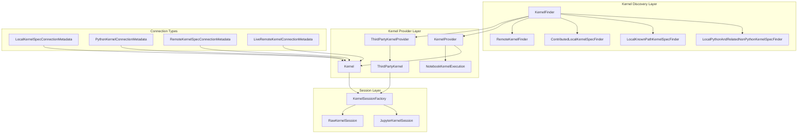
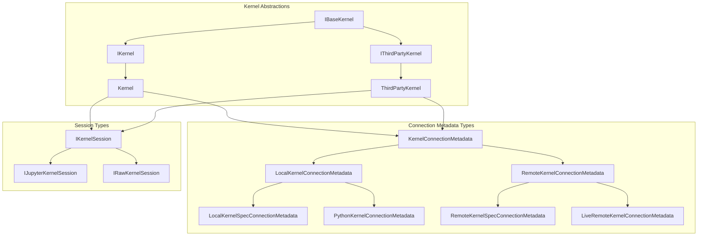
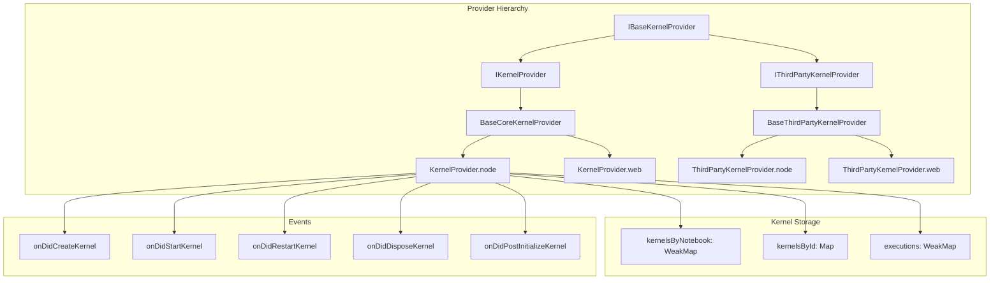
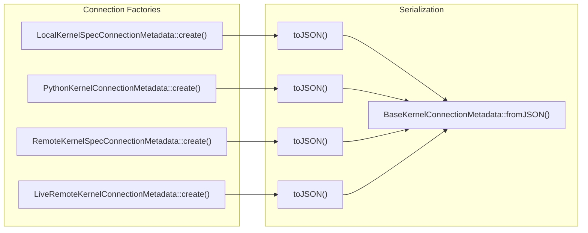
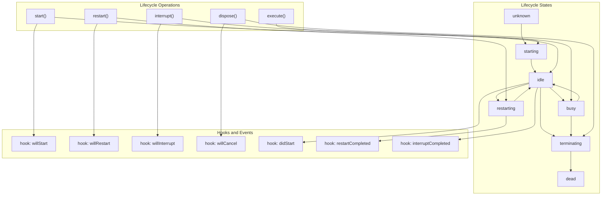
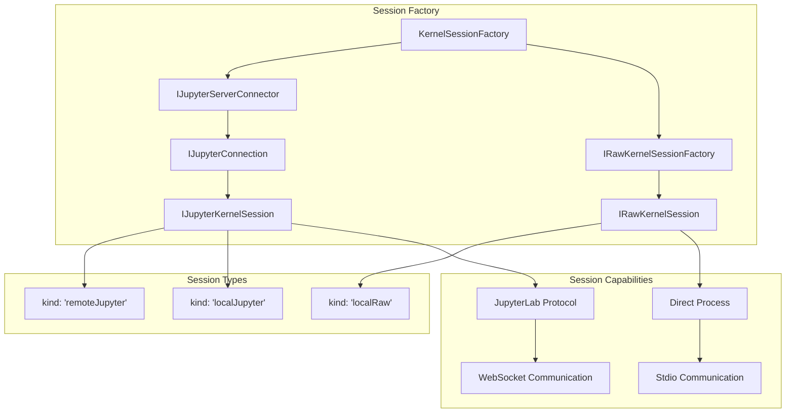
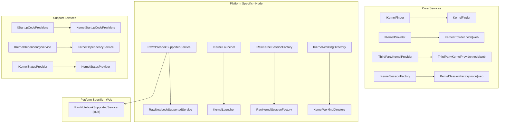
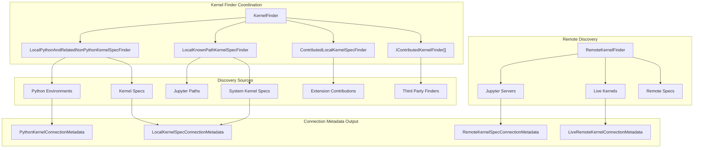
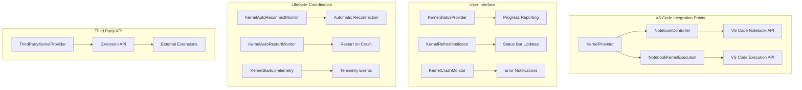

<!-- source: DeepWiki mcp.deepwiki.com · repo microsoft/vscode-jupyter · page 3 Kernel Management · fetched 2026-10-26 -->

# Kernel Management

Relevant source files

The following files were used as context for generating this wiki page:

- [src/api.proposed.kernelStartHook.d.ts](src/api.proposed.kernelStartHook.d.ts)
- [src/kernels/kernel.ts](src/kernels/kernel.ts)
- [src/kernels/kernelProvider.base.ts](src/kernels/kernelProvider.base.ts)
- [src/kernels/kernelProvider.node.ts](src/kernels/kernelProvider.node.ts)
- [src/kernels/kernelProvider.node.unit.test.ts](src/kernels/kernelProvider.node.unit.test.ts)
- [src/kernels/kernelProvider.web.ts](src/kernels/kernelProvider.web.ts)
- [src/kernels/kernelProvider.web.unit.test.ts](src/kernels/kernelProvider.web.unit.test.ts)
- [src/kernels/kernelStatusProvider.ts](src/kernels/kernelStatusProvider.ts)
- [src/kernels/serviceRegistry.node.ts](src/kernels/serviceRegistry.node.ts)
- [src/kernels/serviceRegistry.web.ts](src/kernels/serviceRegistry.web.ts)
- [src/kernels/types.ts](src/kernels/types.ts)
- [src/notebooks/serviceRegistry.node.ts](src/notebooks/serviceRegistry.node.ts)
- [src/notebooks/serviceRegistry.web.ts](src/notebooks/serviceRegistry.web.ts)
- [src/platform/constants.ts](src/platform/constants.ts)
- [src/standalone/userJupyterServer/serverSelectorForTests.ts](src/standalone/userJupyterServer/serverSelectorForTests.ts)
- [src/test/client/api.vscode.test.ts](src/test/client/api.vscode.test.ts)

This document covers the complete kernel management system in the VS Code Jupyter extension, which is responsible for discovering, creating, managing, and executing code against Jupyter kernels. The system handles both local and remote kernels, provides lifecycle management, and serves as the foundation for notebook and interactive window execution.

For information about notebook controllers and VS Code integration, see [Notebook Controllers](#4.1). For details about Python environment discovery, see [Environment Discovery](#6.2).

## System Overview

The kernel management system is built around a three-layer architecture that separates kernel discovery, lifecycle management, and execution coordination. The system supports multiple kernel types including local Python interpreters, kernel specifications, remote Jupyter servers, and third-party provided kernels.

**Sources**: [src/kernels/types.ts:525-579](), [src/kernels/kernelProvider.base.ts:25-122](), [src/kernels/kernelFinder.ts]()

## Core Kernel Types and Abstractions

The system defines several key abstractions that form the foundation of kernel management. The base kernel interface `IBaseKernel` provides common functionality, while specialized implementations handle different kernel types.

The `BaseKernel` class provides core functionality including status management, lifecycle hooks, and execution coordination. All kernels extend this base to inherit common behavior while specializing for their specific use cases.

**Sources**: [src/kernels/types.ts:345-429](), [src/kernels/kernel.ts:119-244](), [src/kernels/types.ts:55-295]()

## Kernel Provider System

The kernel provider system manages kernel instances and their lifecycle. It uses a factory pattern to create kernels and maintains mappings between notebooks/resources and their associated kernels.

The provider maintains weak references to notebooks to automatically clean up kernels when notebooks are closed, while using strong references by ID for programmatic access.

**Sources**: [src/kernels/kernelProvider.base.ts:25-190](), [src/kernels/kernelProvider.node.ts:38-118](), [src/kernels/types.ts:524-579]()

## Kernel Connection Metadata

Connection metadata describes how to connect to or start a kernel. The system supports four primary connection types, each with specific metadata requirements and connection procedures.

| Connection Type | Class | Use Case | Key Properties |
|----------------|-------|----------|----------------|
| Local Kernel Spec | `LocalKernelSpecConnectionMetadata` | Kernels started from local kernel.json specs | `kernelSpec`, `interpreter?` |
| Python Interpreter | `PythonKernelConnectionMetadata` | Python kernels started directly from interpreter | `interpreter`, `kernelSpec` |
| Remote Kernel Spec | `RemoteKernelSpecConnectionMetadata` | Kernels started on remote Jupyter servers | `kernelSpec`, `baseUrl`, `serverProviderHandle` |
| Live Remote Kernel | `LiveRemoteKernelConnectionMetadata` | Connect to existing remote kernels | `kernelModel`, `baseUrl`, `serverProviderHandle` |

All connection metadata classes support JSON serialization for persistence and provide hashed IDs for telemetry and caching purposes.

**Sources**: [src/kernels/types.ts:55-295](), [src/kernels/types.ts:301-328]()

## Kernel Lifecycle Management

The kernel lifecycle is managed through a series of hooks and events that coordinate startup, execution, interruption, restart, and disposal operations. The `BaseKernel` class orchestrates these operations while maintaining consistent state.

The hook system allows external components to participate in kernel lifecycle events, enabling features like progress reporting, telemetry, and cleanup operations.

**Sources**: [src/kernels/kernel.ts:246-366](), [src/kernels/types.ts:330-336](), [src/kernels/kernel.ts:367-451]()

## Kernel Session Management

Kernel sessions provide the communication layer between the kernel management system and actual kernel processes. The system supports different session types depending on the kernel connection method.

Sessions abstract the communication protocol differences between raw kernel processes and Jupyter server connections, providing a unified interface for kernel operations.

**Sources**: [src/kernels/types.ts:606-620](), [src/kernels/types.ts:737-743](), [src/kernels/types.ts:721-735]()

## Service Registration and Dependency Injection

The kernel management system uses dependency injection to manage component relationships and enable platform-specific implementations. Services are registered differently for Node.js and web environments.

The registration system enables different implementations for Node.js (supporting raw kernels) and web (Jupyter server only) while maintaining the same interfaces.

**Sources**: [src/kernels/serviceRegistry.node.ts:52-146](), [src/kernels/serviceRegistry.web.ts:44-106]()

## Kernel Discovery System

The kernel discovery system finds available kernels from multiple sources and presents them as connection options. Discovery is coordinated by the `KernelFinder` which aggregates results from specialized finder components.

The discovery system runs continuously and updates available kernels as environments change, kernel specs are added, or remote servers are configured.

**Sources**: [src/kernels/kernelFinder.ts](), [src/kernels/raw/finder/localPythonAndRelatedNonPythonKernelSpecFinder.node.ts](), [src/kernels/raw/finder/localKnownPathKernelSpecFinder.node.ts]()

## Integration with VS Code

The kernel management system integrates with VS Code through several coordination mechanisms that bridge the kernel abstraction with VS Code's notebook API and user interface components.

The integration layer ensures that kernel lifecycle events are properly reflected in the VS Code user interface and that external extensions can participate in the kernel ecosystem.

**Sources**: [src/kernels/kernelStatusProvider.ts:19-121](), [src/notebooks/controllers/types.ts](), [src/kernels/kernelProvider.node.ts:80-117]()

---

