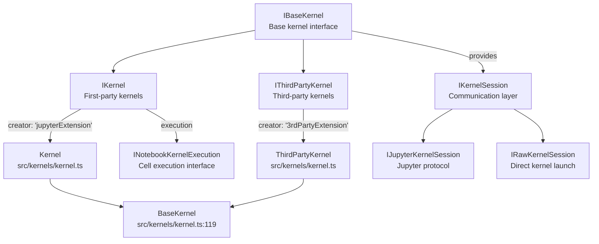
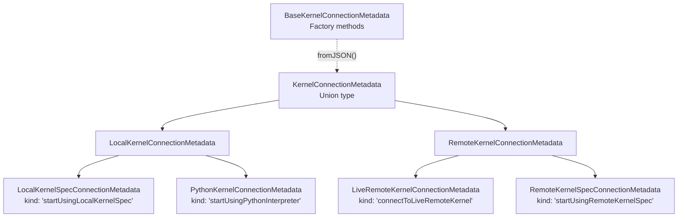
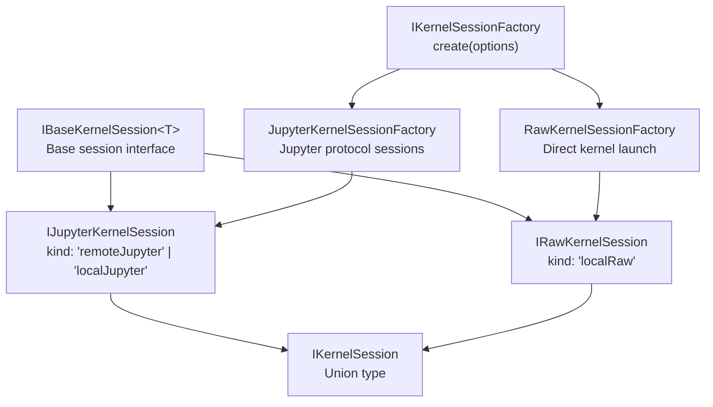
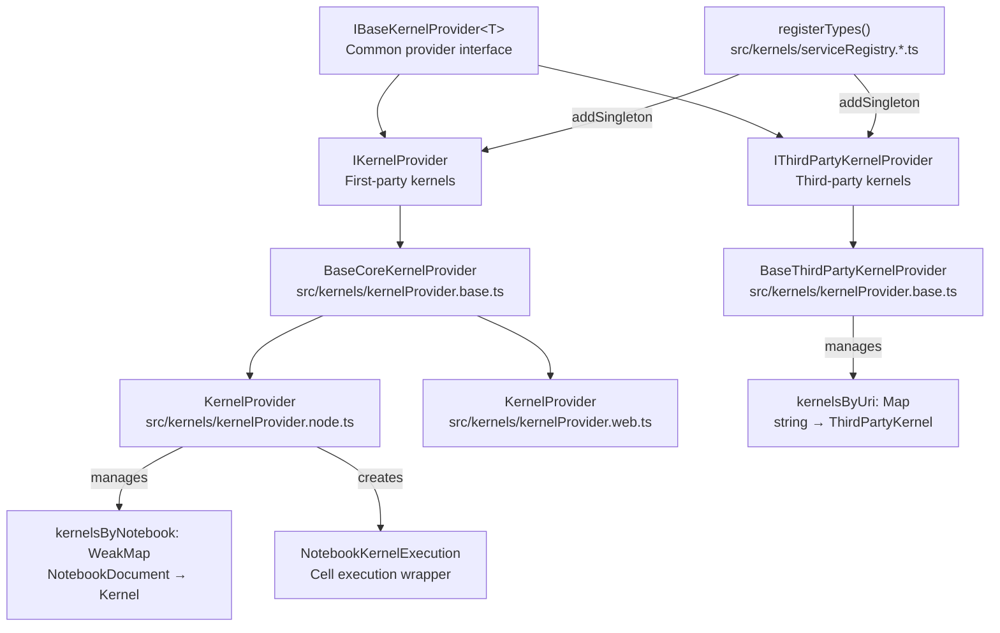
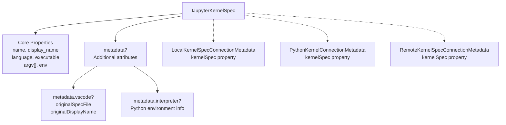
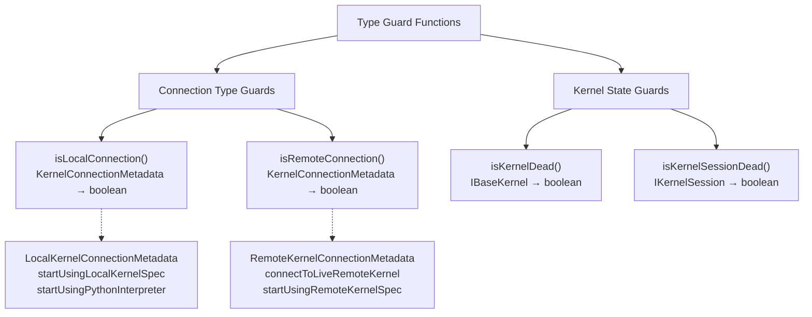

<!-- source: DeepWiki mcp.deepwiki.com · repo microsoft/vscode-jupyter · page 3.1 Kernel Types and Abstractions · fetched 2026-10-26 -->

# Kernel Types and Abstractions

<details>
<summary>Relevant source files</summary>

The following files were used as context for generating this wiki page:

- [src/api.proposed.kernelStartHook.d.ts](src/api.proposed.kernelStartHook.d.ts)
- [src/kernels/kernel.ts](src/kernels/kernel.ts)
- [src/kernels/kernelProvider.base.ts](src/kernels/kernelProvider.base.ts)
- [src/kernels/kernelProvider.node.ts](src/kernels/kernelProvider.node.ts)
- [src/kernels/kernelProvider.node.unit.test.ts](src/kernels/kernelProvider.node.unit.test.ts)
- [src/kernels/kernelProvider.web.ts](src/kernels/kernelProvider.web.ts)
- [src/kernels/kernelProvider.web.unit.test.ts](src/kernels/kernelProvider.web.unit.test.ts)
- [src/kernels/kernelStatusProvider.ts](src/kernels/kernelStatusProvider.ts)
- [src/kernels/serviceRegistry.node.ts](src/kernels/serviceRegistry.node.ts)
- [src/kernels/serviceRegistry.web.ts](src/kernels/serviceRegistry.web.ts)
- [src/kernels/types.ts](src/kernels/types.ts)
- [src/notebooks/serviceRegistry.node.ts](src/notebooks/serviceRegistry.node.ts)
- [src/notebooks/serviceRegistry.web.ts](src/notebooks/serviceRegistry.web.ts)
- [src/platform/constants.ts](src/platform/constants.ts)
- [src/standalone/userJupyterServer/serverSelectorForTests.ts](src/standalone/userJupyterServer/serverSelectorForTests.ts)
- [src/test/client/api.vscode.test.ts](src/test/client/api.vscode.test.ts)

</details>


This document covers the core type system and abstractions used for kernel management in the VS Code Jupyter extension. It focuses on the fundamental interfaces, connection metadata structures, and provider patterns that enable the extension to work with different types of kernels (local Python interpreters, local kernel specs, remote Jupyter servers, and live remote kernels).

For information about kernel discovery mechanisms, see [Kernel Discovery](#3.2). For details about remote Jupyter server connections, see [Remote Jupyter Servers](#3.3).

## Core Kernel Interface Hierarchy

The kernel system is built around a hierarchy of interfaces that abstract different kernel types and their capabilities.



The `IBaseKernel` interface defines the fundamental kernel operations and properties that all kernels must support:

- **Lifecycle management**: `start()`, `restart()`, `interrupt()`, `dispose()`, `shutdown()`
- **Status tracking**: `status`, `onStatusChanged`, lifecycle events
- **Connection metadata**: `kernelConnectionMetadata` property
- **Session access**: `session` property providing low-level communication
- **Resource association**: `uri` and `resourceUri` for file/notebook association
- **Hook system**: `addHook()` for lifecycle event handling
- **Post-initialization**: `onPostInitialized` event for extension coordination

The `BaseKernel` abstract class provides the core implementation, handling status management, lifecycle events, and the hook system for extensibility.

**Sources**: [src/kernels/types.ts:345-428](), [src/kernels/kernel.ts:119-244]()

## Connection Metadata Type System

Connection metadata encapsulates all information needed to start or connect to a kernel. The type system uses a discriminated union pattern with `kind` properties for type safety.



Each connection metadata type serves a specific kernel startup scenario:

| Connection Type | Purpose | Key Properties |
|-----------------|---------|----------------|
| `LocalKernelSpecConnectionMetadata` | Start kernel using local kernel spec JSON | `kernelSpec`, optional `interpreter` |
| `PythonKernelConnectionMetadata` | Start kernel using Python interpreter | `kernelSpec`, `interpreter` (required) |
| `LiveRemoteKernelConnectionMetadata` | Connect to existing remote kernel | `kernelModel`, `baseUrl`, `serverProviderHandle` |
| `RemoteKernelSpecConnectionMetadata` | Start new kernel on remote server | `kernelSpec`, `baseUrl`, `serverProviderHandle` |

**Sources**: [src/kernels/types.ts:55-314]()

## Kernel Session Abstractions

Kernel sessions provide the communication layer between the extension and running kernel processes. The session hierarchy abstracts different kernel launch mechanisms.



The session type determines the communication protocol:

- **Jupyter Sessions** (`IJupyterKernelSession`): Use Jupyter's WebSocket-based protocol for both local and remote kernels
- **Raw Sessions** (`IRawKernelSession`): Launch kernels directly as processes and communicate via stdio/ZMQ

**Sources**: [src/kernels/types.ts:605-618](), [src/kernels/raw/session/rawKernelSessionFactory.node.ts:23-74]()

## Provider Architecture

The provider pattern manages kernel lifecycle and maintains mappings between resources (notebooks/files) and their associated kernels. Providers are registered in the service container and act as the primary factory for kernel instances.



**Key Provider Responsibilities**:

- **Kernel Creation**: `getOrCreate()` methods ensure one kernel per resource
- **Lifecycle Management**: Automatic disposal when notebooks close
- **Event Coordination**: Forward kernel events to extension-wide listeners
- **Resource Mapping**: Maintain associations between files/notebooks and kernels
- **Execution Management**: Create `INotebookKernelExecution` instances for cell execution

The providers use different storage strategies:
- **First-party kernels**: `WeakMap<NotebookDocument, Kernel>` - automatically cleans up when notebooks are GC'd
- **Third-party kernels**: `Map<string, ThirdPartyKernel>` - manual cleanup via dispose/close events

Providers are registered as singletons in the service container, with platform-specific implementations for Node.js and web environments.

**Sources**: [src/kernels/kernelProvider.base.ts:25-318](), [src/kernels/kernelProvider.node.ts:39-180](), [src/kernels/serviceRegistry.node.ts:114-115]()

## Kernel Specification Structure

The `IJupyterKernelSpec` interface represents kernel specification metadata used to launch kernels. This closely mirrors the Jupyter kernel spec format but includes VS Code-specific extensions.



**Key Properties**:

| Property | Type | Purpose |
|----------|------|---------|
| `name` | `string` | Kernel identifier (e.g., "python3", "julia-1.6") |
| `display_name` | `string` | Human-readable name for UI |
| `language` | `string?` | Primary language (e.g., "python", "julia") |
| `executable` | `string` | Command to launch kernel (`argv[0]`) |
| `argv` | `string[]` | Full command line arguments |
| `metadata.vscode.originalSpecFile` | `string?` | Path to source kernel spec file |
| `metadata.interpreter` | `object?` | Associated Python environment info |

**Sources**: [src/kernels/types.ts:620-692]()

## Type Guards and Utility Functions

The kernel type system includes several utility functions for type discrimination and safe type narrowing.



These utilities enable safe type narrowing in TypeScript:

```typescript
// Type narrowing example
if (isLocalConnection(kernelConnection)) {
    // kernelConnection is now typed as LocalKernelConnectionMetadata
    // Can safely access interpreter property
}

if (isKernelDead(kernel)) {
    // Handle dead kernel state
}
```

**Sources**: [src/kernels/types.ts:316-328](), [src/kernels/kernel.ts:94-113]()

---

