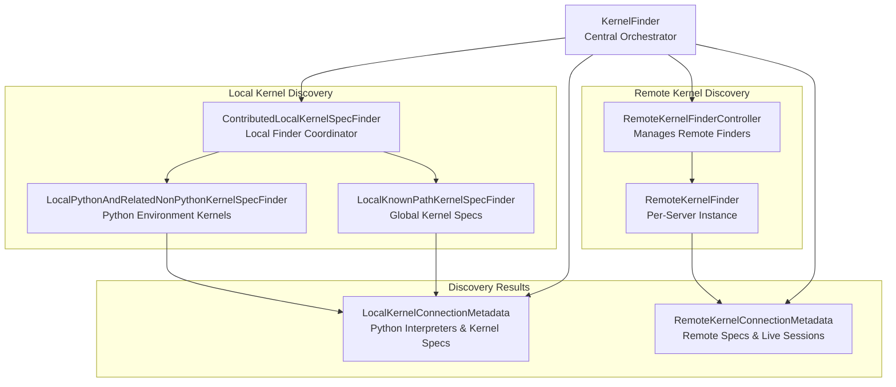
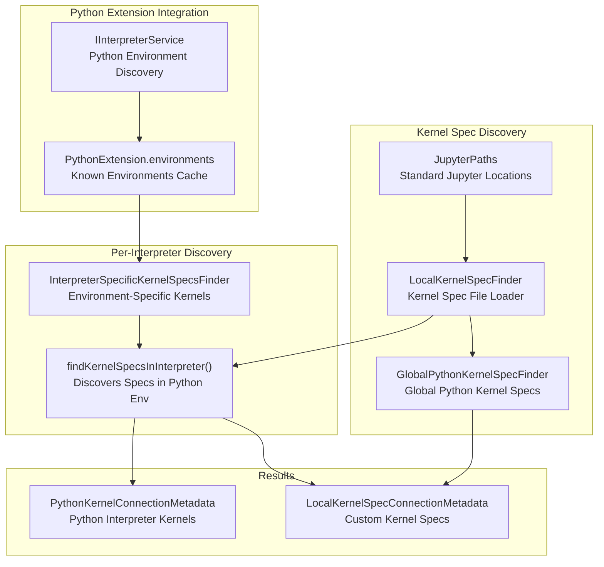
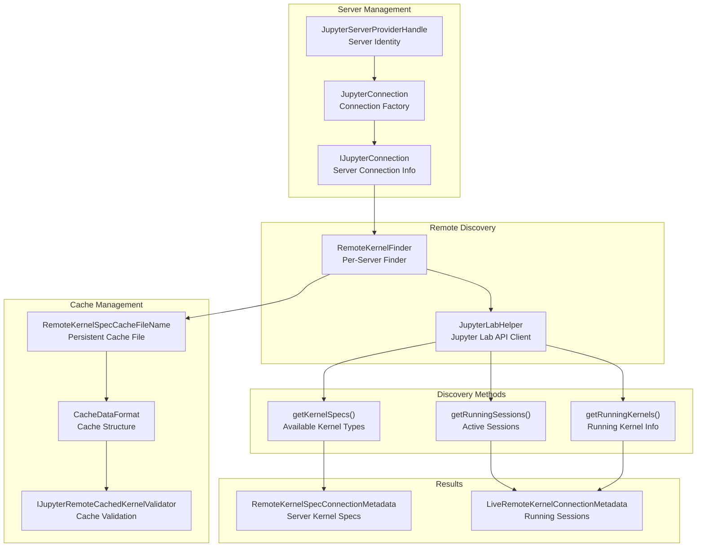
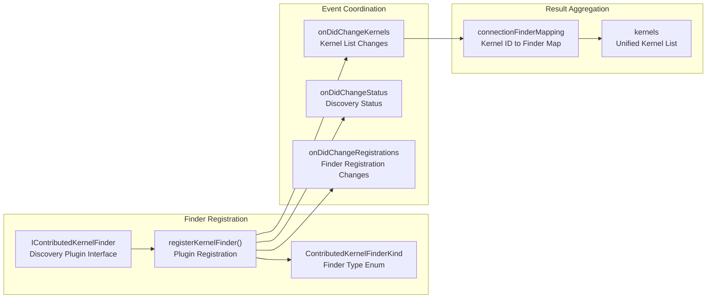
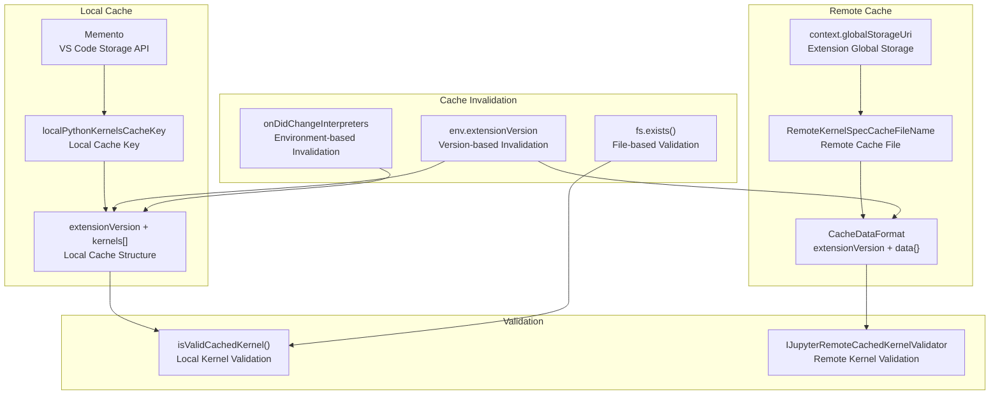

<!-- source: DeepWiki mcp.deepwiki.com · repo microsoft/vscode-jupyter · page 3.2 Kernel Discovery and Selection · fetched 2026-10-26 -->

# Kernel Discovery and Selection

Relevant source files

The following files were used as context for generating this wiki page:

- [src/kernels/helpers.ts](src/kernels/helpers.ts)
- [src/kernels/raw/finder/contributedKerneFinder.node.unit.test.ts](src/kernels/raw/finder/contributedKerneFinder.node.unit.test.ts)
- [src/kernels/raw/finder/contributedLocalKernelSpecFinder.node.ts](src/kernels/raw/finder/contributedLocalKernelSpecFinder.node.ts)
- [src/kernels/raw/finder/contributedLocalKernelSpecFinder.node.unit.test.ts](src/kernels/raw/finder/contributedLocalKernelSpecFinder.node.unit.test.ts)
- [src/kernels/raw/finder/interpreterKernelSpecFinderHelper.node.ts](src/kernels/raw/finder/interpreterKernelSpecFinderHelper.node.ts)
- [src/kernels/raw/finder/interpreterKernelSpecFinderHelper.node.unit.test.ts](src/kernels/raw/finder/interpreterKernelSpecFinderHelper.node.unit.test.ts)
- [src/kernels/raw/finder/localKernelSpecFinderBase.node.ts](src/kernels/raw/finder/localKernelSpecFinderBase.node.ts)
- [src/kernels/raw/finder/localKnownPathKernelSpecFinder.node.ts](src/kernels/raw/finder/localKnownPathKernelSpecFinder.node.ts)
- [src/kernels/raw/finder/localPythonAndRelatedNonPythonKernelSpecFinder.node.ts](src/kernels/raw/finder/localPythonAndRelatedNonPythonKernelSpecFinder.node.ts)
- [src/kernels/raw/finder/localPythonAndRelatedNonPythonKernelSpecFinder.node.unit.test.ts](src/kernels/raw/finder/localPythonAndRelatedNonPythonKernelSpecFinder.node.unit.test.ts)
- [src/notebooks/controllers/kernelSource/baseKernelSelector.ts](src/notebooks/controllers/kernelSource/baseKernelSelector.ts)
- [src/notebooks/controllers/kernelSource/localNotebookKernelSourceSelector.node.ts](src/notebooks/controllers/kernelSource/localNotebookKernelSourceSelector.node.ts)
- [src/notebooks/controllers/kernelSource/localPythonEnvKernelSourceSelector.node.ts](src/notebooks/controllers/kernelSource/localPythonEnvKernelSourceSelector.node.ts)
- [src/notebooks/controllers/kernelSource/quicPickKernelItemProvider.unit.test.ts](src/notebooks/controllers/kernelSource/quicPickKernelItemProvider.unit.test.ts)
- [src/notebooks/controllers/kernelSource/quickPickKernelItemProvider.ts](src/notebooks/controllers/kernelSource/quickPickKernelItemProvider.ts)
- [src/notebooks/controllers/kernelSource/types.ts](src/notebooks/controllers/kernelSource/types.ts)
- [src/platform/api/pythonApi.ts](src/platform/api/pythonApi.ts)
- [src/platform/api/types.ts](src/platform/api/types.ts)
- [src/platform/common/utils/localize.ts](src/platform/common/utils/localize.ts)
- [src/platform/interpreter/activation/types.ts](src/platform/interpreter/activation/types.ts)
- [src/platform/interpreter/contracts.ts](src/platform/interpreter/contracts.ts)
- [src/platform/interpreter/environmentActivationService.node.ts](src/platform/interpreter/environmentActivationService.node.ts)
- [src/platform/interpreter/globalPythonExePathService.node.ts](src/platform/interpreter/globalPythonExePathService.node.ts)
- [src/platform/interpreter/helpers.ts](src/platform/interpreter/helpers.ts)

## Purpose and Scope

The kernel discovery and selection system is responsible for finding all available Jupyter kernels and providing user interfaces for selecting them. The discovery component finds and manages kernels from local Python interpreters, custom kernel specifications, and remote Jupyter servers. The selection component provides multi-step UI workflows that allow users to choose kernels through VS Code's quick pick interface.

This system provides a unified interface for discovering, caching, tracking changes to available kernels, and presenting them to users in an organized, filterable format.

For information about how selected kernels are actually started and managed during execution, see [Kernel Types and Abstractions](#3.1). For details about connecting to remote Jupyter servers, see [Remote Jupyter Servers](#3.3).

## System Architecture

The kernel discovery system is built around a plugin-like architecture where different `IContributedKernelFinder` implementations discover kernels from various sources, and a central `KernelFinder` orchestrates and aggregates the results.

Sources: [src/kernels/kernelFinder.ts:15-155](), [src/kernels/internalTypes.ts:14-32](), [src/kernels/raw/finder/contributedLocalKernelSpecFinder.node.ts:29-207]()

## Local Kernel Discovery

Local kernel discovery finds kernels available on the local machine, including Python interpreters and custom kernel specifications installed in standard locations.

### Discovery Architecture

Sources: [src/kernels/raw/finder/localPythonAndRelatedNonPythonKernelSpecFinder.node.ts:46-371](), [src/kernels/raw/finder/interpreterKernelSpecFinderHelper.node.ts:138-325](), [src/kernels/raw/finder/interpreterKernelSpecFinderHelper.node.ts:53-130]()

### Discovery Process

The local discovery process involves multiple stages:

| Stage | Finder Class | Responsibility |
|-------|--------------|----------------|
| **Cache Loading** | `LocalPythonAndRelatedNonPythonKernelSpecFinder` | Load previously cached kernels from memento storage |
| **Global Specs** | `LocalKnownPathKernelSpecFinder` | Find kernel specs in standard Jupyter locations |
| **Python Environments** | `InterpreterSpecificKernelSpecsFinder` | Discover kernels within each Python environment |
| **Interpreter Creation** | `createInterpreterKernelSpec()` | Generate default kernel specs for Python interpreters |

**Cache Management**: The system uses persistent caching with the key `localPythonKernelsCacheKey()` to store discovered kernels between sessions. Cache entries include the extension version to invalidate outdated data.

**Environment Tracking**: The discovery system listens to Python extension events via `IInterpreterService.onDidChangeInterpreters` and `onDidRemoveInterpreter` to update the kernel list when Python environments are added or removed.

Sources: [src/kernels/raw/finder/localPythonAndRelatedNonPythonKernelSpecFinder.node.ts:130-183](), [src/kernels/raw/finder/interpreterKernelSpecFinderHelper.node.ts:48-51](), [src/kernels/raw/finder/localKernelSpecFinderBase.node.ts:246-284]()

## Remote Kernel Discovery

Remote kernel discovery finds kernels available on Jupyter servers, including both kernel specifications and live running sessions.

### Remote Discovery Architecture

Sources: [src/kernels/jupyter/finder/remoteKernelFinder.ts:46-462](), [src/kernels/jupyter/finder/remoteKernelFinder.ts:327-390](), [src/kernels/jupyter/finder/remoteKernelFinder.ts:40-43]()

### Remote Discovery Process

**Connection Establishment**: Each `RemoteKernelFinder` instance manages discovery for a single Jupyter server identified by a `JupyterServerProviderHandle`. The finder creates connections through `JupyterConnection.createConnectionInfo()`.

**Kernel Enumeration**: The system queries three different endpoint types:
- **Kernel Specs** (`getKernelSpecs()`): Available kernel types on the server
- **Running Sessions** (`getRunningSessions()`): Active notebook/console sessions  
- **Running Kernels** (`getRunningKernels()`): Detailed kernel execution information

**Cache Strategy**: Remote kernels are cached in `RemoteKernelSpecCacheFileName` with a `CacheDataFormat` that includes:
- Extension version for cache invalidation
- Per-server cache keys using `generateIdFromRemoteProvider()`
- Separate validation for live kernels vs kernel specs

**Live Kernel Updates**: The system automatically refreshes remote kernel lists when:
- A new kernel is started (`onDidStartKernel`) 
- A kernel is disposed (`onDidDisposeKernel` with `REMOTE_KERNEL_REFRESH_INTERVAL` delay)

Sources: [src/kernels/jupyter/finder/remoteKernelFinder.ts:174-199](), [src/kernels/jupyter/finder/remoteKernelFinder.ts:392-451](), [src/kernels/jupyter/finder/remoteKernelFinder.ts:36-38](), [src/kernels/jupyter/finder/remoteKernelFinder.ts:143-166]()

## Kernel Finder Orchestration

The `KernelFinder` class serves as the central orchestrator that manages all kernel discovery sources and provides a unified view of available kernels.

### Registration and Lifecycle

Sources: [src/kernels/kernelFinder.ts:52-85](), [src/kernels/kernelFinder.ts:87-143](), [src/kernels/internalTypes.ts:8-12]()

### Kernel Prioritization

The `KernelFinder.kernels` property implements a prioritization strategy when combining results from multiple discovery sources:

| Priority | Finder Kind | Rationale |
|----------|-------------|-----------|
| **Highest** | `LocalPythonEnvironment` | Python interpreter kernels have the most complete metadata |
| **Medium** | `LocalKernelSpec` | Custom kernel specs, but filtered to avoid duplicates |
| **Lowest** | `Remote` | Remote kernels from all registered servers |

The system prevents duplicate entries by tracking `loadedKernelSpecFiles` and giving preference to kernels discovered through the Python extension, which have richer interpreter metadata.

Sources: [src/kernels/kernelFinder.ts:87-143](), [src/kernels/internalTypes.ts:8-12]()

## Caching and Validation

The discovery system implements sophisticated caching to improve startup performance and handle network connectivity issues.

### Cache Architecture

Sources: [src/kernels/raw/finder/interpreterKernelSpecFinderHelper.node.ts:48-51](), [src/kernels/jupyter/finder/remoteKernelFinder.ts:40-43](), [src/kernels/raw/finder/localKernelSpecFinderBase.node.ts:300-315]()

### Cache Validation Strategy

**Local Kernel Validation**: The `isValidCachedKernel()` method checks:
- **Interpreter Kernels**: Verify the interpreter executable still exists
- **Kernel Spec Kernels**: Verify both the spec file and associated interpreter exist

**Remote Kernel Validation**: Uses `IJupyterRemoteCachedKernelValidator.isValid()` to validate:
- **Kernel Specs**: Always considered invalid (fetch fresh from server)
- **Live Kernels**: Check if the session is still active and usable

**Version-based Invalidation**: All caches include `env.extensionVersion` to automatically invalidate when the extension is updated, preventing compatibility issues with cache format changes.

Sources: [src/kernels/raw/finder/localKernelSpecFinderBase.node.ts:300-315](), [src/kernels/jupyter/finder/remoteKernelFinder.ts:453-461](), [src/kernels/raw/finder/localKernelSpecFinderBase.node.ts:266-268]()

## Integration Points

The kernel discovery system integrates with several other extension components:

**Python Extension Integration**: Discovery depends heavily on `IInterpreterService` for Python environment information and listens to interpreter change events to maintain up-to-date kernel lists.

**Service Registration**: Kernel finders are registered through the IoC container in `registerTypes()` functions, with different registration patterns for desktop vs web environments.

**Extension Activation**: Most kernel finders implement `IExtensionSyncActivationService` and are activated during extension startup through the `activate()` method.

**Telemetry Integration**: The system reports kernel discovery metrics through `sendKernelSpecTelemetry()` to track usage patterns and performance.

Sources: [src/kernels/jupyter/serviceRegistry.node.ts:55-125](), [src/kernels/raw/finder/helper.ts:1-30](), [src/kernels/raw/finder/localKnownPathKernelSpecFinder.node.ts:46-57]()

---

