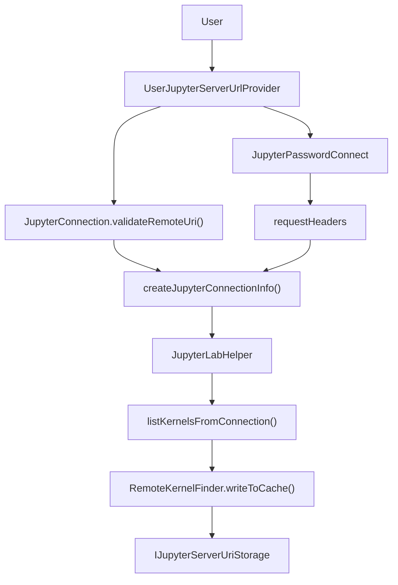
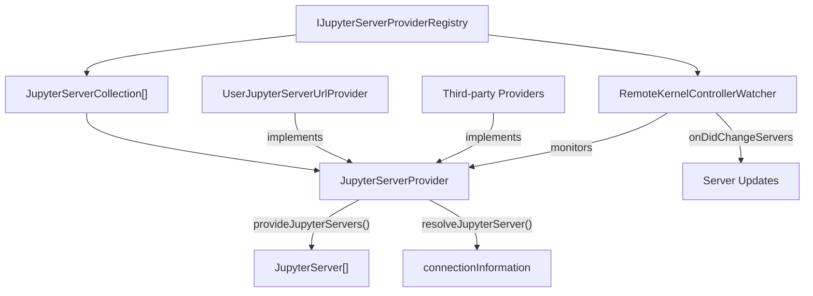
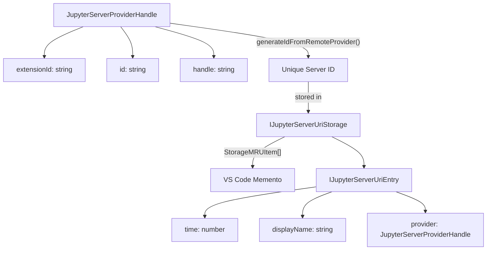
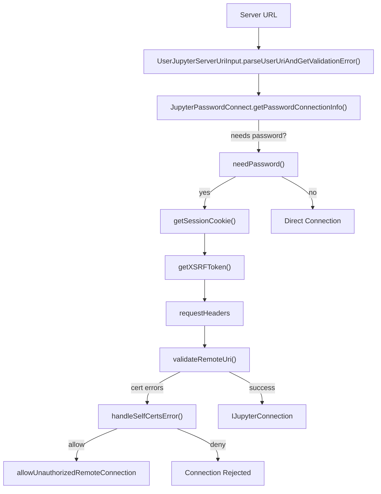
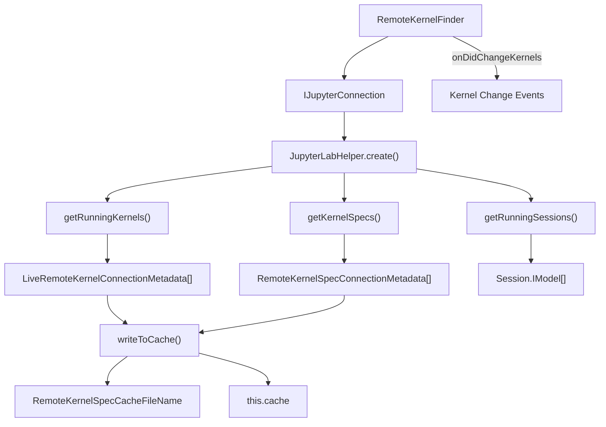
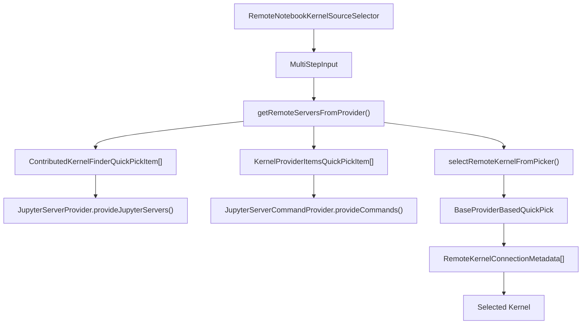
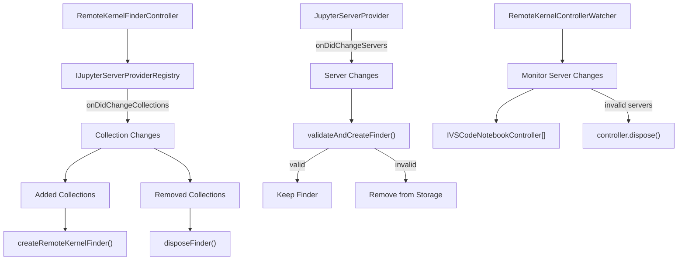
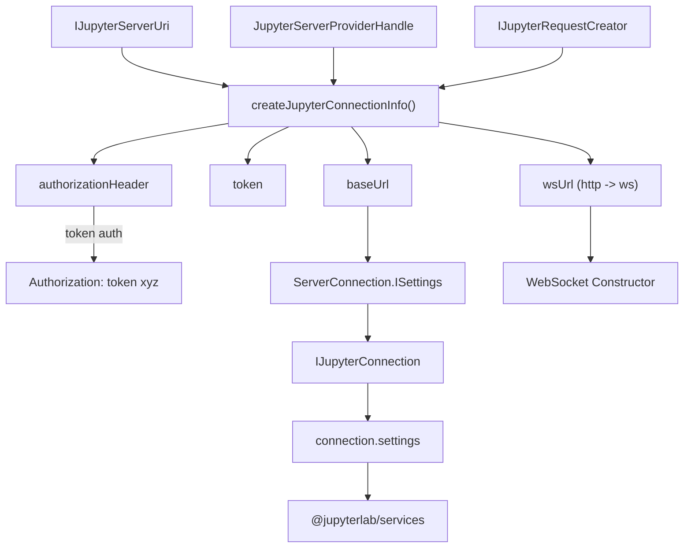
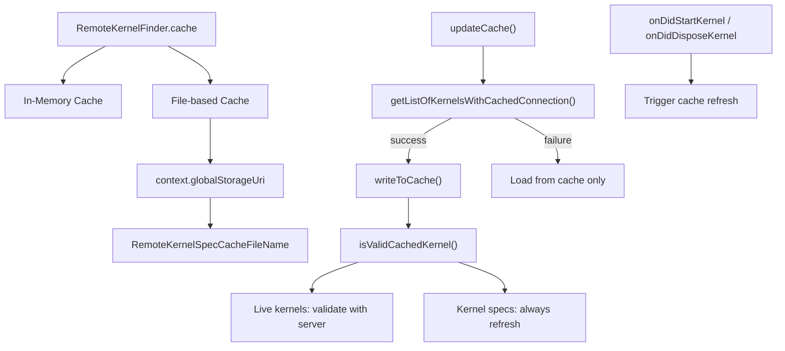

<!-- source: DeepWiki mcp.deepwiki.com · repo microsoft/vscode-jupyter · page 3.3 Remote Jupyter Servers · fetched 2026-10-26 -->

# Remote Jupyter Servers

Relevant source files

The following files were used as context for generating this wiki page:

- [src/api.internal.d.ts](src/api.internal.d.ts)
- [src/kernels/internalTypes.ts](src/kernels/internalTypes.ts)
- [src/kernels/jupyter/connection/jupyterConnection.ts](src/kernels/jupyter/connection/jupyterConnection.ts)
- [src/kernels/jupyter/connection/jupyterConnection.unit.test.ts](src/kernels/jupyter/connection/jupyterConnection.unit.test.ts)
- [src/kernels/jupyter/connection/jupyterServerProviderRegistry.ts](src/kernels/jupyter/connection/jupyterServerProviderRegistry.ts)
- [src/kernels/jupyter/connection/serverUriStorage.ts](src/kernels/jupyter/connection/serverUriStorage.ts)
- [src/kernels/jupyter/connection/serverUriStorage.unit.test.ts](src/kernels/jupyter/connection/serverUriStorage.unit.test.ts)
- [src/kernels/jupyter/finder/remoteKernelFinder.ts](src/kernels/jupyter/finder/remoteKernelFinder.ts)
- [src/kernels/jupyter/finder/remoteKernelFinder.unit.test.ts](src/kernels/jupyter/finder/remoteKernelFinder.unit.test.ts)
- [src/kernels/jupyter/finder/remoteKernelFinderController.ts](src/kernels/jupyter/finder/remoteKernelFinderController.ts)
- [src/kernels/jupyter/jupyterUtils.ts](src/kernels/jupyter/jupyterUtils.ts)
- [src/kernels/jupyter/serviceRegistry.node.ts](src/kernels/jupyter/serviceRegistry.node.ts)
- [src/kernels/jupyter/serviceRegistry.web.ts](src/kernels/jupyter/serviceRegistry.web.ts)
- [src/kernels/jupyter/types.ts](src/kernels/jupyter/types.ts)
- [src/kernels/kernelFinder.ts](src/kernels/kernelFinder.ts)
- [src/notebooks/controllers/kernelSource/remoteNotebookKernelSourceSelector.ts](src/notebooks/controllers/kernelSource/remoteNotebookKernelSourceSelector.ts)
- [src/notebooks/controllers/remoteKernelControllerWatcher.ts](src/notebooks/controllers/remoteKernelControllerWatcher.ts)
- [src/notebooks/controllers/remoteKernelControllerWatcher.unit.test.ts](src/notebooks/controllers/remoteKernelControllerWatcher.unit.test.ts)
- [src/standalone/userJupyterHubServer/jupyterHubPasswordConnect.ts](src/standalone/userJupyterHubServer/jupyterHubPasswordConnect.ts)
- [src/standalone/userJupyterServer/jupyterPasswordConnect.ts](src/standalone/userJupyterServer/jupyterPasswordConnect.ts)
- [src/standalone/userJupyterServer/jupyterPasswordConnect.unit.test.ts](src/standalone/userJupyterServer/jupyterPasswordConnect.unit.test.ts)
- [src/standalone/userJupyterServer/userServerUriProvider.unit.test.ts](src/standalone/userJupyterServer/userServerUriProvider.unit.test.ts)
- [src/standalone/userJupyterServer/userServerUrlProvider.ts](src/standalone/userJupyterServer/userServerUrlProvider.ts)
- [src/test/datascience/.vscode/settings.json](src/test/datascience/.vscode/settings.json)
- [src/test/datascience/dsTestSetup.ts](src/test/datascience/dsTestSetup.ts)
- [src/test/datascience/jupyter/connection.vscode.test.ts](src/test/datascience/jupyter/connection.vscode.test.ts)

This document covers the system for connecting to and managing remote Jupyter servers in the VS Code Jupyter extension. It includes server discovery, authentication, kernel enumeration, and connection management for external Jupyter instances.

For information about local kernel management, see [Kernel Discovery and Selection](#3.2). For notebook controller integration, see [Notebook Controllers](#4.1).

## Overview

The remote Jupyter server system enables users to connect to Jupyter servers running on remote machines, cloud instances, or other network locations. The system handles server discovery through multiple providers, manages authentication credentials, discovers available kernels, and maintains connection state.

**Core Server Connection Flow**

Sources: [src/standalone/userJupyterServer/userServerUrlProvider.ts:305-625](), [src/kernels/jupyter/connection/jupyterConnection.ts:41-66](), [src/kernels/jupyter/finder/remoteKernelFinder.ts:327-390]()

## Server Provider Architecture

The extension supports multiple server providers through a pluggable architecture. Each provider implements the `JupyterServerProvider` interface and is registered via `IJupyterServerProviderRegistry`.

**Provider Registration and Management**

Sources: [src/kernels/jupyter/types.ts:245-259](), [src/standalone/userJupyterServer/userServerUrlProvider.ts:79-147](), [src/notebooks/controllers/remoteKernelControllerWatcher.ts:20-44]()

## Server Identification and Storage

Each remote server is uniquely identified by a `JupyterServerProviderHandle` containing the extension ID, provider ID, and server handle. The system maintains an MRU (Most Recently Used) list of servers.

**Server Handle Structure**

Sources: [src/kernels/jupyter/types.ts:117-131](), [src/kernels/jupyter/connection/serverUriStorage.ts:14-31](), [src/kernels/jupyter/jupyterUtils.ts:190-209]()

## Authentication and Connection Security

The system handles various authentication scenarios including password-protected servers, token-based authentication, and certificate validation.

**Authentication Flow**

Sources: [src/standalone/userJupyterServer/jupyterPasswordConnect.ts:98-183](), [src/kernels/jupyter/jupyterUtils.ts:43-81](), [src/kernels/jupyter/connection/jupyterConnection.ts:68-132]()

## Remote Kernel Discovery

Once connected to a server, the system discovers available kernels through the `RemoteKernelFinder` which queries both running kernels and available kernel specifications.

**Kernel Discovery Process**

Sources: [src/kernels/jupyter/finder/remoteKernelFinder.ts:327-390](), [src/kernels/jupyter/finder/remoteKernelFinder.ts:46-123](), [src/kernels/jupyter/finder/remoteKernelFinder.ts:392-451]()

## Kernel Selection UI

The kernel selection interface allows users to choose between different remote servers and their available kernels through a multi-step picker UI.

**Selection Interface Components**

Sources: [src/notebooks/controllers/kernelSource/remoteNotebookKernelSourceSelector.ts:137-239](), [src/notebooks/controllers/kernelSource/remoteNotebookKernelSourceSelector.ts:540-583]()

## Connection Lifecycle Management

The system tracks server connections and automatically manages their lifecycle, including cleanup of stale connections and validation of cached servers.

**Connection Management**

Sources: [src/kernels/jupyter/finder/remoteKernelFinderController.ts:33-120](), [src/notebooks/controllers/remoteKernelControllerWatcher.ts:45-127]()

## Connection Information Creation

The `createJupyterConnectionInfo` function transforms server URIs into `IJupyterConnection` objects with proper authentication headers and WebSocket configuration.

**Connection Creation Details**

Sources: [src/kernels/jupyter/jupyterUtils.ts:83-179](), [src/kernels/jupyter/connection/jupyterConnection.ts:41-66]()

## Key Types and Interfaces

| Type | Purpose | Key Properties |
|------|---------|----------------|
| `JupyterServerProviderHandle` | Unique server identifier | `extensionId`, `id`, `handle` |
| `IJupyterConnection` | Connection instance | `baseUrl`, `token`, `settings`, `serverProviderHandle` |
| `RemoteKernelConnectionMetadata` | Remote kernel metadata | Base class for remote kernel types |
| `LiveRemoteKernelConnectionMetadata` | Active remote kernel | `kernelModel`, running session info |
| `RemoteKernelSpecConnectionMetadata` | Remote kernel spec | `kernelSpec`, available but not running |
| `IJupyterServerUri` | Server connection details | `baseUrl`, `token`, `authorizationHeader` |

Sources: [src/kernels/jupyter/types.ts:117-131](), [src/kernels/types.ts:15-20](), [src/api.ts:1-50]()

## Caching and Performance

The system implements sophisticated caching to minimize server requests and improve performance, especially for frequently accessed remote servers.

**Cache Management**

Sources: [src/kernels/jupyter/finder/remoteKernelFinder.ts:201-236](), [src/kernels/jupyter/finder/remoteKernelFinder.ts:237-265](), [src/kernels/jupyter/finder/remoteKernelFinder.ts:392-451]()

---

