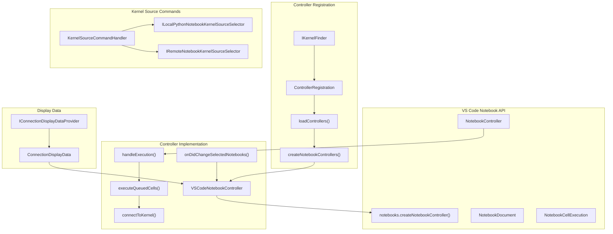
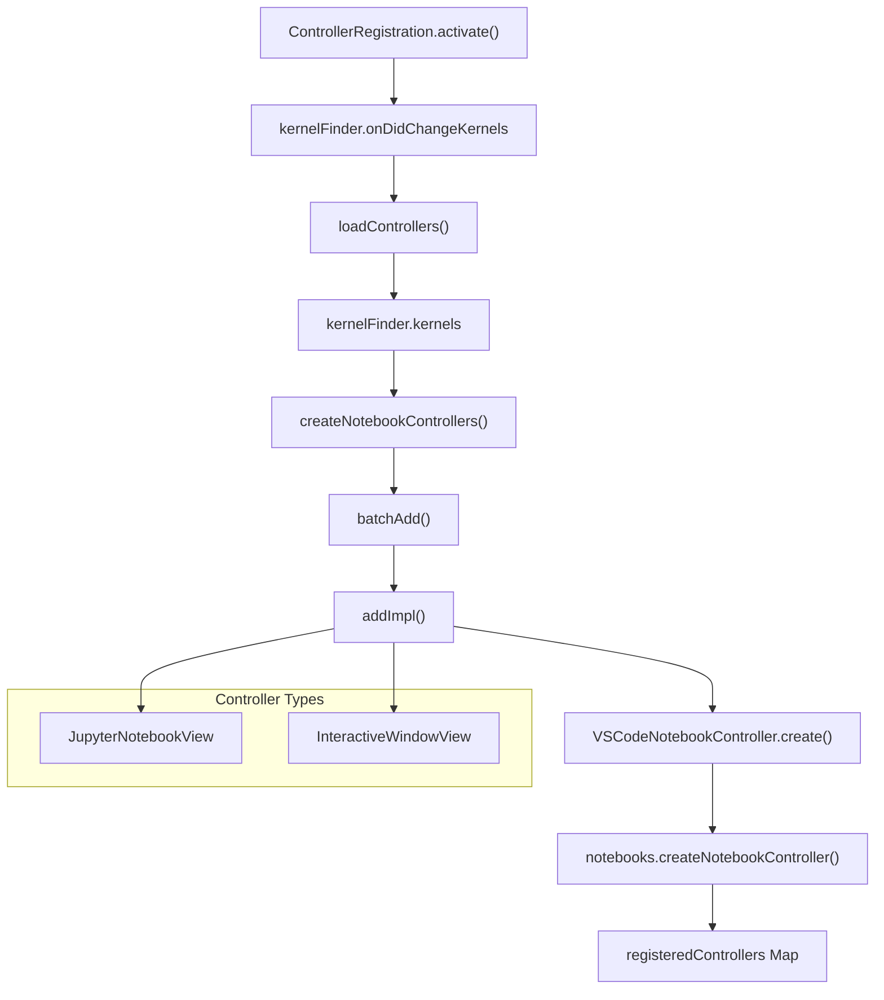
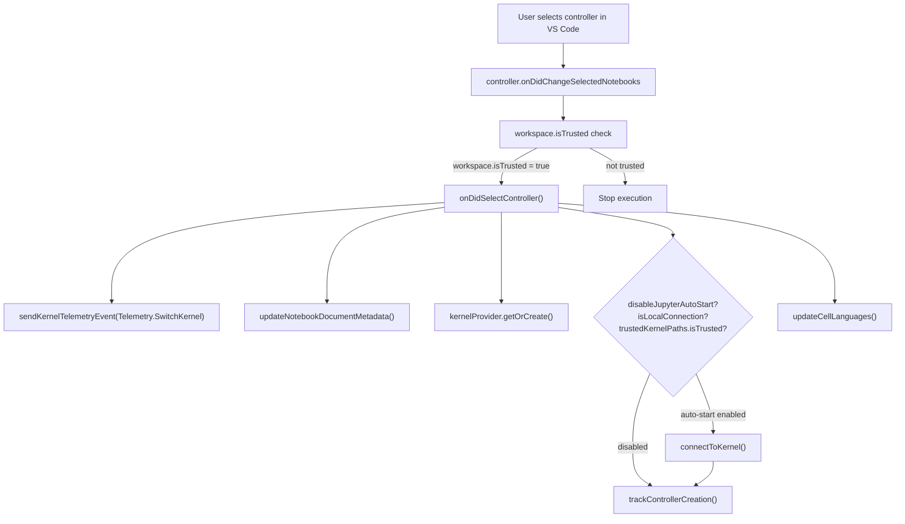
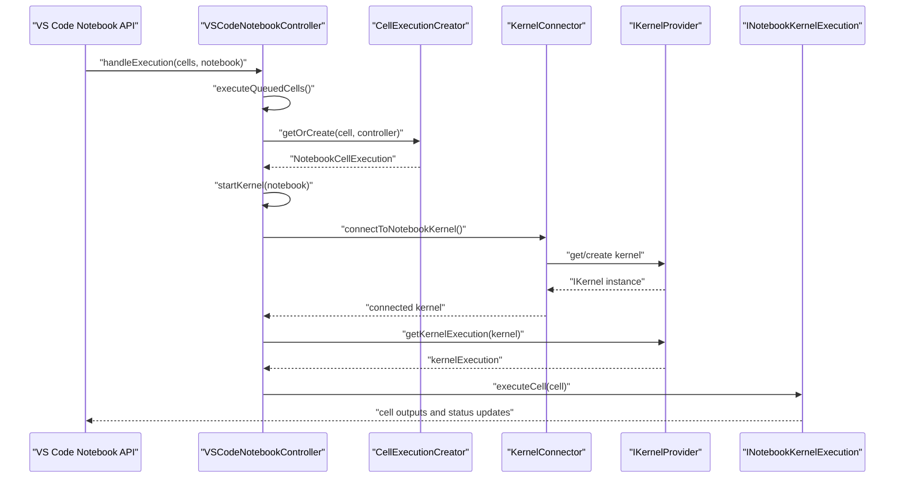
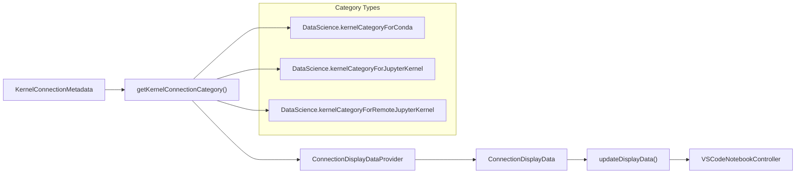

<!-- source: DeepWiki mcp.deepwiki.com · repo microsoft/vscode-jupyter · page 4 Notebook System · fetched 2026-10-26 -->

# Notebook System

Relevant source files

The following files were used as context for generating this wiki page:

- [src/notebooks/controllers/commands/installPythonControllerCommands.ts](src/notebooks/controllers/commands/installPythonControllerCommands.ts)
- [src/notebooks/controllers/connectionDisplayData.ts](src/notebooks/controllers/connectionDisplayData.ts)
- [src/notebooks/controllers/controllerRegistration.ts](src/notebooks/controllers/controllerRegistration.ts)
- [src/notebooks/controllers/controllerRegistration.unit.test.ts](src/notebooks/controllers/controllerRegistration.unit.test.ts)
- [src/notebooks/controllers/kernelSource/kernelSourceCommandHandler.ts](src/notebooks/controllers/kernelSource/kernelSourceCommandHandler.ts)
- [src/notebooks/controllers/serviceRegistry.node.ts](src/notebooks/controllers/serviceRegistry.node.ts)
- [src/notebooks/controllers/serviceRegistry.web.ts](src/notebooks/controllers/serviceRegistry.web.ts)
- [src/notebooks/controllers/types.ts](src/notebooks/controllers/types.ts)
- [src/notebooks/controllers/vscodeNotebookController.ts](src/notebooks/controllers/vscodeNotebookController.ts)
- [src/notebooks/controllers/vscodeNotebookController.unit.test.ts](src/notebooks/controllers/vscodeNotebookController.unit.test.ts)
- [src/test/datascience/jupyter/kernels/installationPrompts.vscode.test.ts](src/test/datascience/jupyter/kernels/installationPrompts.vscode.test.ts)
- [src/test/datascience/notebook/controllerDefaultService.ts](src/test/datascience/notebook/controllerDefaultService.ts)
- [src/test/datascience/notebook/controllerPreferredService.ts](src/test/datascience/notebook/controllerPreferredService.ts)
- [src/test/datascience/notebook/kernelCrashes.vscode.test.ts](src/test/datascience/notebook/kernelCrashes.vscode.test.ts)
- [src/test/datascience/notebook/kernelRankingHelper.ts](src/test/datascience/notebook/kernelRankingHelper.ts)
- [src/test/datascience/notebook/remoteNotebookEditor.vscode.common.test.ts](src/test/datascience/notebook/remoteNotebookEditor.vscode.common.test.ts)
- [src/test/datascience/notebook/remoteNotebookEditor.vscode.test.ts](src/test/datascience/notebook/remoteNotebookEditor.vscode.test.ts)
- [src/test/datascience/variableView/variableViewHelpers.ts](src/test/datascience/variableView/variableViewHelpers.ts)

The Notebook System integrates with VS Code's native notebook API to provide Jupyter functionality within `.ipynb` files and interactive windows. It creates and manages `NotebookController` instances through the `IControllerRegistration` interface, handles cell execution via `VSCodeNotebookController`, and connects notebooks to kernels through the `IKernelProvider` system.

## Purpose and Scope

The Notebook System implements the bridge between VS Code's notebook API and Jupyter kernels. The core components include:

- **Controller Registration** - `ControllerRegistration` class manages controller lifecycle based on available `KernelConnectionMetadata`
- **Controller Implementation** - `VSCodeNotebookController` handles cell execution and kernel communication
- **Kernel Source Selection** - `KernelSourceCommandHandler` provides kernel picker integration
- **Display Data Management** - `IConnectionDisplayDataProvider` generates controller labels and descriptions

This system enables execution of Jupyter notebooks and interactive Python code using local interpreters, kernel specifications, and remote Jupyter servers.

## Architecture Overview

**Notebook Controller System Architecture**

**Sources:** [src/notebooks/controllers/vscodeNotebookController.ts:91-769](), [src/notebooks/controllers/controllerRegistration.ts:38-369](), [src/notebooks/controllers/kernelSource/kernelSourceCommandHandler.ts:54-325](), [src/notebooks/controllers/types.ts:22-137]()

## Controller Registration and Lifecycle

The `ControllerRegistration` class implements `IControllerRegistration` and manages the complete lifecycle of `VSCodeNotebookController` instances based on available `KernelConnectionMetadata`. It activates as an `IExtensionSyncActivationService` and monitors changes through `IKernelFinder`.

**Controller Registration Flow**

The registration system creates two controllers per `KernelConnectionMetadata`: one for `JupyterNotebookView` and one for `InteractiveWindowView`. Controllers use `getControllerId()` to generate unique IDs and are automatically disposed via `canControllerBeDisposed()` when kernels become unavailable.

**Sources:** [src/notebooks/controllers/controllerRegistration.ts:83-100](), [src/notebooks/controllers/controllerRegistration.ts:102-141](), [src/notebooks/controllers/controllerRegistration.ts:244-349](), [src/notebooks/controllers/controllerRegistration.ts:359-364]()

## Controller Selection and Kernel Association

When a user selects a controller, the `VSCodeNotebookController` handles the selection through its `onDidChangeSelectedNotebooks` event handler and establishes kernel connections via `KernelConnector.connectToNotebookKernel()`.

**Controller Selection Flow**

The `updateCellLanguages()` method ensures cell language compatibility by calling `languages.setTextDocumentLanguage()` when cells don't match the controller's `supportedLanguages` from `NotebookCellLanguageService.getSupportedLanguages()`.

**Sources:** [src/notebooks/controllers/vscodeNotebookController.ts:395-455](), [src/notebooks/controllers/vscodeNotebookController.ts:708-768](), [src/notebooks/controllers/vscodeNotebookController.ts:474-492](), [src/notebooks/controllers/vscodeNotebookController.ts:193-218]()

## Cell Execution Flow

VS Code triggers cell execution through the `handleExecution()` method registered as the controller's execution handler. The `VSCodeNotebookController` manages cell queuing, kernel connection, and execution coordination.

**Cell Execution Sequence**

The execution system uses `cellQueue` to manage multiple cell execution requests and `runningCellExecutions` to track active executions. Error handling includes `endCellAndDisplayErrorsInCell()` for kernel failures and `IDataScienceErrorHandler` for user-friendly error messages.

**Sources:** [src/notebooks/controllers/vscodeNotebookController.ts:358-394](), [src/notebooks/controllers/vscodeNotebookController.ts:543-655](), [src/notebooks/controllers/vscodeNotebookController.ts:524-540](), [src/notebooks/controllers/vscodeNotebookController.ts:657-671]()

## Display Data and Controller Metadata

The `IConnectionDisplayDataProvider` interface generates display information for controllers in VS Code's kernel picker. The `ConnectionDisplayData` class implements `IConnectionDisplayData` with dynamic updates through `onDidChange` events.

| Property | Interface | Purpose | Example |
|----------|-----------|---------|---------|
| `label` | `IConnectionDisplayData.label` | Primary display name | "Python 3.9.7" |
| `description` | `IConnectionDisplayData.description` | Additional context | "/usr/local/bin/python" |
| `category` | `IConnectionDisplayData.category` | Grouping classification | `DataScience.kernelCategoryForConda` |
| `serverDisplayName` | `IConnectionDisplayData.serverDisplayName` | Remote server context | "Jupyter Server" |

**Display Data Generation**

The `getKernelConnectionCategory()` function maps connection types to localized category strings, while `updateDisplayData()` refreshes controller labels and descriptions when kernel information changes.

**Sources:** [src/notebooks/controllers/connectionDisplayData.ts:13-81](), [src/notebooks/controllers/types.ts:125-137](), [src/notebooks/controllers/vscodeNotebookController.ts:344-357](), [src/notebooks/controllers/vscodeNotebookController.ts:195-204]()

## Integration with VS Code Notebook API

The notebook system leverages several key VS Code notebook APIs to provide seamless integration:

- `notebooks.createNotebookController()` - Creates controller instances that appear in kernel picker
- `NotebookController.executionHandler` - Handles cell execution requests from VS Code  
- `NotebookController.interruptHandler` - Handles kernel interruption requests
- `NotebookCellExecution` - Manages individual cell execution state and outputs
- `NotebookController.onDidChangeSelectedNotebooks` - Monitors controller selection changes

The controllers support execution ordering, multiple programming languages, and custom renderer scripts for development scenarios.

**Sources:** [src/notebooks/controllers/vscodeNotebookController.ts:196-219](), [src/notebooks/controllers/vscodeNotebookController.ts:493-514](), [src/notebooks/controllers/vscodeNotebookController.ts:516-522]()

---

