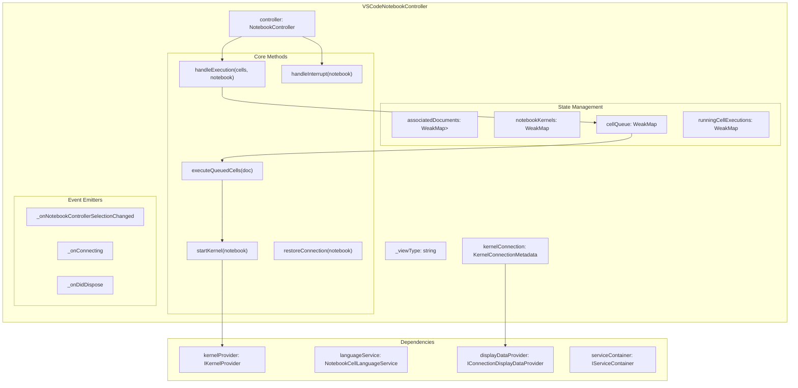
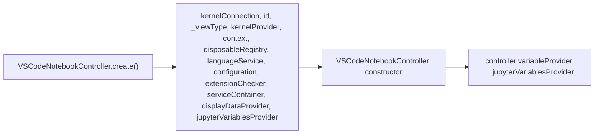
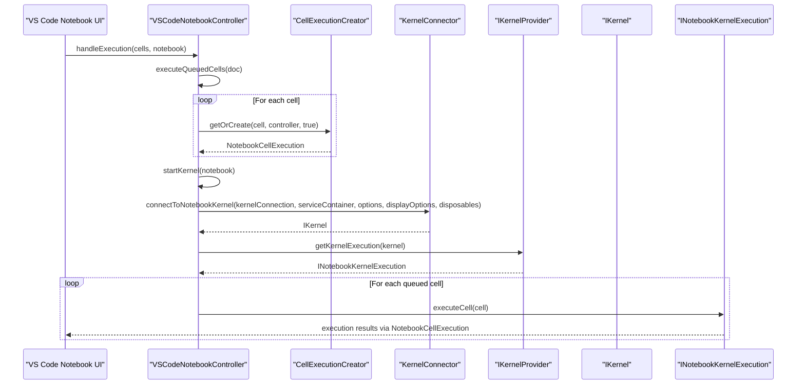
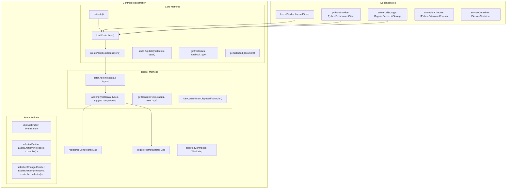
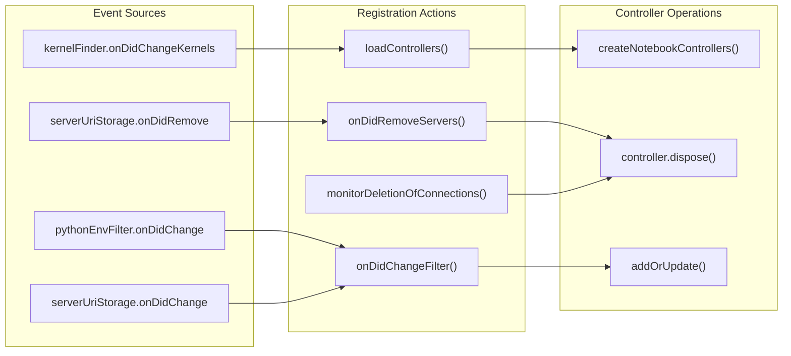
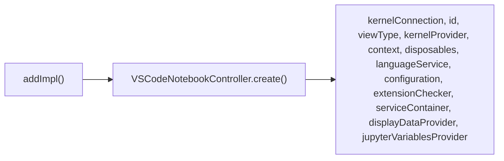
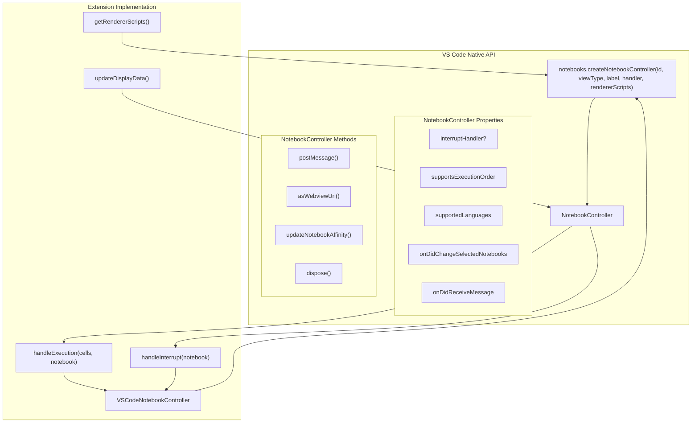
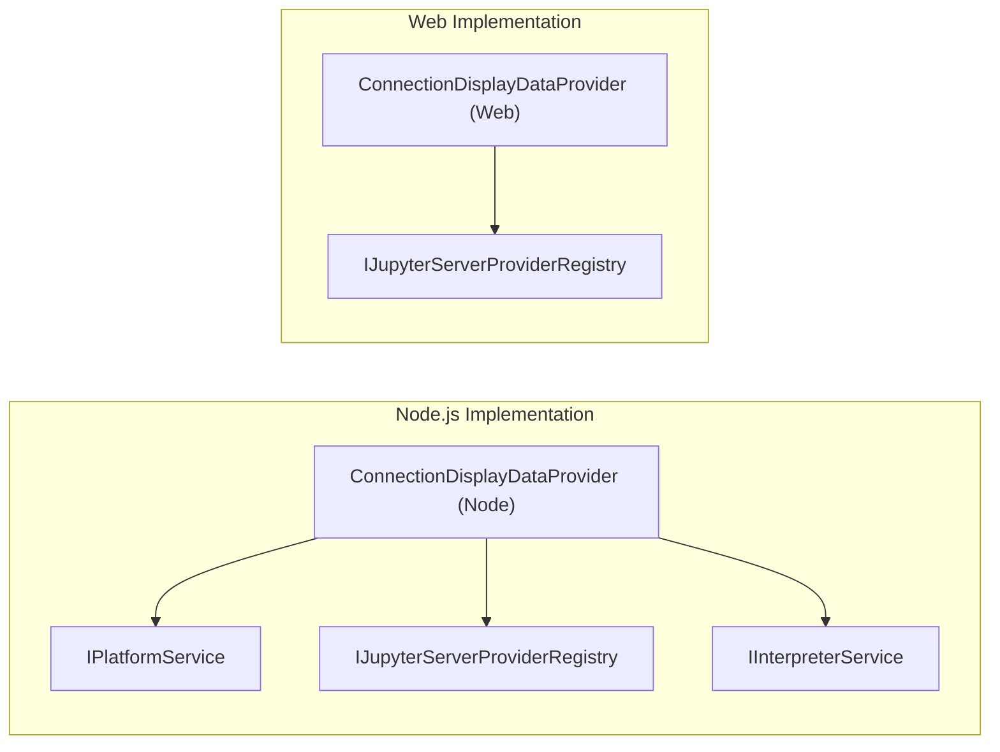

<!-- source: DeepWiki mcp.deepwiki.com · repo microsoft/vscode-jupyter · page 4.1 Notebook Controllers · fetched 2026-10-26 -->

# Notebook Controllers

<details>
<summary>Relevant source files</summary>

The following files were used as context for generating this wiki page:

- [src/notebooks/controllers/commands/installPythonControllerCommands.ts](src/notebooks/controllers/commands/installPythonControllerCommands.ts)
- [src/notebooks/controllers/connectionDisplayData.ts](src/notebooks/controllers/connectionDisplayData.ts)
- [src/notebooks/controllers/controllerRegistration.ts](src/notebooks/controllers/controllerRegistration.ts)
- [src/notebooks/controllers/controllerRegistration.unit.test.ts](src/notebooks/controllers/controllerRegistration.unit.test.ts)
- [src/notebooks/controllers/kernelSource/kernelSourceCommandHandler.ts](src/notebooks/controllers/kernelSource/kernelSourceCommandHandler.ts)
- [src/notebooks/controllers/serviceRegistry.node.ts](src/notebooks/controllers/serviceRegistry.node.ts)
- [src/notebooks/controllers/serviceRegistry.web.ts](src/notebooks/controllers/serviceRegistry.web.ts)
- [src/notebooks/controllers/types.ts](src/notebooks/controllers/types.ts)
- [src/notebooks/controllers/vscodeNotebookController.ts](src/notebooks/controllers/vscodeNotebookController.ts)
- [src/notebooks/controllers/vscodeNotebookController.unit.test.ts](src/notebooks/controllers/vscodeNotebookController.unit.test.ts)
- [src/test/datascience/jupyter/kernels/installationPrompts.vscode.test.ts](src/test/datascience/jupyter/kernels/installationPrompts.vscode.test.ts)
- [src/test/datascience/notebook/controllerDefaultService.ts](src/test/datascience/notebook/controllerDefaultService.ts)
- [src/test/datascience/notebook/controllerPreferredService.ts](src/test/datascience/notebook/controllerPreferredService.ts)
- [src/test/datascience/notebook/kernelCrashes.vscode.test.ts](src/test/datascience/notebook/kernelCrashes.vscode.test.ts)
- [src/test/datascience/notebook/kernelRankingHelper.ts](src/test/datascience/notebook/kernelRankingHelper.ts)
- [src/test/datascience/notebook/remoteNotebookEditor.vscode.common.test.ts](src/test/datascience/notebook/remoteNotebookEditor.vscode.common.test.ts)
- [src/test/datascience/notebook/remoteNotebookEditor.vscode.test.ts](src/test/datascience/notebook/remoteNotebookEditor.vscode.test.ts)
- [src/test/datascience/variableView/variableViewHelpers.ts](src/test/datascience/variableView/variableViewHelpers.ts)

</details>


## Purpose and Scope

The Notebook Controller system provides the integration layer between VS Code's native notebook API and the Jupyter kernel infrastructure. It implements VS Code's `NotebookController` interface to handle cell execution requests and manages the lifecycle of kernel connections for both Jupyter notebooks (`.ipynb` files) and Interactive Windows.

The system consists of controller implementations that wrap VS Code's native `NotebookController` objects with Jupyter-specific functionality, a registration system that manages controller lifecycles based on available kernel connections, and display data providers that present kernel information in the VS Code kernel picker.

For information about kernel management and discovery, see [Kernel Management](3). For details about cell execution mechanics, see [Cell Execution](4.2).

## System Architecture

The Notebook Controller system consists of three main components: controller implementation, registration management, and display data providers. Controllers serve as the bridge between VS Code's notebook UI and the underlying kernel execution system.

### Overall Architecture

```mermaid
graph TB
    subgraph "VS Code Native API"
        notebooks["notebooks.createNotebookController()"]
        NotebookController["NotebookController"]
        NotebookDocument["NotebookDocument"]
        NotebookCell["NotebookCell"]
    end
    
    subgraph "Controller System"
        VSCodeNotebookController["VSCodeNotebookController"]
        ControllerRegistration["ControllerRegistration"]
        IVSCodeNotebookController["IVSCodeNotebookController"]
        IControllerRegistration["IControllerRegistration"]
    end
    
    subgraph "Display System"
        ConnectionDisplayDataProvider["ConnectionDisplayDataProvider"]
        IConnectionDisplayDataProvider["IConnectionDisplayDataProvider"]
        IConnectionDisplayData["IConnectionDisplayData"]
    end
    
    subgraph "Kernel System"
        IKernelProvider["IKernelProvider"]
        KernelConnector["KernelConnector"]
        KernelConnectionMetadata["KernelConnectionMetadata"]
        IKernel["IKernel"]
    end
    
    subgraph "Services"
        NotebookCellLanguageService["NotebookCellLanguageService"]
        IConfigurationService["IConfigurationService"]
        IPythonExtensionChecker["IPythonExtensionChecker"]
        IServiceContainer["IServiceContainer"]
    end
    
    notebooks --> NotebookController
    NotebookController --> VSCodeNotebookController
    VSCodeNotebookController -.implements.-> IVSCodeNotebookController
    ControllerRegistration -.implements.-> IControllerRegistration
    
    ControllerRegistration --> VSCodeNotebookController
    ControllerRegistration --> KernelConnectionMetadata
    
    VSCodeNotebookController --> IKernelProvider
    VSCodeNotebookController --> KernelConnector
    VSCodeNotebookController --> IConnectionDisplayDataProvider
    
    ConnectionDisplayDataProvider -.implements.-> IConnectionDisplayDataProvider
    ConnectionDisplayDataProvider --> IConnectionDisplayData
    
    VSCodeNotebookController --> NotebookCellLanguageService
    VSCodeNotebookController --> IConfigurationService
    VSCodeNotebookController --> IPythonExtensionChecker
    VSCodeNotebookController --> IServiceContainer
```



Sources: [src/notebooks/controllers/vscodeNotebookController.ts:91-219](), [src/notebooks/controllers/controllerRegistration.ts:38-83](), [src/notebooks/controllers/types.ts:22-97](), [src/notebooks/controllers/connectionDisplayData.ts:1-82]()

## VSCodeNotebookController Implementation

The `VSCodeNotebookController` class is the core implementation that wraps a VS Code `NotebookController` and provides Jupyter-specific functionality. Each controller instance is associated with a specific `KernelConnectionMetadata` and handles execution requests for either Jupyter notebooks or Interactive Windows.

### Controller Class Structure



Sources: [src/notebooks/controllers/vscodeNotebookController.ts:91-219](), [src/notebooks/controllers/vscodeNotebookController.ts:542-656]()

### Controller Factory Method

Controllers are created using a static factory method that properly initializes all dependencies:



Sources: [src/notebooks/controllers/vscodeNotebookController.ts:143-178]()

### Cell Execution Flow

When VS Code requests cell execution, the controller follows a structured flow to connect to kernels and execute cells:



Sources: [src/notebooks/controllers/vscodeNotebookController.ts:358-394](), [src/notebooks/controllers/vscodeNotebookController.ts:543-655](), [src/notebooks/controllers/vscodeNotebookController.ts:657-671]()

### Kernel Connection and Auto-Start Logic

The controller implements sophisticated logic for kernel auto-starting based on configuration and trust settings:

| Condition | Auto-Start Behavior |
|-----------|-------------------|
| `disableJupyterAutoStart = true` | No auto-start |
| Remote kernel connection | No auto-start |
| Local connection + trusted kernel path | Auto-start enabled |
| Python kernel + no Python extension | No auto-start |

Sources: [src/notebooks/controllers/vscodeNotebookController.ts:754-767]()

## ControllerRegistration System

The `ControllerRegistration` class manages the lifecycle of all notebook controllers, creating and disposing them based on available kernel connections. It implements `IControllerRegistration` and `IExtensionSyncActivationService` to integrate with the extension's service system.

### Registration Class Architecture



Sources: [src/notebooks/controllers/controllerRegistration.ts:38-100](), [src/notebooks/controllers/controllerRegistration.ts:102-141](), [src/notebooks/controllers/controllerRegistration.ts:213-350]()

### Controller Lifecycle Management

The registration system monitors various events to maintain an up-to-date set of controllers:



Sources: [src/notebooks/controllers/controllerRegistration.ts:83-96](), [src/notebooks/controllers/controllerRegistration.ts:157-178](), [src/notebooks/controllers/controllerRegistration.ts:185-204]()

### Controller Creation and ID Generation

Controllers are created dynamically based on discovered kernel connections. Each `KernelConnectionMetadata` can generate controllers for both notebook and interactive views:

| View Type | Controller ID Format | Purpose |
|-----------|---------------------|---------|
| `JupyterNotebookView` (`jupyter-notebook`) | `{metadata.id}` | Handles `.ipynb` file execution |
| `InteractiveWindowView` (`interactive`) | `{metadata.id} (Interactive)` | Handles Interactive Window execution |

The `getControllerId()` method implements this logic:

```typescript
// Simplified logic from getControllerId()
const id = viewType === JupyterNotebookView 
    ? metadata.id 
    : `${metadata.id}${InteractiveControllerIdSuffix}`;
```

Sources: [src/notebooks/controllers/controllerRegistration.ts:359-364](), [src/notebooks/controllers/types.ts:20]()

### Controller Factory Integration

The registration system uses `VSCodeNotebookController.create()` to instantiate controllers with all required dependencies:



Sources: [src/notebooks/controllers/controllerRegistration.ts:284-297]()

## VS Code Notebook API Integration

The controller system implements VS Code's native notebook controller interface through the `notebooks.createNotebookController()` API, providing execution capabilities and kernel picker integration.

### Native API Integration Points



Sources: [src/notebooks/controllers/vscodeNotebookController.ts:196-219](), [src/notebooks/controllers/vscodeNotebookController.ts:493-514](), [src/notebooks/controllers/vscodeNotebookController.ts:516-522]()

### Controller Configuration

The `VSCodeNotebookController` configures the native controller with Jupyter-specific settings:

```typescript
// Key configuration from constructor
this.controller.interruptHandler = this.handleInterrupt.bind(this);
this.controller.supportsExecutionOrder = true;
this.controller.supportedLanguages = this.languageService.getSupportedLanguages(kernelConnection);
```

Sources: [src/notebooks/controllers/vscodeNotebookController.ts:207-210]()

## Connection Display Data System

The system provides rich display information for kernel selection through the `IConnectionDisplayDataProvider` interface and its implementations, which generate labels, descriptions, and categories for the VS Code kernel picker.

### Display Data Interface Structure

```mermaid
graph TB
    subgraph IConnectionDisplayData["IConnectionDisplayData"]
        onDidChange["onDidChange: Event<IConnectionDisplayData>"]
        label["label: string"]
        description["description: string | undefined"]
        detail["detail: string"]
        category["category: string"]
        serverDisplayName["serverDisplayName?: string"]
        dispose["dispose()"]
    end
    
    subgraph ConnectionDisplayData["ConnectionDisplayData (Implementation)"]
        _onDidChange["_onDidChange: EventEmitter<ConnectionDisplayData>"]
        getDescription["getDescription?: () => string"]
        triggerChange["triggerChange()"]
        constructor["constructor(label, description, detail, category, serverDisplayName?, getDescription?)"]
    end
    
    subgraph IConnectionDisplayDataProvider["IConnectionDisplayDataProvider"]
        getDisplayData["getDisplayData(connection: KernelConnectionMetadata): IConnectionDisplayData"]
    end
    
    IConnectionDisplayData <-.implements.- ConnectionDisplayData
    IConnectionDisplayDataProvider --> IConnectionDisplayData
```

Sources: [src/notebooks/controllers/types.ts:125-137](), [src/notebooks/controllers/connectionDisplayData.ts:13-36]()

### Kernel Connection Categories

The `getKernelConnectionCategory()` function maps different kernel connection types to user-friendly categories:

| Connection Kind | Category Function | Category Label |
|----------------|------------------|----------------|
| `connectToLiveRemoteKernel` | `DataScience.kernelCategoryForJupyterSession` | "Existing Jupyter Session" |
| `startUsingRemoteKernelSpec` | `DataScience.kernelCategoryForRemoteJupyterKernel` | "Remote Jupyter Kernel" |
| `startUsingLocalKernelSpec` | `DataScience.kernelCategoryForJupyterKernel` | "Jupyter Kernel" |
| `startUsingPythonInterpreter` + Conda | `DataScience.kernelCategoryForConda` | "Conda" |
| `startUsingPythonInterpreter` + Virtual Env | `DataScience.kernelCategoryForVirtual` | "Virtual Environment" |
| `startUsingPythonInterpreter` + Global | `DataScience.kernelCategoryForGlobal` | "Global Python" |

Sources: [src/notebooks/controllers/connectionDisplayData.ts:38-81]()

### Platform-Specific Implementations

The system provides different implementations for Node.js and Web environments:



Sources: [src/notebooks/controllers/serviceRegistry.node.ts:25-28](), [src/notebooks/controllers/serviceRegistry.web.ts:16-19]()

## Error Handling and Reliability

The controller system includes comprehensive error handling for kernel failures, connection issues, and execution problems:

### Error Recovery Mechanisms

- **Kernel Death Detection**: Monitors kernel status and displays appropriate error messages
- **Connection Restoration**: Supports reconnection to live remote kernels on startup
- **Execution Queuing**: Manages cell execution order and handles interruption gracefully
- **Trusted Path Validation**: Ensures only trusted kernel paths are auto-started

Sources: [src/notebooks/controllers/vscodeNotebookController.ts:223-291](), [src/notebooks/controllers/vscodeNotebookController.ts:583-608](), [src/notebooks/controllers/vscodeNotebookController.ts:758-767]()

---

