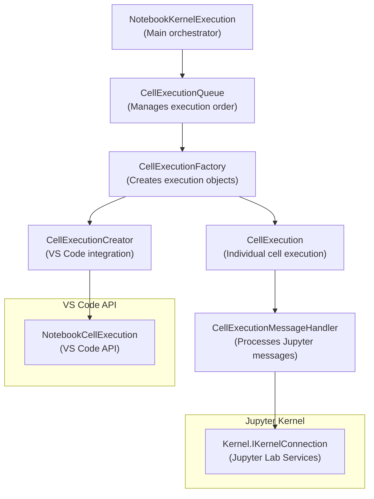
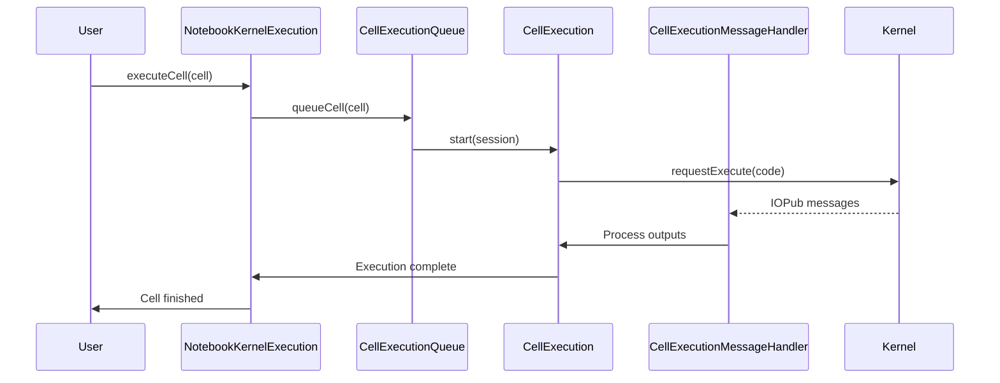
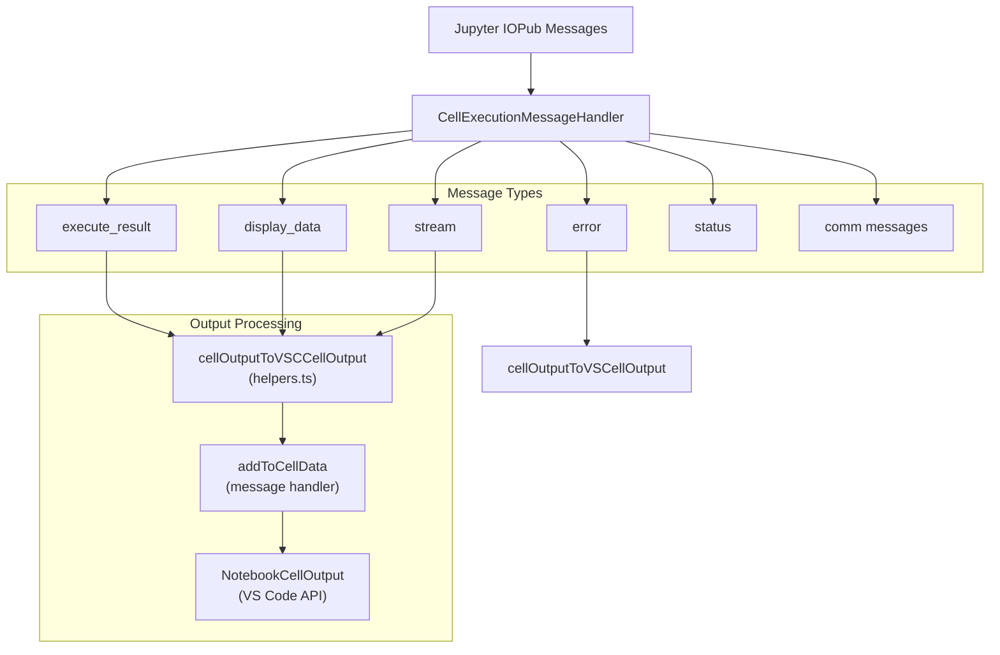
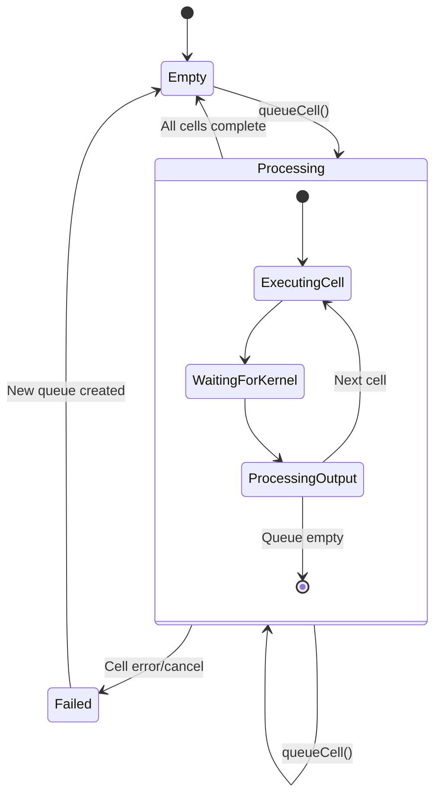
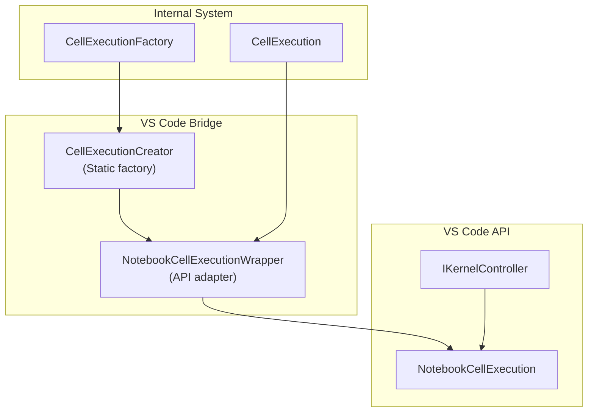
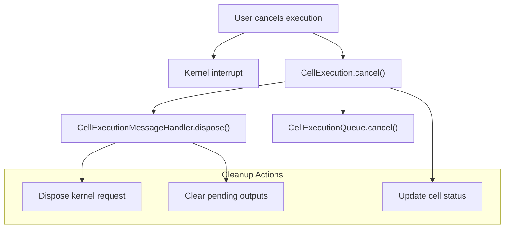
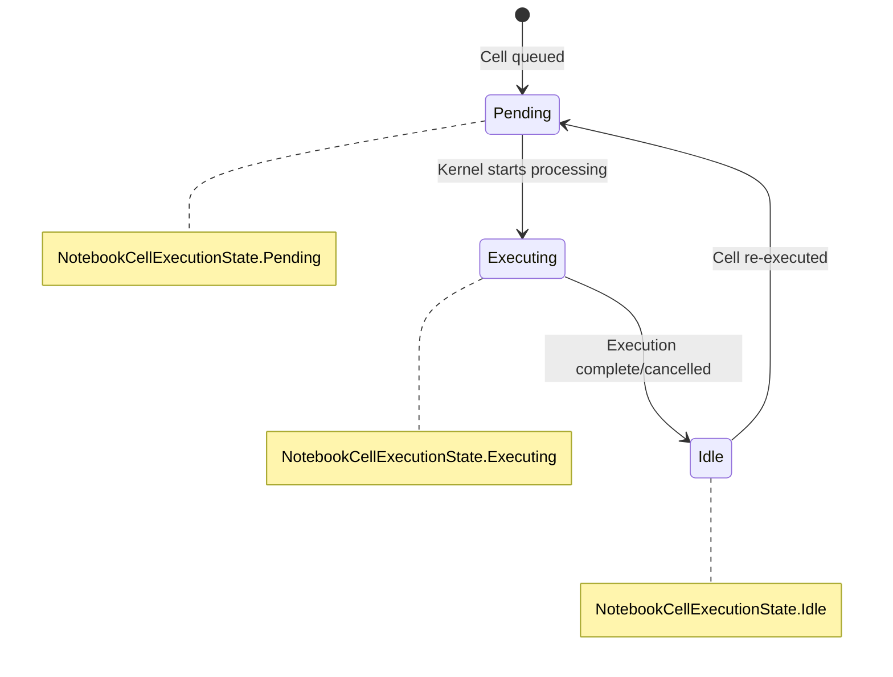

<!-- source: DeepWiki mcp.deepwiki.com · repo microsoft/vscode-jupyter · page 4.2 Cell Execution · fetched 2026-10-26 -->

# Cell Execution

<details>
<summary>Relevant source files</summary>

The following files were used as context for generating this wiki page:

- [src/kernels/execution/cellDisplayIdTracker.ts](src/kernels/execution/cellDisplayIdTracker.ts)
- [src/kernels/execution/cellExecution.ts](src/kernels/execution/cellExecution.ts)
- [src/kernels/execution/cellExecutionCreator.ts](src/kernels/execution/cellExecutionCreator.ts)
- [src/kernels/execution/cellExecutionMessageHandler.ts](src/kernels/execution/cellExecutionMessageHandler.ts)
- [src/kernels/execution/cellExecutionQueue.ts](src/kernels/execution/cellExecutionQueue.ts)
- [src/kernels/execution/codeExecution.ts](src/kernels/execution/codeExecution.ts)
- [src/kernels/execution/helpers.ts](src/kernels/execution/helpers.ts)
- [src/kernels/execution/helpers.unit.test.ts](src/kernels/execution/helpers.unit.test.ts)
- [src/kernels/execution/types.ts](src/kernels/execution/types.ts)
- [src/kernels/jupyter/interpreter/jupyterInterpreterDependencyService.node.ts](src/kernels/jupyter/interpreter/jupyterInterpreterDependencyService.node.ts)
- [src/kernels/jupyter/interpreter/jupyterInterpreterSubCommandExecutionService.node.ts](src/kernels/jupyter/interpreter/jupyterInterpreterSubCommandExecutionService.node.ts)
- [src/kernels/jupyter/interpreter/jupyterInterpreterSubCommandExecutionService.unit.test.ts](src/kernels/jupyter/interpreter/jupyterInterpreterSubCommandExecutionService.unit.test.ts)
- [src/kernels/kernelExecution.ts](src/kernels/kernelExecution.ts)
- [src/platform/common/utils/events.ts](src/platform/common/utils/events.ts)
- [src/platform/common/utils/lifecycle.ts](src/platform/common/utils/lifecycle.ts)
- [src/test/datascience/notebook/intellisense/completion.vscode.common.test.ts](src/test/datascience/notebook/intellisense/completion.vscode.common.test.ts)
- [src/test/datascience/notebook/intellisense/completionProvider.vscode.common.test.ts](src/test/datascience/notebook/intellisense/completionProvider.vscode.common.test.ts)
- [src/test/datascience/notebook/stackTraceParsing.vscode.test.ts](src/test/datascience/notebook/stackTraceParsing.vscode.test.ts)

</details>


This document covers the cell execution system in the VS Code Jupyter extension, which is responsible for executing notebook cells and managing their lifecycle from submission to completion. This includes handling kernel communication, processing outputs, managing execution queues, and integrating with VS Code's notebook API.

For information about notebook controllers and kernel management, see [Notebook Controllers](#4.1). For details about kernel discovery and selection, see [Kernel Discovery and Selection](#3.2).

## Architecture Overview

The cell execution system is built around several key components that work together to provide reliable and efficient cell execution:



Sources: [src/kernels/kernelExecution.ts:52-98](), [src/kernels/execution/cellExecution.ts:37-54](), [src/kernels/execution/cellExecutionMessageHandler.ts:85](), [src/kernels/execution/cellExecutionCreator.ts:123-164]()

## Core Execution Flow

The cell execution process follows a well-defined sequence from user interaction to completion:



The main entry point is `NotebookKernelExecution.executeCell`, which:

1. **Queues the cell** - Creates or reuses a `CellExecutionQueue` for the notebook [src/kernels/kernelExecution.ts:157-193]()
2. **Starts execution** - The queue processes cells in order via `CellExecutionQueue.executeQueuedCells` [src/kernels/execution/cellExecutionQueue.ts:189-311]()
3. **Creates execution objects** - `CellExecutionFactory.create` generates `CellExecution` instances [src/kernels/execution/cellExecution.ts:142-151]()
4. **Sends to kernel** - `CellExecution.execute` submits code using `kernel.requestExecute` [src/kernels/execution/cellExecution.ts:394-502]()
5. **Handles responses** - `CellExecutionMessageHandler` processes all Jupyter messages [src/kernels/execution/cellExecutionMessageHandler.ts:483-537]()

Sources: [src/kernels/kernelExecution.ts:157-193](), [src/kernels/execution/cellExecutionQueue.ts:189-311](), [src/kernels/execution/cellExecution.ts:142-151](), [src/kernels/execution/cellExecution.ts:394-502](), [src/kernels/execution/cellExecutionMessageHandler.ts:483-537]()

## Message Processing and Output Handling

The `CellExecutionMessageHandler` is responsible for processing all IOPub messages from Jupyter and converting them to VS Code notebook outputs:



Key message handling methods include:

- **`handleIOPub`** - Main message dispatcher that routes messages by type [src/kernels/execution/cellExecutionMessageHandler.ts:483-537]()
- **`handleExecuteResult`** - Processes execution results and display data [src/kernels/execution/cellExecutionMessageHandler.ts:504-505]()
- **`handleStreamMessage`** - Handles stdout/stderr streams [src/kernels/execution/cellExecutionMessageHandler.ts:513-514]()
- **`handleError`** - Processes error messages and exceptions [src/kernels/execution/cellExecutionMessageHandler.ts:521-522]()
- **`addToCellData`** - Converts Jupyter outputs to VS Code format [src/kernels/execution/cellExecutionMessageHandler.ts:621-699]()

The `cellOutputToVSCCellOutput` function in helpers.ts handles the conversion between Jupyter's nbformat and VS Code's NotebookCellOutput format [src/kernels/execution/helpers.ts:129-163]().

Sources: [src/kernels/execution/cellExecutionMessageHandler.ts:483-537](), [src/kernels/execution/helpers.ts:129-163](), [src/kernels/execution/cellExecutionMessageHandler.ts:621-699]()

## Execution Queue Management

The `CellExecutionQueue` manages the sequential execution of cells and code within a notebook, ensuring proper ordering and handling cancellation:

| Queue State | Description | Action |
|-------------|-------------|---------|
| Empty | No pending executions | Ready for new cells |
| Processing | Cells being executed | Queue additional cells |
| Failed | Error or cancellation | Cancel remaining cells |



The queue supports both cell execution and code execution (for extensions):

- **`queueCell`** - Adds notebook cells to execution queue [src/kernels/execution/cellExecutionQueue.ts:62-64]()
- **`queueCode`** - Adds extension code to execution queue [src/kernels/execution/cellExecutionQueue.ts:68-71]()
- **`cancel`** - Cancels all pending executions [src/kernels/execution/cellExecutionQueue.ts:137-143]()
- **`waitForCompletion`** - Waits for specific cells to complete [src/kernels/execution/cellExecutionQueue.ts:161-167]()

Sources: [src/kernels/execution/cellExecutionQueue.ts:22-53](), [src/kernels/execution/cellExecutionQueue.ts:62-71](), [src/kernels/execution/cellExecutionQueue.ts:137-167]()

## VS Code Integration Layer

The `CellExecutionCreator` and `NotebookCellExecutionWrapper` provide the bridge between the internal execution system and VS Code's notebook API:



The `NotebookCellExecutionWrapper` provides important functionality:

- **Multiple start support** - Allows `start()` to be called multiple times safely [src/kernels/execution/cellExecutionCreator.ts:59-76]()
- **Automatic disposal** - Cleans up when execution completes [src/kernels/execution/cellExecutionCreator.ts:77-91]()
- **Controller switching** - Handles kernel changes during execution [src/kernels/execution/cellExecutionCreator.ts:125-146]()

The static `CellExecutionCreator` manages the lifecycle:

- **`getOrCreate`** - Creates or reuses execution objects [src/kernels/execution/cellExecutionCreator.ts:125-147]()
- **`get`** - Retrieves existing execution for a cell [src/kernels/execution/cellExecutionCreator.ts:148-150]()

Sources: [src/kernels/execution/cellExecutionCreator.ts:22-118](), [src/kernels/execution/cellExecutionCreator.ts:123-164]()

## Error Handling and Cancellation

The execution system provides robust error handling and cancellation support at multiple levels:

### Cancellation Flow



### Error Types and Handling

| Error Type | Handler | Action |
|------------|---------|---------|
| Kernel errors | `CellExecution.completedWithErrors` | Display in cell output |
| Session disposed | `SessionDisposedError` | Show connection error |
| Execution timeout | Request cancellation | Interrupt kernel |
| Message processing | `CellExecutionMessageHandler._onErrorHandlingIOPubMessage` | Log and continue |

The `CellExecution.cancel` method supports both graceful and forced cancellation:

```typescript
// Graceful cancellation - waits for kernel response
await cellExecution.cancel(false);

// Forced cancellation - immediately stops execution  
await cellExecution.cancel(true);
```

Error location detection is provided by `findErrorLocation` in helpers.ts, which parses Python stack traces to highlight the specific line in a cell that caused an error [src/kernels/execution/helpers.ts:find]().

Sources: [src/kernels/execution/cellExecution.ts:252-273](), [src/kernels/execution/cellExecution.ts:286-334](), [src/kernels/execution/cellExecutionMessageHandler.ts:251-273](), [src/kernels/execution/cellExecutionQueue.ts:137-143]()

## State Management and Tracking

The execution system maintains detailed state information for monitoring and debugging:

### Cell State Tracking

The `NotebookCellStateTracker` provides execution state monitoring:



### Execution Tracking

Multiple systems track execution state:

- **`activeNotebookCellExecution`** - Maps notebooks to currently executing cells [src/kernels/execution/cellExecutionMessageHandler.ts:73]()
- **`NotebookCellStateTracker`** - Tracks detailed state transitions with timing [src/kernels/execution/helpers.ts:88-105]()
- **`CellExecutionCreator._map`** - Maps cells to their execution wrappers [src/kernels/execution/cellExecutionCreator.ts:124]()

### Display ID Tracking

For advanced output scenarios like widgets, the system tracks display IDs:

- **`CellOutputDisplayIdTracker`** - Maps display IDs to cells for output updates [src/kernels/execution/cellDisplayIdTracker.ts:15-91]()
- **Widget output handling** - Manages complex widget interactions [src/kernels/execution/cellExecutionMessageHandler.ts:547-607]()

Sources: [src/kernels/execution/helpers.ts:88-105](), [src/kernels/execution/cellExecutionMessageHandler.ts:73](), [src/kernels/execution/cellExecutionCreator.ts:124](), [src/kernels/execution/cellDisplayIdTracker.ts:15-91]()

---

