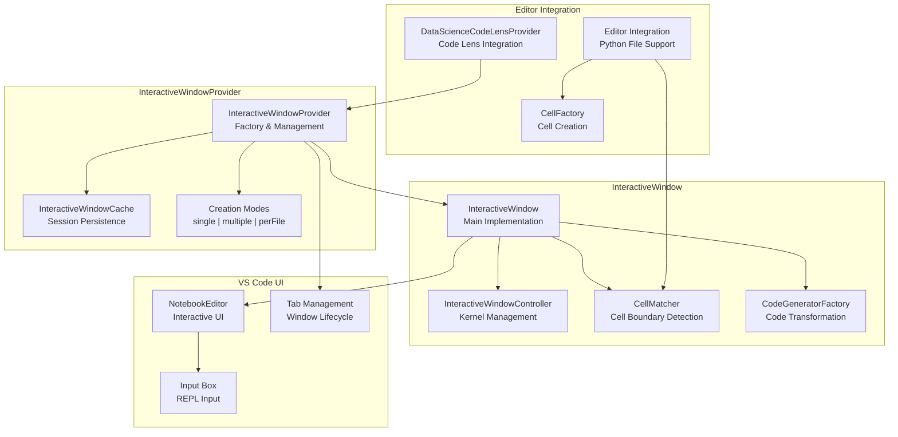
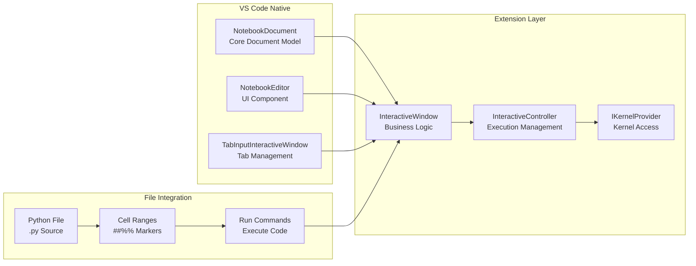
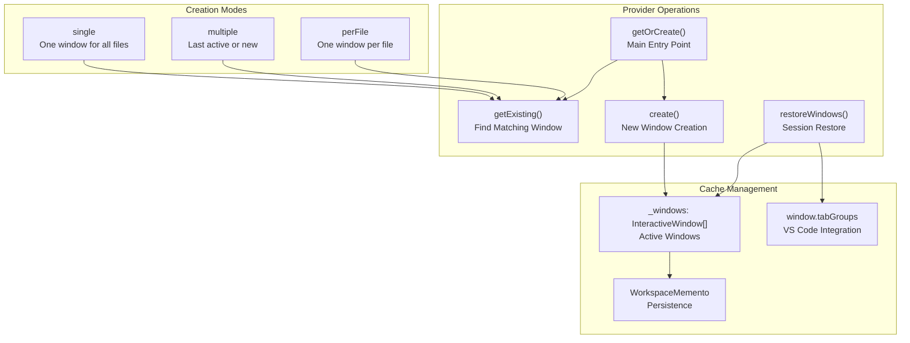
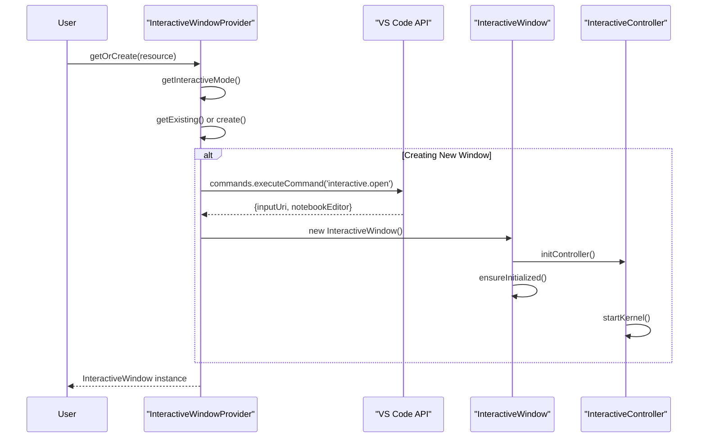
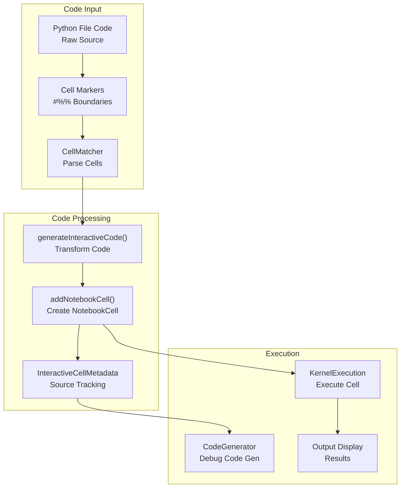

<!-- source: DeepWiki mcp.deepwiki.com · repo microsoft/vscode-jupyter · page 5 Interactive Window · fetched 2026-10-26 -->

# Interactive Window

<details>
<summary>Relevant source files</summary>

The following files were used as context for generating this wiki page:

- [src/interactive-window/InteractiveControllerHelper.ts](src/interactive-window/InteractiveControllerHelper.ts)
- [src/interactive-window/InteractiveWindowController.ts](src/interactive-window/InteractiveWindowController.ts)
- [src/interactive-window/helpers.ts](src/interactive-window/helpers.ts)
- [src/interactive-window/interactiveWindow.ts](src/interactive-window/interactiveWindow.ts)
- [src/interactive-window/interactiveWindowProvider.ts](src/interactive-window/interactiveWindowProvider.ts)
- [src/interactive-window/systemInfoCell.ts](src/interactive-window/systemInfoCell.ts)
- [src/interactive-window/types.ts](src/interactive-window/types.ts)
- [src/notebooks/controllers/kernelConnector.ts](src/notebooks/controllers/kernelConnector.ts)
- [src/notebooks/export/exportBase.node.ts](src/notebooks/export/exportBase.node.ts)
- [src/notebooks/export/exportDialog.ts](src/notebooks/export/exportDialog.ts)
- [src/notebooks/export/exportFileOpener.ts](src/notebooks/export/exportFileOpener.ts)
- [src/notebooks/export/exportToHTML.ts](src/notebooks/export/exportToHTML.ts)
- [src/notebooks/export/exportToPDF.ts](src/notebooks/export/exportToPDF.ts)
- [src/notebooks/export/exportToPython.ts](src/notebooks/export/exportToPython.ts)
- [src/notebooks/export/exportToPythonPlain.ts](src/notebooks/export/exportToPythonPlain.ts)
- [src/notebooks/export/exportUtil.ts](src/notebooks/export/exportUtil.ts)
- [src/notebooks/export/fileConverter.ts](src/notebooks/export/fileConverter.ts)
- [src/notebooks/notebookCommandListener.ts](src/notebooks/notebookCommandListener.ts)

</details>


The Interactive Window system provides a REPL-style Python development environment within VS Code, allowing users to execute code from Python files interactively and see results in a notebook-like interface. This system enables rapid prototyping and exploratory data analysis by combining the benefits of script-based development with interactive execution.

For information about the underlying notebook system that Interactive Windows are built upon, see [Notebook System](#2). For details about kernel management and connection, see [Kernel Management](#3).

## Architecture Overview

The Interactive Window system consists of several key components that work together to provide seamless code execution from Python files into a REPL environment.

### Core Components Relationship



**Sources:** [src/interactive-window/interactiveWindow.ts:68-644](), [src/interactive-window/interactiveWindowProvider.ts:86-504](), [src/interactive-window/types.ts:23-56]()

### Integration with VS Code Notebook API

The Interactive Window leverages VS Code's native notebook infrastructure while providing a specialized REPL experience.



**Sources:** [src/interactive-window/interactiveWindow.ts:14-24](), [src/interactive-window/interactiveWindowProvider.ts:287-346](), [src/interactive-window/types.ts:4-11]()

## Core Classes and Interfaces

### InteractiveWindow Class

The `InteractiveWindow` class serves as the main implementation of the interactive environment, managing the notebook document, kernel connections, and code execution.

| Property | Type | Purpose |
|----------|------|---------|
| `notebookDocument` | `NotebookDocument` | Underlying VS Code notebook |
| `inputUri` | `Uri` | URI of the input box editor |
| `owner` | `Resource` | Associated Python file |
| `submitters` | `Uri[]` | Files that have submitted code |
| `controller` | `InteractiveController` | Kernel management |

Key methods include:
- `addCode(code: string, file: Uri, line: number)` - Execute code from a file
- `debugCode(code: string, file: Uri, line: number)` - Debug code execution
- `showInteractiveEditor()` - Display the interactive window UI
- `exportAs()` - Export to various formats

**Sources:** [src/interactive-window/interactiveWindow.ts:68-114](), [src/interactive-window/interactiveWindow.ts:276-325]()

### InteractiveWindowProvider

The `InteractiveWindowProvider` acts as a factory and manager for Interactive Window instances, handling creation modes and lifecycle management.



**Sources:** [src/interactive-window/interactiveWindowProvider.ts:182-206](), [src/interactive-window/interactiveWindowProvider.ts:411-439](), [src/interactive-window/interactiveWindowProvider.ts:117-180]()

## Interactive Window Lifecycle

### Window Creation and Initialization

The creation process involves multiple steps to set up the notebook document, input editor, and kernel connection.



**Sources:** [src/interactive-window/interactiveWindowProvider.ts:217-285](), [src/interactive-window/interactiveWindow.ts:191-216]()

### Code Execution Flow

When code is submitted from a Python file, it goes through several transformation and execution stages.



**Sources:** [src/interactive-window/interactiveWindow.ts:327-398](), [src/interactive-window/interactiveWindow.ts:520-594](), [src/interactive-window/helpers.ts:18-38]()

## Code Execution from Python Files

### Cell Detection and Processing

The system automatically detects cell boundaries in Python files using configurable markers and processes them for execution.

The `CellMatcher` class handles detection of cell boundaries using patterns like `#%%` and processes the code for execution:

```python
# %%
import pandas as pd
data = pd.read_csv('data.csv')

# %%
data.head()
```

The `generateInteractiveCode` function transforms the raw cell code by:
1. Removing cell markers
2. Trimming leading/trailing whitespace  
3. Uncommenting magic commands if configured
4. Applying proper indentation

**Sources:** [src/interactive-window/editor-integration/cellMatcher.ts](), [src/interactive-window/helpers.ts:23-38]()

### Integration with Code Lenses

The extension provides code lenses in Python files that allow direct execution to Interactive Windows.

```mermaid
graph LR
    subgraph "Python Editor"
        CodeLens["Run Cell<br/>Debug Cell"]
        CellBoundary["#%% Marker<br/>Cell Definition"]
        FileContent["Python Code<br/>Source File"]
    end
    
    subgraph "Code Lens Provider"
        DataScienceProvider["IDataScienceCodeLensProvider<br/>Lens Generation"]
        Commands["Commands<br/>RunAllCells, DebugCell"]
        Watcher["CodeWatcher<br/>File Monitoring"]
    end
    
    subgraph "Execution"
        IWProvider["InteractiveWindowProvider<br/>Window Management"]
        IWindow["InteractiveWindow<br/>Code Execution"]
        Results["Interactive Results<br/>Output Display"]
    end
    
    FileContent --> CellBoundary
    CellBoundary --> CodeLens
    CodeLens --> DataScienceProvider
    DataScienceProvider --> Commands
    Commands --> Watcher
    
    Watcher --> IWProvider
    IWProvider --> IWindow
    IWindow --> Results
```



**Sources:** [src/test/datascience/helpers.ts:148-172](), [src/interactive-window/types.ts:58-78]()

## Integration with VS Code UI

### Tab and Editor Management

Interactive Windows integrate seamlessly with VS Code's tab system and editor management.

The system handles:
- **Tab Persistence**: Windows are restored when VS Code restarts using `TabInputInteractiveWindow`
- **View Columns**: Configurable placement (beside, active, secondGroup)
- **Focus Management**: Proper focus handling between input box and notebook
- **Title Generation**: Meaningful titles based on associated files

**Sources:** [src/interactive-window/interactiveWindowProvider.ts:348-361](), [src/interactive-window/interactiveWindowProvider.ts:117-180]()

### Input Box and REPL Experience

The Interactive Window provides a dedicated input box for REPL-style interaction separate from the notebook cells.

Key features include:
- **Dedicated Input Editor**: Separate text editor for typing code
- **Command Integration**: `interactive.execute`, `interactive.input.clear`, `interactive.input.focus`
- **History Management**: Previous commands and cell execution tracking
- **Multi-line Support**: Complex code blocks and cell execution

**Sources:** [src/interactive-window/interactiveWindow.ts:221-242](), [src/test/datascience/interactiveWindow.vscode.common.test.ts:177-195]()

### Export and Sharing

Interactive Windows support exporting to multiple formats for sharing and documentation.

The export system provides:
- **Notebook Export**: Convert to `.ipynb` format via `export()` method
- **Python Script Export**: Export as executable Python file via `exportAs()`
- **Format Selection**: Different export formats based on platform (web vs desktop)
- **File Dialog Integration**: Native save dialogs for export destination

**Sources:** [src/interactive-window/interactiveWindow.ts:596-643](), [src/test/datascience/interactiveWindow.vscode.test.ts:119-157]()

---

