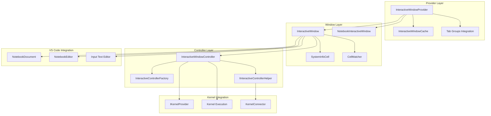
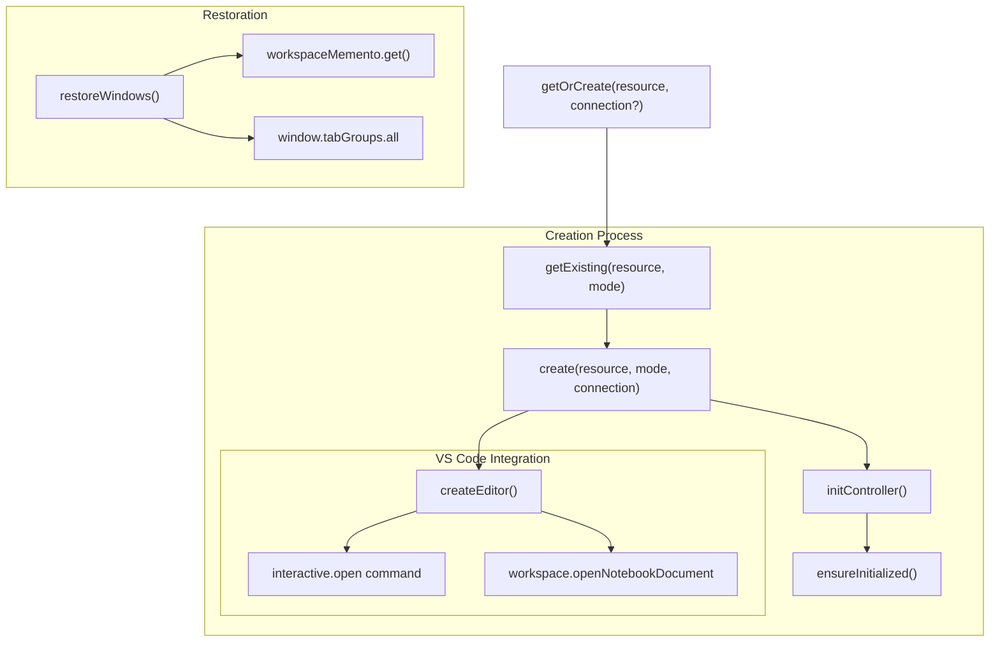
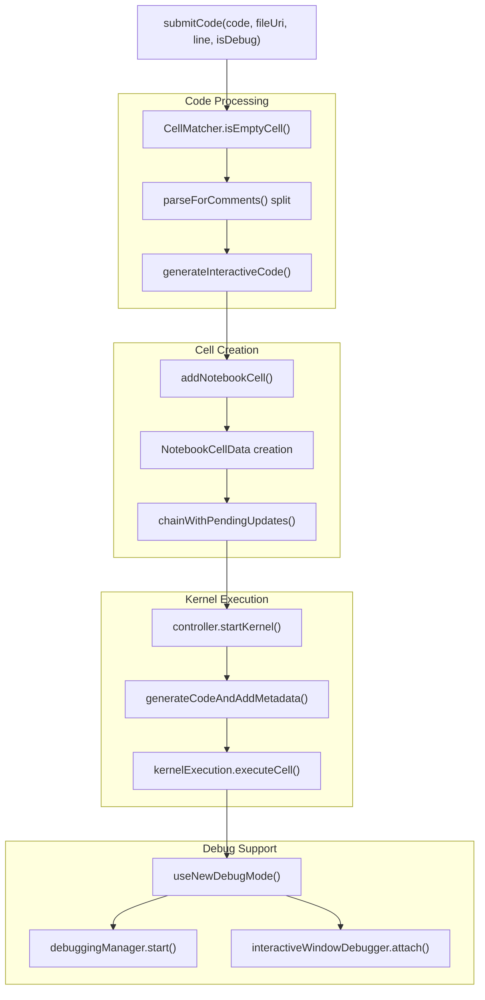
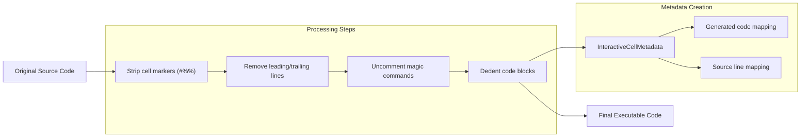
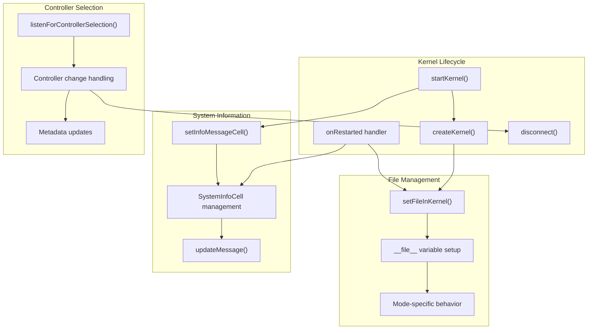
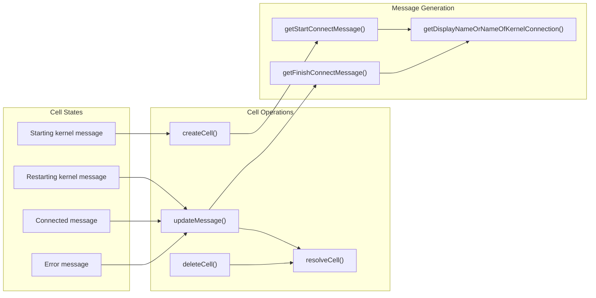
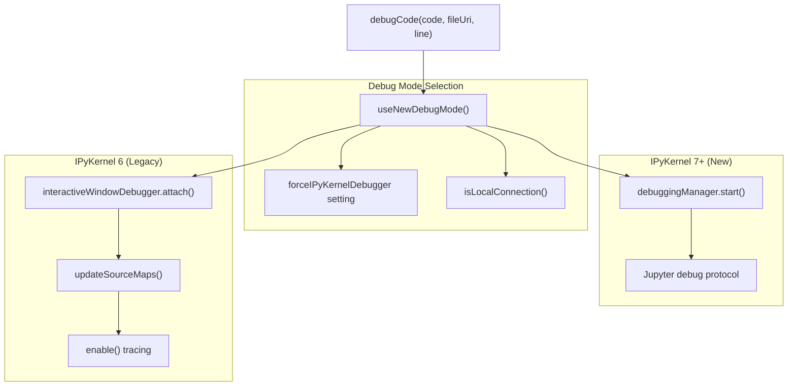
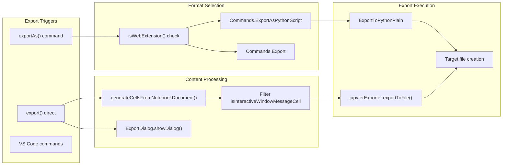
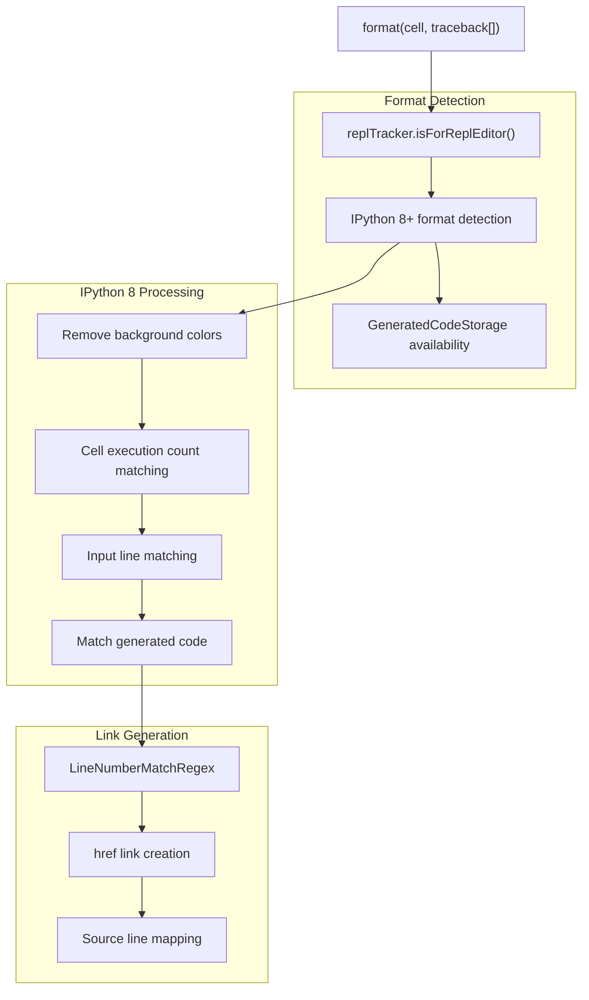

<!-- source: DeepWiki mcp.deepwiki.com · repo microsoft/vscode-jupyter · page 5.1 Interactive Window System · fetched 2026-10-26 -->

# Interactive Window System

Relevant source files

The following files were used as context for generating this wiki page:

- [src/interactive-window/InteractiveControllerHelper.ts](src/interactive-window/InteractiveControllerHelper.ts)
- [src/interactive-window/InteractiveWindowController.ts](src/interactive-window/InteractiveWindowController.ts)
- [src/interactive-window/generatedCodeStoreManager.ts](src/interactive-window/generatedCodeStoreManager.ts)
- [src/interactive-window/helpers.ts](src/interactive-window/helpers.ts)
- [src/interactive-window/interactiveWindow.ts](src/interactive-window/interactiveWindow.ts)
- [src/interactive-window/interactiveWindowProvider.ts](src/interactive-window/interactiveWindowProvider.ts)
- [src/interactive-window/outputs/tracebackFormatter.ts](src/interactive-window/outputs/tracebackFormatter.ts)
- [src/interactive-window/systemInfoCell.ts](src/interactive-window/systemInfoCell.ts)
- [src/interactive-window/types.ts](src/interactive-window/types.ts)
- [src/notebooks/controllers/kernelConnector.ts](src/notebooks/controllers/kernelConnector.ts)
- [src/notebooks/debugger/debugLocationTrackerFactory.ts](src/notebooks/debugger/debugLocationTrackerFactory.ts)
- [src/notebooks/export/exportBase.node.ts](src/notebooks/export/exportBase.node.ts)
- [src/notebooks/export/exportDialog.ts](src/notebooks/export/exportDialog.ts)
- [src/notebooks/export/exportFileOpener.ts](src/notebooks/export/exportFileOpener.ts)
- [src/notebooks/export/exportToHTML.ts](src/notebooks/export/exportToHTML.ts)
- [src/notebooks/export/exportToPDF.ts](src/notebooks/export/exportToPDF.ts)
- [src/notebooks/export/exportToPython.ts](src/notebooks/export/exportToPython.ts)
- [src/notebooks/export/exportToPythonPlain.ts](src/notebooks/export/exportToPythonPlain.ts)
- [src/notebooks/export/exportUtil.ts](src/notebooks/export/exportUtil.ts)
- [src/notebooks/export/fileConverter.ts](src/notebooks/export/fileConverter.ts)
- [src/notebooks/notebookCommandListener.ts](src/notebooks/notebookCommandListener.ts)
- [src/notebooks/outputs/tracebackFormatter.ts](src/notebooks/outputs/tracebackFormatter.ts)
- [src/test/datascience/helpers.ts](src/test/datascience/helpers.ts)
- [src/test/datascience/interactiveDebugging.vscode.test.ts](src/test/datascience/interactiveDebugging.vscode.test.ts)
- [src/test/datascience/interactiveWindow.vscode.common.test.ts](src/test/datascience/interactiveWindow.vscode.common.test.ts)
- [src/test/datascience/interactiveWindow.vscode.test.ts](src/test/datascience/interactiveWindow.vscode.test.ts)

The Interactive Window System provides an interactive Python execution environment that allows users to execute code from Python files in a REPL-like interface. Unlike notebooks, the Interactive Window maintains a connection to source files and supports cell-based execution using `# %%` markers while preserving the original file structure.

For information about notebook execution and controllers, see [Notebook System](#4). For details about kernel management and connections, see [Kernel Management](#3).

## Architecture Overview

The Interactive Window System consists of three primary layers: the provider layer for window lifecycle management, the window layer for execution and user interaction, and the controller layer for kernel management.

### Core Components Architecture

Sources: [src/interactive-window/interactiveWindowProvider.ts:86-504](), [src/interactive-window/interactiveWindow.ts:68-644](), [src/interactive-window/InteractiveWindowController.ts:18-298]()

### Window Creation and Lifecycle

The Interactive Window lifecycle involves provider-managed creation, VS Code integration, and kernel initialization with automatic restoration across VS Code sessions.

Sources: [src/interactive-window/interactiveWindowProvider.ts:182-286](), [src/interactive-window/interactiveWindowProvider.ts:117-180](), [src/interactive-window/interactiveWindow.ts:191-216]()

## Window Modes and Management

The Interactive Window supports three distinct operational modes that determine how windows are created and associated with source files.

| Mode | Description | Window Behavior | Use Case |
|------|-------------|-----------------|----------|
| `single` | One window for entire workspace | Shared across all files | Simple interactive development |
| `multiple` | Multiple independent windows | New window per request | Parallel development workflows |
| `perFile` | One window per source file | File-specific association | Isolated file development |

The mode selection includes user prompting when transitioning from single to multiple file usage:

Sources: [src/interactive-window/interactiveWindowProvider.ts:363-398](), [src/interactive-window/interactiveWindowProvider.ts:411-439]()

## Code Execution Workflow

The Interactive Window processes Python code through a multi-stage pipeline that handles cell parsing, code generation, kernel execution, and metadata management.

### Execution Pipeline

Sources: [src/interactive-window/interactiveWindow.ts:276-398](), [src/interactive-window/interactiveWindow.ts:400-450](), [src/interactive-window/interactiveWindow.ts:520-563]()

### Code Generation and Metadata

The system generates executable code from source cells and maintains metadata for debugging and source mapping:

Sources: [src/interactive-window/helpers.ts:18-38](), [src/interactive-window/interactiveWindow.ts:572-594]()

## Controller and Kernel Management

The `InteractiveWindowController` manages kernel lifecycle, connection state, and initialization procedures for Interactive Windows.

### Controller Responsibilities

Sources: [src/interactive-window/InteractiveWindowController.ts:48-135](), [src/interactive-window/InteractiveWindowController.ts:137-163](), [src/interactive-window/InteractiveWindowController.ts:172-201]()

## System Information and Status

The Interactive Window displays system information cells that provide feedback about kernel status, connections, and errors.

### System Info Cell Management

The `SystemInfoCell` class manages markdown cells that display kernel connection status and error information:

Sources: [src/interactive-window/systemInfoCell.ts:45-115](), [src/interactive-window/systemInfoCell.ts:21-39](), [src/interactive-window/InteractiveWindowController.ts:203-257]()

## Debugging Support

The Interactive Window provides comprehensive debugging support through two different debugger implementations based on kernel capabilities.

### Debug Architecture

| Debugger Type | Condition | Implementation | Features |
|---------------|-----------|----------------|----------|
| IPyKernel 7+ | `forceIPyKernelDebugger` or remote | `IInteractiveWindowDebuggingManager` | Jupyter Protocol debugging |
| IPyKernel 6 | Local kernels | `IInteractiveWindowDebugger` | Direct kernel attachment |

The debugging workflow integrates with code generation and source mapping:

Sources: [src/interactive-window/interactiveWindow.ts:280-325](), [src/interactive-window/interactiveWindow.ts:415-431](), [src/interactive-window/types.ts:14-21]()

## Export Functionality

The Interactive Window supports exporting content to various formats including Python scripts and Jupyter notebooks.

### Export Implementation

The export system leverages the underlying notebook infrastructure while filtering Interactive Window-specific metadata:

Sources: [src/interactive-window/interactiveWindow.ts:596-643](), [src/notebooks/export/exportToPythonPlain.ts:42-64](), [src/interactive-window/editor-integration/cellFactory.ts]()

## Error Handling and Traceback Formatting

The Interactive Window includes specialized traceback formatting that provides clickable links to source files and proper line number mapping.

### Traceback Processing

The `InteractiveWindowTracebackFormatter` processes error tracebacks to enhance debugging experience:

Sources: [src/interactive-window/outputs/tracebackFormatter.ts:25-211](), [src/interactive-window/outputs/tracebackFormatter.ts:59-144]()

## Integration Points

The Interactive Window System integrates with several other systems within the VS Code Jupyter extension:

| Integration | Interface | Purpose |
|-------------|-----------|---------|
| Kernel Management | `IKernelProvider` | Kernel creation and execution |
| Python Extension | `IPythonApiProvider` | Environment discovery and management |
| Notebook Controllers | `IControllerRegistration` | VS Code notebook integration |
| Error Handling | `IDataScienceErrorHandler` | Error processing and display |
| Code Generation | `ICodeGeneratorFactory` | Source-to-executable code mapping |

The system maintains compatibility with VS Code's notebook infrastructure while providing a file-centric interactive experience optimized for Python development workflows.

Sources: [src/interactive-window/types.ts:23-56](), [src/interactive-window/InteractiveControllerHelper.ts:22-173](), [src/interactive-window/interactiveWindowProvider.ts:69-81]()

---

