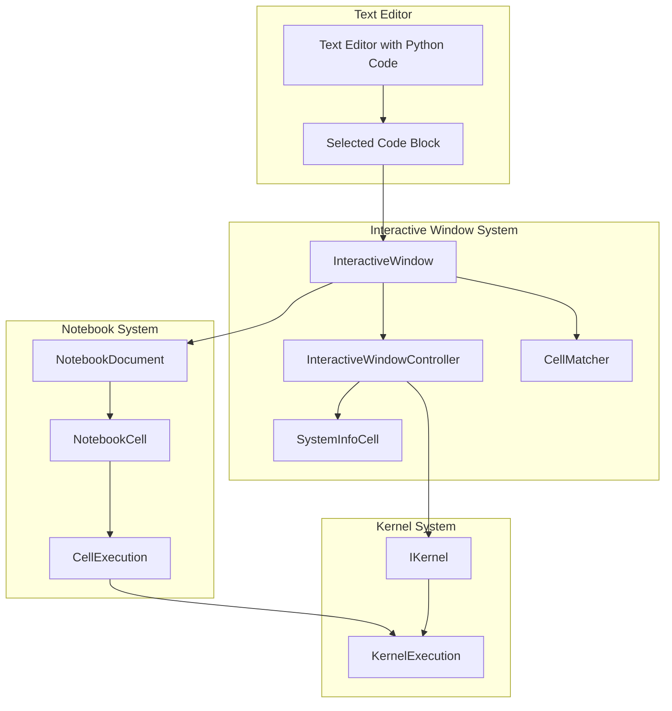
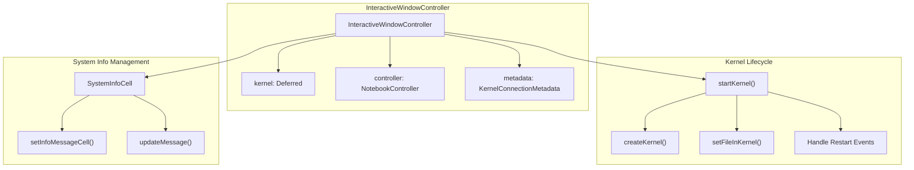
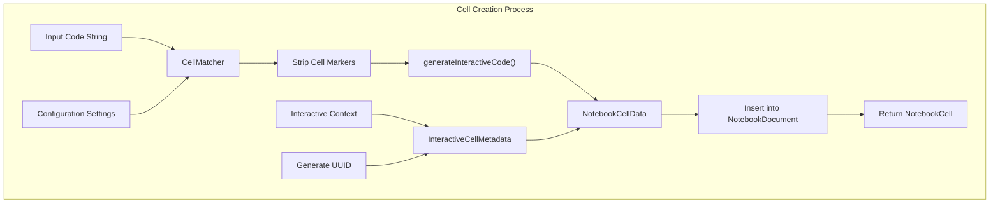
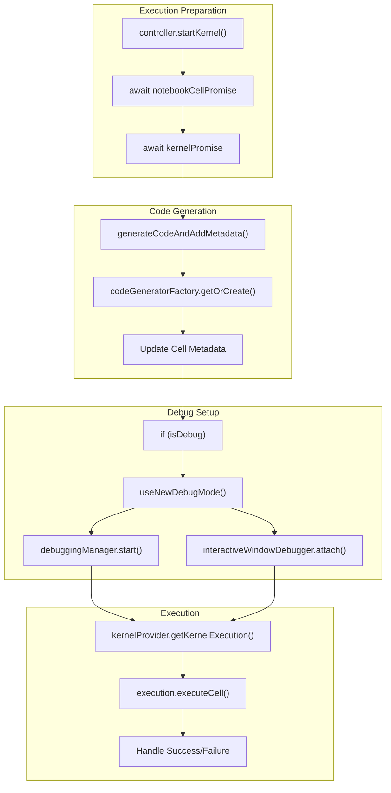
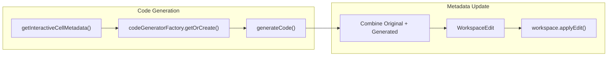
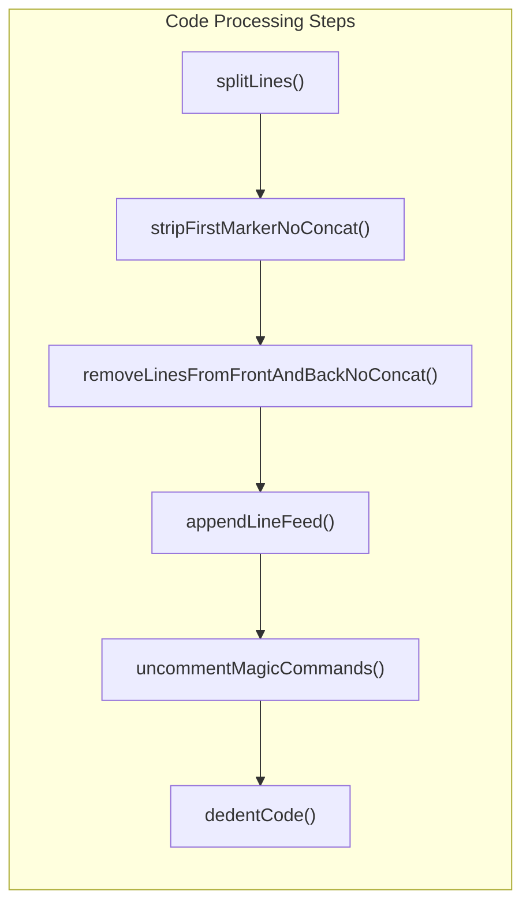

<!-- source: DeepWiki mcp.deepwiki.com · repo microsoft/vscode-jupyter · page 5.2 Code Execution in Editor · fetched 2026-10-26 -->

# Code Execution in Editor

Relevant source files

The following files were used as context for generating this wiki page:

- [src/interactive-window/InteractiveControllerHelper.ts](src/interactive-window/InteractiveControllerHelper.ts)
- [src/interactive-window/InteractiveWindowController.ts](src/interactive-window/InteractiveWindowController.ts)
- [src/interactive-window/helpers.ts](src/interactive-window/helpers.ts)
- [src/interactive-window/interactiveWindow.ts](src/interactive-window/interactiveWindow.ts)
- [src/interactive-window/interactiveWindowProvider.ts](src/interactive-window/interactiveWindowProvider.ts)
- [src/interactive-window/systemInfoCell.ts](src/interactive-window/systemInfoCell.ts)
- [src/interactive-window/types.ts](src/interactive-window/types.ts)
- [src/notebooks/controllers/kernelConnector.ts](src/notebooks/controllers/kernelConnector.ts)
- [src/notebooks/export/exportBase.node.ts](src/notebooks/export/exportBase.node.ts)
- [src/notebooks/export/exportDialog.ts](src/notebooks/export/exportDialog.ts)
- [src/notebooks/export/exportFileOpener.ts](src/notebooks/export/exportFileOpener.ts)
- [src/notebooks/export/exportToHTML.ts](src/notebooks/export/exportToHTML.ts)
- [src/notebooks/export/exportToPDF.ts](src/notebooks/export/exportToPDF.ts)
- [src/notebooks/export/exportToPython.ts](src/notebooks/export/exportToPython.ts)
- [src/notebooks/export/exportToPythonPlain.ts](src/notebooks/export/exportToPythonPlain.ts)
- [src/notebooks/export/exportUtil.ts](src/notebooks/export/exportUtil.ts)
- [src/notebooks/export/fileConverter.ts](src/notebooks/export/fileConverter.ts)
- [src/notebooks/notebookCommandListener.ts](src/notebooks/notebookCommandListener.ts)

## Purpose and Scope

This document covers how Python code from text editors is executed in the Interactive Window environment. It details the process of taking code from a text editor, processing it into executable cells, and running it through the kernel system. For information about the Interactive Window system architecture, see [Interactive Window System](#5.1). For information about general notebook cell execution mechanisms, see [Cell Execution](#4.2).

## Overview

The code execution in editor system enables users to run Python code directly from text editors into an Interactive Window, providing a REPL-like experience while maintaining context about the source file. The system handles code preprocessing, cell creation, kernel management, and execution coordination.

**Code Execution Flow Overview**

Sources: [src/interactive-window/interactiveWindow.ts:1-645](), [src/interactive-window/InteractiveWindowController.ts:1-299]()

## Core Components

### InteractiveWindow Class

The `InteractiveWindow` class serves as the primary coordinator for code execution from editors. It manages the lifecycle of code submission, cell creation, and execution orchestration.

| Method | Purpose | Key Functionality |
|--------|---------|-------------------|
| `addCode()` | Execute code normally | Calls `submitCode()` with debug=false |
| `debugCode()` | Execute code in debug mode | Handles file saving and calls `submitCode()` with debug=true |
| `submitCode()` | Core submission logic | Processes code, creates cells, manages execution |
| `createExecutionPromise()` | Execution coordination | Starts kernel, generates metadata, executes cell |

Sources: [src/interactive-window/interactiveWindow.ts:276-278](), [src/interactive-window/interactiveWindow.ts:288-325](), [src/interactive-window/interactiveWindow.ts:327-398](), [src/interactive-window/interactiveWindow.ts:401-450]()

### InteractiveWindowController

The `InteractiveWindowController` manages kernel lifecycle and connection state for the Interactive Window.

**InteractiveWindowController Architecture**

Sources: [src/interactive-window/InteractiveWindowController.ts:18-39](), [src/interactive-window/InteractiveWindowController.ts:48-101](), [src/interactive-window/InteractiveWindowController.ts:203-221]()

## Code Submission Flow

### Entry Points

Code execution begins through two primary entry points in the `InteractiveWindow` class:

- **`addCode(code: string, file: Uri, line: number)`** - Standard execution mode
- **`debugCode(code: string, fileUri: Uri, line: number)`** - Debug execution mode

Both methods ultimately call the internal `submitCode()` method with appropriate flags.

Sources: [src/interactive-window/interactiveWindow.ts:276-278](), [src/interactive-window/interactiveWindow.ts:288-325]()

### Code Processing Pipeline

```mermaid
graph LR
    subgraph "Input Processing"
        RawCode["Raw Code String"]
        EmptyCheck["cellMatcher.isEmptyCell()"]
        OwnerUpdate["updateOwners()"]
    end
    
    subgraph "Code Analysis"
        SplitLines["splitLines()"]
        MarkdownCheck["matcher.isMarkdown()"]
        ParseComments["parseForComments()"]
        CellSplit["Split into Multiple Cells"]
    end
    
    subgraph "Cell Creation"
        CellMapping["Map Cells to Promises"]
        AddNotebookCell["addNotebookCell()"]
        GenerateMetadata["Generate Cell Metadata"]
    end
    
    subgraph "Execution"
        CreateExecution["createExecutionPromise()"]
        KernelExecution["Kernel Execution"]
    end
    
    RawCode --> EmptyCheck
    EmptyCheck --> OwnerUpdate
    OwnerUpdate --> SplitLines
    SplitLines --> MarkdownCheck
    MarkdownCheck --> ParseComments
    ParseComments --> CellSplit
    CellSplit --> CellMapping
    CellMapping --> AddNotebookCell
    AddNotebookCell --> GenerateMetadata
    GenerateMetadata --> CreateExecution
    CreateExecution --> KernelExecution
```

**Code Processing Pipeline**

The `submitCode()` method implements this pipeline with the following key steps:

1. **Empty Cell Check** - Uses `CellMatcher.isEmptyCell()` to skip empty submissions
2. **Owner Management** - Updates file ownership tracking via `updateOwners()`
3. **Code Splitting** - Handles mixed markdown/code content by splitting into separate cells
4. **Cell Creation** - Maps each code segment to a notebook cell creation promise
5. **Execution Queuing** - Creates execution promises for each cell

Sources: [src/interactive-window/interactiveWindow.ts:327-398](), [src/interactive-window/interactiveWindow.ts:337-356](), [src/interactive-window/interactiveWindow.ts:359-394]()

### Cell Creation and Metadata

The `addNotebookCell()` method creates properly formatted notebook cells with Interactive Window-specific metadata:

**Cell Creation and Metadata Flow**

The cell metadata includes:
- `interactiveWindowCellMarker` - Original cell marker from source
- `interactive` - Context information (file URI, line index, original source)  
- `id` - Unique identifier for the cell

Sources: [src/interactive-window/interactiveWindow.ts:520-563](), [src/interactive-window/interactiveWindow.ts:543-554]()

## Execution Process

### Kernel Management and Startup

The `createExecutionPromise()` method coordinates kernel startup and code execution:

**Execution Process Flow**

Sources: [src/interactive-window/interactiveWindow.ts:401-450](), [src/interactive-window/interactiveWindow.ts:407-408](), [src/interactive-window/interactiveWindow.ts:414-442]()

### Debug Mode Execution

Debug mode execution involves additional setup and file handling:

1. **File Saving** - Ensures unsaved files are saved before debugging
2. **Debug Mode Detection** - Uses `useNewDebugMode()` to determine debug protocol
3. **Debugger Attachment** - Attaches appropriate debugger (IPyKernel 7 vs older versions)
4. **Source Map Updates** - Updates debugger source mappings for generated code

Sources: [src/interactive-window/interactiveWindow.ts:288-325](), [src/interactive-window/interactiveWindow.ts:280-286](), [src/interactive-window/interactiveWindow.ts:415-431]()

### Code Generation and Metadata

The system generates execution-ready code through the `generateCodeAndAddMetadata()` method:

**Code Generation and Metadata Update**

This process:
- Retrieves the cell's Interactive Window metadata
- Generates execution-ready code (handling debug flags and kernel type)
- Updates cell metadata with generated code information
- Applies changes to the notebook document

Sources: [src/interactive-window/interactiveWindow.ts:572-594](), [src/interactive-window/interactiveWindow.ts:581-583](), [src/interactive-window/interactiveWindow.ts:590-593]()

## Code Processing Utilities

### CellMatcher and Code Formatting

The `CellMatcher` class handles cell type detection and code formatting:

- **Cell Type Detection** - Determines if code is markdown or executable
- **Marker Processing** - Handles cell markers like `#%%`
- **Code Formatting** - Strips markers and processes magic commands

The `generateInteractiveCode()` function in helpers processes raw code for execution:

**Code Processing Pipeline in generateInteractiveCode()**

Sources: [src/interactive-window/helpers.ts:23-38](), [src/interactive-window/editor-integration/cellMatcher.ts]()

### System Information Management

The `SystemInfoCell` class manages status messages during kernel operations:

- **Connection Messages** - Shows kernel startup/restart status
- **Error Handling** - Displays error messages when kernel operations fail
- **Dynamic Updates** - Updates messages as operations progress

Sources: [src/interactive-window/systemInfoCell.ts:45-115](), [src/interactive-window/systemInfoCell.ts:21-39]()

This system provides a comprehensive solution for executing Python code from text editors in the Interactive Window environment, handling everything from code preprocessing to kernel execution and result display.

---

