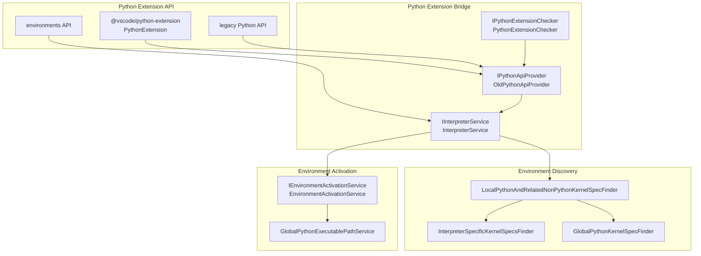
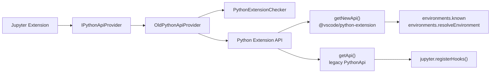
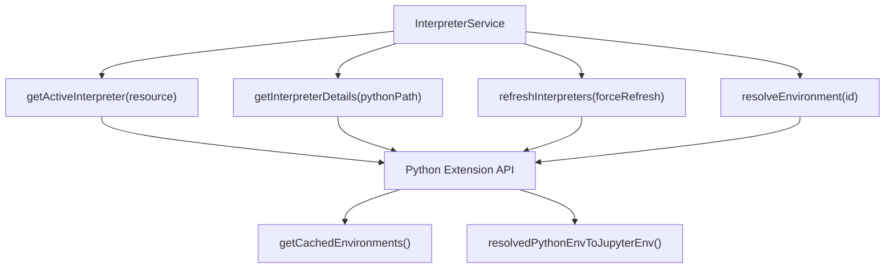
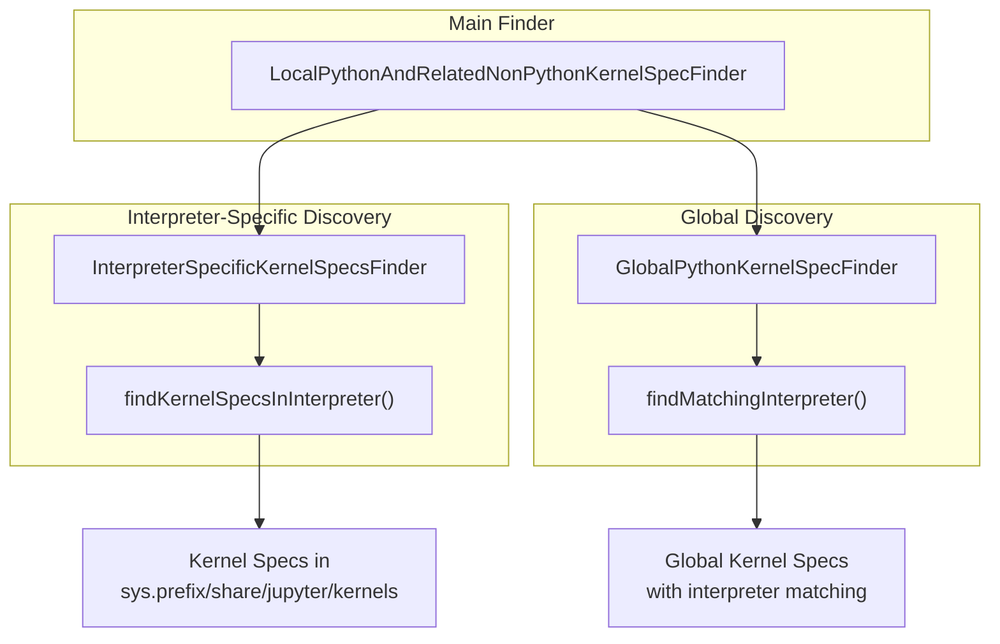
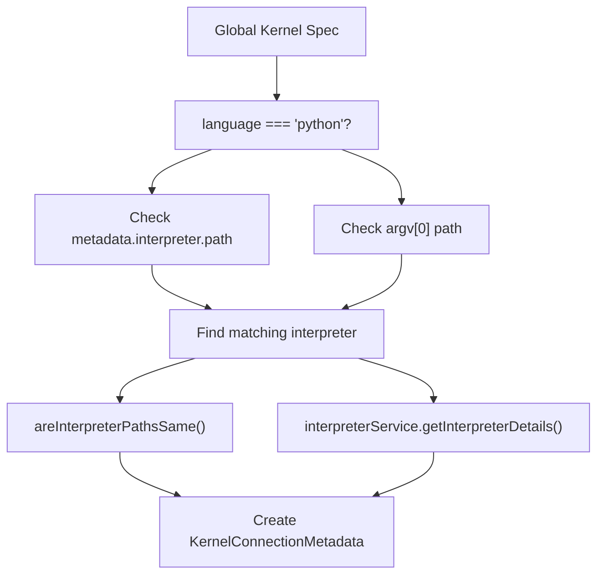
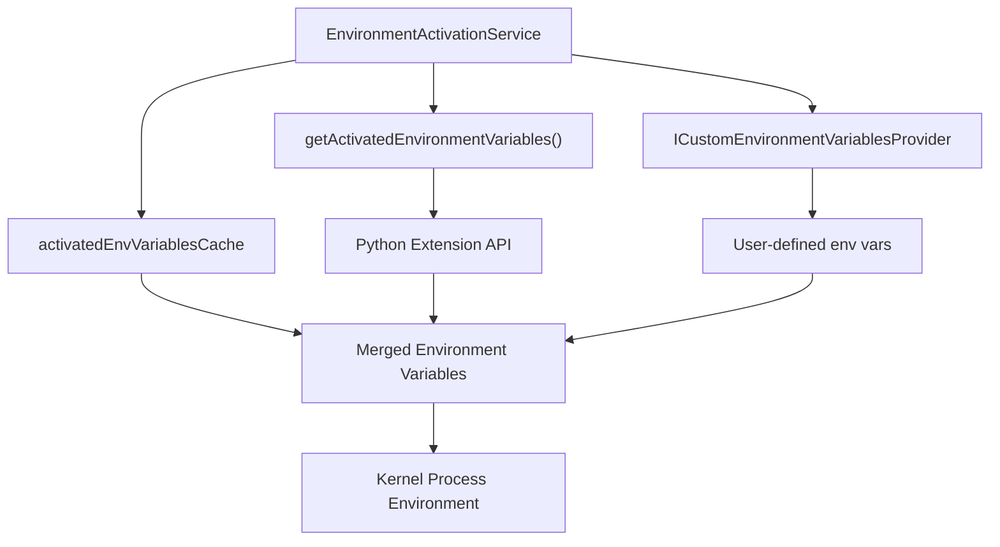
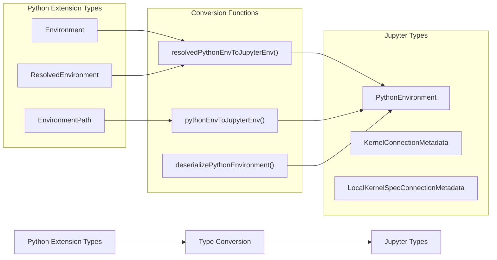
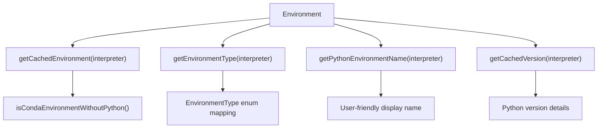

<!-- source: DeepWiki mcp.deepwiki.com · repo microsoft/vscode-jupyter · page 6 Python Integration · fetched 2026-10-26 -->

# Python Integration

Relevant source files

The following files were used as context for generating this wiki page:

- [src/kernels/helpers.ts](src/kernels/helpers.ts)
- [src/kernels/raw/finder/contributedKerneFinder.node.unit.test.ts](src/kernels/raw/finder/contributedKerneFinder.node.unit.test.ts)
- [src/kernels/raw/finder/contributedLocalKernelSpecFinder.node.ts](src/kernels/raw/finder/contributedLocalKernelSpecFinder.node.ts)
- [src/kernels/raw/finder/contributedLocalKernelSpecFinder.node.unit.test.ts](src/kernels/raw/finder/contributedLocalKernelSpecFinder.node.unit.test.ts)
- [src/kernels/raw/finder/interpreterKernelSpecFinderHelper.node.ts](src/kernels/raw/finder/interpreterKernelSpecFinderHelper.node.ts)
- [src/kernels/raw/finder/interpreterKernelSpecFinderHelper.node.unit.test.ts](src/kernels/raw/finder/interpreterKernelSpecFinderHelper.node.unit.test.ts)
- [src/kernels/raw/finder/localKernelSpecFinderBase.node.ts](src/kernels/raw/finder/localKernelSpecFinderBase.node.ts)
- [src/kernels/raw/finder/localKnownPathKernelSpecFinder.node.ts](src/kernels/raw/finder/localKnownPathKernelSpecFinder.node.ts)
- [src/kernels/raw/finder/localPythonAndRelatedNonPythonKernelSpecFinder.node.ts](src/kernels/raw/finder/localPythonAndRelatedNonPythonKernelSpecFinder.node.ts)
- [src/kernels/raw/finder/localPythonAndRelatedNonPythonKernelSpecFinder.node.unit.test.ts](src/kernels/raw/finder/localPythonAndRelatedNonPythonKernelSpecFinder.node.unit.test.ts)
- [src/platform/api/pythonApi.ts](src/platform/api/pythonApi.ts)
- [src/platform/api/types.ts](src/platform/api/types.ts)
- [src/platform/interpreter/activation/types.ts](src/platform/interpreter/activation/types.ts)
- [src/platform/interpreter/contracts.ts](src/platform/interpreter/contracts.ts)
- [src/platform/interpreter/environmentActivationService.node.ts](src/platform/interpreter/environmentActivationService.node.ts)
- [src/platform/interpreter/globalPythonExePathService.node.ts](src/platform/interpreter/globalPythonExePathService.node.ts)
- [src/platform/interpreter/helpers.ts](src/platform/interpreter/helpers.ts)

This document covers how the VS Code Jupyter extension integrates with the Python extension to discover, manage, and activate Python environments for use as Jupyter kernels. This integration enables automatic detection of Python interpreters, virtual environments, conda environments, and their associated kernel specifications.

For information about kernel discovery in general, see [Kernel Management](#3). For details about notebook execution, see [Cell Execution](#4.2).

## Architecture Overview

The Python integration system consists of three main subsystems that work together to bridge the Jupyter extension with the Python extension:

**Sources:** [src/platform/api/pythonApi.ts:1-687](), [src/kernels/raw/finder/localPythonAndRelatedNonPythonKernelSpecFinder.node.ts:1-372](), [src/platform/interpreter/environmentActivationService.node.ts:1-250]()

## Python Extension Bridge

The bridge layer handles communication with the Python extension and provides a unified interface for the Jupyter extension to access Python environment information.

### API Provider System

The `OldPythonApiProvider` class manages access to both modern and legacy Python extension APIs:

- **New API Access**: [src/platform/api/pythonApi.ts:149-162]() - Uses `@vscode/python-extension` for environment discovery
- **Legacy API Support**: [src/platform/api/pythonApi.ts:145-148]() - Maintains backward compatibility with older Python extension versions  
- **Extension Detection**: [src/platform/api/pythonApi.ts:177-184]() - Automatically detects when Python extension is installed

### Interpreter Service

The `InterpreterService` provides the main interface for working with Python environments:

Key responsibilities include:
- **Environment Resolution**: [src/platform/api/pythonApi.ts:377-385]() - Resolves environment IDs to full environment details
- **Active Interpreter Detection**: [src/platform/api/pythonApi.ts:422-485]() - Finds the active Python interpreter for a given workspace
- **Change Notifications**: [src/platform/api/pythonApi.ts:614-685]() - Listens for environment changes from Python extension

**Sources:** [src/platform/api/pythonApi.ts:303-686](), [src/platform/interpreter/contracts.ts:1-47]()

## Environment Discovery System

The environment discovery system finds Python environments and their associated kernel specifications through multiple specialized finders.

### Discovery Architecture

### Python Environment Discovery Process

The `LocalPythonAndRelatedNonPythonKernelSpecFinder` orchestrates the discovery process:

1. **Get Python Environments**: [src/kernels/raw/finder/localPythonAndRelatedNonPythonKernelSpecFinder.node.ts:295-296]() - Retrieves environments from Python extension
2. **Create Finder Instances**: [src/kernels/raw/finder/localPythonAndRelatedNonPythonKernelSpecFinder.node.ts:300-308]() - Creates `InterpreterSpecificKernelSpecsFinder` for each environment
3. **Discover Kernels**: [src/kernels/raw/finder/localPythonAndRelatedNonPythonKernelSpecFinder.node.ts:321-331]() - Searches for kernel specs in parallel

### Interpreter-Specific Kernel Discovery

For each Python environment, the system searches for kernel specifications:

Key implementation details:
- **Kernel Path Construction**: [src/kernels/raw/finder/interpreterKernelSpecFinderHelper.node.ts:60-67]() - Builds search path from interpreter's `sys.prefix`
- **Default Kernel Filtering**: [src/kernels/raw/finder/interpreterKernelSpecFinderHelper.node.ts:242-256]() - Hides default Python kernel specs when custom ones exist
- **Non-Python Kernel Support**: [src/kernels/raw/finder/interpreterKernelSpecFinderHelper.node.ts:132-137]() - Discovers Java, R, Julia kernels in Python environments

**Sources:** [src/kernels/raw/finder/localPythonAndRelatedNonPythonKernelSpecFinder.node.ts:294-332](), [src/kernels/raw/finder/interpreterKernelSpecFinderHelper.node.ts:138-325]()

### Global Kernel Spec Matching

The `GlobalPythonKernelSpecFinder` matches global kernel specifications to Python interpreters:

The matching process prioritizes:
1. **Metadata Path**: [src/kernels/raw/finder/interpreterKernelSpecFinderHelper.node.ts:408-422]() - Checks `metadata.interpreter.path`
2. **Argv Path**: [src/kernels/raw/finder/interpreterKernelSpecFinderHelper.node.ts:434-456]() - Matches first argument in `argv`
3. **Interpreter Resolution**: [src/kernels/raw/finder/interpreterKernelSpecFinderHelper.node.ts:461-482]() - Resolves path to interpreter details

**Sources:** [src/kernels/raw/finder/interpreterKernelSpecFinderHelper.node.ts:332-576]()

## Environment Activation

The environment activation system manages Python environment variables and activation for kernel execution.

### Activation Service Architecture

### Environment Variable Resolution

The activation process follows these steps:

1. **Cache Check**: [src/platform/interpreter/environmentActivationService.node.ts:77-86]() - Check for cached environment variables
2. **Python Extension Query**: [src/platform/interpreter/environmentActivationService.node.ts:167-178]() - Get activated variables from Python extension
3. **Custom Variables**: [src/platform/interpreter/environmentActivationService.node.ts:156-158]() - Merge user-defined environment variables
4. **Global Python Paths**: [src/platform/interpreter/globalPythonExePathService.node.ts:30-46]() - Add user site-packages paths for global interpreters

### Caching Strategy

Environment variables are cached to improve performance:

- **Cache Timeout**: [src/platform/interpreter/environmentActivationService.node.ts:28]() - 60 second cache expiration
- **Resource-Specific**: [src/platform/interpreter/environmentActivationService.node.ts:77]() - Cached per workspace resource and interpreter
- **Invalidation**: [src/platform/interpreter/environmentActivationService.node.ts:46-48]() - Cache cleared on interpreter or env var changes

**Sources:** [src/platform/interpreter/environmentActivationService.node.ts:30-250](), [src/platform/interpreter/globalPythonExePathService.node.ts:17-102]()

## Data Flow and Type Conversion

The Python integration system handles conversion between Python extension types and Jupyter extension types.

### Type Conversion Pipeline

### Key Conversion Functions

- **Environment Resolution**: [src/platform/interpreter/helpers.ts:229-254]() - Converts Python `Environment` to Jupyter `PythonEnvironment`
- **Serialization Support**: [src/platform/api/pythonApi.ts:52-67](), [src/platform/api/pythonApi.ts:91-102]() - Handles serialization for caching
- **URI Handling**: [src/platform/api/pythonApi.ts:68-89]() - Manages file system path conversions

### Environment Information Helpers

The system provides various helper functions for accessing environment information:

These helpers provide:
- **Environment Type Detection**: [src/platform/interpreter/helpers.ts:87-121]() - Maps Python extension types to Jupyter `EnvironmentType` enum
- **Display Name Generation**: [src/platform/interpreter/helpers.ts:15-63]() - Creates user-friendly environment names
- **Conda Environment Handling**: [src/platform/interpreter/helpers.ts:136-146]() - Special handling for conda environments without Python

**Sources:** [src/platform/interpreter/helpers.ts:1-255](), [src/platform/api/pythonApi.ts:52-102]()

---

