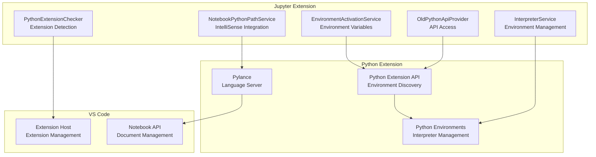
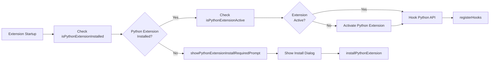
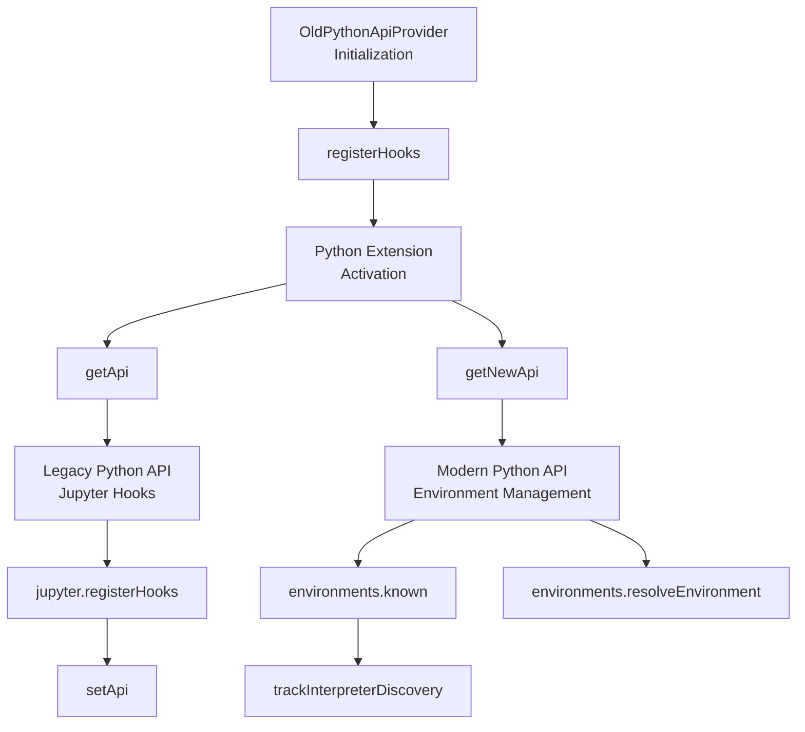
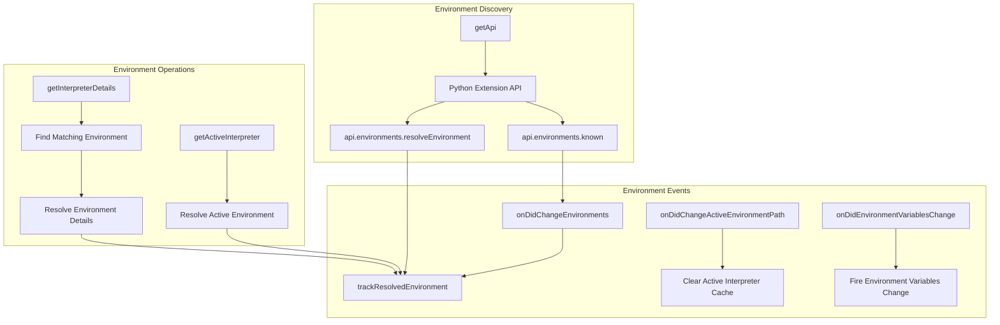
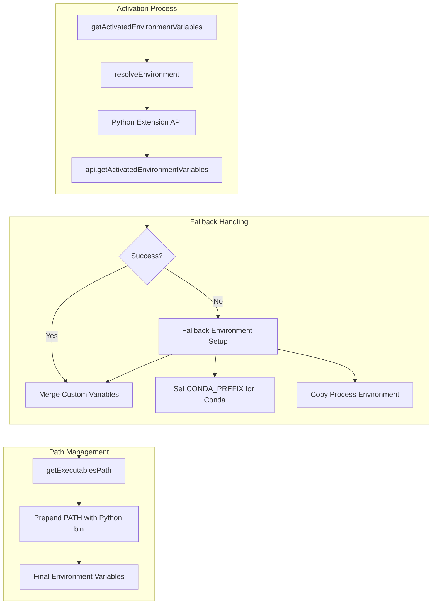
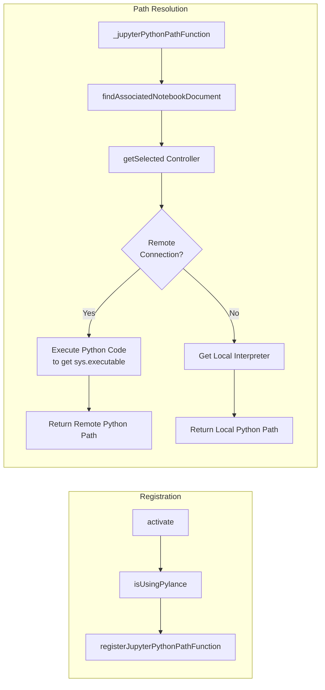
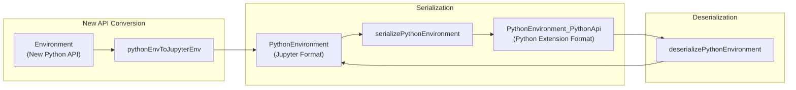
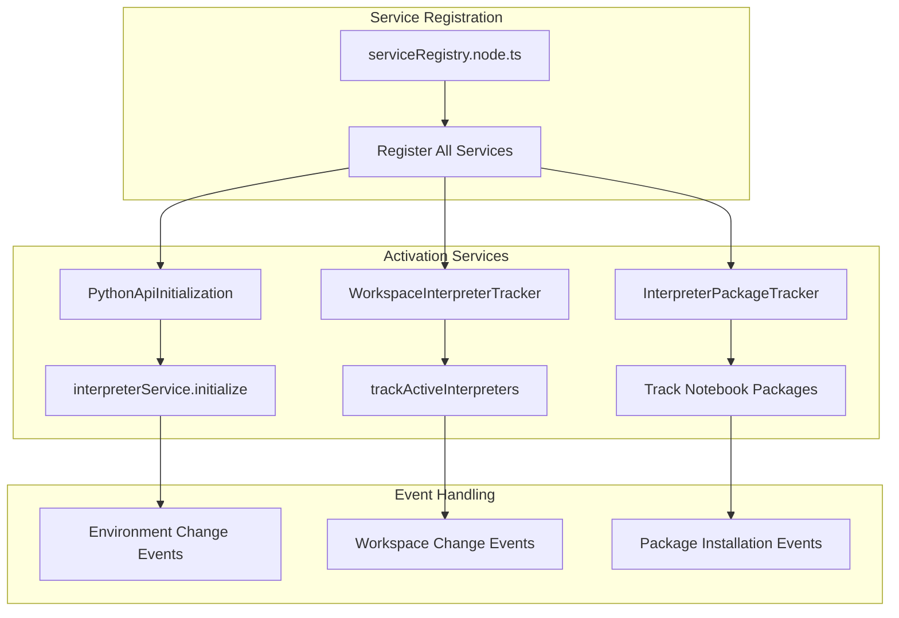

<!-- source: DeepWiki mcp.deepwiki.com · repo microsoft/vscode-jupyter · page 6.1 Python Extension Bridge · fetched 2026-10-26 -->

# Python Extension Bridge

Relevant source files

The following files were used as context for generating this wiki page:

- [src/kernels/helpers.ts](src/kernels/helpers.ts)
- [src/kernels/raw/finder/contributedKerneFinder.node.unit.test.ts](src/kernels/raw/finder/contributedKerneFinder.node.unit.test.ts)
- [src/kernels/raw/finder/contributedLocalKernelSpecFinder.node.ts](src/kernels/raw/finder/contributedLocalKernelSpecFinder.node.ts)
- [src/kernels/raw/finder/contributedLocalKernelSpecFinder.node.unit.test.ts](src/kernels/raw/finder/contributedLocalKernelSpecFinder.node.unit.test.ts)
- [src/kernels/raw/finder/interpreterKernelSpecFinderHelper.node.ts](src/kernels/raw/finder/interpreterKernelSpecFinderHelper.node.ts)
- [src/kernels/raw/finder/interpreterKernelSpecFinderHelper.node.unit.test.ts](src/kernels/raw/finder/interpreterKernelSpecFinderHelper.node.unit.test.ts)
- [src/kernels/raw/finder/localKernelSpecFinderBase.node.ts](src/kernels/raw/finder/localKernelSpecFinderBase.node.ts)
- [src/kernels/raw/finder/localKnownPathKernelSpecFinder.node.ts](src/kernels/raw/finder/localKnownPathKernelSpecFinder.node.ts)
- [src/kernels/raw/finder/localPythonAndRelatedNonPythonKernelSpecFinder.node.ts](src/kernels/raw/finder/localPythonAndRelatedNonPythonKernelSpecFinder.node.ts)
- [src/kernels/raw/finder/localPythonAndRelatedNonPythonKernelSpecFinder.node.unit.test.ts](src/kernels/raw/finder/localPythonAndRelatedNonPythonKernelSpecFinder.node.unit.test.ts)
- [src/platform/api/pythonApi.ts](src/platform/api/pythonApi.ts)
- [src/platform/api/types.ts](src/platform/api/types.ts)
- [src/platform/interpreter/activation/types.ts](src/platform/interpreter/activation/types.ts)
- [src/platform/interpreter/contracts.ts](src/platform/interpreter/contracts.ts)
- [src/platform/interpreter/environmentActivationService.node.ts](src/platform/interpreter/environmentActivationService.node.ts)
- [src/platform/interpreter/globalPythonExePathService.node.ts](src/platform/interpreter/globalPythonExePathService.node.ts)
- [src/platform/interpreter/helpers.ts](src/platform/interpreter/helpers.ts)

This document covers how the VS Code Jupyter extension bridges with the Microsoft Python extension to provide Python environment management, IntelliSense support, and kernel functionality. The bridge establishes a communication layer between the two extensions, enabling seamless environment discovery, activation, and Python-specific features for Jupyter notebooks.

For information about kernel management and types, see [Kernel Management](#3). For details about extension activation and lifecycle, see [Extension Activation and Lifecycle](#5.1).

## Overview

The Python extension bridge consists of several key components that establish communication channels and shared functionality between the Jupyter and Python extensions:

**Python Extension Integration Architecture**

The integration provides environment discovery, activation, and IntelliSense support through multiple service layers that communicate with the Python extension's API.

Sources: [src/platform/api/pythonApi.ts:1-687](), [src/platform/api/types.ts:1-99](), [src/standalone/intellisense/notebookPythonPathService.node.ts:1-161]()

## Extension Detection and Activation

The `PythonExtensionChecker` class monitors the Python extension's installation status and handles activation:

**Python Extension Detection and Activation Flow**

The system automatically detects and activates the Python extension, prompting users to install it if missing.

Key methods in `PythonExtensionChecker`:

- `isPythonExtensionInstalled`: Checks if the Python extension is available
- `isPythonExtensionActive`: Verifies the extension is activated
- `showPythonExtensionInstallRequiredPrompt()`: Shows installation dialog
- `directlyInstallPythonExtension()`: Programmatically installs the extension

Sources: [src/platform/api/pythonApi.ts:228-299](), [src/platform/api/types.ts:19-26]()

## Python API Provider

The `OldPythonApiProvider` class manages access to the Python extension's API and handles the integration lifecycle:

**Python API Integration Flow**

The provider manages both legacy and modern Python extension APIs, ensuring compatibility across different Python extension versions.

Key functionality:
- `getApi()`: Returns the legacy Python API for Jupyter hooks
- `getNewApi()`: Returns the modern Python extension API for environment management
- `pythonExtensionHooked`: Promise that resolves when Python extension is connected
- `onDidActivatePythonExtension`: Event fired when Python extension activates

Sources: [src/platform/api/pythonApi.ts:106-225](), [src/platform/api/types.ts:10-18]()

## Environment Management

The `InterpreterService` class provides Python environment discovery and management through the Python extension API:

**Environment Management System**

The service manages Python environment discovery, caching, and event handling through the Python extension's environment API.

Core methods:
- `getActiveInterpreter(resource)`: Gets the active Python interpreter for a resource
- `getInterpreterDetails(pythonPath)`: Resolves detailed information about a Python environment
- `refreshInterpreters(forceRefresh)`: Triggers environment discovery refresh
- `resolveEnvironment(id)`: Resolves an environment by ID using the new API

Sources: [src/platform/api/pythonApi.ts:304-686](), [src/platform/interpreter/contracts.ts:8-47]()

## Environment Activation

The `EnvironmentActivationService` handles Python environment activation and environment variable management:

**Environment Activation Flow**

The service activates Python environments and manages environment variables, with fallback mechanisms for edge cases.

Key features:
- Caches activated environment variables for performance
- Handles Conda environment activation
- Manages PATH variable setup for Python executables
- Provides fallback mechanisms when Python extension activation fails

Sources: [src/platform/interpreter/environmentActivationService.node.ts:31-293](), [src/platform/interpreter/activation/types.ts:7-14]()

## IntelliSense Integration

The `NotebookPythonPathService` provides Python path information to Pylance for notebook IntelliSense:

**Pylance Integration for Notebooks**

The service provides Python interpreter paths to Pylance for accurate IntelliSense in notebooks, handling both local and remote kernels.

Integration points:
- `registerJupyterPythonPathFunction()`: Registers callback with Python extension
- `_jupyterPythonPathFunction(uri)`: Resolves Python path for a notebook URI
- `isUsingPylance()`: Checks if Pylance is the active language server
- Remote kernel support through code execution to determine Python executable path

Sources: [src/standalone/intellisense/notebookPythonPathService.node.ts:25-160](), [src/standalone/intellisense/notebookPythonPathService.ts:6-18]()

## Environment Serialization

The integration includes utilities for converting between Jupyter and Python extension environment formats:

**Environment Format Conversion**

The system converts between different Python environment representations to maintain compatibility across API versions.

Key conversion functions:
- `serializePythonEnvironment()`: Converts Jupyter format to Python extension format
- `deserializePythonEnvironment()`: Converts Python extension format to Jupyter format  
- `pythonEnvToJupyterEnv()`: Converts new Python API format to Jupyter format
- `resolvedPythonEnvToJupyterEnv()`: Converts resolved environments from new API

Sources: [src/platform/api/pythonApi.ts:52-102](), [src/kernels/helpers.ts:24-25]()

## Initialization and Lifecycle

The Python API integration is initialized through several activation services:

**Python Integration Initialization**

Multiple activation services coordinate to initialize the Python extension integration and set up event handling.

Initialization components:
- `PythonApiInitialization`: Initializes the interpreter service connection
- `WorkspaceInterpreterTracker`: Tracks active interpreters per workspace
- `InterpreterPackageTracker`: Monitors package installations in interpreters
- Service registration through dependency injection

Sources: [src/platform/interpreter/pythonApiInitialization.ts:8-16](), [src/platform/interpreter/workspaceInterpreterTracker.node.ts:18-71](), [src/notebooks/telemetry/interpreterPackageTracker.node.ts:20-56](), [src/platform/interpreter/serviceRegistry.node.ts:41-94]()

---

