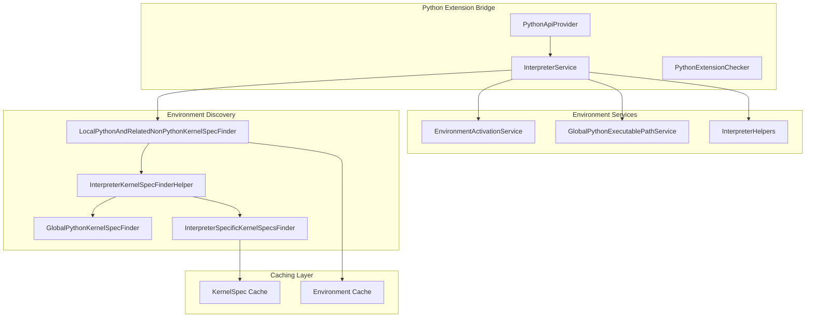
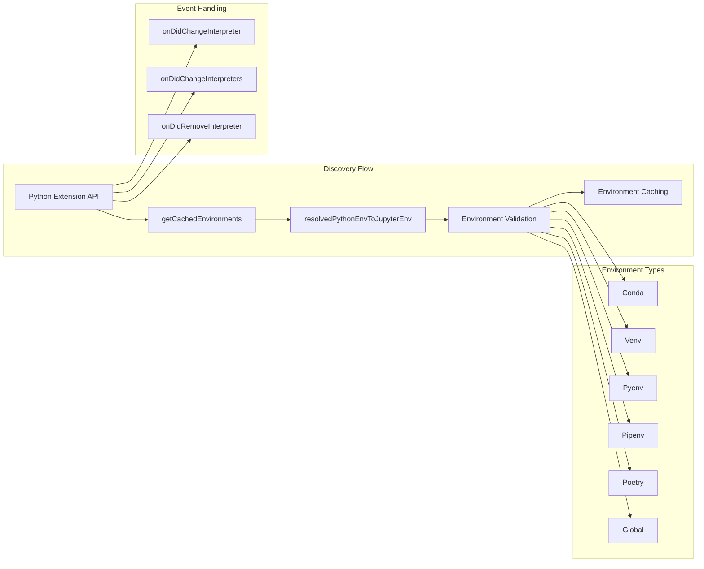
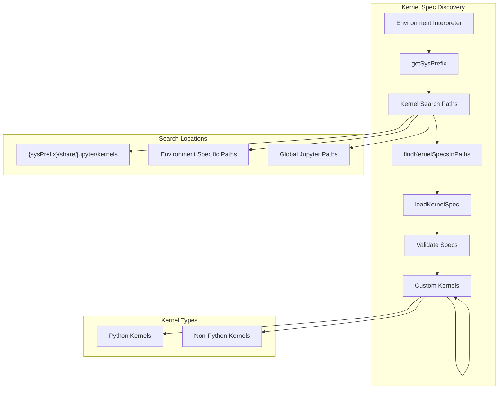
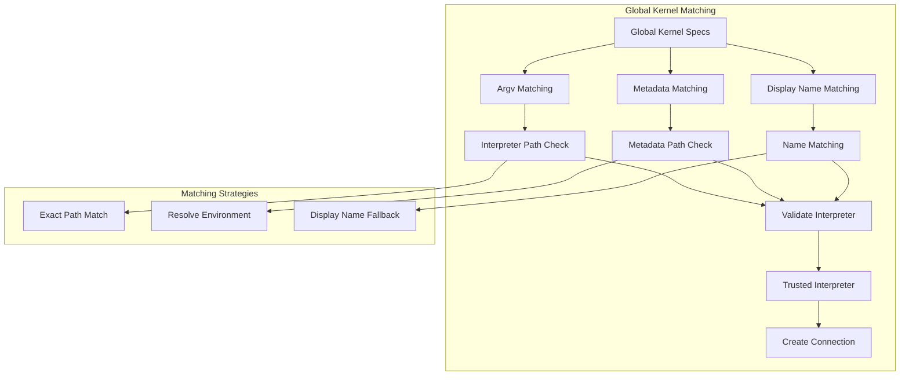
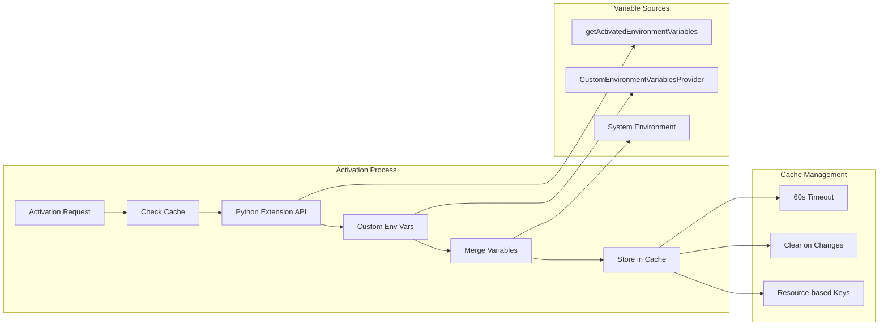
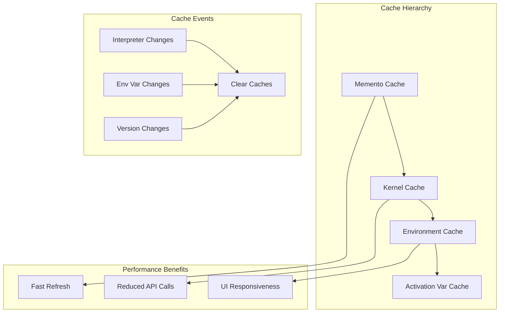
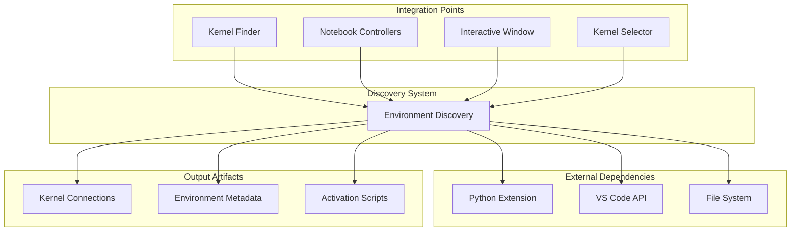

<!-- source: DeepWiki mcp.deepwiki.com · repo microsoft/vscode-jupyter · page 6.2 Environment Discovery · fetched 2026-10-26 -->

# Environment Discovery

Relevant source files

The following files were used as context for generating this wiki page:

- [src/kernels/helpers.ts](src/kernels/helpers.ts)
- [src/kernels/raw/finder/contributedKerneFinder.node.unit.test.ts](src/kernels/raw/finder/contributedKerneFinder.node.unit.test.ts)
- [src/kernels/raw/finder/contributedLocalKernelSpecFinder.node.ts](src/kernels/raw/finder/contributedLocalKernelSpecFinder.node.ts)
- [src/kernels/raw/finder/contributedLocalKernelSpecFinder.node.unit.test.ts](src/kernels/raw/finder/contributedLocalKernelSpecFinder.node.unit.test.ts)
- [src/kernels/raw/finder/interpreterKernelSpecFinderHelper.node.ts](src/kernels/raw/finder/interpreterKernelSpecFinderHelper.node.ts)
- [src/kernels/raw/finder/interpreterKernelSpecFinderHelper.node.unit.test.ts](src/kernels/raw/finder/interpreterKernelSpecFinderHelper.node.unit.test.ts)
- [src/kernels/raw/finder/localKernelSpecFinderBase.node.ts](src/kernels/raw/finder/localKernelSpecFinderBase.node.ts)
- [src/kernels/raw/finder/localKnownPathKernelSpecFinder.node.ts](src/kernels/raw/finder/localKnownPathKernelSpecFinder.node.ts)
- [src/kernels/raw/finder/localPythonAndRelatedNonPythonKernelSpecFinder.node.ts](src/kernels/raw/finder/localPythonAndRelatedNonPythonKernelSpecFinder.node.ts)
- [src/kernels/raw/finder/localPythonAndRelatedNonPythonKernelSpecFinder.node.unit.test.ts](src/kernels/raw/finder/localPythonAndRelatedNonPythonKernelSpecFinder.node.unit.test.ts)
- [src/platform/api/pythonApi.ts](src/platform/api/pythonApi.ts)
- [src/platform/api/types.ts](src/platform/api/types.ts)
- [src/platform/interpreter/activation/types.ts](src/platform/interpreter/activation/types.ts)
- [src/platform/interpreter/contracts.ts](src/platform/interpreter/contracts.ts)
- [src/platform/interpreter/environmentActivationService.node.ts](src/platform/interpreter/environmentActivationService.node.ts)
- [src/platform/interpreter/globalPythonExePathService.node.ts](src/platform/interpreter/globalPythonExePathService.node.ts)
- [src/platform/interpreter/helpers.ts](src/platform/interpreter/helpers.ts)

This document covers the Python environment discovery system in the VS Code Jupyter extension. Environment discovery is responsible for finding, cataloging, and managing Python interpreters and their associated kernel specifications to enable Jupyter notebook execution.

For information about the broader Python extension integration, see [Python Extension Bridge](#6.1). For details about kernel management and selection, see [Kernel Discovery and Selection](#3.2).

## Architecture Overview

The environment discovery system operates through a multi-layered architecture that bridges the Python extension's environment API with Jupyter kernel requirements:

Sources: [src/platform/api/pythonApi.ts:304-686](), [src/kernels/raw/finder/localPythonAndRelatedNonPythonKernelSpecFinder.node.ts:45-371](), [src/kernels/raw/finder/interpreterKernelSpecFinderHelper.node.ts:138-325]()

## Python Environment Discovery Process

The `InterpreterService` serves as the primary interface for discovering and managing Python environments. It bridges the Python extension's environment API with Jupyter's requirements:

The environment discovery process involves several key steps:

1. **Environment Enumeration**: The system queries the Python extension API through `getCachedEnvironments()` to retrieve known Python environments
2. **Environment Mapping**: Raw Python extension environments are converted to Jupyter-compatible format via `resolvedPythonEnvToJupyterEnv()`  
3. **Type Detection**: Environment types (Conda, Venv, etc.) are determined using `getEnvironmentType()`
4. **Validation**: Environments are validated to ensure they still exist and are accessible

Sources: [src/platform/interpreter/helpers.ts:223-254](), [src/platform/api/pythonApi.ts:362-418](), [src/platform/interpreter/helpers.ts:87-121]()

## Kernel Specification Discovery

For each discovered Python environment, the system searches for associated kernel specifications that can be used to start Jupyter kernels:

The `InterpreterSpecificKernelSpecsFinder` handles discovery of kernel specifications within individual Python environments:

1. **Path Resolution**: Determines the `sysPrefix` of the Python environment using `getSysPrefix()`
2. **Kernel Spec Search**: Searches for `kernel.json` files in the environment's kernel directory
3. **Spec Loading**: Loads and parses kernel specification files
4. **Metadata Creation**: Creates `PythonKernelConnectionMetadata` or `LocalKernelSpecConnectionMetadata` objects

The system also includes logic to hide default kernel specs that are ambiguous (like generic "python3" specs) when more specific environment-based kernels are available.

Sources: [src/kernels/raw/finder/interpreterKernelSpecFinderHelper.node.ts:138-325](), [src/kernels/raw/finder/interpreterKernelSpecFinderHelper.node.ts:53-130](), [src/platform/interpreter/helpers.ts:164-181]()

## Global Kernel Specification Matching

The `GlobalPythonKernelSpecFinder` handles the complex task of matching globally installed Python kernel specifications to specific Python interpreters:

The matching process follows a priority-based approach:

1. **Exact Metadata Match**: Check if `kernelSpec.metadata.interpreter.path` matches a known interpreter
2. **Argv Path Match**: Check if the first argument in `kernelSpec.argv` matches an interpreter path
3. **Path Resolution**: For paths that don't directly match, use `getInterpreterDetails()` to resolve the interpreter
4. **Display Name Fallback**: As a last resort, match based on environment display names

Sources: [src/kernels/raw/finder/interpreterKernelSpecFinderHelper.node.ts:377-576]()

## Environment Activation and Variable Resolution

The `EnvironmentActivationService` handles the complex task of activating Python environments and retrieving their environment variables:

The activation service provides several key features:

1. **Environment Variable Retrieval**: Gets activated environment variables from the Python extension
2. **Custom Variable Integration**: Merges custom environment variables from workspace settings
3. **Caching**: Caches environment variables with a 60-second timeout for performance
4. **Progress Reporting**: Shows progress indicators during environment activation

Sources: [src/platform/interpreter/environmentActivationService.node.ts:31-118](), [src/platform/interpreter/environmentActivationService.node.ts:125-178]()

## Caching and Performance Optimization

The environment discovery system implements multiple layers of caching to optimize performance:

| Cache Type | Location | Timeout | Key Strategy |
|------------|----------|---------|--------------|
| Environment Cache | `InterpreterService` | Event-based | Interpreter ID |
| Kernel Spec Cache | `LocalKernelSpecFinder` | Persistent | Spec file path |
| Activation Variables | `EnvironmentActivationService` | 60 seconds | Resource + Interpreter |
| Memento Cache | Various finders | Session-based | Version + environment |

The caching strategy includes:

1. **Persistent Caching**: Kernel specifications and environments are cached across VS Code sessions using `Memento`
2. **Version-based Invalidation**: Caches are tied to extension versions to prevent stale data
3. **Event-driven Updates**: Caches are cleared when interpreters change or environment variables are modified
4. **Resource-specific Keys**: Environment activation variables are cached per workspace resource

Sources: [src/kernels/raw/finder/localKernelSpecFinderBase.node.ts:246-298](), [src/platform/interpreter/environmentActivationService.node.ts:28-52](), [src/kernels/raw/finder/interpreterKernelSpecFinderHelper.node.ts:48-51]()

## Integration Points

The environment discovery system integrates with several other components of the Jupyter extension:

Key integration aspects include:

1. **Kernel Provider Integration**: Discovered environments are converted to kernel connection metadata for the kernel provider system
2. **Controller Registration**: Environment-based kernels are registered as VS Code notebook controllers
3. **Telemetry Integration**: Discovery events and performance metrics are tracked for telemetry
4. **Error Handling**: Robust error handling ensures discovery failures don't break the overall system

Sources: [src/kernels/raw/finder/localPythonAndRelatedNonPythonKernelSpecFinder.node.ts:285-357](), [src/platform/api/pythonApi.ts:559-574](), [src/kernels/raw/finder/contributedLocalKernelSpecFinder.node.ts:140-161]()

---

