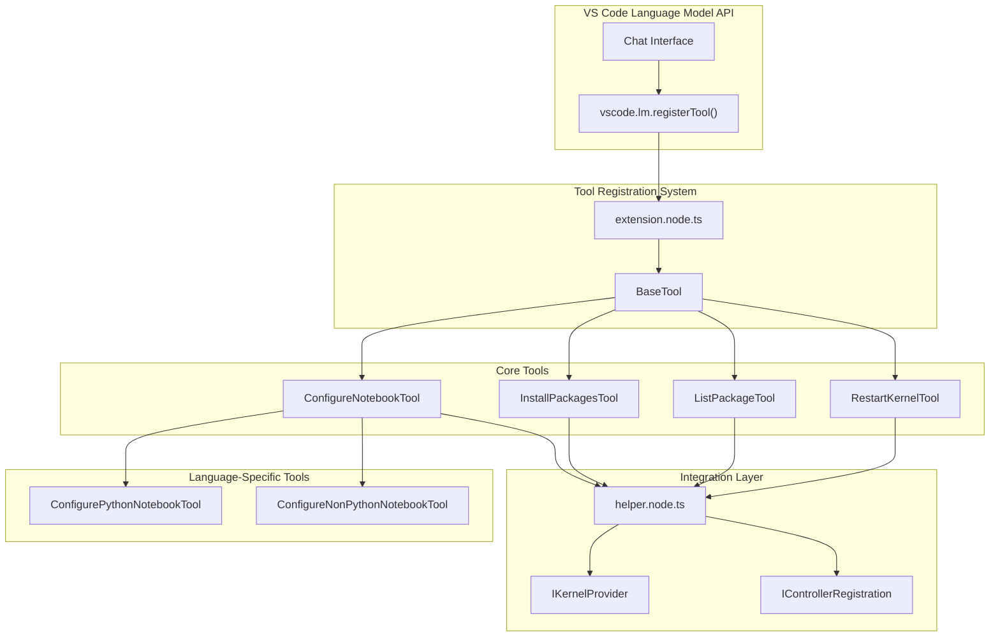
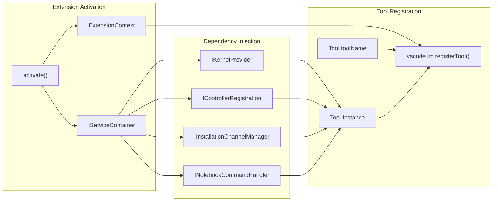
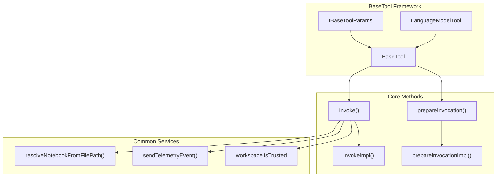
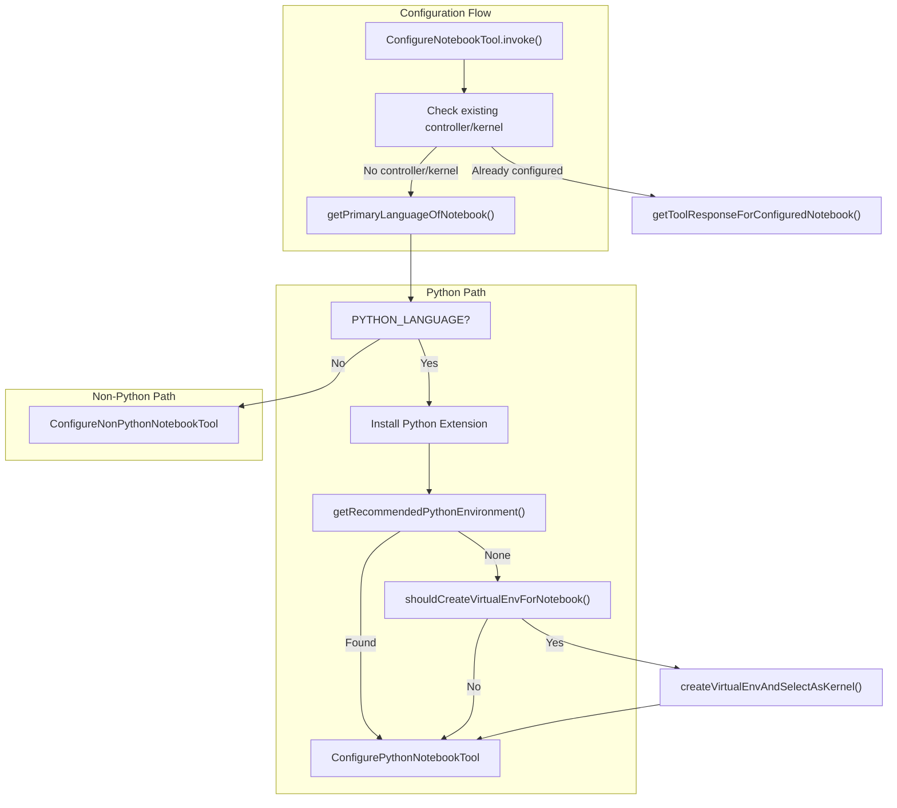
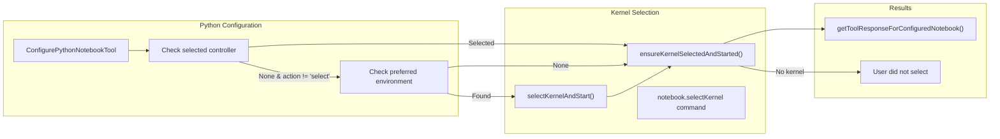
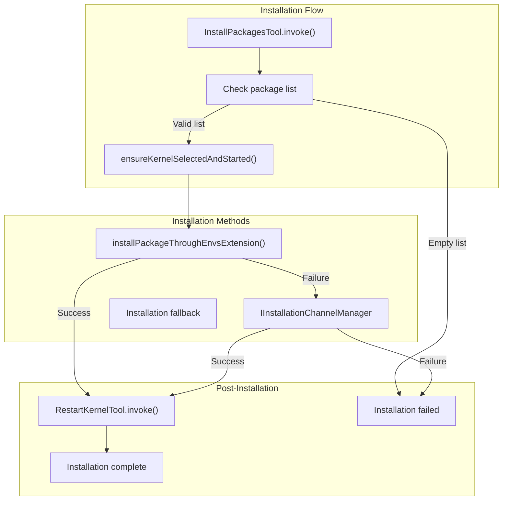
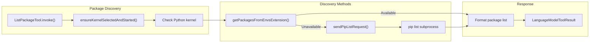
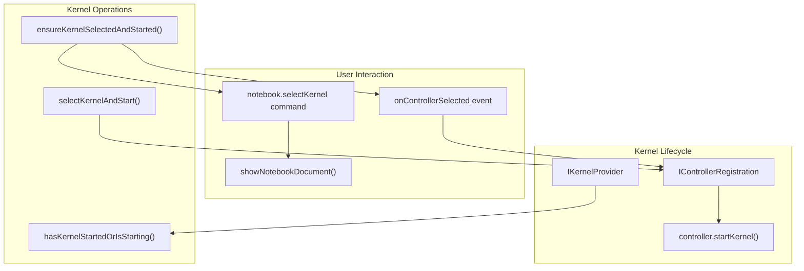
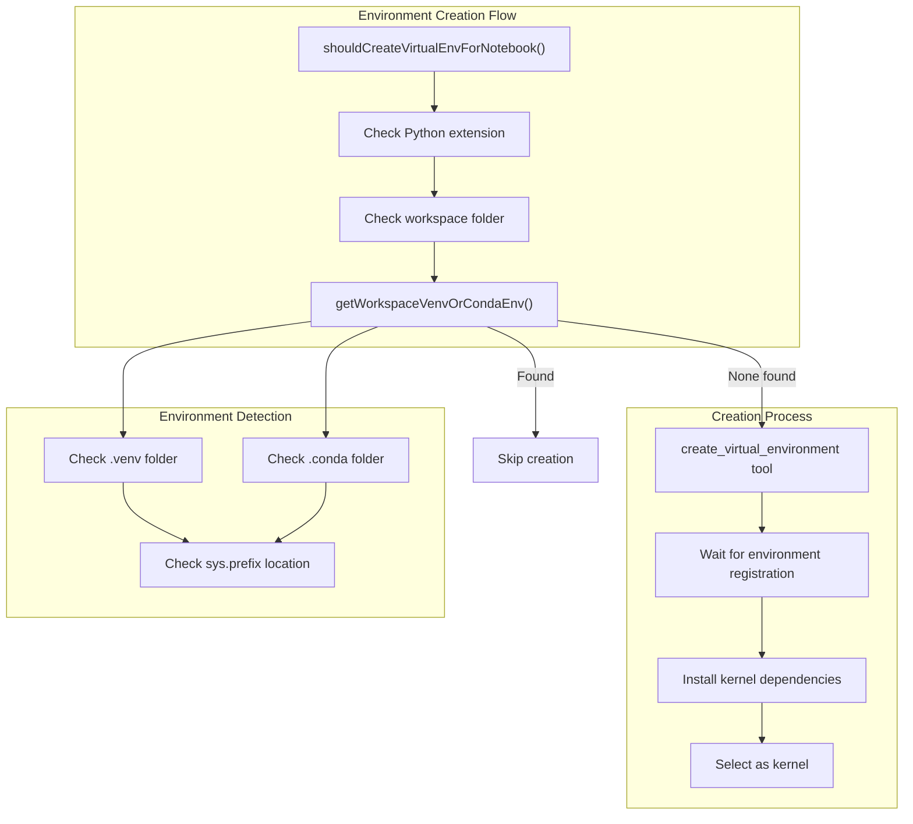
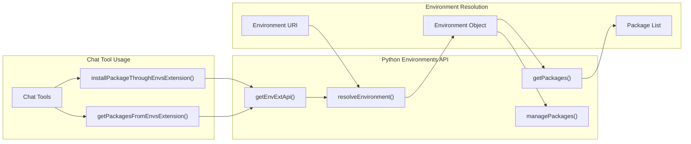

<!-- source: DeepWiki mcp.deepwiki.com · repo microsoft/vscode-jupyter · page 7 AI and Chat Tools · fetched 2026-10-26 -->

# AI and Chat Tools

Relevant source files

The following files were used as context for generating this wiki page:

- [src/platform/api/python-envs/api.ts](src/platform/api/python-envs/api.ts)
- [src/standalone/chat/configureNotebook.node.ts](src/standalone/chat/configureNotebook.node.ts)
- [src/standalone/chat/configureNotebook.other.node.ts](src/standalone/chat/configureNotebook.other.node.ts)
- [src/standalone/chat/configureNotebook.python.node.ts](src/standalone/chat/configureNotebook.python.node.ts)
- [src/standalone/chat/createVirtualEnv.python.node.ts](src/standalone/chat/createVirtualEnv.python.node.ts)
- [src/standalone/chat/extension.node.ts](src/standalone/chat/extension.node.ts)
- [src/standalone/chat/helper.node.ts](src/standalone/chat/helper.node.ts)
- [src/standalone/chat/helper.ts](src/standalone/chat/helper.ts)
- [src/standalone/chat/installPackageTool.node.ts](src/standalone/chat/installPackageTool.node.ts)
- [src/standalone/chat/listPackageTool.node.ts](src/standalone/chat/listPackageTool.node.ts)
- [src/standalone/chat/restartKernelTool.node.ts](src/standalone/chat/restartKernelTool.node.ts)

This document covers the AI-powered chat tools system in the Jupyter extension, which provides language model-based tools for notebook configuration and package management. These tools integrate with VS Code's Language Model API to provide AI-assisted workflows for common notebook tasks.

For information about the broader kernel management system that these tools interact with, see [Kernel Management](#3). For details about Python environment integration, see [Python Integration](#6).

## Purpose and Architecture

The AI and Chat Tools system provides a set of language model tools that automate common notebook workflows through natural language interactions. The system is built around VS Code's `vscode.lm` API and provides tools for kernel selection, package installation, and notebook configuration.

**Tool Registration and Base Architecture**

Sources: [src/standalone/chat/extension.node.ts:1-147](), [src/standalone/chat/helper.ts:48-108]()

## Tool Registration System

The chat tools are registered during extension activation through a centralized registration system that connects each tool implementation to VS Code's Language Model API.

Each tool follows a common registration pattern in the activation function:

| Tool | Tool Name | Dependencies |
|------|-----------|--------------|
| `InstallPackagesTool` | `notebook_install_packages` | `IKernelProvider`, `IControllerRegistration`, `IInstallationChannelManager` |
| `ListPackageTool` | `notebook_list_packages` | `IKernelProvider`, `IControllerRegistration` |
| `ConfigureNotebookTool` | `configure_notebook` | `IControllerRegistration`, `IKernelDependencyService`, `IKernelProvider` |
| `ConfigurePythonNotebookTool` | `configure_python_notebook` | `IKernelProvider`, `IControllerRegistration` |
| `ConfigureNonPythonNotebookTool` | `configure_non_python_notebook` | `IControllerRegistration`, `IKernelProvider` |
| `RestartKernelTool` | `restart_notebook_kernel` | `IKernelProvider`, `IControllerRegistration`, `INotebookCommandHandler` |

Sources: [src/standalone/chat/extension.node.ts:20-78]()

## Base Tool Framework

All chat tools extend the `BaseTool<T>` abstract class, which provides common functionality for notebook resolution, telemetry, and error handling.

The base tool provides several key services:

- **Notebook Resolution**: Converts file paths to `NotebookDocument` objects [src/standalone/chat/helper.ts:110-144]()
- **Workspace Trust Checking**: Ensures tools only run in trusted workspaces [src/standalone/chat/helper.ts:52-56]()
- **Telemetry Collection**: Tracks tool usage and failure modes [src/standalone/chat/helper.ts:67-88]()
- **Error Handling**: Categorizes errors and cancellation scenarios [src/standalone/chat/helper.ts:67-75]()

Sources: [src/standalone/chat/helper.ts:48-108](), [src/standalone/chat/helper.ts:25-27]()

## Notebook Configuration Tools

The notebook configuration system provides tools for setting up kernels and environments for different notebook types.

### ConfigureNotebookTool

The main configuration tool orchestrates the setup process based on notebook language and available environments.

The configuration tool implements sophisticated logic for Python notebooks:

1. **Extension Management**: Automatically installs the Python extension if missing [src/standalone/chat/configureNotebook.node.ts:67-76]()
2. **Environment Recommendation**: Uses preferred Python environments when available [src/standalone/chat/configureNotebook.node.ts:80-93]()
3. **Virtual Environment Creation**: Creates project-specific virtual environments [src/standalone/chat/configureNotebook.node.ts:94-119]()
4. **Fallback Selection**: Provides kernel selection UI as a fallback [src/standalone/chat/configureNotebook.node.ts:129-133]()

Sources: [src/standalone/chat/configureNotebook.node.ts:42-134](), [src/standalone/chat/configureNotebook.node.ts:60-134]()

### Python-Specific Configuration

The `ConfigurePythonNotebookTool` handles Python environment selection and kernel startup.

Sources: [src/standalone/chat/configureNotebook.python.node.ts:43-94]()

## Package Management Tools

The package management tools provide AI-assisted package installation and listing capabilities.

### InstallPackagesTool

The package installation tool supports multiple installation methods with automatic kernel restart.

The installation process follows a priority order:

1. **Python Environments Extension**: Uses the environments extension API when available [src/standalone/chat/installPackageTool.node.ts:56]()
2. **Installation Channel Manager**: Falls back to the extension's installer service [src/standalone/chat/installPackageTool.node.ts:62-77]()
3. **Automatic Restart**: Restarts the kernel after successful installation [src/standalone/chat/installPackageTool.node.ts:85-98]()

Sources: [src/standalone/chat/installPackageTool.node.ts:28-105]()

### ListPackageTool

The package listing tool retrieves installed packages using multiple discovery methods.

Sources: [src/standalone/chat/listPackageTool.node.ts:28-60](), [src/standalone/chat/listPackageTool.node.ts:83-114]()

## Kernel Management Integration

The chat tools integrate closely with the kernel management system through helper functions that handle kernel lifecycle operations.

Key helper functions provide kernel management capabilities:

- **`ensureKernelSelectedAndStarted()`**: Displays kernel selector if needed and starts the selected kernel [src/standalone/chat/helper.node.ts:81-127]()
- **`selectKernelAndStart()`**: Programmatically selects a specific kernel connection [src/standalone/chat/helper.node.ts:129-170]()
- **`hasKernelStartedOrIsStarting()`**: Checks kernel status for tool availability [src/standalone/chat/helper.node.ts:203-208]()

Sources: [src/standalone/chat/helper.node.ts:81-209]()

## Virtual Environment Creation

The system includes sophisticated support for creating Python virtual environments for notebook projects.

The virtual environment creation process:

1. **Workspace Validation**: Ensures a workspace folder exists [src/standalone/chat/createVirtualEnv.python.node.ts:121-127]()
2. **Existing Environment Check**: Looks for `.venv` or `.conda` environments [src/standalone/chat/createVirtualEnv.python.node.ts:137-167]()
3. **Tool Invocation**: Uses the `create_virtual_environment` tool with `ipykernel` package [src/standalone/chat/createVirtualEnv.python.node.ts:43-44]()
4. **Controller Registration**: Waits for the new environment to be registered as a controller [src/standalone/chat/createVirtualEnv.python.node.ts:68-75]()
5. **Dependency Installation**: Installs missing kernel dependencies if needed [src/standalone/chat/createVirtualEnv.python.node.ts:98-108]()

Sources: [src/standalone/chat/createVirtualEnv.python.node.ts:27-111](), [src/standalone/chat/createVirtualEnv.python.node.ts:113-135]()

## Python Environments API Integration

The chat tools integrate with the Python Environments Extension API for enhanced package and environment management.

The integration provides several advantages:

- **Environment Resolution**: Resolves kernel URIs to environment objects [src/standalone/chat/helper.node.ts:56-61]()
- **Package Discovery**: Gets package lists without subprocess execution [src/standalone/chat/helper.node.ts:51-62]()
- **Package Management**: Installs packages through the environments extension [src/standalone/chat/helper.node.ts:64-77]()

Sources: [src/standalone/chat/helper.node.ts:50-77]()

---

