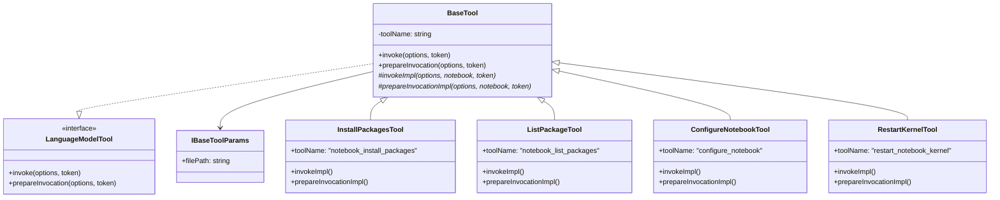
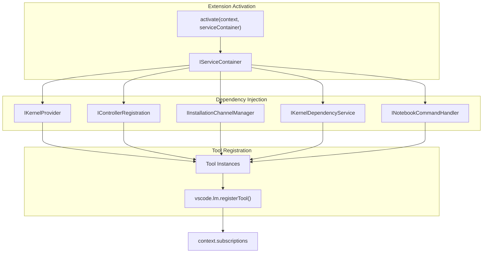
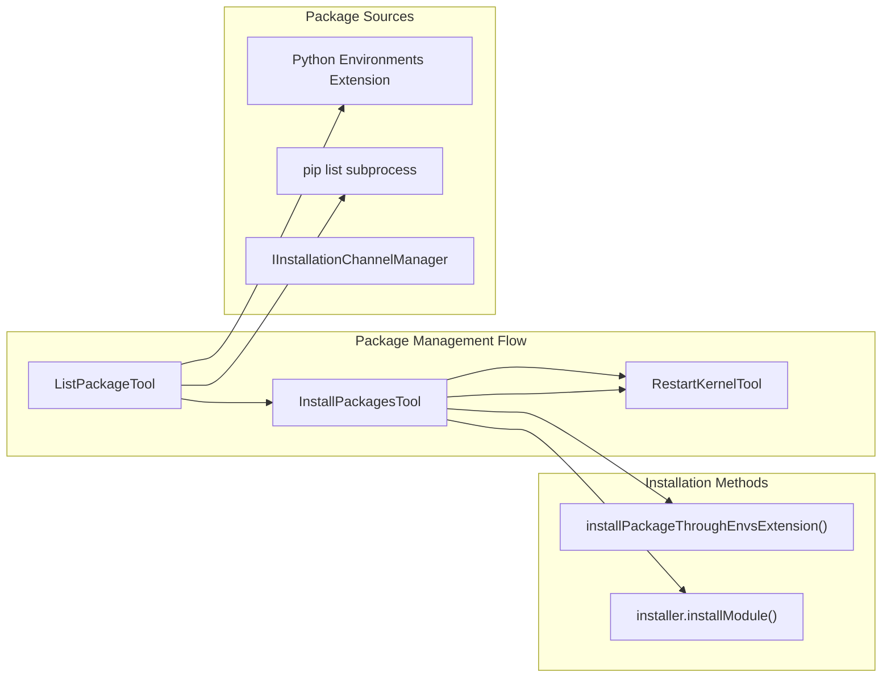
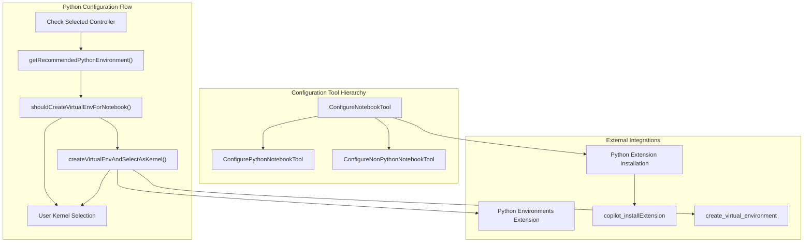
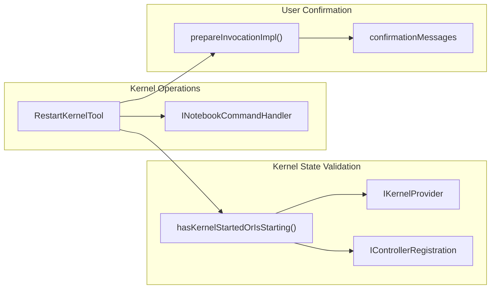
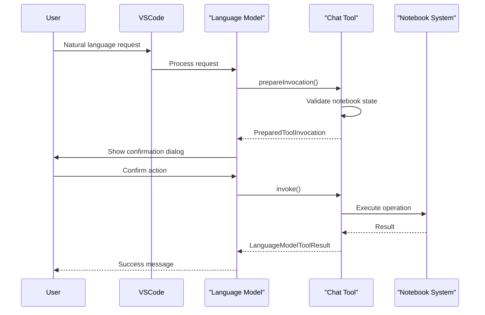
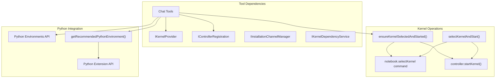

<!-- source: DeepWiki mcp.deepwiki.com · repo microsoft/vscode-jupyter · page 7.1 Chat Tool Architecture · fetched 2026-10-26 -->

# Chat Tool Architecture

Relevant source files

The following files were used as context for generating this wiki page:

- [src/platform/api/python-envs/api.ts](src/platform/api/python-envs/api.ts)
- [src/standalone/chat/configureNotebook.node.ts](src/standalone/chat/configureNotebook.node.ts)
- [src/standalone/chat/configureNotebook.other.node.ts](src/standalone/chat/configureNotebook.other.node.ts)
- [src/standalone/chat/configureNotebook.python.node.ts](src/standalone/chat/configureNotebook.python.node.ts)
- [src/standalone/chat/createVirtualEnv.python.node.ts](src/standalone/chat/createVirtualEnv.python.node.ts)
- [src/standalone/chat/extension.node.ts](src/standalone/chat/extension.node.ts)
- [src/standalone/chat/helper.node.ts](src/standalone/chat/helper.node.ts)
- [src/standalone/chat/helper.ts](src/standalone/chat/helper.ts)
- [src/standalone/chat/installPackageTool.node.ts](src/standalone/chat/installPackageTool.node.ts)
- [src/standalone/chat/listPackageTool.node.ts](src/standalone/chat/listPackageTool.node.ts)
- [src/standalone/chat/restartKernelTool.node.ts](src/standalone/chat/restartKernelTool.node.ts)

## Purpose and Scope

The Chat Tool Architecture provides AI-powered tools that integrate with VS Code's Language Model API to help users configure Jupyter notebooks, manage Python packages, and perform kernel operations through natural language interactions. This system bridges conversational AI with the extension's kernel management and notebook infrastructure.

For information about the broader kernel management system that these tools interact with, see [Kernel Management](#3). For details about notebook controllers and execution, see [Notebook System](#4).

## Base Tool Framework

The chat tool system is built around a common base architecture that provides shared functionality for tool registration, validation, and execution.

### Core Abstractions

The `BaseTool` abstract class provides common functionality including workspace trust validation, notebook resolution from file paths, error handling, and telemetry collection. All concrete tools extend this base and implement the abstract methods `invokeImpl` and `prepareInvocationImpl`.

**Sources**: [src/standalone/chat/helper.ts:48-108](), [src/standalone/chat/installPackageTool.node.ts:18-26](), [src/standalone/chat/listPackageTool.node.ts:19-25]()

### Tool Registration and Activation

All tools are registered during extension activation through the VS Code Language Model API. The registration process injects necessary services from the service container into each tool instance.

**Sources**: [src/standalone/chat/extension.node.ts:20-78]()

## Tool Implementations

### Package Management Tools

The system provides two complementary tools for Python package management:

**ListPackageTool** (`notebook_list_packages`) retrieves the current packages in a kernel's Python environment. It first attempts to use the Python Environments extension API for better performance, then falls back to executing `pip list --format json` commands directly in the kernel.

**InstallPackagesTool** (`notebook_install_packages`) installs Python packages and automatically restarts the kernel. It tries the Python Environments extension first, then uses the extension's installation channel manager as a fallback.

**Sources**: [src/standalone/chat/listPackageTool.node.ts:19-81](), [src/standalone/chat/installPackageTool.node.ts:18-105](), [src/standalone/chat/helper.node.ts:19-77]()

### Notebook Configuration Tools

The notebook configuration system uses a hierarchical approach to handle different scenarios:

**ConfigureNotebookTool** (`configure_notebook`) serves as the main entry point that determines notebook language and delegates to appropriate specialized tools. For Python notebooks, it can automatically install the Python extension, recommend environments, or create virtual environments.

**Sources**: [src/standalone/chat/configureNotebook.node.ts:31-134](), [src/standalone/chat/configureNotebook.python.node.ts:34-141](), [src/standalone/chat/createVirtualEnv.python.node.ts:27-111]()

### Kernel Management Tools

**RestartKernelTool** (`restart_notebook_kernel`) restarts notebook kernels with user confirmation. It validates that an active kernel exists before proceeding and provides appropriate error messages if no kernel is available.

**Sources**: [src/standalone/chat/restartKernelTool.node.ts:17-62]()

## Integration Points

### VS Code Language Model Integration

The tools integrate with VS Code's Language Model API through two main phases: preparation (where user confirmation is requested) and invocation (where the actual work is performed).

**Sources**: [src/standalone/chat/helper.ts:91-97](), [src/standalone/chat/installPackageTool.node.ts:107-137]()

### Kernel and Controller Integration

The chat tools heavily integrate with the extension's kernel management system, using controller registration to track selected kernels and kernel providers to access running kernel instances.

**Sources**: [src/standalone/chat/helper.node.ts:81-170](), [src/notebooks/controllers/preferredKernelConnectionService.node.ts]()

### Telemetry and Error Handling

All tools implement comprehensive telemetry collection and error handling:

| Tool Event | Data Collected | Error Categories |
|------------|----------------|------------------|
| Tool Invocation | `toolName`, `resourceHash`, `failed`, `failureCategory` | `cancelled`, `error`, custom categories |
| Configure Notebook | `isPython`, `installedPythonExtension`, `createdEnv` | Environment-specific errors |
| Package Management | Package lists, installation success | Package installation failures |

**Sources**: [src/standalone/chat/helper.ts:67-87](), [src/standalone/chat/helper.ts:29-45]()

---

