<!-- source: DeepWiki mcp.deepwiki.com · repo microsoft/vscode-jupyter · page 7.2 Package Management Tools · fetched 2026-10-26 -->

# Package Management Tools

<details>
<summary>Relevant source files</summary>

The following files were used as context for generating this wiki page:

- [src/platform/api/python-envs/api.ts](src/platform/api/python-envs/api.ts)
- [src/standalone/chat/configureNotebook.node.ts](src/standalone/chat/configureNotebook.node.ts)
- [src/standalone/chat/configureNotebook.other.node.ts](src/standalone/chat/configureNotebook.other.node.ts)
- [src/standalone/chat/configureNotebook.python.node.ts](src/standalone/chat/configureNotebook.python.node.ts)
- [src/standalone/chat/createVirtualEnv.python.node.ts](src/standalone/chat/createVirtualEnv.python.node.ts)
- [src/standalone/chat/extension.node.ts](src/standalone/chat/extension.node.ts)
- [src/standalone/chat/helper.node.ts](src/standalone/chat/helper.node.ts)
- [src/standalone/chat/helper.ts](src/standalone/chat/helper.ts)
- [src/standalone/chat/installPackageTool.node.ts](src/standalone/chat/installPackageTool.node.ts)
- [src/standalone/chat/listPackageTool.node.ts](src/standalone/chat/listPackageTool.node.ts)
- [src/standalone/chat/restartKernelTool.node.ts](src/standalone/chat/restartKernelTool.node.ts)

</details>


## Purpose and Scope

The Package Management Tools system provides AI-powered capabilities for installing and managing Python packages within Jupyter notebooks through VS Code's Language Model API. These tools enable users to interact with package management through natural language conversations, automatically handling kernel selection, package installation, and environment management.

For information about the broader chat tools architecture, see [Chat Tool Architecture](#7.1). For notebook configuration tools, see [Chat Tool Architecture](#7.1).

## Architecture Overview

The package management tools are implemented as VS Code Language Model tools that integrate with the Jupyter extension's kernel and environment management systems. The architecture consists of two main tools and supporting infrastructure:

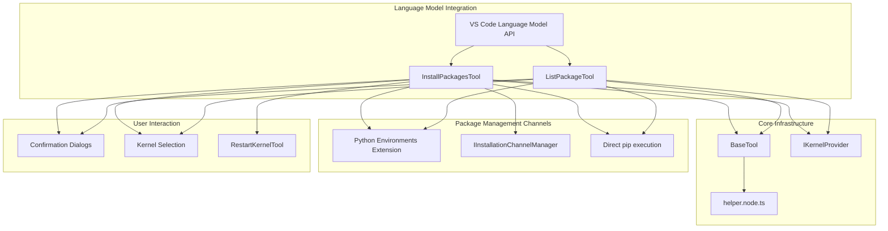

**Tool Registration Architecture:**
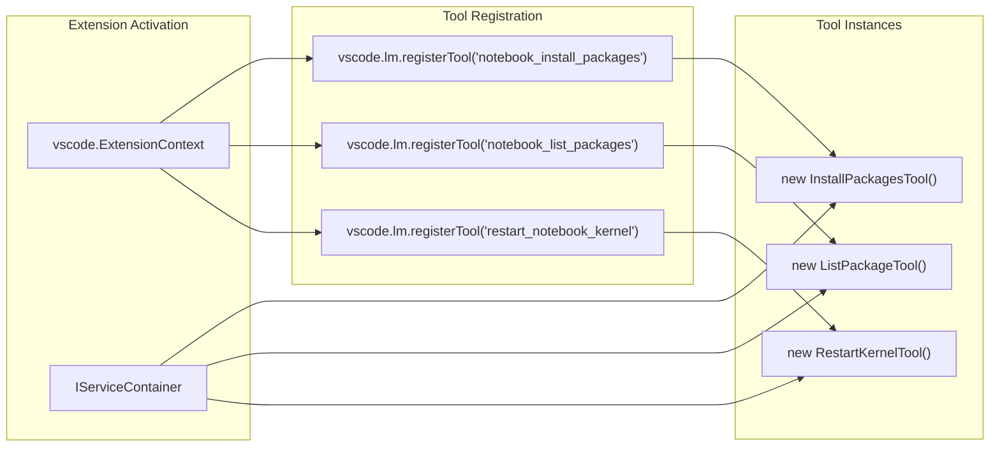

Sources: [src/standalone/chat/extension.node.ts:20-78](), [src/standalone/chat/helper.ts:48-108]()

## Package Installation Tool

The `InstallPackagesTool` provides AI-powered package installation capabilities with multiple installation channels and automatic kernel management.

### Installation Flow

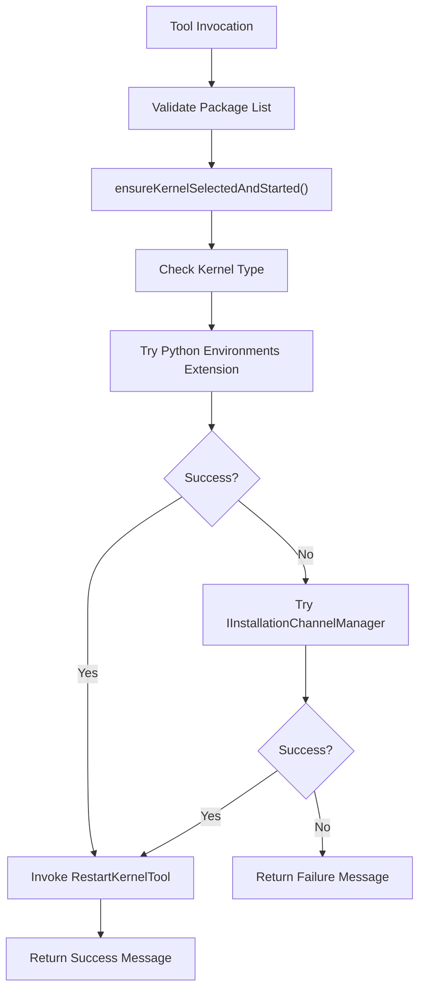

### Key Implementation Details

The installation tool supports multiple package installation channels with fallback logic:

| Channel | Priority | Requirements |
|---------|----------|--------------|
| Python Environments Extension | 1 | Local Python kernel with interpreter URI |
| Installation Channel Manager | 2 | Kernel with interpreter metadata |
| Direct pip execution | Not implemented | Would require kernel execution |

**Installation Channel Selection:**
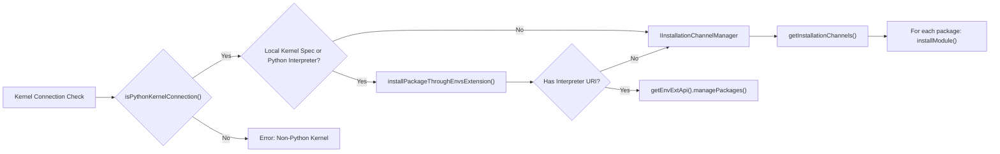

Sources: [src/standalone/chat/installPackageTool.node.ts:28-105](), [src/standalone/chat/helper.node.ts:64-77]()

## Package Listing Tool

The `ListPackageTool` provides package discovery and listing capabilities for Python environments, supporting both the Python Environments Extension and direct pip execution.

### Listing Flow

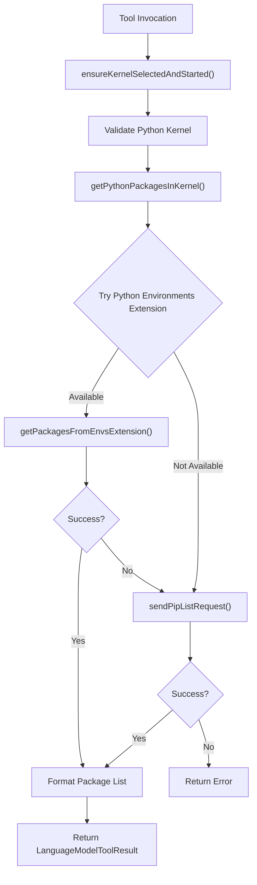

### Package Data Sources

The tool accesses package information through two primary channels:

**Python Environments Extension Integration:**
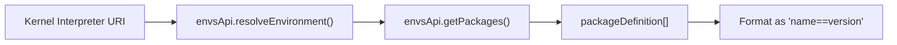

**Direct pip Execution:**
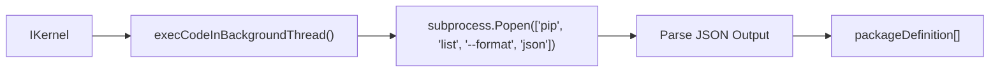

Sources: [src/standalone/chat/listPackageTool.node.ts:28-114](), [src/standalone/chat/helper.node.ts:19-62]()

## Package Management Channels

The system supports multiple package management backends with automatic fallback logic.

### Python Environments Extension Channel

When available, the Python Environments Extension provides the primary package management interface:

```typescript
// Package installation through environments extension
async function installPackageThroughEnvsExtension(
    kernelUri: vscode.Uri, 
    packages: string[]
): Promise<boolean>

// Package listing through environments extension  
async function getPackagesFromEnvsExtension(
    kernelUri: vscode.Uri
): Promise<packageDefinition[] | undefined>
```

**Integration Flow:**
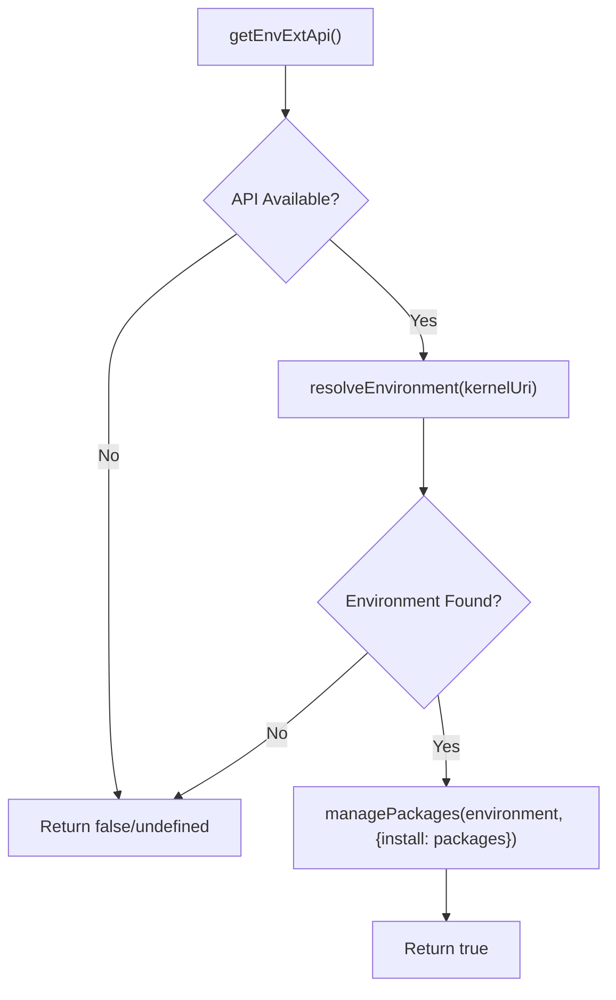

### Installation Channel Manager

The extension's built-in installation system provides fallback package management:

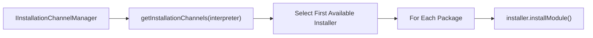

### Direct pip Execution

For package listing, the system can execute pip commands directly in the kernel:

| Operation | Command | Output Format |
|-----------|---------|---------------|
| List packages | `pip list --format json` | JSON array of {name, version} |
| Install packages | Not implemented | Would use `pip install` |

Sources: [src/standalone/chat/helper.node.ts:50-77](), [src/standalone/chat/installPackageTool.node.ts:49-78]()

## Language Model Integration

The package management tools integrate with VS Code's Language Model API through the `BaseTool` framework.

### Tool Registration and Lifecycle

**Tool Names and Registration:**
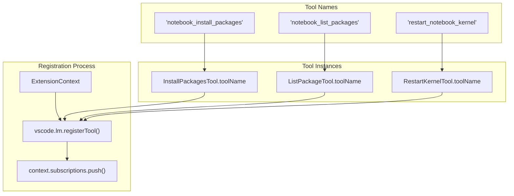

### Parameter Interfaces

The tools use structured parameter interfaces for type safety:

```typescript
interface IInstallPackageParams extends IBaseToolParams {
    packageList: string[];
}

interface IBaseToolParams {
    filePath: string;
}
```

**Tool Invocation Flow:**
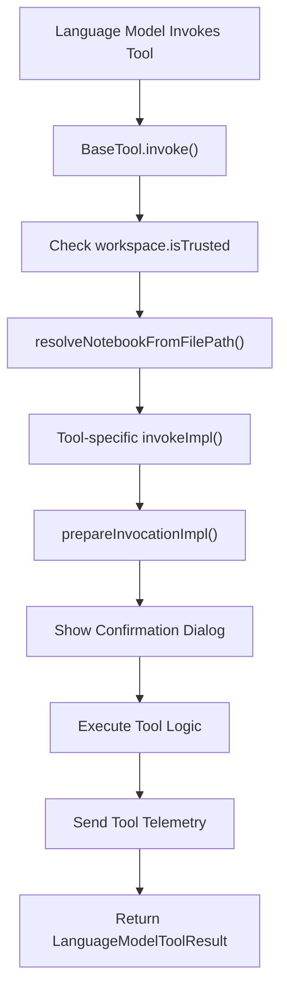

Sources: [src/standalone/chat/helper.ts:48-108](), [src/standalone/chat/installPackageTool.node.ts:140-142]()

## User Interaction Flow

The package management tools provide rich user interaction through confirmation dialogs and progress messaging.

### Confirmation and Progress Messaging

**Install Tool Confirmation Flow:**
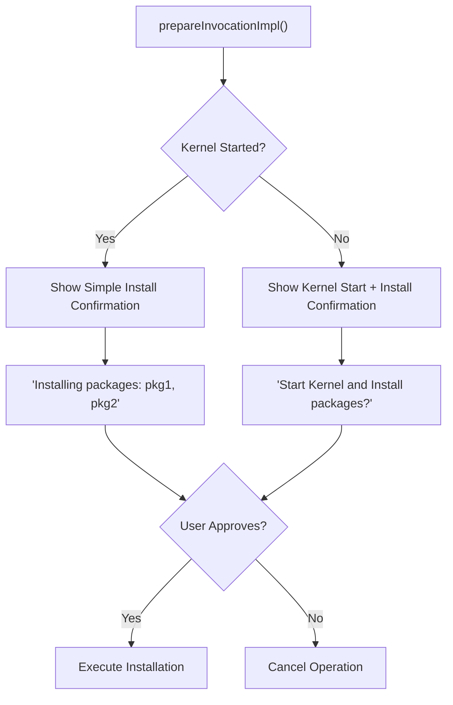

**List Tool Confirmation Flow:**
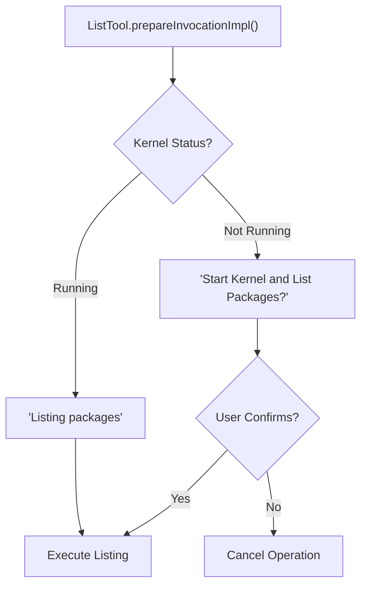

### Integration with Kernel Restart

Package installation automatically triggers kernel restart to ensure new packages are available:

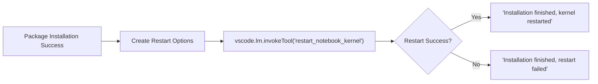

### Error Handling and Telemetry

The tools implement comprehensive error handling with telemetry collection:

| Error Category | Example | Telemetry Category |
|----------------|---------|-------------------|
| Empty package list | No packages specified | `emptyPackageList` |
| No active kernel | Kernel not selected | `noActiveKernel` |
| Non-Python kernel | Julia/R kernel selected | `nonPythonKernelSelected` |
| Installation failure | Network/permission error | `error` |
| User cancellation | Dialog dismissed | `cancelled` |

Sources: [src/standalone/chat/installPackageTool.node.ts:107-137](), [src/standalone/chat/listPackageTool.node.ts:62-80](), [src/standalone/chat/helper.ts:66-88]()

---

