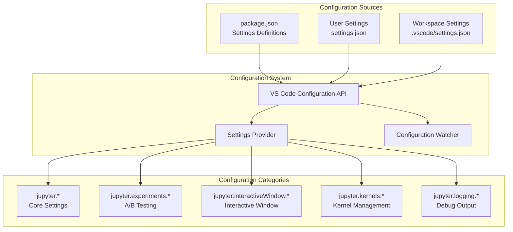
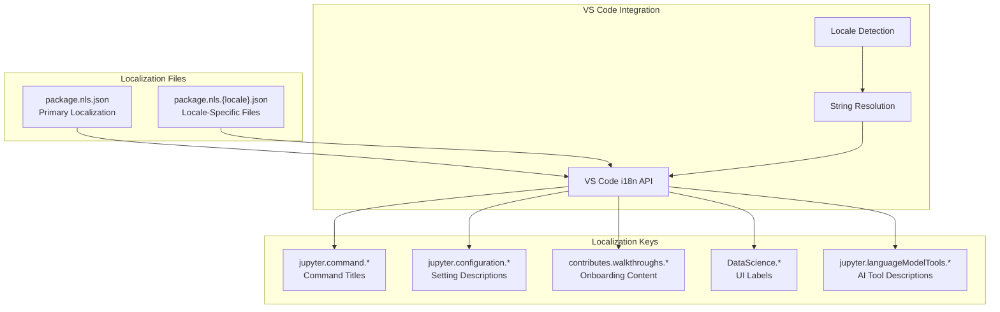
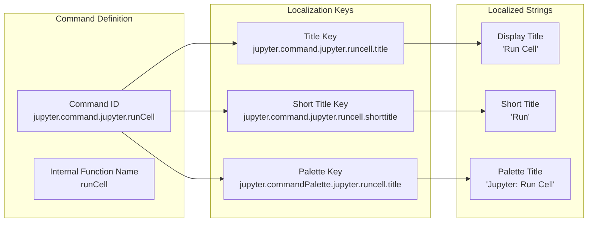
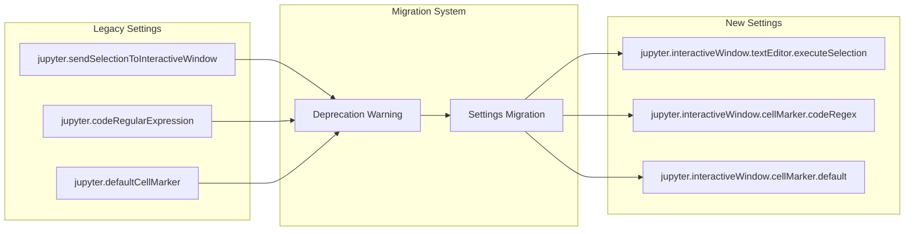
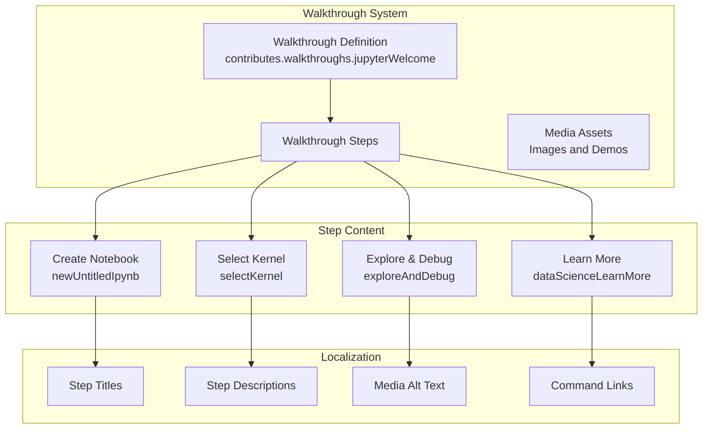

<!-- source: DeepWiki mcp.deepwiki.com · repo microsoft/vscode-jupyter · page 8 Configuration and Localization · fetched 2026-10-26 -->

# Configuration and Localization

Relevant source files

The following files were used as context for generating this wiki page:

- [package.nls.json](package.nls.json)

## Purpose and Scope

This document covers the configuration and localization systems of the VS Code Jupyter extension. It explains how extension settings are defined and managed, how commands are registered and localized, and how the internationalization (i18n) system works to support multiple languages. The configuration system enables users to customize the extension's behavior, while the localization system ensures the extension can be used by developers worldwide.

For information about specific extension settings that control kernel behavior, see [Kernel Management](#3). For details about user interface components and interactive features, see [User Experience & Interface Layer](#4).

## Configuration System Overview

The VS Code Jupyter extension uses VS Code's standard configuration system, where settings are defined in `package.json` and their localized descriptions are stored in `package.nls.json`. The configuration system is organized into several categories of settings that control different aspects of the extension's behavior.

**Sources:** [package.nls.json:123-246]()

## Localization System Architecture

The extension implements VS Code's standard localization pattern using `.nls.json` files. The localization system provides translated strings for commands, settings descriptions, error messages, and user interface elements.

**Sources:** [package.nls.json:1-247]()

## Command System and Localization

The extension defines numerous commands that are exposed through the Command Palette, context menus, and keyboard shortcuts. Each command has both an internal identifier and localized display strings.

### Core Command Categories

| Category | Key Pattern | Example Commands |
|----------|-------------|------------------|
| Cell Operations | `jupyter.command.jupyter.run*` | Run Cell, Run All Cells |
| Kernel Management | `jupyter.command.jupyter.*kernel*` | Restart Kernel, Interrupt Kernel |
| Export Operations | `jupyter.command.jupyter.export*` | Export to HTML, Export to PDF |
| Interactive Window | `jupyter.command.jupyter.*interactive*` | Run File Interactive, Create Interactive Window |
| Debugging | `jupyter.command.jupyter.debug*` | Debug Cell, Run by Line |
| Navigation | `jupyter.command.jupyter.*cell*` | Go to Next Cell, Select Cell |

### Command Localization Structure

**Sources:** [package.nls.json:36-117]()

## Configuration Settings Structure

The extension's configuration settings are organized hierarchically under the `jupyter` namespace. Each setting includes a localized description that explains its purpose and usage to users.

### Core Configuration Areas

| Setting Namespace | Purpose | Example Settings |
|------------------|---------|------------------|
| `jupyter.experiments.*` | A/B testing and feature flags | `enabled`, `optInto`, `optOutFrom` |
| `jupyter.logging.*` | Debug output control | `level` |
| `jupyter.kernels.*` | Kernel management | `filter`, `trusted` |
| `jupyter.interactiveWindow.*` | Interactive window behavior | `creationMode`, `viewColumn` |
| `jupyter.*` | General extension settings | `askForKernelRestart`, `themeMatplotlibPlots` |

### Deprecated Settings Migration

The extension maintains backward compatibility while migrating to a more organized settings structure:

**Sources:** [package.nls.json:156-199]()

## User Onboarding and Walkthroughs

The extension provides guided walkthroughs to help new users get started with Jupyter notebooks in VS Code. These walkthroughs are fully localized and provide step-by-step instructions.

### Walkthrough Structure

The main walkthrough (`jupyterWelcome`) includes four key steps:

1. **Create or Open Notebook** - Guide users to create their first `.ipynb` file
2. **Select Kernel** - Help users understand kernel selection
3. **Explore and Debug** - Introduce data viewer and run-by-line debugging
4. **Learn More** - Provide additional resources and documentation links

**Sources:** [package.nls.json:3-35]()

## AI Integration and Language Model Tools

The extension includes AI-powered tools that integrate with VS Code's language model system. These tools have localized descriptions and help users with notebook configuration and package management.

### Language Model Tool Categories

| Tool | Identifier | Purpose |
|------|------------|---------|
| Configure Notebook | `configure_notebook` | Ensure notebook readiness and cell execution |
| List Packages | `notebook_list_packages` | Display available Python packages in kernel |
| Install Packages | `notebook_install_packages` | Install Python packages in kernel environment |

**Sources:** [package.nls.json:243-246]()

## Implementation Details

### Localization Key Patterns

The extension follows consistent naming patterns for localization keys:

- **Commands**: `jupyter.command.{commandCategory}.{commandName}.title`
- **Settings**: `jupyter.configuration.jupyter.{settingName}.description`
- **Walkthroughs**: `contributes.walkthroughs.{walkthroughId}.{stepId}.{property}`
- **UI Elements**: `DataScience.{elementName}`

### Special Localization Features

The localization system includes several advanced features:

1. **Locked Content**: Certain strings contain `{Locked='...'}` comments to prevent translation of technical terms
2. **Markdown Support**: Setting descriptions support full markdown formatting
3. **Command References**: Localized strings can reference VS Code commands using `command:` syntax
4. **Variable Substitution**: Some strings support variable replacement patterns like `${packageName}`

**Sources:** [package.nls.json:8-143]()

---

