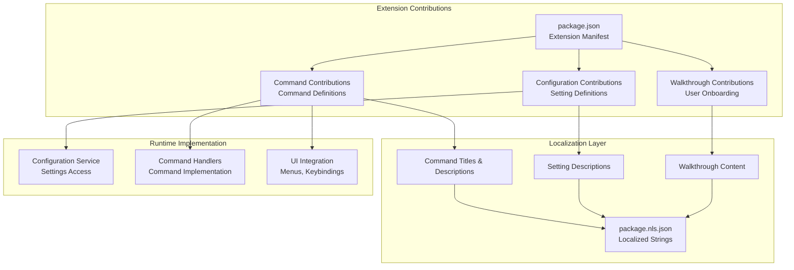
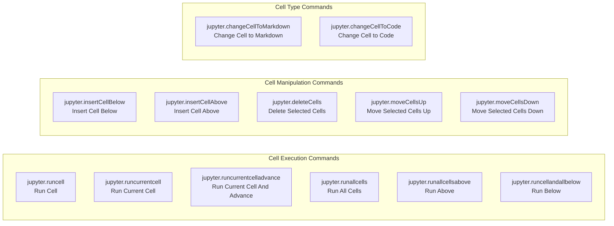
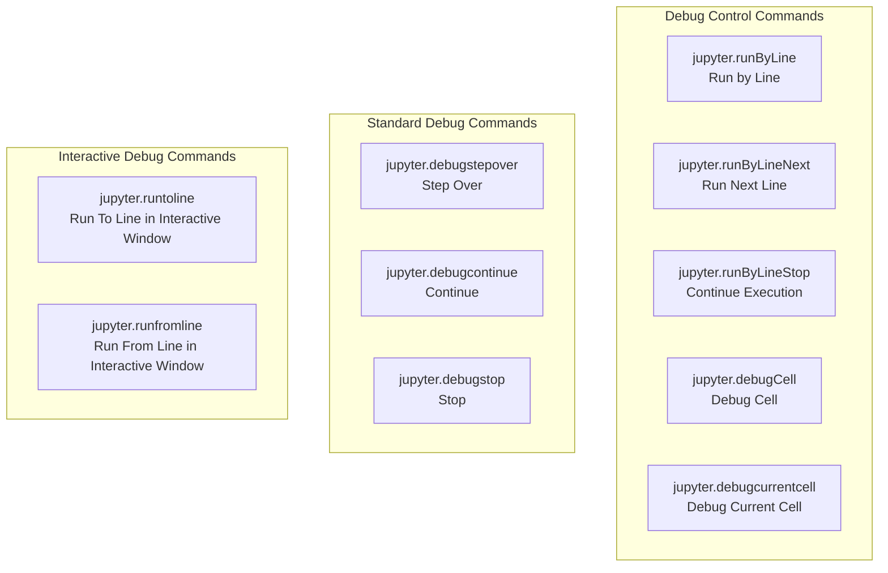
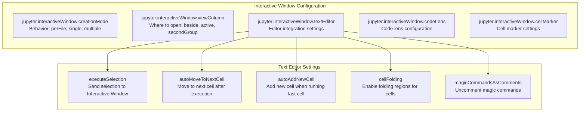
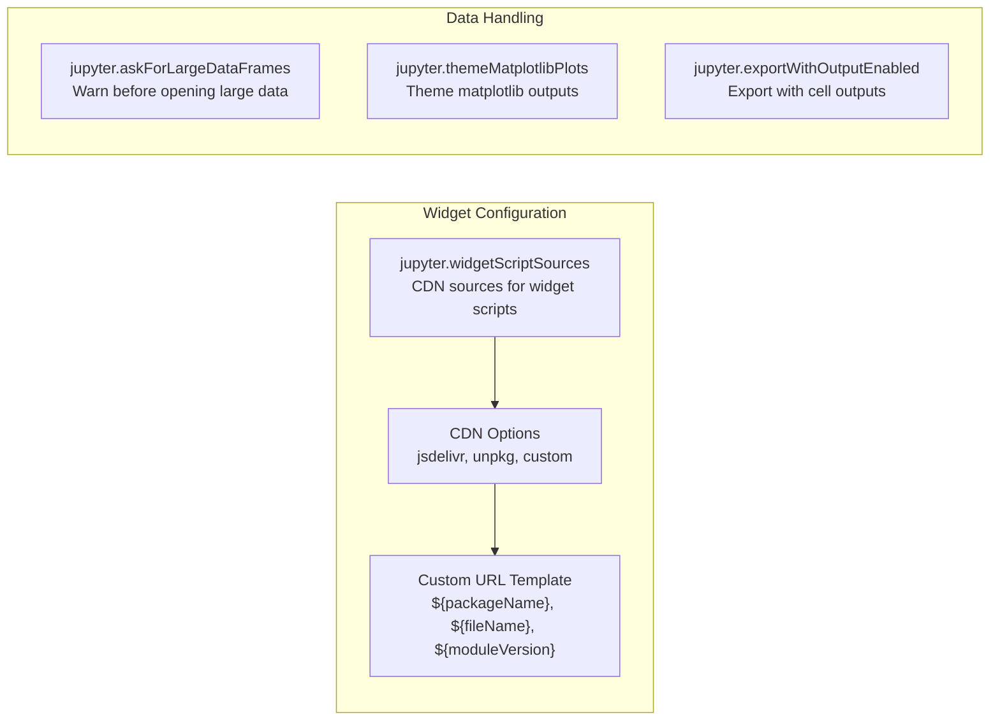
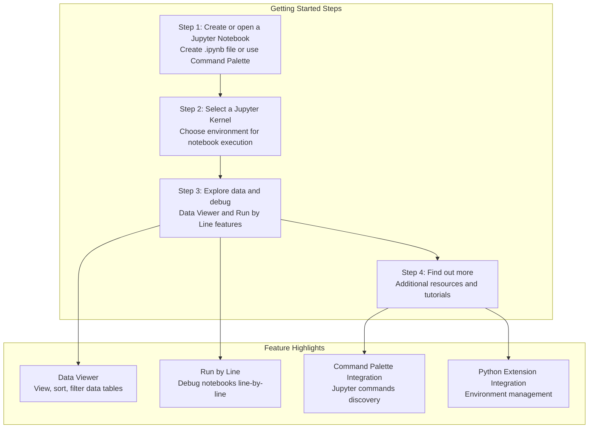
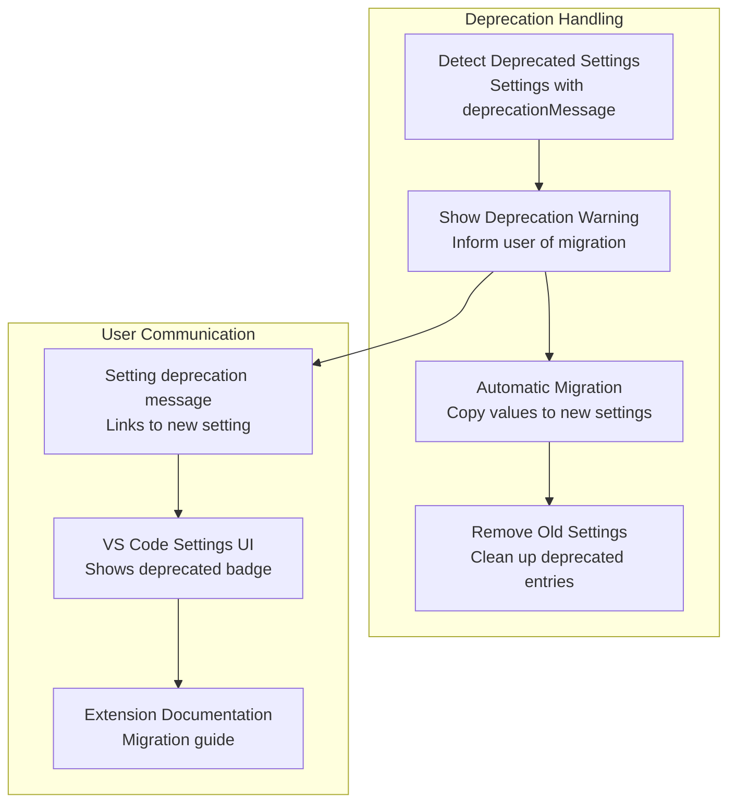
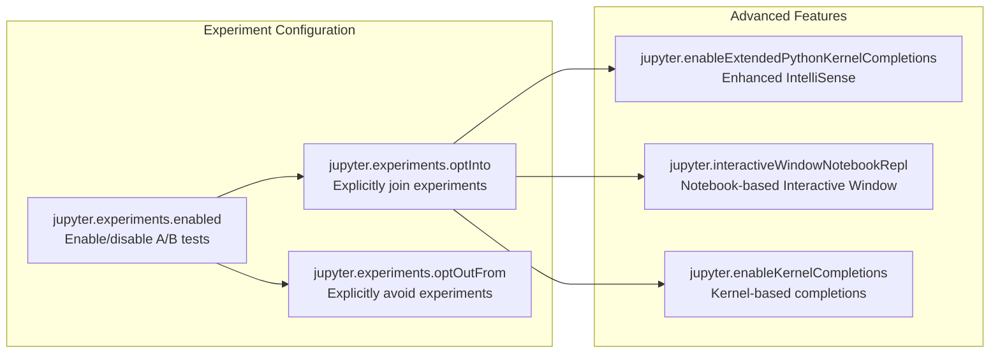
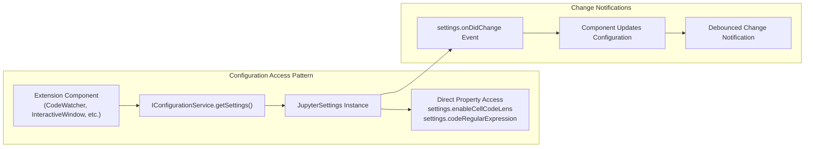

<!-- source: DeepWiki mcp.deepwiki.com · repo microsoft/vscode-jupyter · page 8.1 Settings and Commands · fetched 2026-10-26 -->

# Settings and Commands

Relevant source files

The following files were used as context for generating this wiki page:

- [package.nls.json](package.nls.json)

This document covers the settings and commands system for the VS Code Jupyter extension, including how settings and commands are defined, localized, and integrated with the VS Code UI. The system provides a comprehensive set of configuration options and user commands for managing Jupyter notebooks and kernels.

For information about localization implementation details, see [Localization](8.2). For extension activation and lifecycle management, see [Extension Activation and Lifecycle](2.1).

## Overview

The settings and commands system provides user-facing configuration options and commands for the Jupyter extension. Settings control extension behavior and user preferences, while commands provide actions users can execute through the Command Palette, keyboard shortcuts, and UI elements. All settings and commands are defined in the extension's contribution points and localized using string resources.

**Sources:** [package.nls.json:1-247]()

## Command System

The extension provides a comprehensive set of commands for notebook and kernel management, organized into logical categories:

### Core Jupyter Commands

| Command ID | Title | Description |
|------------|-------|-------------|
| `jupyter.clearCache` | Clear Cache | Clears Jupyter extension cache |
| `jupyter.selectJupyterInterpreter` | Select Interpreter to Start Jupyter Server | Choose Python interpreter for Jupyter |
| `jupyter.restartkernelandrunallcells` | Restart Kernel and Run All Cells | Restart kernel and execute all cells |
| `jupyter.interruptkernel` | Interrupt Kernel | Stop kernel execution |
| `jupyter.restartkernel` | Restart Kernel | Restart the current kernel |

**Sources:** [package.nls.json:36-117]()

### Cell Management Commands

**Sources:** [package.nls.json:44-78]()

### Interactive Window Commands

The extension provides specialized commands for the Interactive Window:

| Command ID | Title | Context |
|------------|-------|---------|
| `jupyter.runFileInteractive` | Run Current File in Interactive Window | Execute entire file |
| `jupyter.debugFileInteractive` | Debug Current File in Interactive Window | Debug entire file |
| `jupyter.execSelectionInteractive` | Run Selection/Line in Interactive Window | Execute selected code |
| `jupyter.createnewinteractive` | Create Interactive Window | Create new interactive session |

**Sources:** [package.nls.json:48-82]()

### Debugging Commands

**Sources:** [package.nls.json:44-62]()

## Configuration Settings

The extension provides extensive configuration options organized into logical categories. Each setting has a localized description defined in `package.nls.json`.

### Jupyter Server Settings

| Setting | Description | Type |
|---------|-------------|------|
| `jupyter.allowUnauthorizedRemoteConnection` | Allow connecting to https Jupyter servers without valid certificates | boolean |
| `jupyter.jupyterLaunchTimeout` | Amount of time (in ms) to wait for Jupyter server to start | number |
| `jupyter.jupyterLaunchRetries` | Number of times to attempt to connect to Jupyter | number |
| `jupyter.useDefaultConfigForJupyter` | Create a default empty Jupyter config when running locally | boolean |
| `jupyter.notebookFileRoot` | Root directory for Jupyter notebooks and Interactive Window | string |

**Sources:** [package.nls.json:147-151]()

### Interactive Window Settings

**Sources:** [package.nls.json:153-212]()

### Kernel and Execution Settings

| Setting | Description | Default |
|---------|-------------|---------|
| `jupyter.askForKernelRestart` | Warn before restarting a kernel | true |
| `jupyter.excludeUserSitePackages` | Add PYTHONNOUSERSITE to prevent global site-packages | false |
| `jupyter.runStartupCommands` | Commands to run when kernel starts/restarts | [] |
| `jupyter.debugJustMyCode` | Only step through user-written code when debugging | true |
| `jupyter.showVariableViewWhenDebugging` | Show Variable View during Run by Line | true |

**Sources:** [package.nls.json:145-178, 204-211]()

### Widget and Rendering Settings

**Sources:** [package.nls.json:134-147]()

## Walkthrough and Onboarding

The extension provides a comprehensive walkthrough system to help users get started with Jupyter notebooks:

### Jupyter Welcome Walkthrough

**Sources:** [package.nls.json:3-35]()

### Command Integration

The walkthrough integrates with VS Code commands to provide interactive onboarding:

| Walkthrough Action | Command | Purpose |
|-------------------|---------|---------|
| Create New Notebook | `ipynb.newUntitledIpynb` | Create new .ipynb file |
| Open Command Palette | `workbench.action.showCommands` | Access Jupyter commands |
| Open Folder | `workbench.action.files.openFolder` | Open workspace |
| Clone Repository | `git.clone` | Clone project from Git |
| Search Python Extension | `workbench.extensions.search` | Install Python extension |

**Sources:** [package.nls.json:7-31]()

## Deprecated Settings Migration

The extension maintains backward compatibility by automatically migrating deprecated settings to their new equivalents:

### Migration Categories

| Old Setting | New Setting | Migration Type |
|-------------|-------------|----------------|
| `jupyter.sendSelectionToInteractiveWindow` | `jupyter.interactiveWindow.textEditor.executeSelection` | Interactive Window |
| `jupyter.interactiveWindowMode` | `jupyter.interactiveWindow.creationMode` | Interactive Window |
| `jupyter.enableCellCodeLens` | `jupyter.interactiveWindow.codeLens.enable` | Code Lens |
| `jupyter.addGotoCodeLenses` | `jupyter.interactiveWindow.codeLens.enableGotoCell` | Code Lens |
| `jupyter.codeRegularExpression` | `jupyter.interactiveWindow.cellMarker.codeRegex` | Cell Markers |
| `jupyter.markdownRegularExpression` | `jupyter.interactiveWindow.cellMarker.markdownRegex` | Cell Markers |
| `jupyter.pythonCompletionTriggerCharacters` | `jupyter.completionTriggerCharacters` | Completion |

**Sources:** [package.nls.json:156-224]()

### Deprecation Messages

**Sources:** [package.nls.json:156-224]()

## AI and Language Model Integration

The extension integrates with VS Code's language model tools to provide AI-powered assistance:

### Chat Tools Configuration

| Tool | Display Name | Purpose |
|------|--------------|---------|
| `jupyter.languageModelTools.configure_notebook` | Configure Jupyter Notebook | Ensure notebook is ready for use |
| `jupyter.languageModelTools.notebook_list_packages` | List Packages | List Python packages in kernel |
| `jupyter.languageModelTools.notebook_install_packages` | Install Packages | Install Python packages in kernel |

**Sources:** [package.nls.json:243-246]()

### Experimental Features

The extension provides experimental feature flags for advanced functionality:

**Sources:** [package.nls.json:123-223]()

## Settings Usage Patterns

Components throughout the extension access settings through the `IConfigurationService`:

Common usage patterns include:

1. **Direct Property Access**: `configService.getSettings(resource).enableCellCodeLens`
2. **Change Listening**: `settings.onDidChange` event subscription
3. **Resource-Scoped Settings**: `getSettings(documentUri)` for document-specific configuration
4. **System Variable Resolution**: `settings.createSystemVariables(resource)`

**Sources:** [src/interactive-window/editor-integration/codewatcher.ts:74](), [src/platform/common/configSettings.ts:157-159]()

## Configuration Service Integration

The configuration service integrates with VS Code's settings system and provides additional functionality:

| Method | Purpose | Example Usage |
|--------|---------|---------------|
| `getSettings(resource?)` | Get settings for resource | `configService.getSettings(documentUri)` |
| `updateSetting(setting, value, resource?, target?)` | Update individual setting | `updateSetting('enableCellCodeLens', true)` |
| `updateSectionSetting(section, setting, value, resource?, target?)` | Update nested setting | `updateSectionSetting('interactiveWindow', 'mode', 'single')` |

The service automatically handles:
- Workspace folder detection and scoping
- Settings inheritance and precedence
- System variable resolution (`${workspaceFolder}`, `${fileDirname}`, etc.)
- Change event debouncing and propagation

**Sources:** [src/platform/common/types.ts:130-141](), [src/platform/common/configSettings.ts:223-271]()

---

