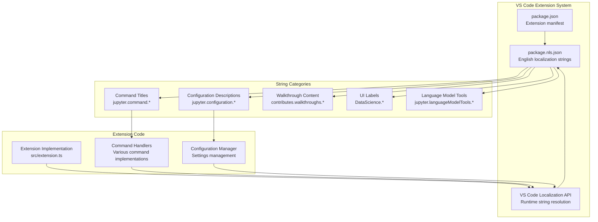
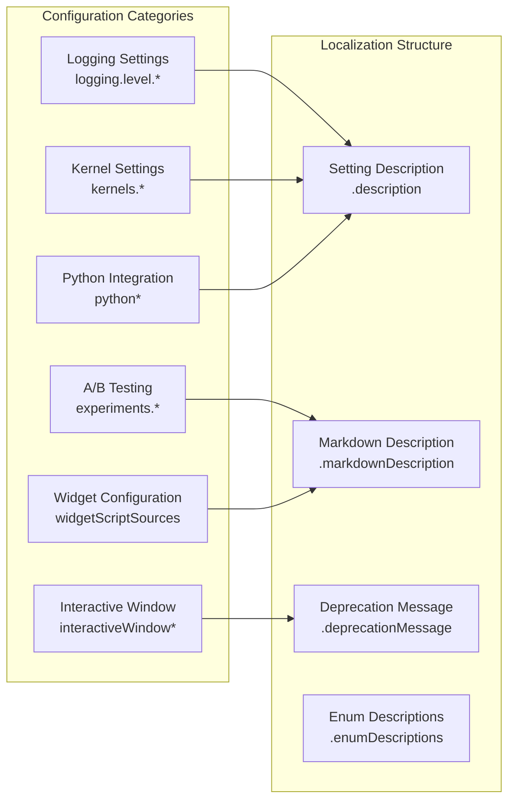
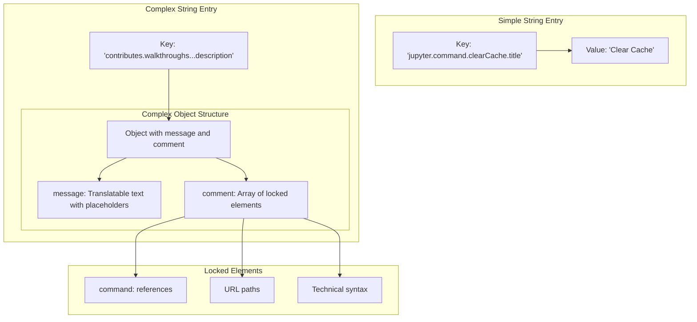
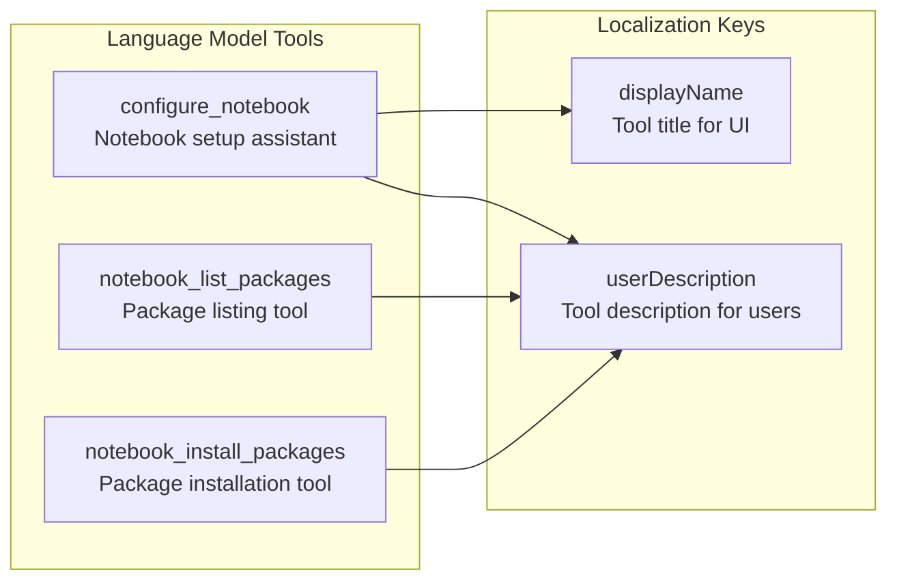

<!-- source: DeepWiki mcp.deepwiki.com · repo microsoft/vscode-jupyter · page 8.2 Localization · fetched 2026-10-26 -->

# Localization

Relevant source files

The following files were used as context for generating this wiki page:

- [package.nls.json](package.nls.json)

The localization system in the VS Code Jupyter extension provides internationalization (i18n) support for all user-facing text, including command titles, configuration descriptions, walkthrough content, and UI labels. This system follows VS Code's standard localization framework using `.nls.json` files to define translatable strings.

For information about extension configuration settings, see [Settings and Commands](#8.1).

## Localization Architecture

The extension's localization system is built around a single primary localization file that contains all translatable strings organized in a hierarchical structure.

**Localization System Overview**
This diagram shows how the extension's localization system integrates with VS Code's i18n framework to provide translated strings throughout the extension.

Sources: [package.nls.json:1-247]()

## String Organization and Structure

The localization strings are organized into several major categories, each following specific naming conventions and serving different purposes within the extension.

### Command Localization

Command titles and descriptions are organized under the `jupyter.command` namespace, providing user-facing names for all extension commands.

| Category | Pattern | Example |
|----------|---------|---------|
| Interactive Window | `jupyter.command.jupyter.*Interactive*` | `runFileInteractive.title` |
| Cell Operations | `jupyter.command.jupyter.*cell*` | `runcurrentcell.title` |
| Kernel Management | `jupyter.command.jupyter.*kernel*` | `restartkernel.title` |
| Export Functions | `jupyter.command.jupyter.export*` | `exportToPDF.title` |
| Debug Commands | `jupyter.command.jupyter.debug*` | `debugCell.title` |

Sources: [package.nls.json:36-117]()

### Configuration Localization

Configuration settings use the `jupyter.configuration.jupyter` namespace to provide descriptions for all user-configurable options.

**Configuration Localization Structure**
This diagram illustrates how different types of configuration settings are localized with various description formats.

Sources: [package.nls.json:123-224]()

### Complex Localization Entries

Some localization entries include additional metadata for translators, particularly for strings containing locked elements that should not be translated.

**Complex Localization Entry Structure**
This diagram shows how complex localization entries preserve technical elements while allowing translation of user-facing text.

Sources: [package.nls.json:6-34](), [package.nls.json:137-143]()

## Walkthrough Localization

The extension includes an extensive walkthrough system to help users get started with Jupyter notebooks, with all content fully localized.

### Walkthrough Structure

| Component | Localization Key | Purpose |
|-----------|-----------------|---------|
| Title | `contributes.walkthroughs.jupyterWelcome.title` | Main walkthrough title |
| Description | `contributes.walkthroughs.jupyterWelcome.description` | Overview description |
| Step Titles | `contributes.walkthroughs.jupyterWelcome.steps.*.title` | Individual step titles |
| Step Content | `contributes.walkthroughs.jupyterWelcome.steps.*.description` | Step instructions |
| Media Alt Text | `contributes.walkthroughs.jupyterWelcome.steps.*.media.altText` | Accessibility text |

The walkthrough content includes embedded commands and links that are marked as locked elements to prevent translation of technical references.

Sources: [package.nls.json:3-35]()

## Language Model Tools Localization

The extension includes AI-powered tools for notebook configuration and package management, with localized descriptions for user interaction.

**Language Model Tools Localization**
This diagram shows how AI-powered tools are localized for user interaction.

Sources: [package.nls.json:243-246]()

## Deprecated Settings Migration

The localization system includes deprecation messages for settings that have been moved or renamed, helping users migrate to current configuration options.

### Deprecation Pattern

Many settings follow a migration pattern where old settings are deprecated in favor of new, more specific namespaces:

- Old: `jupyter.*` → New: `jupyter.interactiveWindow.*`
- Old: `jupyter.*` → New: `jupyter.interactiveWindow.textEditor.*`
- Old: `jupyter.*` → New: `jupyter.interactiveWindow.codeLens.*`

Each deprecated setting includes a `deprecationMessage` that references the new setting path.

Sources: [package.nls.json:156-224]()

## Technical Implementation

The localization system integrates with VS Code's built-in internationalization framework:

1. **String Resolution**: VS Code automatically loads the appropriate `.nls.json` file based on the user's locale
2. **Fallback Mechanism**: If a localized string is not available, VS Code falls back to the base `package.nls.json` file
3. **Dynamic Loading**: Localization strings are loaded at extension activation time
4. **Command Integration**: Command titles and descriptions are automatically applied to VS Code's command palette

The extension's localization files follow the standard VS Code naming convention:
- `package.nls.json` - English (base language)
- `package.nls.{locale}.json` - Locale-specific translations (when available)

Sources: [package.nls.json:1-247]()

---

