<!-- source: DeepWiki mcp.deepwiki.com · repo microsoft/vscode-jupyter · page 9 Development and Testing · fetched 2026-10-26 -->

# Development and Testing

Relevant source files

The following files were used as context for generating this wiki page:

- [.eslintrc.js](.eslintrc.js)
- [src/test/datascience/notebook/executionService.vscode.test.ts](src/test/datascience/notebook/executionService.vscode.test.ts)
- [src/test/datascience/notebook/helper.ts](src/test/datascience/notebook/helper.ts)
- [src/test/datascience/notebook/interruptRestart.vscode.test.ts](src/test/datascience/notebook/interruptRestart.vscode.test.ts)
- [src/test/datascience/notebook/nonPythonKernels.vscode.test.ts](src/test/datascience/notebook/nonPythonKernels.vscode.test.ts)

This document covers the development infrastructure, testing framework, and quality assurance processes for the VS Code Jupyter extension. It includes code quality enforcement through ESLint, comprehensive testing infrastructure, and test execution patterns.

The testing system provides extensive utilities for notebook testing, kernel management, and execution validation across multiple environments and kernel types.

## Code Quality and Linting

The extension enforces strict code quality standards through ESLint with comprehensive architectural constraints. The linting configuration prevents circular dependencies and enforces module boundaries to maintain clean architecture.

### ESLint Architectural Constraints

The linting system enforces strict import restrictions to maintain architectural boundaries:

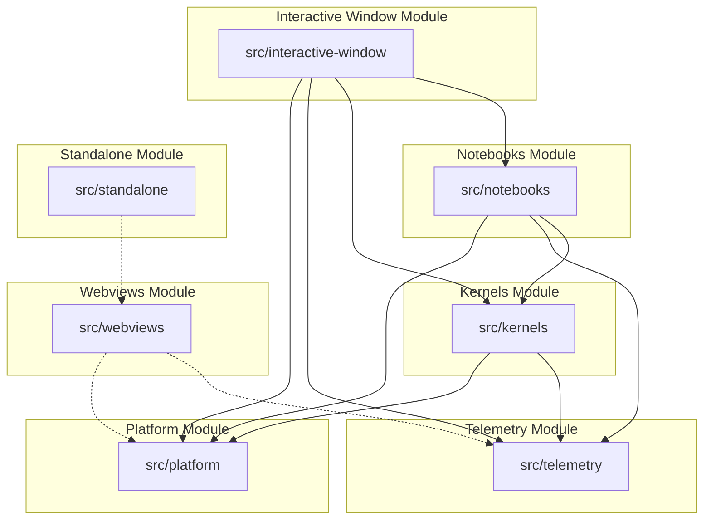

**Sources:** [.eslintrc.js:140-209]()

### Import Restriction Rules

The ESLint configuration includes specific rules for maintaining module boundaries:

| Restriction | Target | Allowed Dependencies | Purpose |
|-------------|--------|---------------------|---------|
| Kernels Module | `src/kernels/**` | `platform`, `telemetry` | Core kernel functionality isolation |
| Notebooks Module | `src/notebooks/**` | `platform`, `telemetry`, `kernels` | Notebook controller separation |
| Interactive Window | `src/interactive-window/**` | `platform`, `telemetry`, `kernels`, `notebooks` | Interactive execution isolation |
| Platform Module | `src/platform/**` | None (self-contained) | Foundation layer isolation |
| Webviews Module | Core components | Prohibited | UI layer separation |
| Standalone Module | Other components | Prohibited | Independent tool isolation |

**Sources:** [.eslintrc.js:170-208]()

### TypeScript and Code Standards

The linting configuration enforces TypeScript best practices and code quality:

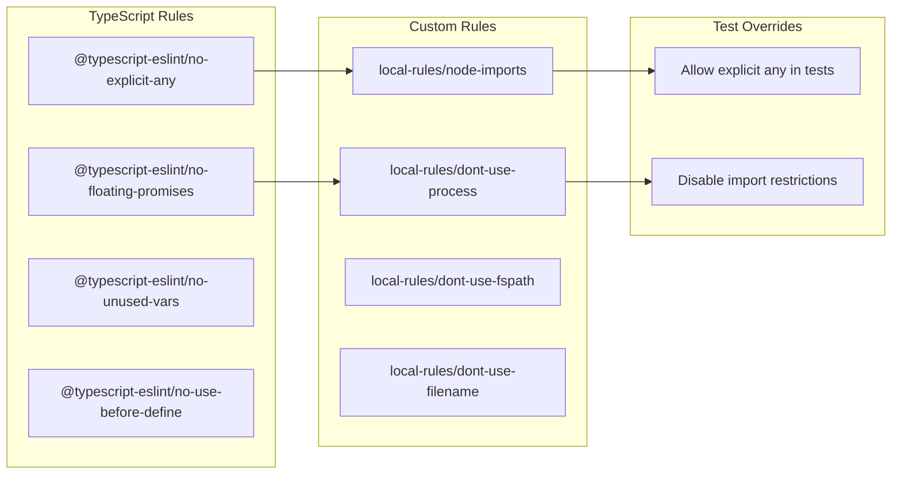

**Sources:** [.eslintrc.js:31-67](), [.eslintrc.js:211-256]()

## Testing Infrastructure

The extension employs a comprehensive testing infrastructure built around notebook testing, kernel management, and execution validation. The system provides extensive helper utilities for creating test environments and validating notebook behavior.

### Notebook Test Helper Architecture

The core testing infrastructure centers around notebook test helpers that manage the complete test lifecycle:

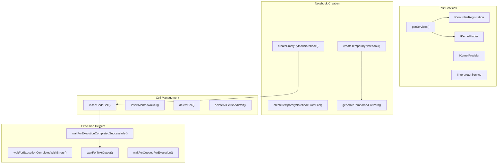

**Sources:** [src/test/datascience/notebook/helper.ts:113-129](), [src/test/datascience/notebook/helper.ts:285-313](), [src/test/datascience/notebook/helper.ts:153-168]()

### Kernel Selection and Management

The test infrastructure provides sophisticated kernel selection and management capabilities:

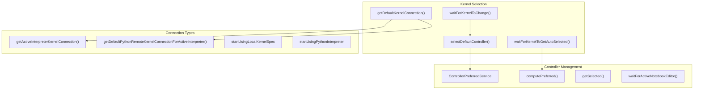

**Sources:** [src/test/datascience/notebook/helper.ts:426-549](), [src/test/datascience/notebook/helper.ts:612-621](), [src/test/datascience/notebook/helper.ts:697-834]()

### Test Execution Utilities

The testing framework provides comprehensive utilities for validating cell execution and output:

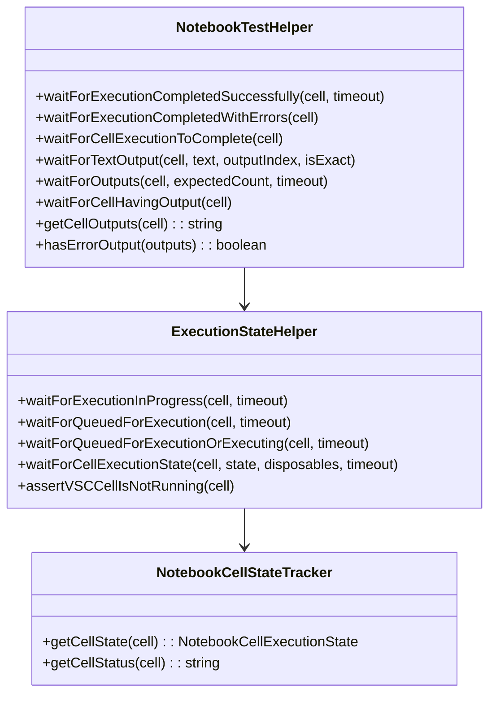

**Sources:** [src/test/datascience/notebook/helper.ts:954-974](), [src/test/datascience/notebook/helper.ts:1018-1064](), [src/test/datascience/notebook/helper.ts:940-953]()

## Test Categories and Execution Patterns

The extension supports multiple test categories with specialized execution patterns and environment configurations.

### Kernel Execution Tests

The core execution tests validate notebook cell execution across different environments and scenarios:

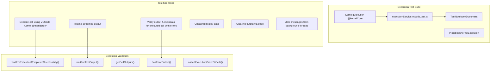

**Sources:** [src/test/datascience/notebook/executionService.vscode.test.ts:71-139](), [src/test/datascience/notebook/executionService.vscode.test.ts:140-147](), [src/test/datascience/notebook/executionService.vscode.test.ts:447-469]()

### Non-Python Kernel Tests

Specialized tests for non-Python kernels validate multi-language support:

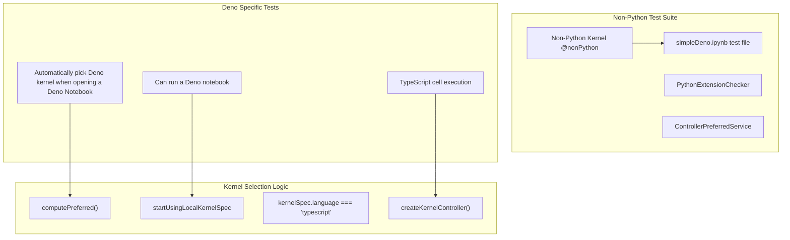

**Sources:** [src/test/datascience/notebook/nonPythonKernels.vscode.test.ts:28-53](), [src/test/datascience/notebook/nonPythonKernels.vscode.test.ts:75-93](), [src/test/datascience/notebook/nonPythonKernels.vscode.test.ts:94-125]()

### Interrupt and Restart Tests

Critical tests for kernel lifecycle management:

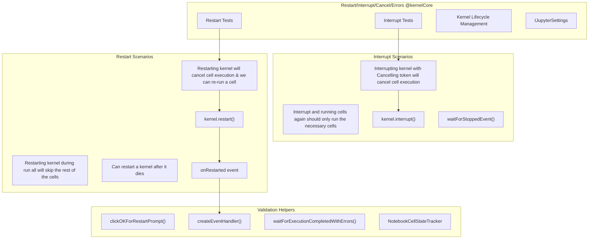

**Sources:** [src/test/datascience/notebook/interruptRestart.vscode.test.ts:39-103](), [src/test/datascience/notebook/interruptRestart.vscode.test.ts:105-133](), [src/test/datascience/notebook/interruptRestart.vscode.test.ts:134-185]()

### Test Environment Configuration

Test suites require careful setup and teardown with kernel management:

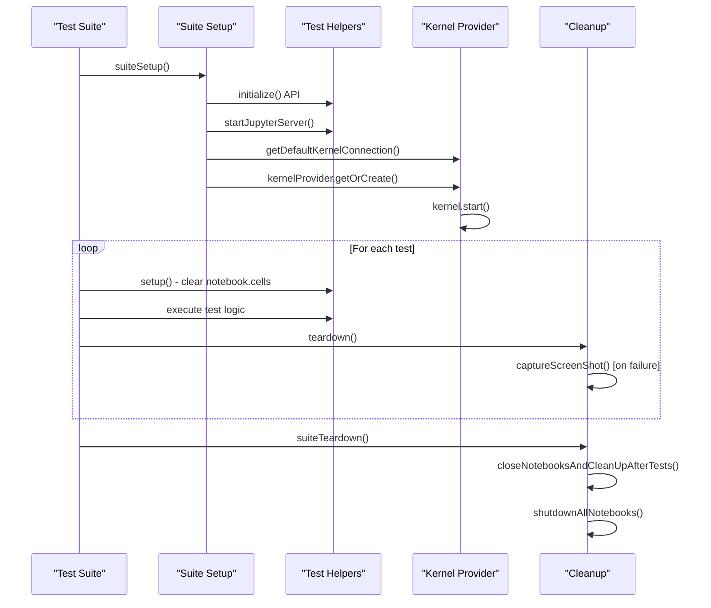

**Sources:** [src/test/datascience/notebook/executionService.vscode.test.ts:82-127](), [src/test/datascience/notebook/helper.ts:364-385](), [src/test/datascience/notebook/helper.ts:315-321]()

## Debug Testing Infrastructure

The extension includes specialized debugging test infrastructure for testing debugger functionality and Run by Line features.

### Debug Test Architecture

```mermaid
graph TB
    subgraph "Debug_Test_Components"
        DEBUG_MANAGER["IDebuggingManager<br/>Debug session management"]
        DEBUG_ADAPTER["getDebugSessionAndAdapter<br/>Adapter access"]
        STOPPED_EVENT["waitForStoppedEvent<br/>Breakpoint handling"]
    end
    
    subgraph "Variable_Testing"
        VAR_PROVIDER["ITestVariableViewProvider<br/>Variable inspection"]
        VAR_MATCHER["waitForVariablesToMatch<br/>State verification"]
        TEST_WEBVIEW["ITestWebviewHost<br/>UI testing interface"]
    end
    
    subgraph "Debug_Commands"
        RUN_BY_LINE["Commands.RunByLine<br/>Step debugging"]
        RUN_BY_LINE_NEXT["Commands.RunByLineNext<br/>Step execution"]
        RUN_BY_LINE_STOP["Commands.RunByLineStop<br/>Stop debugging"]
        INTERRUPT_KERNEL["Commands.InterruptKernel<br/>Kernel interruption"]
    end
    
    DEBUG_MANAGER --> DEBUG_ADAPTER
    DEBUG_ADAPTER --> STOPPED_EVENT
    VAR_PROVIDER --> VAR_MATCHER
    VAR_MATCHER --> TEST_WEBVIEW
    RUN_BY_LINE --> RUN_BY_LINE_NEXT
    RUN_BY_LINE_NEXT --> RUN_BY_LINE_STOP
```

**Sources:** [src/test/datascience/debugger.vscode.test.ts:37-343](), [src/test/datascience/variableView/variableView.vscode.test.ts:32-351]()

### Test Lifecycle Management

Debug tests require careful lifecycle management with setup and teardown procedures:

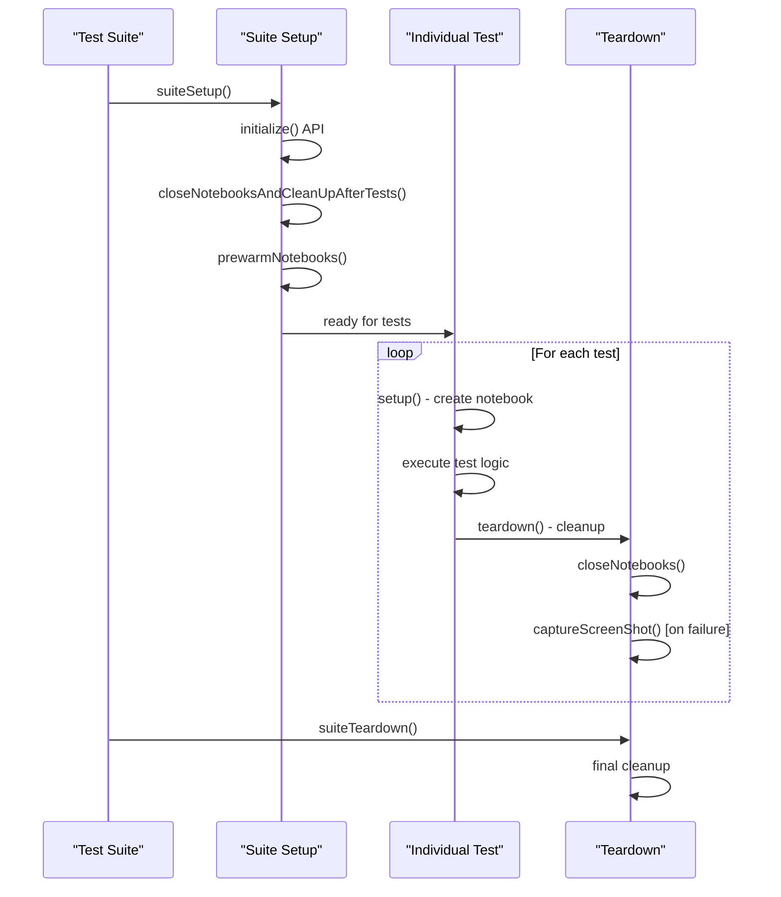

**Sources:** [src/test/datascience/debugger.vscode.test.ts:43-71](), [src/test/datascience/debugger.vscode.test.ts:99-108]()

## Performance Testing

The extension includes specialized performance testing infrastructure for measuring notebook and execution performance.

### Performance Test Categories

Performance tests are categorized by their focus areas and execution environments:

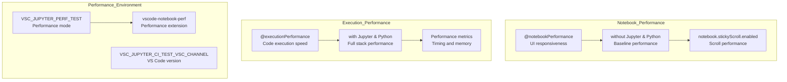

**Sources:** [.vscode/launch.json:323-354](), [.vscode/launch.json:356-385](), [src/test/standardTest.node.ts:51-53]()

This comprehensive development and testing infrastructure ensures code quality, functionality verification, and performance optimization across multiple environments and use cases. The system supports both automated CI/CD workflows and interactive development debugging, providing developers with the tools needed to maintain and extend the extension effectively.

---

