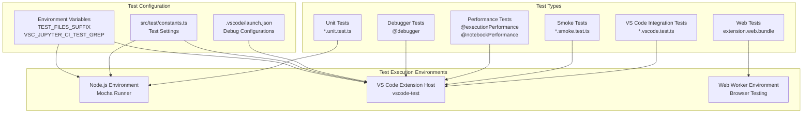
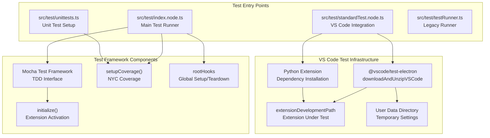
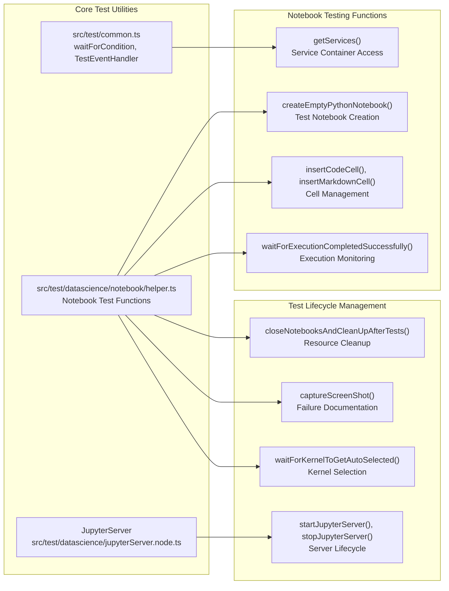
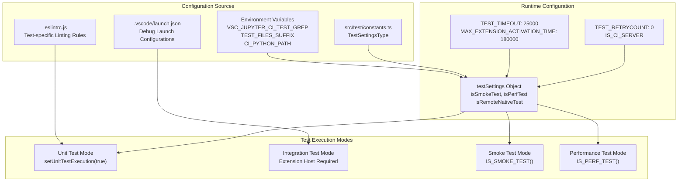
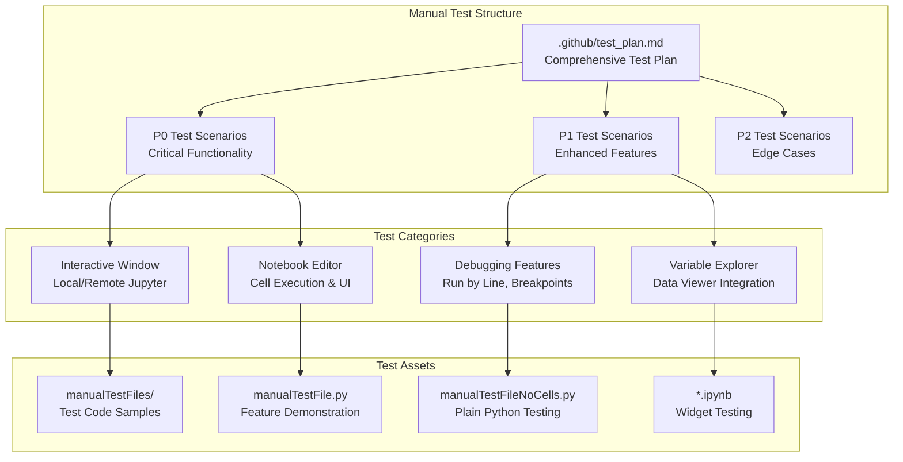

<!-- source: DeepWiki mcp.deepwiki.com · repo microsoft/vscode-jupyter · page 9.1 Testing Infrastructure · fetched 2026-10-26 -->

# Testing Infrastructure

<details>
<summary>Relevant source files</summary>

The following files were used as context for generating this wiki page:

- [.eslintrc.js](.eslintrc.js)
- [.github/test_plan.md](.github/test_plan.md)
- [.gitignore](.gitignore)
- [.vscode-test.mjs](.vscode-test.mjs)
- [.vscode/settings.json](.vscode/settings.json)
- [.vscodeignore](.vscodeignore)
- [build/conda-nonconda-test-requirements.txt](build/conda-nonconda-test-requirements.txt)
- [build/conda-test-requirements.yml](build/conda-test-requirements.yml)
- [build/venv-test-ipywidgets7-requirements.txt](build/venv-test-ipywidgets7-requirements.txt)
- [build/venv-test-ipywidgets8-requirements.txt](build/venv-test-ipywidgets8-requirements.txt)
- [src/notebooks/controllers/ipywidgets/scriptSourceProvider/remoteIPyWidgetScriptManager.ts](src/notebooks/controllers/ipywidgets/scriptSourceProvider/remoteIPyWidgetScriptManager.ts)
- [src/test/common.test.require.ts](src/test/common.test.require.ts)
- [src/test/common.ts](src/test/common.ts)
- [src/test/constants.ts](src/test/constants.ts)
- [src/test/datascience/debugger.vscode.test.ts](src/test/datascience/debugger.vscode.test.ts)
- [src/test/datascience/interactiveDebugging.vscode.common.ts](src/test/datascience/interactiveDebugging.vscode.common.ts)
- [src/test/datascience/interactiveWindowRemote.vscode.test.ts](src/test/datascience/interactiveWindowRemote.vscode.test.ts)
- [src/test/datascience/jupyterServer.node.ts](src/test/datascience/jupyterServer.node.ts)
- [src/test/datascience/manualTestFiles/manualTestFile.py](src/test/datascience/manualTestFiles/manualTestFile.py)
- [src/test/datascience/manualTestFiles/manualTestFileNoCells.py](src/test/datascience/manualTestFiles/manualTestFileNoCells.py)
- [src/test/datascience/notebook/executionService.vscode.test.ts](src/test/datascience/notebook/executionService.vscode.test.ts)
- [src/test/datascience/notebook/exportFull.vscode.test.ts](src/test/datascience/notebook/exportFull.vscode.test.ts)
- [src/test/datascience/notebook/helper.ts](src/test/datascience/notebook/helper.ts)
- [src/test/datascience/notebook/interruptRestart.vscode.test.ts](src/test/datascience/notebook/interruptRestart.vscode.test.ts)
- [src/test/datascience/notebook/nonPythonKernels.vscode.test.ts](src/test/datascience/notebook/nonPythonKernels.vscode.test.ts)
- [src/test/datascience/notebook/remote.vscode.common.test.ts](src/test/datascience/notebook/remote.vscode.common.test.ts)
- [src/test/datascience/notebook/remote.vscode.web.test.ts](src/test/datascience/notebook/remote.vscode.web.test.ts)
- [src/test/datascience/notebook/standard_widgets.ipynb](src/test/datascience/notebook/standard_widgets.ipynb)
- [src/test/datascience/variableView/variableView.vscode.test.ts](src/test/datascience/variableView/variableView.vscode.test.ts)
- [src/test/datascience/widgets/notebooks/slider_widgets.ipynb](src/test/datascience/widgets/notebooks/slider_widgets.ipynb)
- [src/test/datascience/widgets/standardWidgets.vscode.common.test.ts](src/test/datascience/widgets/standardWidgets.vscode.common.test.ts)
- [src/test/datascience/widgets/thirdpartyWidgets.vscode.common.test.ts](src/test/datascience/widgets/thirdpartyWidgets.vscode.common.test.ts)
- [src/test/extension.serviceRegistry.vscode.test.ts](src/test/extension.serviceRegistry.vscode.test.ts)
- [src/test/platform/common/process/proc.node.vscode.test.ts](src/test/platform/common/process/proc.node.vscode.test.ts)
- [src/test/standalone/api/kernels/api.vscode.common.test.ts](src/test/standalone/api/kernels/api.vscode.common.test.ts)
- [src/test/testRunner.ts](src/test/testRunner.ts)
- [src/test/unittests.ts](src/test/unittests.ts)

</details>


This document covers the comprehensive testing infrastructure for the VS Code Jupyter extension, including test types, execution frameworks, utilities, and configuration. The testing system supports multiple execution environments (desktop VS Code, web, and unit testing) with extensive automation for setup, teardown, and validation.

For information about code quality enforcement and architectural constraints, see [Code Quality and Architecture](#7.1). For details about CI/CD workflows and automated builds, see [CI/CD and Release Process](#7.4).

## Test Types and Organization

The extension employs a multi-layered testing strategy with different test types serving specific validation purposes:



**Test Type Classification**

| Test Type | Pattern | Environment | Purpose |
|---|---|---|---|
| Unit Tests | `*.unit.test.ts` | Node.js | Isolated component testing without VS Code API |
| VS Code Tests | `*.vscode.test.ts` | Extension Host | Full VS Code integration testing |
| Smoke Tests | `*.smoke.test.ts` | Extension Host | Critical path validation |
| Web Tests | Web bundle | Browser | Web extension functionality |
| Performance Tests | `@executionPerformance`<br/>`@notebookPerformance` | Extension Host | Performance benchmarking |
| Debugger Tests | `@debugger` | Extension Host | Debugging functionality validation |

Sources: [.vscode/launch.json:1-441](), [src/test/constants.ts:1-74](), [src/test/index.node.ts:84-135]()

## Test Execution Framework

The test execution framework provides multiple entry points and configuration options for different testing scenarios:



**Key Framework Classes and Functions**

- `configure()`: Sets up Mocha options, reporters, and test file patterns [src/test/index.node.ts:84-135]()
- `activateExtensionScript()`: Ensures Python extension is loaded before tests [src/test/index.node.ts:146-157]()
- `installPythonExtension()`: Installs required dependencies for VS Code tests [src/test/standardTest.node.ts:83-97]()
- `createSettings()`: Creates temporary VS Code settings for test isolation [src/test/standardTest.node.ts:124-154]()

Sources: [src/test/index.node.ts:1-237](), [src/test/standardTest.node.ts:1-231](), [src/test/unittests.ts:1-42]()

## Test Utilities and Helpers

The testing infrastructure provides extensive utilities for common testing patterns and scenarios:

**Test Utilities Architecture**



**Key Utility Functions**

The `TestEventHandler` class provides comprehensive event testing capabilities:
- `assertFired()`: Validates that events were triggered [src/test/common.ts:168-170]()
- `assertFiredExactly()`: Checks exact event count [src/test/common.ts:171-180]()
- `assertFiredAtLeast()`: Validates minimum event count [src/test/common.ts:181-191]()

The `waitForCondition()` function enables robust async testing:
- Polls conditions with configurable intervals [src/test/common.ts:45-52]()
- Supports cancellation tokens and timeouts [src/test/common.ts:51]()
- Provides detailed error messages [src/test/common.ts:48]()

**Notebook Testing Helper Functions**

The notebook helper provides specialized functions for Jupyter testing:
- `getServices()`: Access to service container and components [src/test/datascience/notebook/helper.ts:113-129]()
- `createEmptyPythonNotebook()`: Creates test notebooks with Python kernels [src/test/datascience/notebook/helper.ts:285-313]()
- `insertCodeCell()`: Programmatically adds code cells [src/test/datascience/notebook/helper.ts:153-168]()
- `waitForKernelToGetAutoSelected()`: Ensures kernel selection completes [src/test/datascience/notebook/helper.ts:697-735]()
- `closeNotebooksAndCleanUpAfterTests()`: Comprehensive test cleanup [src/test/datascience/notebook/helper.ts:364-385]()

**Test Environment API**

The `IExtensionTestApi` interface provides access to the extension's service container:
```typescript
interface IExtensionTestApi extends IExtensionApi {
    serviceContainer: IServiceContainer;
    serviceManager: IServiceManager;
}
```

Sources: [src/test/common.ts:1-288](), [src/test/datascience/notebook/helper.ts:1-1600](), [src/test/datascience/jupyterServer.node.ts:1-400]()

## Test Environment Configuration

The test environment configuration system manages settings, dependencies, and runtime parameters across different test execution modes:

**Configuration Architecture**



**ESLint Test Configuration**

The ESLint configuration includes specific rules for test files to enforce testing best practices:

| Rule | Purpose | Test Files Only |
|---|---|---|
| `no-only-tests/no-only-tests` | Prevents committing `.only` tests | ✓ |
| `@typescript-eslint/no-explicit-any: off` | Allows `any` in tests | ✓ |
| `import/no-restricted-paths` | Prevents importing test code into production | ✓ |

Key ESLint overrides for test files:
- Test files can use `any` types for mocking [.eslintrc.js:236-240]()
- Test modules cannot be imported into production code [.eslintrc.js:145-148]()
- Platform modules are isolated from higher-level modules [.eslintrc.js:204-208]()

**Configuration Management**

The `TestSettingsType` interface defines the available test configuration options:
```typescript
type TestSettingsType = {
    isSmokeTest: boolean;
    isRemoteNativeTest: boolean;
    isNonRawNativeTest: boolean;
    isCIServer: boolean;
    isCIServerTestDebuggable: boolean;
    isCondaTest: boolean;
    isPerfTest: boolean;
};
```

Key configuration functions:
- `setTestSettings()`: Updates test configuration at runtime [src/test/constants.ts:69-71]()
- `IS_SMOKE_TEST()`: Determines if running smoke tests [src/test/constants.ts:31-33]()
- `IS_PERF_TEST()`: Checks for performance test mode [src/test/constants.ts:34-36]()

**Test Constants**

Critical timing and execution constants:
- `MAX_EXTENSION_ACTIVATION_TIME`: 180,000ms for extension startup [src/test/constants.ts:27]()
- `TEST_TIMEOUT`: 25,000ms default test timeout [src/test/constants.ts:28]()
- `defaultNotebookTestTimeout`: 60,000ms for notebook operations [src/test/datascience/notebook/helper.ts:111]()

Sources: [.eslintrc.js:1-278](), [src/test/constants.ts:1-74](), [.vscode/launch.json:1-441](), [src/test/datascience/notebook/helper.ts:110-112]()

## Manual Testing Framework

The extension includes a comprehensive manual testing framework for validation scenarios that require human interaction:



**Manual Test Organization**

Priority levels determine test execution order and importance:
- **P0 Tests**: Critical functionality that must work (Interactive Window, Notebook Editor) [.github/test_plan.md:24-139]()
- **P1 Tests**: Enhanced features and integrations (Remote servers, Commands) [.github/test_plan.md:140-252]()
- **P2 Tests**: Edge cases and advanced scenarios (Directory changes, Themes) [.github/test_plan.md:253-267]()

The manual test files provide realistic test scenarios:
- `manualTestFile.py`: Comprehensive feature demonstration including plots, widgets, and data types [src/test/datascience/manualTestFiles/manualTestFile.py:1-91]()
- `manualTestFileNoCells.py`: Plain Python file testing without cell markers [src/test/datascience/manualTestFiles/manualTestFileNoCells.py:1-22]()

Sources: [.github/test_plan.md:1-267](), [src/test/datascience/manualTestFiles/manualTestFile.py:1-91](), [src/test/datascience/manualTestFiles/manualTestFileNoCells.py:1-22]()

## Running Tests

The testing infrastructure supports multiple execution methods through VS Code launch configurations and npm scripts:

### VS Code Launch Configurations

**Primary Test Configurations**
- `Tests (Jupyter+Python Extension installed, *.vscode.test.ts)`: Full integration testing [.vscode/launch.json:183-221]()
- `Unit Tests (without VS Code, *.unit.test.ts)`: Isolated unit testing [.vscode/launch.json:291-321]()
- `Smoke Tests (*.smoke.test.ts)`: Critical path validation [.vscode/launch.json:123-151]()
- `Web Tests`: Browser-based testing [.vscode/launch.json:80-101]()

**Specialized Test Configurations**
- `Tests Notebook Performance without Jupyter & Python`: Performance benchmarking [.vscode/launch.json:323-354]()
- `Tests Execution Performance with Jupyter & Python`: Execution timing tests [.vscode/launch.json:355-385]()

### Environment Variables for Test Control

Key environment variables for test configuration:
- `VSC_JUPYTER_CI_TEST_GREP`: Filter tests by pattern [.vscode/launch.json:195]()
- `CI_PYTHON_PATH`: Specify Python interpreter for testing [.vscode/launch.json:197]()
- `VSC_JUPYTER_REMOTE_NATIVE_TEST`: Enable remote Jupyter testing [.vscode/launch.json:201]()
- `TEST_FILES_SUFFIX`: Control which test files to execute [.vscode/launch.json:200]()

### Task Automation

VS Code tasks provide convenient test execution:
- `Run Unit Tests`: Execute unit test suite [.vscode/tasks.json:49-56]()
- `Start Jupyter Server`: Set up test Jupyter environment [.vscode/tasks.json:87-99]()
- `Stop Jupyter Server`: Clean up test resources [.vscode/tasks.json:107-111]()

Sources: [.vscode/launch.json:1-441](), [.vscode/tasks.json:1-122]()

---

