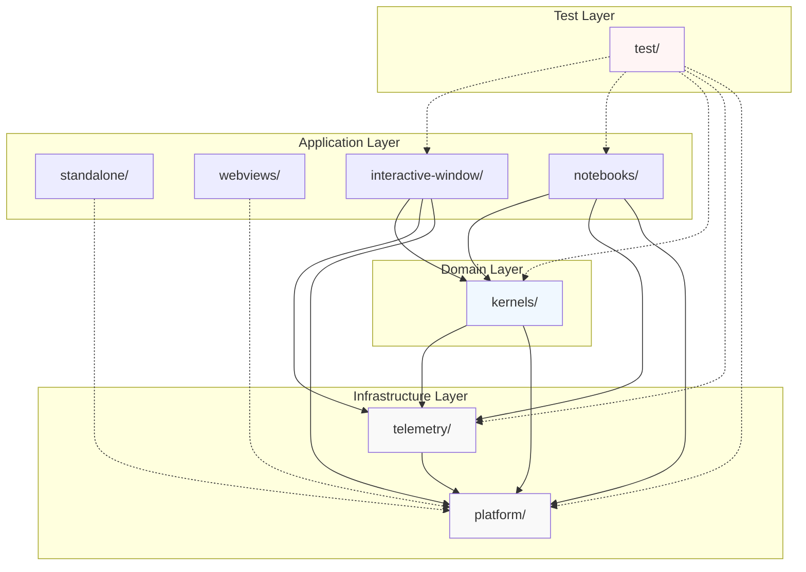
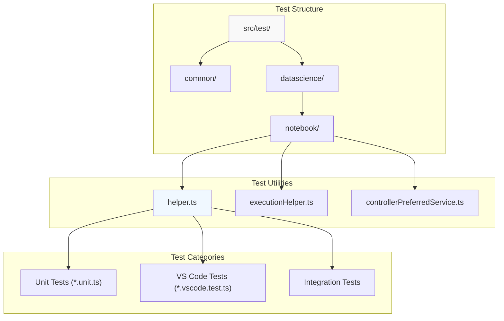
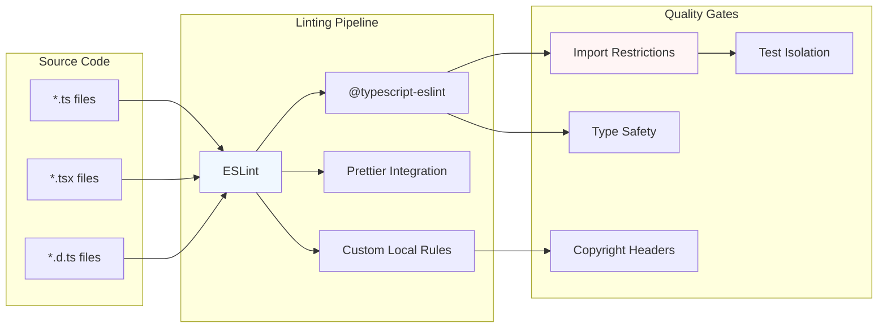

<!-- source: DeepWiki mcp.deepwiki.com · repo microsoft/vscode-jupyter · page 9.2 Code Quality and Architecture · fetched 2026-10-26 -->

# Code Quality and Architecture

<details>
<summary>Relevant source files</summary>

The following files were used as context for generating this wiki page:

- [.eslintrc.js](.eslintrc.js)
- [src/test/datascience/notebook/executionService.vscode.test.ts](src/test/datascience/notebook/executionService.vscode.test.ts)
- [src/test/datascience/notebook/helper.ts](src/test/datascience/notebook/helper.ts)
- [src/test/datascience/notebook/interruptRestart.vscode.test.ts](src/test/datascience/notebook/interruptRestart.vscode.test.ts)
- [src/test/datascience/notebook/nonPythonKernels.vscode.test.ts](src/test/datascience/notebook/nonPythonKernels.vscode.test.ts)

</details>


This document covers the code quality standards, architectural constraints, and organizational patterns that govern the VS Code Jupyter extension codebase. It focuses on the technical enforcement mechanisms, linting rules, and structural boundaries that maintain code quality and architectural integrity.

For information about the testing framework and test utilities, see [Testing Infrastructure](#9.1). For details about CI/CD processes and automated quality gates, see [CI/CD and Release Process](#9.3).

## Architectural Constraints and Module Boundaries

The extension enforces strict architectural boundaries through ESLint import restrictions that create a layered architecture. These constraints prevent circular dependencies and maintain clear separation of concerns.

### Core Architecture Layers



**Sources:** [.eslintrc.js:140-210]()

### Import Restriction Rules

The codebase enforces these architectural boundaries through specific ESLint rules:

| Target Module | Allowed Imports | Restriction Purpose |
|---------------|----------------|-------------------|
| `platform/` | Only other `platform/` modules | Core infrastructure isolation |
| `telemetry/` | Only `platform/` and `telemetry/` | Telemetry system isolation |
| `kernels/` | Only `platform/`, `telemetry/`, `kernels/` | Domain layer boundary |
| `notebooks/` | `platform/`, `telemetry/`, `kernels/`, `notebooks/` | Application layer dependency management |
| `interactive-window/` | `platform/`, `telemetry/`, `kernels/`, `notebooks/` | Interactive features dependency management |
| Extension code | Cannot import from `test/` | Production/test code separation |

**Sources:** [.eslintrc.js:170-207]()

### Platform Separation Rules

The extension supports both Node.js and web environments with strict separation:

```mermaid
graph LR
    subgraph "Node Environment"
        NodeExt["extension.node.ts"]
        NodeFiles["*.node.ts files"]
    end
    
    subgraph "Web Environment"
        WebExt["extension.web.ts"]
        WebFiles["*.web.ts files"]
    end
    
    subgraph "Shared Code"
        SharedFiles["*.ts files"]
    end
    
    NodeExt --> NodeFiles
    NodeExt --> SharedFiles
    WebExt --> WebFiles
    WebExt --> SharedFiles
    
    NodeFiles -.x WebExt
    WebFiles -.x NodeExt
    NodeFiles -.x WebFiles
    WebFiles -.x NodeFiles
    
    style NodeExt fill:#e1f5fe
    style WebExt fill:#f3e5f5
```

**Sources:** [.eslintrc.js:149-167]()

## Code Quality Rules

### TypeScript Quality Standards

The extension enforces strict TypeScript coding standards through ESLint configuration:

#### Core TypeScript Rules

```typescript
// Key enforced patterns from .eslintrc.js
{
  "@typescript-eslint/no-explicit-any": "error",           // Prevents any usage
  "@typescript-eslint/no-floating-promises": "error",     // Requires promise handling
  "@typescript-eslint/no-unused-vars": "warn",           // Warns on unused variables
  "@typescript-eslint/no-use-before-define": "error"     // Prevents hoisting issues
}
```

**Sources:** [.eslintrc.js:47-66]()

#### Import and Dependency Management

The extension restricts certain imports to maintain code quality:

- **Lodash restriction**: Direct lodash imports are forbidden to reduce bundle size
- **JupyterLab imports**: Must use type-only imports or dynamic imports
- **Node.js built-ins**: Restricted through custom rules except for approved modules

**Sources:** [.eslintrc.js:127-139](), [.eslintrc.js:211-214]()

### Custom Local Rules

The extension implements custom ESLint rules for specific quality requirements:

| Rule | Purpose | Enforcement |
|------|---------|-------------|
| `local-rules/node-imports` | Controls Node.js module usage | Only allows `events` module |
| `local-rules/dont-use-process` | Prevents direct `process` usage | Forces abstraction through platform layer |
| `local-rules/dont-use-fspath` | Prevents direct `.fsPath` usage | Encourages platform-agnostic path handling |
| `local-rules/dont-use-filename` | Controls filename access patterns | Promotes consistent file handling |

**Sources:** [.eslintrc.js:211-214]()

### Header and Licensing

All source files must include the Microsoft copyright header:

```typescript
// Copyright (c) Microsoft Corporation.
// Licensed under the MIT License.
```

This is enforced through the `header/header` ESLint rule with automatic verification.

**Sources:** [.eslintrc.js:216-221]()

## Testing Architecture and Quality

### Test Organization Structure

The testing infrastructure follows a hierarchical organization that mirrors the main codebase structure:



**Sources:** [src/test/datascience/notebook/helper.ts:1-100]()

### Test Quality Patterns

#### Async Testing Infrastructure

The test infrastructure provides robust async testing utilities:

```typescript
// Key testing patterns from helper.ts
async function waitForCondition(
    condition: () => Promise<boolean>,
    timeout: number,
    errorMessage: string
): Promise<void>

async function waitForExecutionCompletedSuccessfully(
    cell: NotebookCell,
    timeout: number = defaultNotebookTestTimeout
): Promise<void>
```

**Sources:** [src/test/datascience/notebook/helper.ts:910-974]()

#### Test Environment Management

The testing framework provides comprehensive environment management:

| Function | Purpose | Usage Pattern |
|----------|---------|---------------|
| `createEmptyPythonNotebook()` | Creates test notebooks | Setup for notebook tests |
| `closeNotebooksAndCleanUpAfterTests()` | Cleanup after tests | Teardown to prevent state leakage |
| `getServices()` | Service container access | Dependency injection in tests |
| `waitForKernelToGetAutoSelected()` | Kernel selection testing | Async kernel testing |

**Sources:** [src/test/datascience/notebook/helper.ts:285-313](), [src/test/datascience/notebook/helper.ts:364-385]()

## Quality Enforcement Pipeline

### Linting Integration

The quality enforcement pipeline integrates multiple tools and configurations:



**Sources:** [.eslintrc.js:1-30](), [.eslintrc.js:31-67]()

### Configuration Overrides

The linting system provides different quality standards for different file types:

#### Test File Overrides

Test files have relaxed rules to support testing scenarios:

```javascript
// Relaxed rules for test files
{
  files: ['**/*.test.ts', 'src/test/**/*.ts'],
  rules: {
    '@typescript-eslint/no-explicit-any': 'off',
    '@typescript-eslint/no-restricted-imports': 'off'
  }
}
```

**Sources:** [.eslintrc.js:234-247]()

#### Build System Overrides

Build and infrastructure files have specialized rule sets:

```javascript
// Build system overrides
{
  files: ['gulpfile.js', 'build/**/*.js'],
  rules: {
    'local-rules/node-imports': ['off'],
    'local-rules/dont-use-process': ['off'],
    'import/no-restricted-paths': ['off']
  }
}
```

**Sources:** [.eslintrc.js:224-233]()

### Parser and Environment Configuration

The ESLint configuration supports multiple TypeScript project configurations:

| Configuration File | Purpose | Environment |
|-------------------|---------|-------------|
| `tsconfig.json` | Main extension configuration | Node.js runtime |
| `tsconfig.datascience-ui.json` | UI component configuration | Browser runtime |
| `src/tsconfig.extension.node.json` | Node-specific extension code | Node.js only |
| `src/tsconfig.extension.web.json` | Web extension configuration | Browser runtime |

**Sources:** [.eslintrc.js:11-17]()

---

