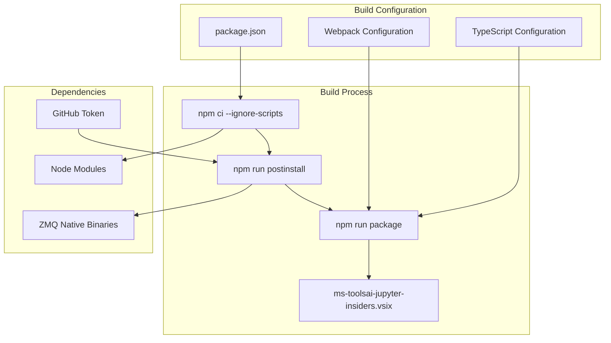
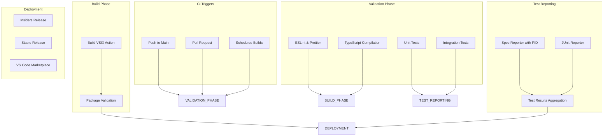
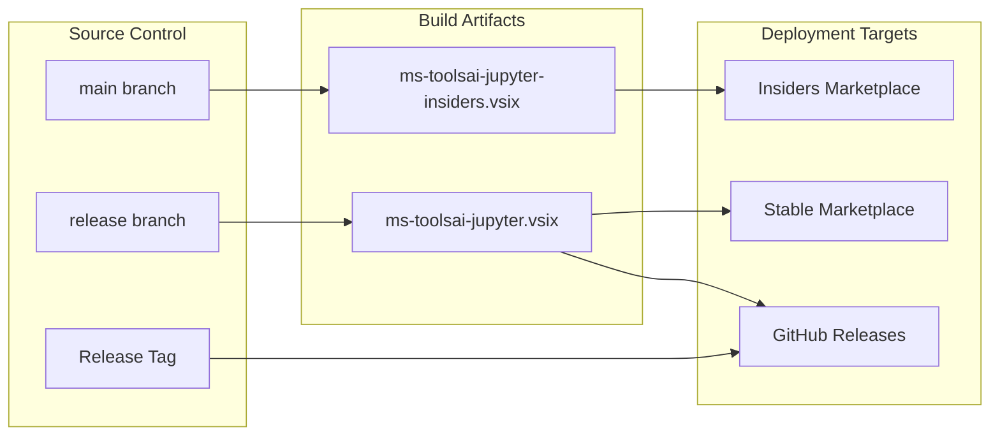

<!-- source: DeepWiki mcp.deepwiki.com · repo microsoft/vscode-jupyter · page 9.3 CI/CD and Release Process · fetched 2026-10-26 -->

# CI/CD and Release Process

Relevant source files

The following files were used as context for generating this wiki page:

- [.devcontainer/dev-with-python/Dockerfile](.devcontainer/dev-with-python/Dockerfile)
- [.devcontainer/dev/Dockerfile](.devcontainer/dev/Dockerfile)
- [.github/actions/build-vsix/action.yml](.github/actions/build-vsix/action.yml)
- [.github/actions/create-venv-for-tests/action.yml](.github/actions/create-venv-for-tests/action.yml)
- [.github/instructions/typescript.instructions.md](.github/instructions/typescript.instructions.md)
- [.github/workflows/build-test.yml](.github/workflows/build-test.yml)
- [.nvmrc](.nvmrc)
- [.vscode/launch.json](.vscode/launch.json)
- [.vscode/tasks.json](.vscode/tasks.json)
- [CHANGELOG.md](CHANGELOG.md)
- [CONTRIBUTING.md](CONTRIBUTING.md)
- [README.md](README.md)
- [build/.mocha-multi-reporters.config](build/.mocha-multi-reporters.config)
- [build/azure-pipeline.pre-release.yml](build/azure-pipeline.pre-release.yml)
- [build/azure-pipeline.stable.yml](build/azure-pipeline.stable.yml)
- [gulpfile.js](gulpfile.js)
- [package-lock.json](package-lock.json)
- [package.json](package.json)
- [src/platform/vscode-path/platform.ts](src/platform/vscode-path/platform.ts)
- [src/test/constants.node.ts](src/test/constants.node.ts)
- [src/test/index.node.ts](src/test/index.node.ts)
- [src/test/mocks/mementos.ts](src/test/mocks/mementos.ts)
- [src/test/standardTest.node.ts](src/test/standardTest.node.ts)
- [src/test/web/customReporter.ts](src/test/web/customReporter.ts)

This document covers the continuous integration, continuous deployment (CI/CD), and release processes for the VS Code Jupyter extension. It explains the build system, automated testing pipelines, and deployment workflows that ensure code quality and reliable releases.

For information about the testing infrastructure and test execution details, see [Testing Infrastructure](#7.2). For code quality enforcement and architectural constraints, see [Code Quality and Architecture](#7.1).

## Overview

The VS Code Jupyter extension uses GitHub Actions for CI/CD orchestration, with a sophisticated build system that handles both development and production builds. The process includes automated testing, VSIX package generation, and deployment to the Visual Studio Code Marketplace.

## Build System Architecture

The build system is designed around npm scripts and GitHub Actions composite actions that handle the complex requirements of building a VS Code extension with native dependencies.

**Sources:** [.github/actions/build-vsix/action.yml:1-24]()

### VSIX Build Process

The core build process is encapsulated in the `build-vsix` GitHub Actions composite action, which performs the following steps:

1. **Dependency Installation**: Uses `npm ci --ignore-scripts --prefer-offline --no-audit` to install dependencies quickly while skipping potentially problematic post-install scripts
2. **Post-Install Processing**: Runs `npm run postinstall` with a GitHub token to handle ZMQ binary downloads that may fail with 403 errors
3. **Package Generation**: Executes `npm run package` to create the final VSIX file

The build process specifically handles the challenge of native dependencies like ZMQ, which require special handling in CI environments.

**Sources:** [.github/actions/build-vsix/action.yml:12-23]()

## CI Pipeline Architecture

The CI pipeline orchestrates multiple phases of validation and build processes to ensure code quality and functionality.

**Sources:** [.github/actions/build-vsix/action.yml:1-24](), [build/.mocha-multi-reporters.config:1-6]()

## Test Reporting System

The extension uses a multi-reporter configuration for comprehensive test result reporting in CI environments.

### Reporter Configuration

The test reporting system is configured through `.mocha-multi-reporters.config` which enables:

| Reporter | Purpose | Configuration |
|----------|---------|---------------|
| `spec_with_pid` | Console output with process ID tracking | Custom reporter in `./build/ci/scripts/spec_with_pid` |
| `mocha-junit-reporter` | XML output for CI integration | `includePending: true` to capture incomplete tests |

The dual-reporter setup ensures both human-readable console output and machine-parseable XML results for CI system integration.

**Sources:** [build/.mocha-multi-reporters.config:1-6]()

### Test Result Processing

The JUnit reporter configuration includes pending tests (`includePending: true`), which helps identify incomplete test coverage and ensures that tests marked as pending are tracked in CI reports.

**Sources:** [build/.mocha-multi-reporters.config:3-5]()

## Release Workflow

The release process distinguishes between different release channels to support both stable and pre-release versions.

**Sources:** [.github/actions/build-vsix/action.yml:7]()

### Package Naming Convention

The build system generates packages with specific naming conventions:
- **Insiders builds**: `ms-toolsai-jupyter-insiders.vsix` - for pre-release versions
- **Stable builds**: `ms-toolsai-jupyter.vsix` - for stable marketplace releases

The insiders naming convention allows for parallel distribution channels where users can opt into pre-release functionality.

**Sources:** [.github/actions/build-vsix/action.yml:7]()

## Dependency Management

The CI system handles complex dependency scenarios, particularly around native binaries and GitHub API rate limiting.

### Native Dependency Handling

The build process includes specific handling for ZMQ native binaries:

1. **Skip Scripts**: Uses `--ignore-scripts` flag to avoid running potentially problematic post-install scripts during initial dependency installation
2. **Retry Logic**: Runs `npm run postinstall` separately with GitHub token authentication to handle 403 errors when downloading ZMQ binaries
3. **Offline Preference**: Uses `--prefer-offline` to utilize cached dependencies when possible

This approach ensures reliable builds even when external binary repositories are temporarily unavailable.

**Sources:** [.github/actions/build-vsix/action.yml:12-20]()

### Authentication and Tokens

The build process uses GitHub tokens for:
- Accessing private or rate-limited repositories during dependency installation
- Authenticating with GitHub API for binary downloads
- Ensuring CI builds don't fail due to API rate limits

**Sources:** [.github/actions/build-vsix/action.yml:18-20]()

---

