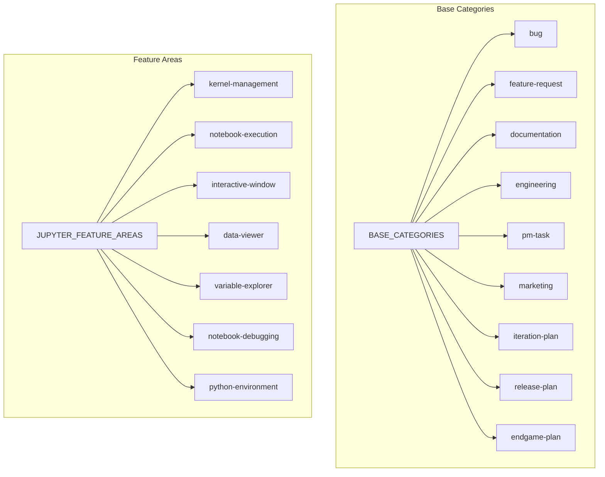
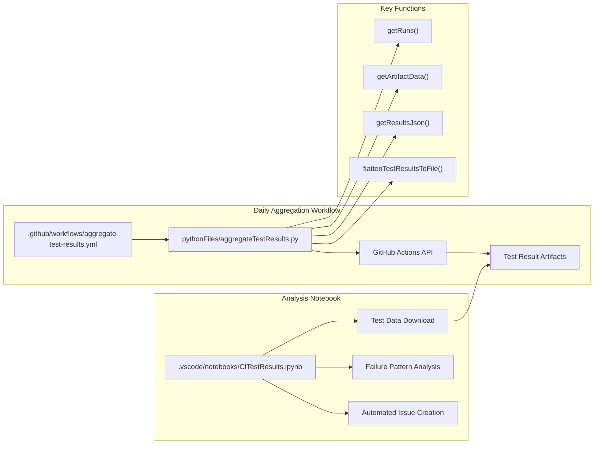
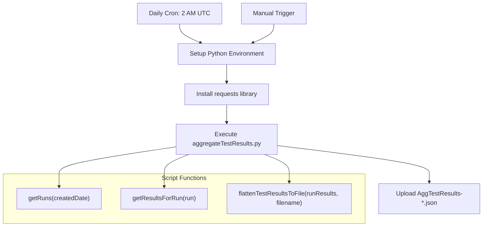
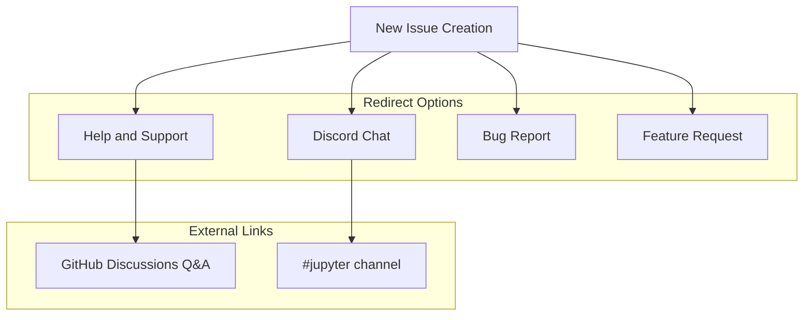
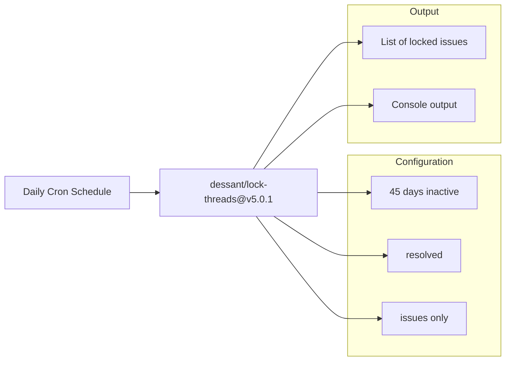
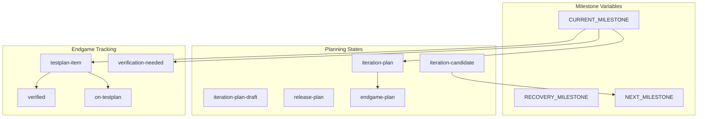

<!-- source: DeepWiki mcp.deepwiki.com · repo microsoft/vscode-jupyter · page 9.4 Issue Management and Planning · fetched 2026-10-26 -->

# Issue Management and Planning

Relevant source files

The following files were used as context for generating this wiki page:

- [.github/ISSUE_TEMPLATE/1_bug_report.md](.github/ISSUE_TEMPLATE/1_bug_report.md)
- [.github/ISSUE_TEMPLATE/2_bug_form.yml](.github/ISSUE_TEMPLATE/2_bug_form.yml)
- [.github/ISSUE_TEMPLATE/3_feature_request.md](.github/ISSUE_TEMPLATE/3_feature_request.md)
- [.github/ISSUE_TEMPLATE/config.yml](.github/ISSUE_TEMPLATE/config.yml)
- [.github/PULL_REQUEST_TEMPLATE.md](.github/PULL_REQUEST_TEMPLATE.md)
- [.github/actions/npm-ci/action.yml](.github/actions/npm-ci/action.yml)
- [.github/actions/set-python-conda/action.yml](.github/actions/set-python-conda/action.yml)
- [.github/actions/set-python/action.yml](.github/actions/set-python/action.yml)
- [.github/codecov.yml](.github/codecov.yml)
- [.github/workflows/aggregate-test-results.yml](.github/workflows/aggregate-test-results.yml)
- [.github/workflows/codeql-analysis.yml](.github/workflows/codeql-analysis.yml)
- [.github/workflows/copilot-setup-steps.yml](.github/workflows/copilot-setup-steps.yml)
- [.github/workflows/lock.yml](.github/workflows/lock.yml)
- [.vscode/notebooks/CITestResults.ipynb](.vscode/notebooks/CITestResults.ipynb)
- [.vscode/notebooks/jupyter.github-issues](.vscode/notebooks/jupyter.github-issues)
- [build/.nycrc](build/.nycrc)
- [build/verifyProposedApiUsage.ts](build/verifyProposedApiUsage.ts)
- [pythonFiles/aggregateTestResults.py](pythonFiles/aggregateTestResults.py)
- [pythonFiles/get-pip.py](pythonFiles/get-pip.py)
- [pythonFiles/printJupyWidgetEntryPoints.py](pythonFiles/printJupyWidgetEntryPoints.py)

This document covers the systems and processes used for managing GitHub issues, aggregating test results, and planning development work in the VS Code Jupyter extension. The issue management system includes sophisticated querying tools, automated test result analysis, and standardized workflows for handling bug reports and feature requests.

For information about the CI/CD build and test processes, see [CI/CD and Release Process](#9.3). For details about the testing infrastructure itself, see [Testing Infrastructure](#9.1).

## GitHub Issue Management System

The primary tool for issue management is a comprehensive GitHub Issues notebook that provides structured queries and workflows for triaging, organizing, and tracking issues across multiple repositories.

```mermaid
graph TB
    subgraph "Issue Management Notebook"
        GitHubIssuesNotebook[".vscode/notebooks/jupyter.github-issues"]
        RepoQueries["Repository Query Variables"]
        TeamQueries["Team Member Queries"]
        MilestoneQueries["Milestone Management"]
        TriageQueries["Triage Workflows"]
    end
    
    subgraph "Repository Configuration"
        JupyterRepo["JUPYTER_REPO"]
        JupyterInternalRepo["JUPYTER_INTERNAL_REPO"]
        DataWranglerRepo["JUPYTER_DATA_WRANGLER_REPO"]
        VSCodeRepos["VSCODE_REPOS"]
        PythonRepos["PYTHON_REPOS"]
    end
    
    subgraph "Issue Categories"
        BaseCategories["BASE_CATEGORIES"]
        FeatureAreas["JUPYTER_FEATURE_AREAS"]
        VSCodeFeatureAreas["VSCODE_FEATURE_AREAS"]
    end
    
    subgraph "Workflow States"
        TriageNeeded["triage-needed"]
        InfoNeeded["info-needed"]
        HousekeepingReview["housekeeping-review"]
        IterationCandidate["iteration-candidate"]
    end
    
    GitHubIssuesNotebook --> RepoQueries
    GitHubIssuesNotebook --> TeamQueries
    GitHubIssuesNotebook --> MilestoneQueries
    GitHubIssuesNotebook --> TriageQueries
    
    RepoQueries --> JupyterRepo
    RepoQueries --> JupyterInternalRepo
    RepoQueries --> DataWranglerRepo
    RepoQueries --> VSCodeRepos
    RepoQueries --> PythonRepos
    
    TriageQueries --> BaseCategories
    TriageQueries --> FeatureAreas
    TriageQueries --> VSCodeFeatureAreas
    
    TriageQueries --> TriageNeeded
    TriageQueries --> InfoNeeded
    TriageQueries --> HousekeepingReview
    TriageQueries --> IterationCandidate
```

**Sources:** [.vscode/notebooks/jupyter.github-issues:1-411]()

### Repository and Team Configuration

The notebook system defines variables for managing multiple repositories and team members:

| Variable | Purpose | Repositories |
|----------|---------|--------------|
| `$JUPYTER_ALL_REPOS` | All Jupyter-related repositories | `microsoft/vscode-jupyter`, `microsoft/vscode-jupyter-internal`, `microsoft/vscode-data-wrangler` |
| `$VSCODE_REPOS` | VS Code core repositories | `microsoft/vscode`, `microsoft/vscode-internalbacklog` |
| `$PYTHON_REPOS` | Python extension repository | `microsoft/vscode-python` |
| `$TEAM_AUTHOR_INCLUSION` | Team member filter for internal issues | Authors: DonJayamanne, rchiodo, greazer, rebornix, roblourens, amunger |
| `$TEAM_ASSIGNMENT` | Team member assignment filter | Assignees: DonJayamanne, rchiodo, greazer, amunger, minsa110, ronglums |

**Sources:** [.vscode/notebooks/jupyter.github-issues:18-30]()

### Issue Classification System

The system uses a hierarchical labeling approach:

**Sources:** [.vscode/notebooks/jupyter.github-issues:49-50]()

### Triage Workflows

The triage system separates customer-entered issues from team-entered issues and provides structured queries for different triage scenarios:

| Query Type | Purpose | GitHub Query Pattern |
|------------|---------|---------------------|
| Customer Entered | External bug reports requiring triage | `$JUPYTER_ALL_REPOS is:issue is:open label:triage-needed $TEAM_AUTHOR_EXLUSION` |
| Team Entered | Internal issues and engineering tasks | `$JUPYTER_ALL_REPOS is:issue is:open label:triage-needed $TEAM_AUTHOR_INCLUSION` |
| VSCode Notebook | Core VS Code notebook issues | `$VSCODE_REPOS is:issue is:open label:notebook-triage` |
| Golden Scenarios | Critical user workflow blockers | `label:important label:nb-golden,iw-golden` |

**Sources:** [.vscode/notebooks/jupyter.github-issues:55-116]()

## Test Result Aggregation and Analysis

The system includes automated collection and analysis of CI test results to identify patterns, flaky tests, and reliability issues.

**Sources:** [.github/workflows/aggregate-test-results.yml:1-44](), [pythonFiles/aggregateTestResults.py:1-178](), [.vscode/notebooks/CITestResults.ipynb:1-386]()

### Automated Test Result Collection

The daily aggregation workflow runs automatically and collects test results from all CI runs:

**Sources:** [.github/workflows/aggregate-test-results.yml:3-36](), [pythonFiles/aggregateTestResults.py:15-143]()

### Test Result Analysis Pipeline

The analysis notebook provides tools for identifying problematic tests and creating GitHub issues automatically:

| Function | Purpose | Key Logic |
|----------|---------|-----------|
| `getRuns()` | Fetch workflow runs from GitHub API | Queries `aggregate-test-results.yml` workflow runs |
| `getArtifactData(id)` | Download test result artifacts | Downloads ZIP artifacts containing `results.json` |
| `shouldDownload(name, timestamp)` | Avoid duplicate downloads | Compares local file timestamps |
| `createIssue(title, body)` | Auto-create GitHub issues | Posts to `/repos/microsoft/vscode-jupyter/issues` with `flaky test` label |

**Sources:** [.vscode/notebooks/CITestResults.ipynb:86-327]()

## Issue Templates and Standardization

The repository provides standardized templates for consistent issue reporting and feature requests.

### Bug Report Templates

Two bug reporting options are available:

1. **Traditional Markdown Form** - [.github/ISSUE_TEMPLATE/1_bug_report.md:1-52]()
2. **Interactive YAML Form** - [.github/ISSUE_TEMPLATE/2_bug_form.yml:1-79]()

The YAML form includes structured fields:

| Field | Type | Required | Purpose |
|-------|------|----------|---------|
| `feature-focus` | checkboxes | No | Notebooks vs Interactive Window |
| `what-happened` | textarea | Yes | Bug description and steps |
| `vscode-version` | input | Yes | VS Code version info |
| `jupyter-version` | input | Yes | Extension version |
| `logs` | textarea | No | Jupyter output panel logs |
| `local-remote` | dropdown | No | Local vs remote Jupyter setup |

**Sources:** [.github/ISSUE_TEMPLATE/2_bug_form.yml:17-78]()

### Issue Template Configuration

The system redirects users to appropriate support channels before they create issues:

**Sources:** [.github/ISSUE_TEMPLATE/config.yml:1-9]()

## Automated Workflows and Housekeeping

Several automated workflows maintain repository hygiene and manage issue lifecycle.

### Thread Locking Automation

Inactive issues are automatically locked to prevent necroposting:

**Sources:** [.github/workflows/lock.yml:1-28]()

### Housekeeping Workflows

The GitHub Issues notebook includes extensive housekeeping queries to maintain issue quality:

| Housekeeping Type | Query Purpose | Target Issues |
|-------------------|---------------|---------------|
| Uncategorized Issues | Find issues missing base labels | `$HOUSEKEEPING_REPO is:open is:issue -label:$BASE_CATEGORIES -label:triage-needed` |
| Unassigned Feature Areas | Find bugs/features without area labels | `label:bug -label:$JUPYTER_FEATURE_AREAS -label:triage-needed` |
| Info-Needed Review | Close stale info requests after 2 weeks | `label:info-needed` |
| Assignment Review | Check assigned issues not in current milestone | `$TEAM_ASSIGNMENT -$CURRENT_MILESTONE -label:info-needed` |

**Sources:** [.vscode/notebooks/jupyter.github-issues:265-386]()

## Planning and Milestone Management

The system provides comprehensive milestone and iteration planning capabilities.

### Milestone Queries

The notebook supports tracking issues across different milestone states:

**Sources:** [.vscode/notebooks/jupyter.github-issues:36-40](), [.vscode/notebooks/jupyter.github-issues:170-236]()

### Endgame Process

The endgame process includes structured verification of completed work:

| Process Step | GitHub Query | Purpose |
|--------------|--------------|---------|
| Created Testplan Items | `$ALL_REPOS is:issue label:testplan-item $CURRENT_MILESTONE $TEAM_AUTHOR_INCLUSION` | Track test items created by team |
| Assigned Testplan Items | `$ALL_REPOS is:open is:issue label:testplan-item $CURRENT_MILESTONE $TEAM_ASSIGNMENT` | Track assigned test verification |
| Verification Needed | `$JUPYTER_ALL_REPOS is:closed is:issue label:verification-needed -label:verified $CURRENT_MILESTONE` | Small features needing verification |
| Bug Verification | `$JUPYTER_ALL_REPOS is:closed is:issue -label:verified -label:verification-needed label:bug $CURRENT_MILESTONE` | Closed bugs requiring verification |

**Sources:** [.vscode/notebooks/jupyter.github-issues:195-236]()